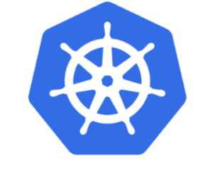

It is not an

overstatement to say that, when it comes to container technologies, 2017

was the year of Kubernetes. While Kubernetes has been steadily gaining

momentum ever since it was announced in 2014, it reached escape velocity

in 2017. Just this year, more than 10,000 people participated in our

free online [Kubernetes Training classes.](https://info.rancher.com/kubernetes-training) A few other key

data points:

1. Our company, Rancher Labs, built a product that supported multiple

   container orchestrators, including Swarm, Mesos, and Kubernetes.

   Responding to overwhelming market and customer demands, we decided

   to build [Rancher 2.0](https://rancher.com/rancher2-0/) to 100% focus

   on Kubernetes. We are not alone. Even vendors who developed

   competing frameworks, like Docker Inc. and Mesosphere, announced

   support for Kubernetes this year.
2. It has become significantly easier to install and operate

   Kubernetes. In fact, in most cases, you no longer need to install

   and operate Kubernetes at all. All major cloud providers, including

   Google, Microsoft Azure, AWS, and leading Chinese cloud providers

   such as Huawei, Alibaba, and Tencent, launched Kubernetes as a

   Service. Not only is it easier to set up and use cloud Kubernetes

   services like Google GKE, cloud Kubernetes services are cheaper.

   They often do not charge for resources required to run the

   Kubernetes master. Because it takes at least 3 nodes to run

   Kubernetes API servers and the etcd database, cloud

   Kubernetes-as-a-Service can lead to significant savings. For users

   who still want to stand up Kubernetes in their own data center,

   VMware announced Pivotal Container Service (PKS.) Indeed, with more

   than 40 vendors shipping CNCF-certified Kubernetes distributions,

   standing up and operating Kubernetes is easier than ever.
3. The most important sign of the growth of Kubernetes is the

   significant number of users who started to run their

   mission-critical production workload on Kubernetes. At Rancher,

   because we supported multiple orchestration engines from day one, we

   have a unique perspective of the growth of Kubernetes relative to

   other technologies. One Fortune 50 Rancher customer, for example,

   runs their applications handling billions of dollars of transactions

   every day on Kubernetes clusters.

A significant trend we observed this year was an increased focus on

security among customers who run Kubernetes in production. Back in 2016,

the most common questions we heard from our customers centered around

CI/CD. That was when Kubernetes was primarily used in development and

testing environments. Nowadays, the most common feature requests from

customers are single sign-on, centralized access control, strong

isolation between applications and services, infrastructure hardening,

and secret and credentials management. We believe, in fact, offering a

layer to define and enforce security policies will be one of the

strongest selling points of Kubernetes. There’s no doubt security will

continue to be one of the hottest areas of development in 2018. With

cloud providers and VMware all supporting Kubernetes services,

Kubernetes has become a new infrastructure standard. This has huge

implications to the IT industry. As we all know, compute workload is

moving to public IaaS clouds, and IaaS is built on virtual machines.

There is no standard virtual machine image format or standard virtual

machine cluster manager. As a result, application built for one cloud

cannot easily be deployed on other clouds. Kubernetes is a game changer.

An application built for Kubernetes can be deployed on any compliant

Kubernetes services, regardless of the underlying infrastructure. Among

Rancher customers, we already see wide-spread adoption of multi-cloud

deployments. With Kubernetes, multi-cloud is easy. DevOps team get the

benefit of increased flexibility, increased reliability, and reduced

cost, without having to complicate their operational practices. I am

really excited about how Kubernetes will continue to grow in 2018. Here

are some specific areas we should pay attention:

1. **Service Mesh gaining mainstream adoption**. At the recent KubeCon

   show, the hottest topic was Service Mesh. Linkerd, Envoy, Istio,

   etc. all gained traction in 2017. Even though the adoption of these

   technologies is still at an early stage, the potential is huge.

   People often think of service mesh as a microservices framework. I

   believe, however, service mesh will bring benefits far beyond a

   microservice framework. Service mesh can become a common

   underpinning for all distributed applications. It offers application

   developers a great deal of support in communication, monitoring, and

   management of various components that make up an application. These

   components may or may not be microservices. They don’t even have to

   be built from containers. Even though not many people use service

   mesh today, we believe it will become popular in 2018. We, like most

   people in the container industry, want to play a part. We are busy

   integrating service mesh technologies into Rancher 2.0 now!
2. **From cloud-native to Kubernetes-native**. The term “cloud native

   application” has been popular for a few years. It means applications

   developed to run on a cloud like AWS, instead of static environments

   like vSphere or bare metal clusters. Applications developed for

   Kubernetes are by definition cloud-native because Kubernetes is now

   available on all clouds. I believe, however, the world is ready to

   move from cloud-native to, using a term I first heard from Joe Beda,

   “Kubernetes-native“. I know of many organizations developing

   applications specifically to run on Kubernetes. These applications

   don’t just use Kubernetes as a deployment platform. They persist

   data in Kubernetes’s own etcd database. They use Kubernetes custom

   resource definition (CRD) as data access objects. They encode

   business logic in Kubernetes controllers. They use Kubelets to

   manage distributed clusters. They build their own API layer on

   Kubernetes API server. They use `kubectl` as their own CLI.

   Kubernetes-native applications are easy to build, run anywhere, and

   are massively scalable. In 2018, we will surely see more

   Kubernetes-native applications!
3. **Massive number of ready-to-run applications for Kubernetes**. Most

   people use Kubernetes today to deploy their own applications. Not

   many organizations ship their application packages as YAML files or

   Helm charts yet. I believe this is about to change. Already most

   modern software (such as AI frameworks like Tensorflow) are

   available as Docker containers. It is easy to deploy these

   containers in Kubernetes clusters. A few weeks ago, Apache Spark

   project added support to use Kubernetes as a scheduler, in addition

   to Mesos and YARN. Kubernetes is now a great big-data platform. We

   believe, from this point onward, all service-side software packages

   will be distributed as containers and will be able to leverage

   Kubernetes as a cluster manager. Watch out for vast growth and

   availability of ready-to-run YAML files or Helm charts in 2018.

Looking back, growth of Kubernetes in 2017 far exceeded what all of us

thought at the end of 2016. While we expected AWS to support Kubernetes,

we did not expect the interest in service mesh and Kubernetes-native

apps to grow so quickly. 2018 could very well bring us many unexpected

technological developments. I can’t wait to find out!
