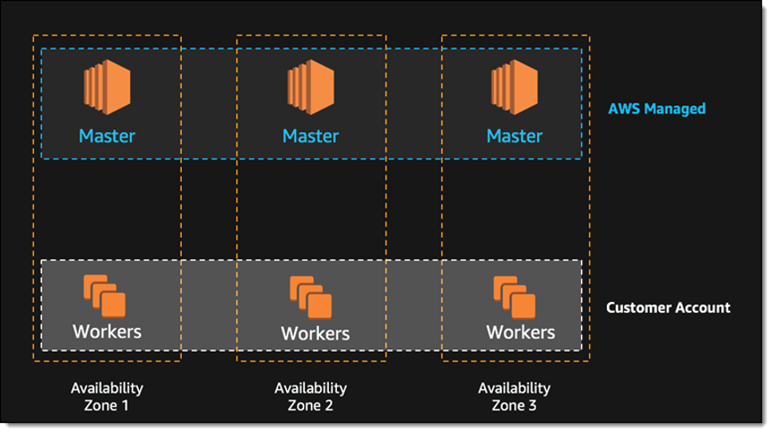
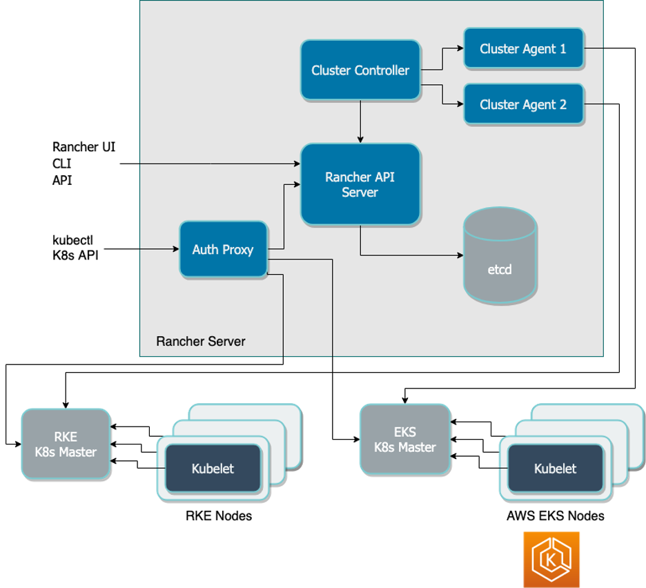
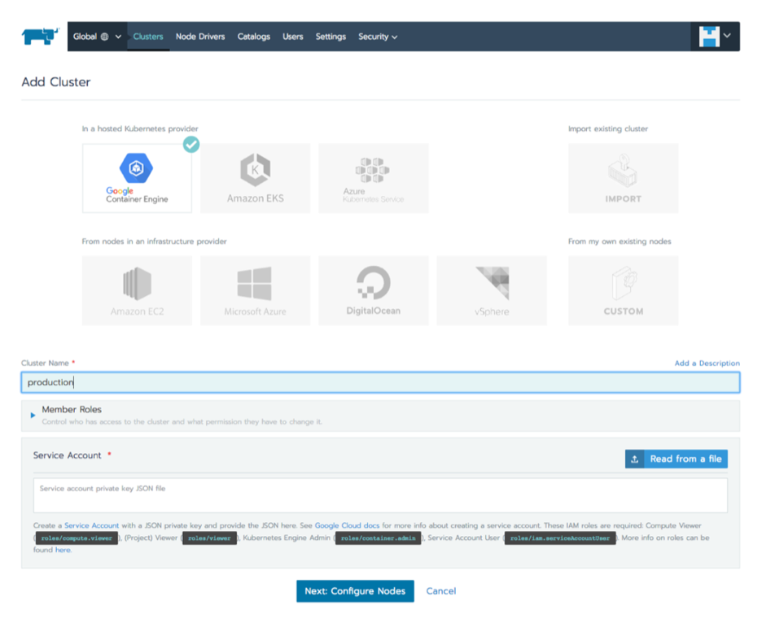

Kubernetes is hugely popular and growing, and is primarily used on the cloud — [83 percent of organizations](https://thenewstack.io/data-says-kubernetes-deployment-patterns/) included in a large CNCF survey said they run Kubernetes on at least one public cloud. Amazon is a natural option for Kubernetes clusters, due to its mature and robust infrastructure, and a variety of deployment options with a varying degree of automation.

Read on to understand three key options for running Kubernetes on AWS, how they work and which is best for your organization’s needs.

In this article you will learn:

- The options for running Kubernetes on AWS
- How to create a Kubernetes cluster on AWS with kops
- How to create a Kubernetes cluster with Elastic Kubernetes Service
- How to create a Kubernetes Cluster with Rancher on EKS

## Kubernetes on AWS: What are the Options?

Kubernetes is an open source container orchestration platform created by Google. You can use Kubernetes for on-premises, cloud or edge deployments. When used in combination with AWS, you use Kubernetes to manage clusters of Amazon Elastic Compute Cloud (EC2) instances that host your containers.

When deploying Kubernetes in AWS, you can configure and manage your deployment by yourself for full flexibility and control. You also have the option of using either AWS-provided services or third-party services to manage your implementation.

Alternatives to self-management include:

- **kops** — an open source tool you can use to automate the provisioning and management of clusters in AWS. Although not a managed tool, kops does enable you to simplify deployment and maintenance processes. It is officially supported by AWS.
- **Amazon Elastic Kubernetes Service (EKS)** — a managed service offered by AWS. EKS uses automatically provisioned instances and provides a managed control plane for your deployment.
- **Rancher** — a complete enterprise computing platform to deploy Kubernetes clusters everywhere: on-premises, in the cloud and at the edge. Rancher unifies these clusters to ensure consistent operations, workload management and enterprise-grade security.

## Creating a Kubernetes Cluster on AWS with kops

Kops lets you create Kubernetes clusters in a few simple steps.

Prerequisites for kops:

- Create an AWS account
- Install the AWS CLI
- Install [kops](https://github.com/kubernetes/kops/blob/master/docs/install.md) and [kubectl](https://kubernetes.io/docs/tasks/tools/install-kubectl/)
- Create a dedicated user for kops in IAM
- You can set up DNS for the cluster, or, as an easy alternative, create a gossip-based cluster by having the cluster name end with k8s.local

**To create a cluster on AWS using kops:**

1. For convenience, create two environment variables: `NAME` set to your cluster name, and `KOPS_STATE_STORE` set to the URL of your cluster state store on S3.
2. Check which availability zones are available on EC2, by running the command `aws ec2 describe-availability-zones --region us-west-2` (ending with the region you want to launch the instances in). Select an available zone, for example `us-west-2a`.
3. Build your cluster as follows - this is a basic cluster with no high availability:

   ```
   kops create cluster 
       --zones=us-west-2a 
       ${NAME}
   ```
4. View your cluster configuration by running the command `kops edit cluster ${NAME}`. You can leave all settings as default for now.
5. Run the command `kops update cluster ${NAME} --yes`. This boots instances and downloads Kubernetes components until the cluster reaches a “ready” state.
6. Check which nodes are alive by running `kubectl get nodes`.
7. Validate that your cluster is working properly by running `kops validate cluster`.

For more details, refer to the [kops documentation](https://github.com/kubernetes/kops/blob/master/docs/getting_started/aws.md).

## Creating a Kubernetes Cluster with Elastic Kubernetes Service

EKS helps manage cluster set up and creation. It offers multi-AZ support and provides automatic replacement of failed or nodes. It also enables on-demand patches and upgrades to clusters. EKS automatically creates three master nodes for each cluster, spread out across three availability zones, as illustrated below. This prevents single points of failure and provides high availability out of the box.



Source: Amazon Web Services

A few prerequisites for creating a cluster on EKS:

- Create an AWS account
- Create an IAM role that Kubernetes can use to create new AWS resources
- [Create a VPC and security group](https://docs.aws.amazon.com/eks/latest/userguide/getting-started-console.html#vpc-create) for your Kubernetes cluster – Amazon strongly recommend creating a separate VPC and security group for each cluster
- Install kubectl – see instructions for installing the [Amazon EKS-vended version](https://docs.aws.amazon.com/eks/latest/userguide/install-kubectl.html)
- Install the Amazon CLI

**To create a Kubernetes cluster using EKS:**

1. Open the [Amazon EKS console](https://console.aws.amazon.com/eks/home#/clusters) and select **Create cluster**.
2. On the **Configure cluster** page, type a name for your cluster, and select the Kubernetes version – if you don’t have a reason to run a specific version, select the latest.
3. Under **Cluster service role**, select the IAM role you created for EKS.
4. The **Secrets encryption** option lets you encrypt Kubernetes secrets using the AWS Key Management Service (KMS). This is an important option for production deployments, but you can leave it off just for this tutorial. Another option is **Tags**, which lets you apply tags to your cluster so you can manage multiple Kubernetes clusters together with other AWS resources.
5. Click **Next** to view the **Specify networking** page. Select the **VPC** you created previously for EKS. Under **Subnets**, select which subnets you would like to host Kubernetes resources. Under **Security groups**, you should see the security group defined when you created the VPC (as defined in the CloudFormation template).
6. Under **Cluster endpoint access**, select Public to enable only public access to the Kubernetes API server, Private to only enable private access from within the VPC, or Public and Private to enable both.
7. Select **Next** to view the **Configure logging** page and select logs you want to enable (all logs are disabled by default).
8. Select **Next** to view the **Review and create** page. Have a look at the cluster options you selected you can click **Edit** to make changes. When you’re ready, click **Create**. The status field shows the status of the cluster, until provisioning is complete (this can take between 10-15 minutes).
9. When the cluster finishes creating, save your **API server endpoint** and **Certificate authority** – you will need these to connect to kubectl and work with your cluster.

To learn more, see the [EKS getting started guide](https://docs.aws.amazon.com/eks/latest/userguide/getting-started.html).

## Creating a Kubernetes Cluster with Rancher on EKS

Using Rancher, you can manage Kubernetes clusters directly on AWS, within the EKS service or across hybrid or multi-cloud systems. Rancher enables you to centrally manage your cluster policies and helps ensure consistent and reliable container access.



Rancher provides the following additional capabilities not fully available in plain Amazon EKS:

- **Centralized user authentication & RBAC** - you can integrate Rancher with LDAP, Active Directory or SAML-based authentication services. This enables you to consistently enforce role-based access control (RBAC) policies across your environments. Centralized RBAC is the preferred way to manage access and permissions as it reduces administrative requirements and makes management of permissions easier.
- **UI in a single pane of glass** - you manage Rancher from an intuitive web interface. This enables DevOps teams to easily deploy and troubleshoot workloads and operations teams to smoothly release and link services and applications across environments. Simplified management also eliminates the need to know specifics of your infrastructure of Kubernetes distribution and promotes greater workflow efficiency.
- **Enhanced cluster security** - Rancher enables you to centrally define security policies and procedures. Security teams can set policies dictating how users are allowed to interact with clusters and how workloads operate across infrastructures. These policies can then be immediately pushed to any clusters as needed.
- **Multi and hybrid-cloud support** - included with Rancher are global application catalogs that you can use across Kubernetes clusters, regardless of location. These catalogs provide access to apps ready for immediate deployment, creating standardized application configurations across your services. Using these apps, you can significantly reduce the load on your operations and development teams.
- **Tools integration** - Rancher includes built-in integrations with the Istio service mesh, Prometheus and Grafana for monitoring, Fluentd for logging. In combination, these integrations help you manage deployments across clouds regardless of service variations.

Let’s see how to create a cluster on AWS with Rancher. The prerequisites are the same as for EKS (see the previous section).

**To create a Kubernetes cluster on AWS with Rancher and EKS:**

1. Prepare a Linux host with a supported version of Linux, and install a supported version of Docker on the host (see all supported versions).
2. Start the Rancher server by running this Docker command:

   ```
   $ sudo docker run -d --restart=unless-stopped -p 80:80 -p 443:443 rancher/rancher
   ```
3. Open a browser and go to the hostname or address where you installed your Docker container. You will see the Rancher server UI.

   
4. Select **Clusters** and click **Add cluster**. Choose **Amazon EKS**.
5. Type a **Cluster Name**. Under **Member Role**s, click Add Member to add users that will be able to manage the cluster, and select a Role for each user.
6. Enter the AWS **Region, Access Key and Secret Key** you got when creating your VPC.
7. Click **Next: Select Service Role**. For this tutorial, select **Standard: Rancher-generated service role**. This means Rancher will automatically add a service role for the cluster to use. You can also select an existing AWS service role.
8. **Click Next: Select VPC and Subnet**. Choose whether there will be a **Public IP for Worker Nodes**. If you choose **No**, select a **VPC & Subnet** to allow instances to access the Internet, so they can communicate with the Kubernetes control plane.
9. Select a **Security Group** (defined when you created your VPC).
10. Click **Select Instance Options** and select:

    a. **Instance type** – you can choose which Amazon instance should be used for your Kubernetes worker nodes.

    b. **Customer AMI override** – you can choose a specific Amazon Machine Image to install on your instances. By default, Rancher provides its EKS-optimized AMI.

    c. **Desired ASG size** – the number of instances in your cluster.

    d. **User data** – custom commands for automated configuration, do not set this when you’re just getting started.
11. Click **Create**. Rancher is now provisioning your cluster. You can access your cluster once its state is **Active**.

For more details, refer to the Rancher AWS [quick start guide](https://rancher.com/docs/rancher/v2.x/en/quick-start-guide/deployment/amazon-aws-qs/), or [learn more](https://rancher.com/products/rancher/) about the Rancher platform.

## Conclusion

In this article we showed three ways to automatically spin up a Kubernetes cluster:

- **kops** - an open source library that lets you quickly create a cluster using CLI commands.
- **Amazon Elastic Kubernetes Service** - creating a cluster managed by Amazon, with high availability and security built in.
- **Rancher with EKS** - creating a cluster with Rancher as an additional management layer, which provided user authentication and RBAC, enhanced security, and the ability to launch Kubernetes clusters on other public clouds or in your local data center, and manage everything on one pane of glass.

[Learn more](https://rancher.com/products/rancher/) about the Rancher platform and see how easy it is to manage Kubernetes across multiple cloud environments.
