Build a CI/CD Pipeline with Kubernetes and RancherRecorded Online Meetup of best practices and tools for building pipelines with containers and kubernetes. [Watch the training](https://rancher.com/events/2018/2018-08-07-onlinemeetup-building-a-cicd-pipeline-with-k8s/) Containers and orchestration frameworks like Rancher will soon allow

every organization to have access to efficient cluster management. This

brave new world frees operations from managing application configuration

and allows development to focus on writing code; containers abstract

complex dependency requirements, which enables ops to deploy immutable

containerized applications and allows devs a consistent runtime for

their code. If the benefits are so clear, then why do companies with

existing infrastructure practices not switch? One of the key issues is

risk. The risk of new unknowns brought by an untested technology, the

risk of inexperience operating a new stack, and the risk of downtime

impacting the brand. Planning for risks and demonstrating that the ops

team can maintain a resilient workload whilst moving into a

containerized world is the key social aspect of a container migration

project. Especially since, when done correctly, Docker and Rancher

provide a solid framework for quickly iterating on infrastructure

improvements, such as [Rancher

catalogs](https://docs.rancher.com/rancher/latest/en/catalog/) for

quickly spinning up popular distributed applications like

[ElasticSearch](https://rancher.com/deploying-an-elasticsearch-cluster-using-rancher-catalog/).

In regard to risk management, we will look into identifying the five

keys to running a resilient workload on Rancher and Docker. The topics

that will be covered are as follows:

- Running Rancher in HA Mode (covered in this post)
- Using Service Load Balancers in Rancher
- Setting up Rancher service health checks and monitoring
- Providing developers with their own Rancher setup
- Discussing Convoy for data resiliency

I had originally hoped to perform experiments on a Rancher cluster

[built on a laptop using Docker Machine with a Rancher Server](https://rancher.com/running-rancher-on-a-laptop/) and various

Rancher Agents on Raspberry Pis. Setup instructions

[here](http://www.codesheppard.com/setting-up-a-local-rancher-cluster-with-raspberry-pi-s-and-an-old-laptop/).

The problem is that most Docker images are made for Intel based CPUs, so

nothing works properly on Pi’s ARM processors. Instead I will directly

use AWS for our experiments with resilient Rancher clusters. With our

initial setup, we have 1 Rancher Server and 1 Agent. Let’s deploy a

simple multiple container application. [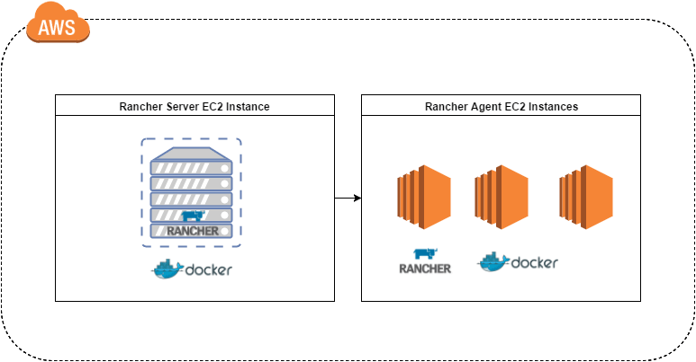](images/rancher_blog_ExperimentDiagramV3-NoHA-1.png)

The above diagram illustrates the setup I am going to use to experiment

with Rancher. I chose AWS because I am familiar with the service, but

you can choose any other provider for setting up Rancher according to

the [Quick Start Guide](https://docs.rancher.com/rancher/latest/en/quick-start-guide/).

[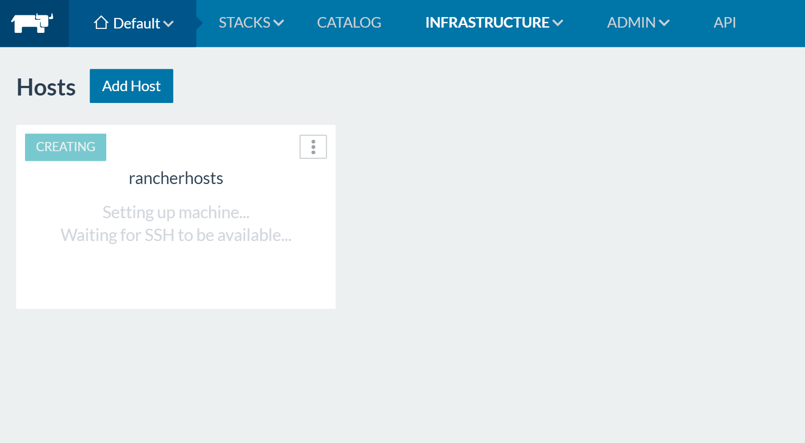](images/rancher_blog_RancherMachine-creation-2.png)

Let’s test our stack with the [WordPress compose](https://docs.rancher.com/rancher/latest/en/quick-start-guide/#create-a-multi-container-application-using-rancher-compose)

described in the Rancher Quick Start instructions. [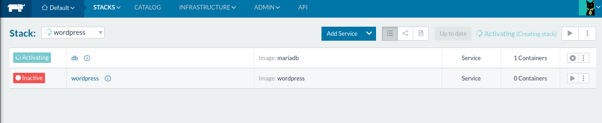](images/rancher_blog_RancherHAPost-3.png)

So now our application is up and running, the one scenario is what

happens if the Rancher Server malfunctions? Or a network issue occurs?

What happens to our application? Will it still continue serving

requests? [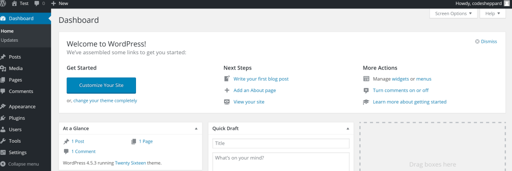](https://cdn.rancher.com/wp-content/uploads/2016/08/01142556/Wordpress-up-4.png)

For this experiment, I will perform the following and document the

results.

- Cutting the Internet from Rancher Agent to Rancher Server
- Stopping the Rancher Server Container
- Peeking under the hood of the Rancher Server Container

Afterwards we will address each of these issues, and then look at

Rancher HA as a means of addressing these risks.

## Cutting the Internet from Rancher Agent to Rancher Server

So let’s go onto AWS and block all access to the Rancher Server from my

Rancher Agents.

- Block access from Rancher Server to Rancher Agent
- Note down what happens
- Kill a few WordPress containers
- Re-instantiate the connection

### Observations:

Firstly, after a few seconds our Rancher hosts end up in a reconnecting

state. [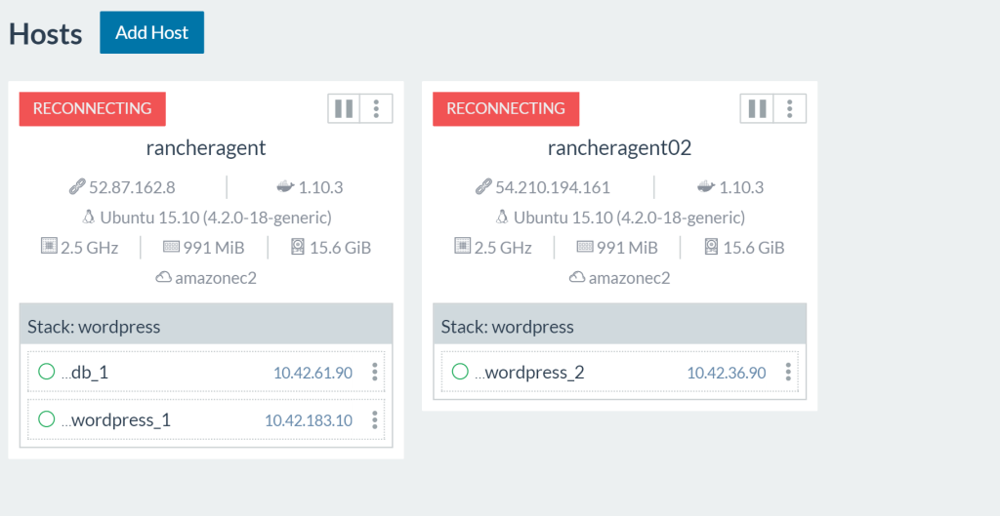](https://cdn.rancher.com/wp-content/uploads/2016/08/01142813/turnOffRancherServer01-5.png)

Browsing to my WordPress URL I can still access all my sites properly.

There is no service outage as the containers are still running on the

remote hosts. The IPSec tunnel between my two agents is still

established, thus allowing my lone WordPress container to still connect

to the DB. Now let’s kill a WordPress container and see what happens.

Since I can’t access my Rancher Agents from the UI, I will be SSHing

into the agent hosts to run Docker commands. (Instructions for SSHing

into Rancher-created hosts can be found

[here](https://docs.rancher.com/rancher/latest/en/hosts/#accessing-hosts-from-the-cloud-providers))

[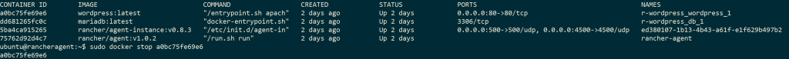](https://cdn.rancher.com/wp-content/uploads/2016/08/01143207/turnOffRancherServer02-6.png)

The WordPress container does not get restarted. This is troublesome, we

will need our Rancher Server back online. Let’s re-establish the network

connection and see if the Rancher Server notices that one of our

WordPress services is down. After a few moments, our Rancher Server

re-establishes connection with the agents and restarts the WordPress

container. Excellent. So the takeaway here is that Rancher Server can

handle intermittent connection issues and reconnect to the agents and

continue on as usual. Although, for reliable uptime of our containers we

would need multiple instances of Rancher Server on different hosts for

resiliency against networking issues in the data center. Now, what would

happen if the Rancher Server dies? Would we lose all of our ability to

manage our hosts after it comes back? Let’s find out!

## Killing the Rancher Server

In this second experiment I will go into the Rancher Server host and

manually terminate the process. Generally a failure will result in the

Docker process restarting due to *--restart=always* being set. Though

let’s assume that either your host ran out of disk space or otherwise

borked itself.

### Observations:

Let’s simulate catastrophic failure, and nuke our Rancher container.

`sudo docker stop rancher-server` As with the network experiment our

WordPress applications still run on the agents and serve traffic

normally. The Rancher UI and any semblance of control is now gone. We

don’t like this world, so we will start the rancher-server back up.

`sudo docker start rancher-server` After starting up again, the Rancher

server picks up where it left off. Wow, that is cool, how does this

magic work?

## Peeking under the hood of the Rancher Server Container

So how does the Rancher Server operate? Let’s take a brief tour into the

inner working of the Rancher server container to get a sense of what

makes it tick. Taking a look at the Rancher Server Docker build file

found [here](https://github.com/rancher/rancher/tree/master/server).

[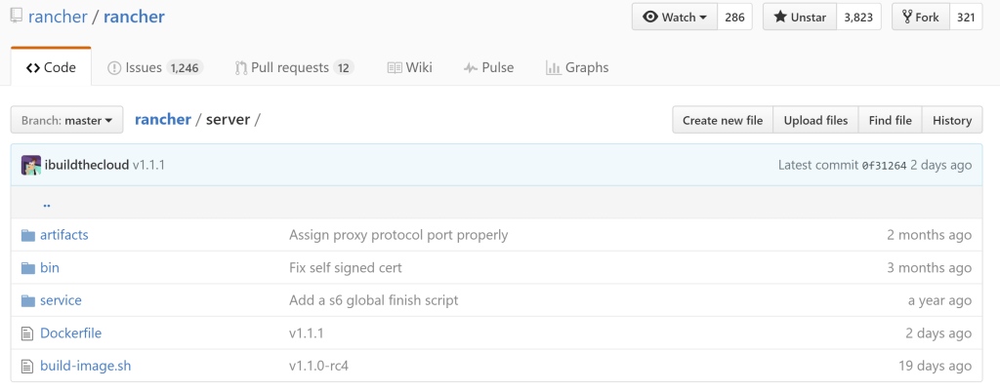](https://cdn.rancher.com/wp-content/uploads/2016/08/01143325/RancherServerComponents01-7.png)

```
# Dockerfile contents
FROM ...
...
...
CMD ["/usr/bin/s6-svscan", "/service"]
```

What is s6-svscan? It is a supervisor process that keeps a process

running based on commands found in files in a folder; these key files

are named as Run, Down, and Finish. If we look inside the service

directory we can see that the container will install dependencies and

use s6-svscan to start up 2 services. [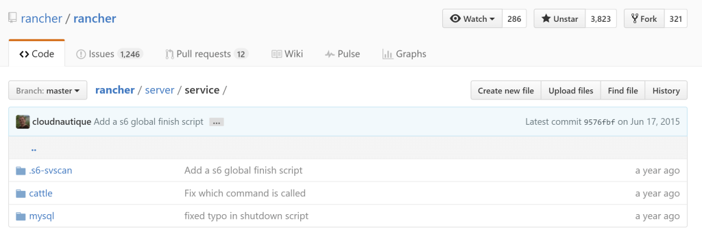](https://cdn.rancher.com/wp-content/uploads/2016/08/01143536/RancherServerComponents02-8.png)

The Cattle service, which is the core Rancher scheduler, and a MySQL

instance. Inside our container the following services are being run.

```
PID TTY      STAT   TIME COMMAND
    1 ?        Ss     0:00 /usr/bin/s6-svscan /service
    7 ?        S      0:00 s6-supervise cattle
    8 ?        S      0:00 s6-supervise mysql
    9 ?        Ssl    0:57 java -Xms128m -Xmx1g -XX:+HeapDumpOnOutOfMemoryError -XX:HeapDumpPath=/var/lib/cattle/logs -Dlogback.bootstrap.level=WARN -cp /usr/share/cattle/1792f92ccdd6495127a28e16a685da7
  135 ?        Sl     0:01 websocket-proxy
  141 ?        Sl     0:00 rancher-catalog-service -catalogUrl library=https://github.com/rancher/rancher-catalog.git,community=https://github.com/rancher/community-catalog.git -refreshInterval 300
  142 ?        Sl     0:00 rancher-compose-executor
  143 ?        Sl     0:00 go-machine-service
 1517 ?        Ss     0:00 bash
 1537 ?        R+     0:00 ps x
```

We see that our Rancher brain is a Java application named Cattle, which

uses a MySQL database embedded within its container to store state. This

is quite convenient, but it would seem that we found the single point of

failure on our quick-start setup. All the state for our cluster lives in

one MySQL instance which no one knows existed. What happens if I nuke

some data files?

#### Corrupting the MySQL Store

Inside my Rancher server container I executed MySQL commands. There is a

certain rush of adrenaline as you execute commands you know will break

everything.

`docker exec -it rancher-server bash $ > mysql mysql> use cattle; mysql> SET FOREIGN_KEY_CHECKS = 0; mysql> truncate service; mysql> truncate network;`

Lo and behold, my Rancher service tracking is broken, even when I kill

my WordPress containers they do not come back up, because Rancher no

longer remembers them. [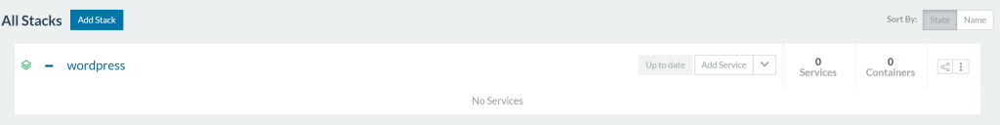](https://cdn.rancher.com/wp-content/uploads/2016/08/01143920/lossData01-9.png)

Since I also truncated the network setup tables, my WordPress

application no longer knows how to route to its DB. [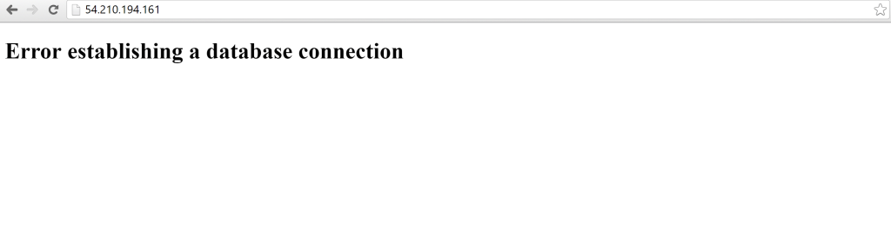](https://cdn.rancher.com/wp-content/uploads/2016/08/01144002/lossData02-10.png)

Clearly, to have confidence in running Rancher in production, we need a

way to protect our Rancher Server’s data integrity. This is where

Rancher HA comes in.

## Rancher HA Setup Process

The first order of business is we need to secure the cluster data. I

chose AWS RDS for this because it is what I am familiar with -- you can

manage your own MySQL or choose another managed provider. We will

proceed assuming we have a trusted MySQL management system with backups

and monitoring. Following the HA setup steps documented in Rancher:

[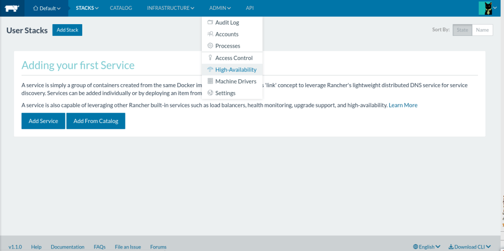](https://cdn.rancher.com/wp-content/uploads/2016/08/01144042/RancherHAPost2-11.png)

As per the setup guide, we create an AWS RDS instance to be our data

store. Once we have our database’s public endpoint, the next step is to

dump your current Rancher installation’s data, and export it to the new

database. [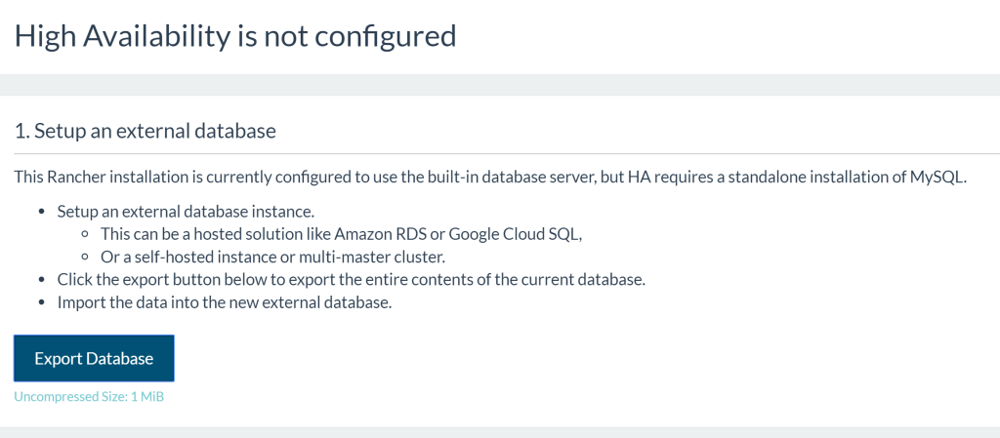](https://cdn.rancher.com/wp-content/uploads/2016/08/01144237/setupHA01-12.png)

For this I created an RDS instance with a public IP address. For your

first Rancher HA setup I recommend just making the database public, then

secure it later with VPC rules. Since Rancher provides an easy way to

dump the state, you can move it around to a secured database at a later

time. Next we will set up our Rancher Server to use the new database.

[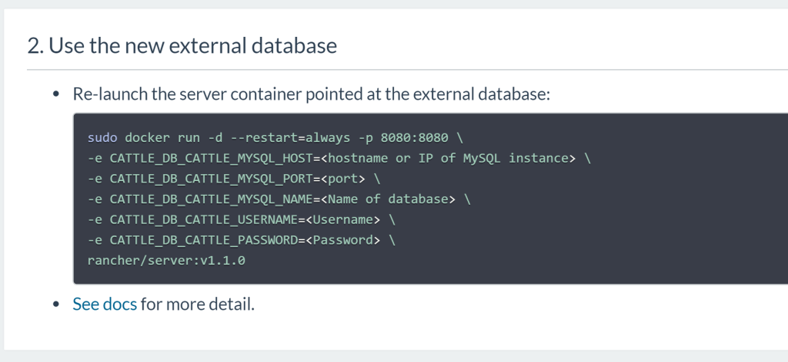](https://cdn.rancher.com/wp-content/uploads/2016/08/01144346/setupHA02-13.png)

After Rancher detects that it is using an external database, it will

open up 2 more options as part of setting up HA mode. (At this point, we

have already solved our point of failure, but for larger scale

deployments, we need to go bigger to lower risk of failure.) [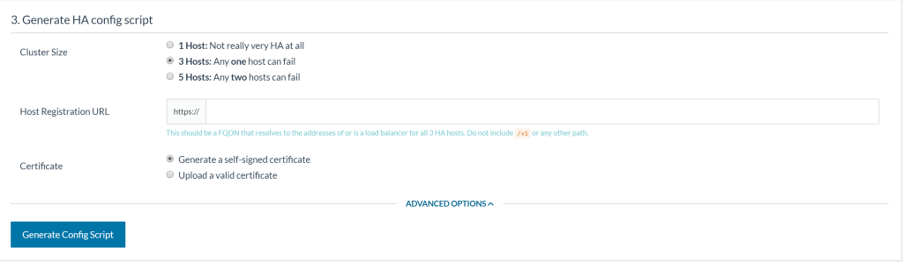](https://cdn.rancher.com/wp-content/uploads/2016/08/01144554/setupHA03-14.png)

Oh no, decision! -- but no worries, let’s go through each of these

options and their implications. **Cluster size**, notice how everything

is odd? Behind the scenes, Rancher HA sets up a ZooKeeper Quorum to keep

locks in sync (More on this in the [appendix](#appendix)). ZooKeeper

recommends odd numbers because an even number of servers does not

provide additional fault tolerance. Let’s pick 3 hosts to test out the

feature, as it is a middle ground between usefulness and ease of setup.

**Host registration URL**, well this section is asking us to provide the

Fully Qualified Domain Name (FQDN) of our Rancher HA cluster. The

instructions recommend an external loadbalancer or a DNS record that

round robins between the 3 hosts. [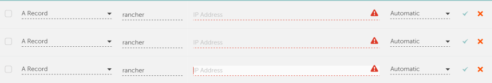](https://cdn.rancher.com/wp-content/uploads/2016/08/01144758/setupHA05-1-15.png)

The examples would be to use a [SRV Record](https://en.wikipedia.org/wiki/SRV_record) on your DNS provider

to balance between the 3 hosts; or an ELB on AWS with the 3 Rancher EC2

instances attached; or just a plain old DNS record pointing to 3 hosts.

I choose the DNS record for my HA setup as it is the simplest to setup

and debug. Now anytime I hit `https://rancher.example.com` my DNS

hosting provider will round robin requests between the 3 Rancher hosts

that I defined above. **SSL Certificate** is the last item on the list.

If you have your own SSL certificate on your domain then you can use it

here. Otherwise Rancher will provide a self-signed certificate instead.

Once all options are filled, Rancher will update fields in its database

to prepare for HA setup. You will then be prompted to download a

rancher-ha.sh script.
> WARNING Be sure to kill the Rancher container you used to generate the  
> rancher-ha.sh script. It will be using ports that are needed by the  
> Rancher-HA container that will be spun up by the script.

Next up, copy the rancher-ha.sh script onto each of the participating

instances in the cluster and then execute them on the nodes to setup HA.
> Caveat! Docker v1.10.3 is required at the time of writing. Newer  
> version of Docker is currently unsupported for the rancher-ha.sh  
> script.

You can provision the correct Docker version on your hosts with the

following commands:

```
#!/bin/bash
apt-get install -y -q apt-transport-https ca-certificates
apt-key adv --keyserver hkp://p80.pool.sks-keyservers.net:80 --recv-keys 58118E89F3A912897C070ADBF76221572C52609D
echo "deb https://apt.dockerproject.org/repo ubuntu-trusty main" > /etc/apt/sources.list.d/docker.list
apt-get update
apt-get install -y -q docker-engine=1.10.3-0~trusty

# run the command below to show all available versions
# apt-cache showpkg docker-engine
```

After Docker, we need to make sure that our instances can talk to each

other so make sure the ports listed on the Rancher multi-node requirements

page are open.
> Advice! For your first test setup, I recommend opening all ports to  
> avoid networking-related blockers.

Once you have the correct prerequisites, you can run the rancher-ha.sh

script on each participating host. You will see the following output.

```
...
ed5d8e75b7be: Pull complete
ed5d8e75b7be: Pull complete
7ebc9fcbf163: Pull complete
7ebc9fcbf163: Pull complete
ffe47ea37862: Pull complete
ffe47ea37862: Pull complete
b320962f9dbe: Pull complete
b320962f9dbe: Pull complete
Digest: sha256:aff7c52e52a80188729c860736332ef8c00d028a88ee0eac24c85015cb0e26a7
Status: Downloaded newer image for rancher/server:latest
Started container rancher-ha c41f0fb7c356a242c7fbdd61d196095c358e7ca84b19a66ea33416ef77d98511
Run the below to see the logs

docker logs -f rancher-ha
```

This is where the rancher-ha.sh script creates additional images that

support the HA feature. Due to the addition of components to the Rancher

Server, it is recommended to run a host with at least 4 GB of memory. A

docker ps of what is running after running the rancher-ha.sh script is

shown here. [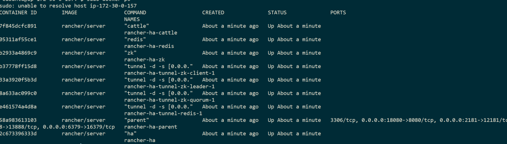](https://cdn.rancher.com/wp-content/uploads/2016/08/01150234/setupHA04-17.png)

### Common Problems and Solutions

You may see some connection errors, so try to run the script on all 3

hosts first. You should see logs showing members being added to the

Rancher HA Cluster.

```
time="2016-07-22T04:13:22Z" level=info msg="Cluster changed, index=0, members=[172.30.0.209, 172.30.0.111, ]" component=service
...
time="2016-07-22T04:13:34Z" level=info msg="Cluster changed, index=3, members=[172.30.0.209, 172.30.0.111, 172.30.0.69]" component=service
```

Sometimes you will see a stream of the following error lines.

```
time="2016-07-23T14:37:02Z" level=info msg="Waiting for server to be available" component=cert
time="2016-07-23T14:37:02Z" level=info msg="Can not launch agent right now: Server not available at http://172.17.0.1:18080/ping:" component=service
```

This is the top level symptom of many issues. Here are some other issues

I have identified by going through the GitHub issues list and various

forum posts: **Security Group Network issues** Sometimes your nodes are

[binding on the wrong IP](https://github.com/rancher/rancher/issues/4459#issuecomment-217242797)

so you would want to [coerce Rancher to broadcast the correct IP](https://github.com/rancher/rancher/issues/4459#issuecomment-217248081).

**ZooKeeper not being up** It is possible that the ZooKeeper Docker

container is not able to communicate with the other nodes, so you would

want to [verify ZooKeeper](https://github.com/rancher/rancher/issues/4634#issuecomment-216378310)

and you should expect to see this [sample output](https://github.com/rancher/rancher/issues/4634#issuecomment-216537628).

**Leftover files in the /var/lib/rancher/state directory from previous HA attempt** If you ran the rancher-ha.sh multiple times then you may

need to [clean up old state files](https://github.com/rancher/rancher/issues/4634#issuecomment-217029268).

**Broken Rancher HA setup state from multiple reattempts** [Drop Database](https://github.com/rancher/rancher/issues/4634#issuecomment-216621277)

and try again. There is a previous issue with [detailed steps](https://github.com/rancher/rancher/issues/4634#issuecomment-216704977)

to try to surface the issue. **Insufficient Resources on the machine**

Since Rancher HA runs multiple Java processes on the machine, you will

want to have at least 4 GB of memory. While testing with a t2.micro

instance with 1 GB the instance became inaccessible due to being memory

constrained. Another issue is that your database host needs to support

50 connections per HA node. You will see these messages when you attempt

to spin up additional nodes.

```
time="2016-07-25T11:01:02Z" level=fatal msg="Failed to create manager" err="Error 1040: Too many connections"
```

**Mismatched rancher/server:version** By default the rancher-ha.sh

script pulls in rancher/server:latest, but this kicked me in the back

because during my setup, Rancher pushed out rancher/server:1.1.2 so I

had two hosts running rancher/server:1.1.1, and my third host was

rancher/server:1.1.2. This caused quite a headache, but a good takeaway

is to always specify the version of rancher/server when running the

rancher-ha.sh script on subsequent hosts.

`./rancher-ha.sh rancher/server:` **Docker virtual network bridge was returning wrong IP** This was the issue I ran into – my HA setup was

trying to check agent health on the wrong Docker interface.

`curl localhost:18080/ping > pong curl http://172.17.0.1:18080/ping > curl: (7) Failed to connect to 172.17.0.1 port 18080: Connection refused`

The error line is found on

[rancher/cluster-manager/service](https://github.com/rancher/cluster-manager/blob/bceca5dc7d06f1357edbf270c9de049cdb9237aa/service/cluster_service.go#L77)

And the offending error call is found here in

[rancher/cluster-manager/docker](https://github.com/rancher/cluster-manager/blob/bceca5dc7d06f1357edbf270c9de049cdb9237aa/docker/docker.go#L133)

What the code is doing is to locate the Docker Bridge and attempt to

ping the :18080 port on the exposed Docker port. Since my Docker bridge

is actually set up on 172.17.42.1 this will always fail. To resolve it I

re-instantiated the host because the multiple Docker installation seemed

to have caused the wrong bridge IP to be fetched. After restarting the

instance and setting the correct Docker bridge, I now see the expected

log lines for HA.

## After Setting Up HA

```
time="2016-07-24T19:51:53Z" level=info msg="Waiting for 3 host(s) to be active" component=cert
```

Excellent. With one node up and ready, repeat the procedure for the rest

of the hosts. After 3 hosts are up, you should be able to access the

Rancher UI on the URL you specified for step 3 of the setup.

```
time="2016-07-24T20:00:11Z" level=info msg="[0/10] [zookeeper]: Starting "
time="2016-07-24T20:00:12Z" level=info msg="[1/10] [zookeeper]: Started "
time="2016-07-24T20:00:12Z" level=info msg="[1/10] [tunnel]: Starting "
time="2016-07-24T20:00:13Z" level=info msg="[2/10] [tunnel]: Started "
time="2016-07-24T20:00:13Z" level=info msg="[2/10] [redis]: Starting "
time="2016-07-24T20:00:14Z" level=info msg="[3/10] [redis]: Started "
time="2016-07-24T20:00:14Z" level=info msg="[3/10] [cattle]: Starting "
time="2016-07-24T20:00:15Z" level=info msg="[4/10] [cattle]: Started "
time="2016-07-24T20:00:15Z" level=info msg="[4/10] [go-machine-service]: Starting "
time="2016-07-24T20:00:15Z" level=info msg="[4/10] [websocket-proxy]: Starting "
time="2016-07-24T20:00:15Z" level=info msg="[4/10] [rancher-compose-executor]: Starting "
time="2016-07-24T20:00:15Z" level=info msg="[4/10] [websocket-proxy-ssl]: Starting "
time="2016-07-24T20:00:16Z" level=info msg="[5/10] [websocket-proxy]: Started "
time="2016-07-24T20:00:16Z" level=info msg="[5/10] [load-balancer]: Starting "
time="2016-07-24T20:00:16Z" level=info msg="[6/10] [rancher-compose-executor]: Started "
time="2016-07-24T20:00:16Z" level=info msg="[7/10] [go-machine-service]: Started "
time="2016-07-24T20:00:16Z" level=info msg="[8/10] [websocket-proxy-ssl]: Started "
time="2016-07-24T20:00:16Z" level=info msg="[8/10] [load-balancer-swarm]: Starting "
time="2016-07-24T20:00:17Z" level=info msg="[9/10] [load-balancer-swarm]: Started "
time="2016-07-24T20:00:18Z" level=info msg="[10/10] [load-balancer]: Started "
time="2016-07-24T20:00:18Z" level=info msg="Done launching management stack" component=service
time="2016-07-24T20:00:18Z" level=info msg="You can access the site at https://" component=service
```

[](https://cdn.rancher.com/wp-content/uploads/2016/08/01145541/setupHA08-17.png)

To get around issues regarding the self-signed HTTPS certificate, you

will need to add it to your trusted certificates. After waiting and

fixing up resource constraints on the DB, I then see all 3 hosts up and

running. [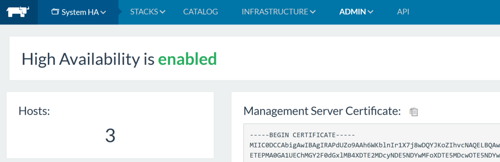](https://cdn.rancher.com/wp-content/uploads/2016/08/01150404/setupHA08-18.png)

## Conclusion

Wow, that was a lot more involved than originally thought. This is why

scalable distributed systems is a realm of PhD study. After resolving

all the failure points, I think setting up and getting to know Rancher

HA is a great starting point to touching state-of-the-art distributed

systems. I will eventually script this out into Ansible provisioning to

make provisioning Rancher HA a trivial task. Stay tuned!

## Appendix

For any distributed system, there is an explicit way to manage state and

changes. Multiple servers need a process to coordinate between updates.

Rancher’s management process works by keeping state and desired state

in the database; then emitting events to be handled by processing

entities to realize the desired state. When an event is being processed,

there is a lock on it, and it is up to the processing entity to update

the state in the database. In the single server setup, all of the

coordination happens in memory on the host. Once you go to a multi

server setup, the additional components like ZooKeeper and Redis are

needed. *Nick Ma is an Infrastructure Engineer who blogs about Rancher and Open Source. You can visit Nick’s blog, [CodeSheppard.com](http://codesheppard.com/), to catch up on practical guides for keeping your services sane and reliable with open-source solutions.*Build a CI/CD Pipeline with Kubernetes and RancherRecorded Online Meetup of best practices and tools for building pipelines with containers and kubernetes. [Watch the training](https://rancher.com/events/2018/2018-08-07-onlinemeetup-building-a-cicd-pipeline-with-k8s/)
