In [Part 1: Rancher Server
HA](https://rancher.com/5-keys-running-workloads-resiliently-rancher-docker-part-1/),
we looked into setting up Rancher Server in HA mode to secure it against
failure. There now exists a degree of engineering in our system on top
of which we can iterate. So what now? In this installment, we’ll look
towards building better service resiliency with Rancher Health Checks
and Load Balancing. Since the Rancher documentation for Health Checks
and Load Balancing are extremely detailed, Part 2 will focus on
illustrating how they work, so we can become familiar with the nuances
of running services in Rancher. A person tasked with supporting the
system might have several questions. For example, how does Rancher know
a container is down? How is this scenario different from a Health Check?
What component is responsible for operating the health checks? How does
networking work with Health Checks?

> Note: the experiments here are for illustration only. For
> troubleshooting and support, we encourage you to check out the
> [various Rancher resources](https://rancher.com/support/), including
> the [forums](https://forums.rancher.com)and
> [Github](http://github.com/rancher).

### Service Scale

First, we will walk through how container scale is maintained in
Rancher, and continue with the WordPress catalog installation from Part
1.
[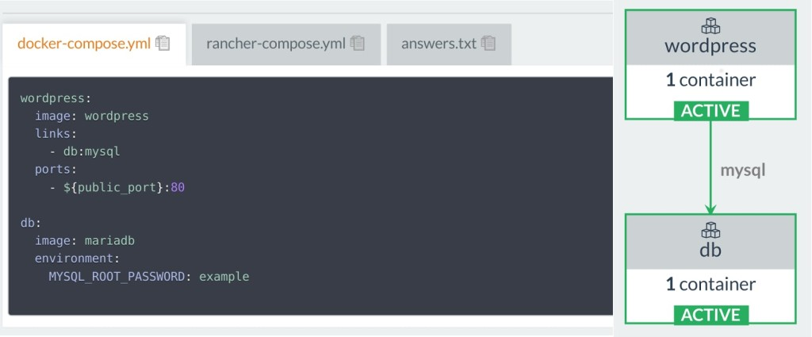](https://cdn.rancher.com/wp-content/uploads/2016/09/12124535/Codesheppard-2-2-2.jpg)
Let’s check out the Rancher Server’s database on our Rancher
quickstart container:

```
$> docker ps | grep rancher/server
cc801bdb5330 rancher/server "/usr/bin/s6-svscan /" 5 days ago Up 5 days 3306/tcp, 0.0.0.0:9999->8080/tcp thirsty_hugle
$> docker inspect -f {{.NetworkSettings.IPAddress}} thirsty_hugle
172.17.0.4
$> mysql --host 172.17.0.4 --port 3306 --user cattle -p
# The password's cattle too!
mysql> show databases;
+--------------------+
| Database |
+--------------------+
| information_schema |
| cattle |
+--------------------+
2 rows in set (0.00 sec)
```

We can drop into the database shell and check out the database, or hook
up that IP address to a GUI such as MySQL Workbench. From there, we can
then see that our WordPress and DB service are registered in our Rancher
Server’s metadata along with other containers on the agent-managed
host.
[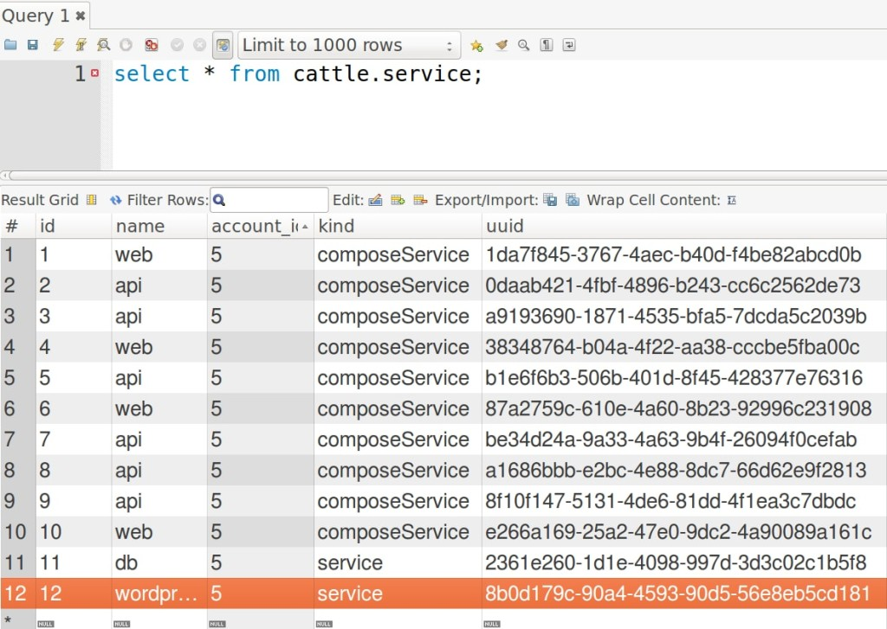](https://cdn.rancher.com/wp-content/uploads/2016/09/12124722/Codesheppard-2-3.jpg)
There are actually quite a lot of tables to browse manually, so I
instead used the Rancher terminal to execute a shell on my
rancher/server container to enable database logging.
[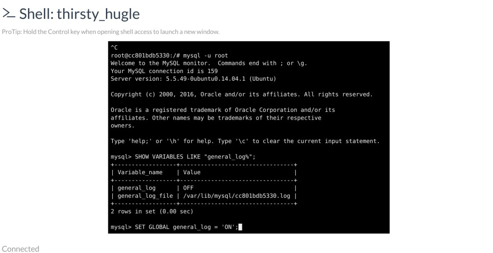](https://cdn.rancher.com/wp-content/uploads/2016/09/12124819/Codesheppard-2-5.jpg)

```
# relevant queries
root@cc801bdb5330:/# mysql -u root
mysql> SHOW VARIABLES LIKE "general_log%";
+------------------+---------------------------------+
| Variable_name | Value |
+------------------+---------------------------------+
| general_log | OFF |
| general_log_file | /var/lib/mysql/cc801bdb5330.log |
+------------------+---------------------------------+
2 rows in set (0.00 sec)
mysql> SET GLOBAL general_log = 'ON';

# Don't forget this, or your local Rancher will be extremely slow and fill up disk space.
# mysql> SET GLOBAL general_log = 'OFF';
```

Now with database event logging turned on, let’s see what happens when
we kill a WordPress container!

```
# on rancher agent host
$> docker ps
CONTAINER ID IMAGE COMMAND CREATED STATUS PORTS NAMES
cffb01a9ea15 wordpress:latest "/entrypoint.sh apach" 20 minutes ago Up 20 minutes 0.0.0.0:80->80/tcp r-wordpress_wordpress_1
98e5bcbdc6b3 mariadb:latest "docker-entrypoint.sh" 15 hours ago Up 15 hours 3306/tcp r-wordpress_db_1
c0ac56d7da38 rancher/agent-instance:v0.8.3 "/etc/init.d/agent-in" 15 hours ago Up 15 hours 0.0.0.0:500->500/udp, 0.0.0.0:4500->4500/udp cbbbed1b-8727-41d1-aa3b-9fb2c7598210
6784df26c8a7 rancher/agent:v1.0.2 "/run.sh run" 5 days ago Up 5 days rancher-agent
$> docker rm -f r-wordpress_wordpress_1
r-wordpress_wordpress_1
```

Checking the audit trail on the Rancher UI, we can see that Rancher
detects that a WordPress container failed and immediately spins up a new
container.
[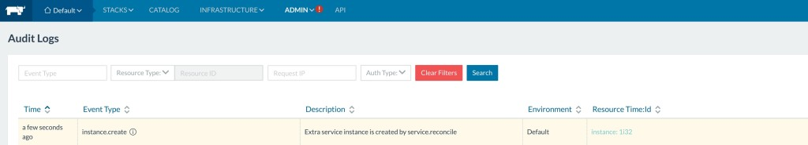](https://cdn.rancher.com/wp-content/uploads/2016/09/12124955/Codesheppard-2-8.jpg)
The database logs we extracted show that these events and actions
triggered responses within the following Rancher database tables:

```
agent
container_event
process_instance
process_execution
service
config_item_status
instance
```

All the logging from the database are from interactions between
[rancher/cattle](https://www.github.com/rancher/cattle) and its agents.

```
$> head cattle_mysql.log
/usr/sbin/mysqld, Version: 5.5.49-0ubuntu0.14.04.1 ((Ubuntu)). started with:
Tcp port: 3306 Unix socket: /var/run/mysqld/mysqld.sock
Time Id Command Argument
160904 18:14:49 1597 Connect root@localhost on
160904 18:14:50 225 Query SELECT 1
 225 Prepare select `agent`.`id`, `agent`.`name`, `agent`.`account_id`, `agent`.`kind`, `agent`.`uuid`, `agent`.`description`, `agent`.`state`, `agent`.`created`, `agent`.`removed`, `agent`.`remove_time`, `
agent`.`data`, `agent`.`uri`, `agent`.`managed_config`, `agent`.`agent_group_id`, `agent`.`zone_id` from `agent` where (`agent`.`state` = ? and `agent`.`uri` not like ? and `agent`.`uri` not like ? and 1 = 1)
 225 Close stmt
```

My logging started at **18:14:49**. From the logs, we can tell
that every so often Rancher checks up with its agents on the state of
the system through the *cattle.agent* table. When we killed the
WordPress container around **18:15:05**, the server received a
*cattle.container\_event* which signaled that WordPress was killed.

```
160904 18:15:05  225 Execute   insert into `container_event` (...omit colunms...) values (7, 'containerEvent', 'requested', '2016-09-04 18:15:05', '{...}', 'cffb01a9ea154f167b8c852fab1f2a444d8e846beefb6b15147109580e3bcf36', 'kill', 'wordpress:latest', 1473012905, '7442b981-b62a-4d29-80ee-e6077589fabc', 1)
```

Cattle then calculated that the desired instance count for wordpress was
insufficient based on the metadata stored in *cattle.service*. So it
emits a few *cattle.process\_instance* to reconcile the load.
[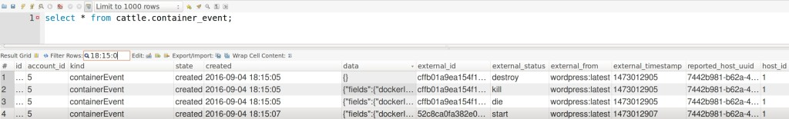](https://cdn.rancher.com/wp-content/uploads/2016/09/12125403/codesheppard-2-11.jpg)
Following the update, Rancher emits a few commands in
*cattle.process\_instance*. Agents then enact upon the events, updating
*cattle.process\_instance* and *cattle.process\_execution* within a few
loops:
[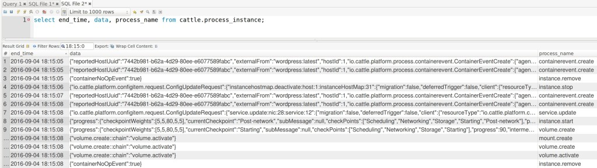](https://cdn.rancher.com/wp-content/uploads/2016/09/12125437/Codesheppard-2-10.jpg)
By **18:15:08**, a new WordPress container is spun up to converge to the
desired instance count. In brief, the Cattle event engine will process
incoming host states from its agents; whenever an imbalance in service
scale is detected, new events are emitted by Cattle and the agents act
on them to achieve the desired state. This does not ensure that your
container is behaving correctly, only that it is up and running. To
ensure correct behavior, we move on to our next topic.

### Health Checks

Health checks, on the other hand, are user defined and use HTTP
request/pings to report a status instead of checking
*container\_events* in the Rancher database. We’ll get to take a look
at this once we setup a multi-container WordPress following the
instructions on [Creating a Multiple Container
Application](https://docs.rancher.com/rancher/v1.2/en/quick-start-guide/#create-a-multi-container-application) in
the Rancher documentation.
[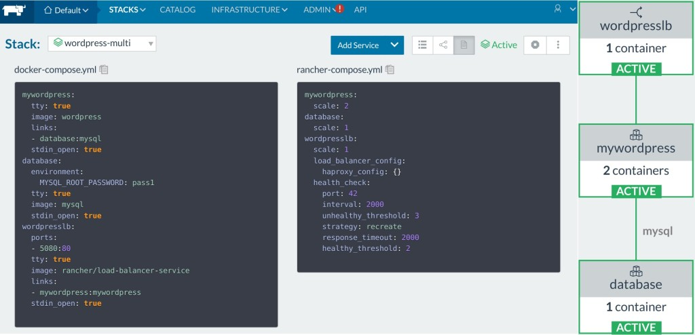](https://cdn.rancher.com/wp-content/uploads/2016/09/12125955/Codesheppard-2-13.jpg)
Let’s introduce a new error type. This time instead of killing the
container, we will make the software fail. I dropped a line in the
WordPress container to cause it to return 500, but the container is
still up serving 500s.

```
$> docker exec -it r-wordpress-multi_mywordpress_1 bash
$root@container> echo "failwhale" >> .htacess
# container now returns 500s.
# we want it to fail when the software fails!
```

What happened? Well, the issue is that the multiple container example
does not contain a Health Check. So I will go ahead and
modify \*rancher-compose.yml \*to include one. The *rancher-compose.yml*
only defines a Health Check for the LoadBalancer itself; we need to add
a service-level Health Check to our WordPress service.

```
mywordpress:
  scale: 2
  health_check:
    # Which port to perform the check against
    port: 80
    # For TCP, request_line needs to be '' or not shown
    # TCP Example:
    # request_line: ''
    request_line: GET / HTTP/1.0
    # Interval is measured in milliseconds
    interval: 2000
    initializing_timeout: 60000
    unhealthy_threshold: 3
    # Strategy for what to do when unhealthy
    # In this service, Rancher will recreate any unhealthy containers
    strategy: recreate
    healthy_threshold: 2
    # Response timeout is measured in milliseconds
   response_timeout: 200
...

$> cd wordpress-multi
$> rancher-compose up --upgrade mywordpress
... log lines
$> rancher-compose up --upgrade --confirm-upgrade
```

I defined my Health Check through *rancher-compose.yml*, but you can
also define it through the Rancher UI to browse through the options.

> Note: You will only have access to this UI on new service creation.

[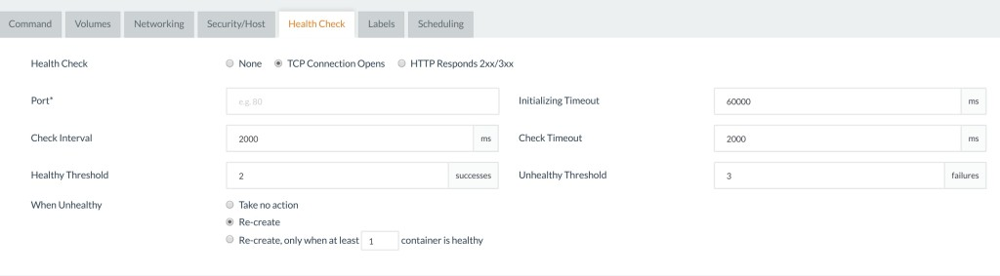](https://cdn.rancher.com/wp-content/uploads/2016/09/12132625/Codesheppard-2-14.jpg)
*Creation of Simple TCP Ping*
[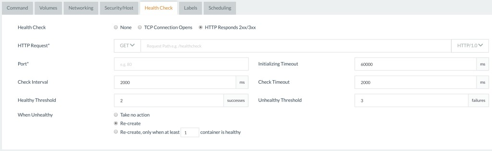](https://cdn.rancher.com/wp-content/uploads/2016/09/12132700/Codesheppard-2-15.jpg)

> The documentation covers the Health Check options in extreme detail.
> So in this post, we’ll instead look at which components support the
> Health Check feature.

With the addition of the Health Check, I repeated the above experiment.
The moment that the container started returning 500s, Rancher Health
Checks marked the container as unhealthy, then proceeded to recreate the
container.
[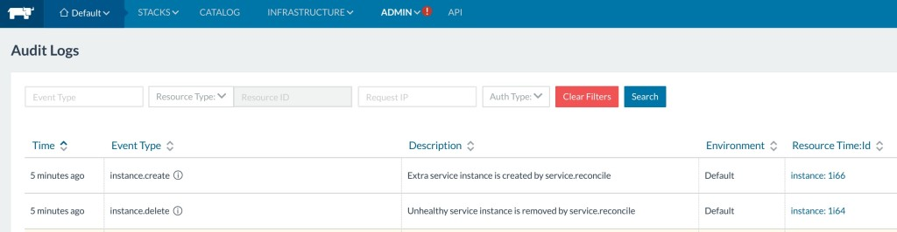](https://cdn.rancher.com/wp-content/uploads/2016/09/12132720/Codesheppard-2-16.jpg)
To get a deeper understanding of how Health Checking works we will take
a look into how the agent’s components faciliate Health Check on one
host. Entering into the agent instance, we check out the processes
running on it.
[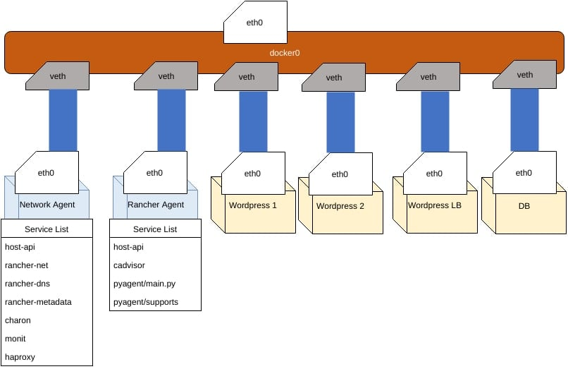](images/rancher_blog_HealthCheckNetworkDiagram.jpg)
At a high level, our hosts communicate with the outside world on the
physical *eth0* interface. Docker by default creates a bridge called
*docker0* and hands out container IP addresses known commonly as *Docker
IPs* to the *eth0* of containers through a *virtual network (veth)*.
This is how we were able to connect to Rancher/server’s MySQL
previously on 172.17.0.4:3306. The network agent contains a DNS server
called [rancher/rancher-dns](https://github.com/rancher/rancher-dns);
every container managed by Rancher uses this DNS to route to the private
IPs, and every networking update is managed by the services found in the
network agent container.

> If you have a networking background, there is a great post on the blog
> called [Life of a Packet in
> Rancher](https://rancher.com/day-life-packet-inside-rancher/).

### Breakdown of Processes Running on *Network Agent Instance*

```
root@agent-instance:/# ps ax
 PID TTY STAT TIME COMMAND
 1 ? Ss 0:00 init
 306 ? Sl 0:02 /var/lib/cattle/bin/rancher-metadata -log /var/log/rancher-metadata.log -answers /var/lib/cattle/etc/cattle/metadata/answers.yml -pid-file /var/run/rancher-metadata.pid
 376 ? Sl 1:29 /var/lib/cattle/bin/rancher-dns -log /var/log/rancher-dns.log -answers /var/lib/cattle/etc/cattle/dns/answers.json -pid-file /var/run/rancher-dns.pid -ttl 1
 692 ? Ssl 0:16 /usr/bin/monit -Ic /etc/monit/monitrc
 715 ? Sl 0:30 /usr/local/sbin/charon
 736 ? Sl 0:40 /var/lib/cattle/bin/rancher-net --log /var/log/rancher-net.log -f /var/lib/cattle/etc/cattle/ipsec/config.json -c /var/lib/cattle/etc/cattle/ipsec -i 172.17.0.2/16 --pid-file /var/run/rancher-net.pi
 837 ? Sl 0:29 /var/lib/cattle/bin/host-api -log /var/log/haproxy-monitor.log -haproxy-monitor -pid-file /var/run/haproxy-monitor.pid
16231 ? Ss 0:00 haproxy -p /var/run/haproxy.pid -f /etc/healthcheck/healthcheck.cfg -sf 16162
```

If we dig into the */etc/healthcheck/healthcheck.cfg*, you can see our
health checks defined inside for HAProxy:

```
...

backend 359346ff-33cb-445e-b1e2-7ec06d95bb19_backend
 mode http
 balance roundrobin
 timeout check 2000
 option httpchk GET / HTTP/1.0
 server cattle-359346ff-33cb-445e-b1e2-7ec06d95bb19_1 10.42.188.31:80 check port 80 inter 2000 rise 2 fall 3

backend cbc329bc-c7ec-4581-941b-da6660b8ef00_backend
 mode http
 balance roundrobin
 timeout check 2000
 option httpchk GET / HTTP/1.0
 server cattle-cbc329bc-c7ec-4581-941b-da6660b8ef00_1 10.42.179.149:80 check port 80 inter 2000 rise 2 fall 3

# This one is the Rancher Internal Health Check defined for Load Balancers
backend 3f730419-9554-4bf6-baef-a7439ba4d16f_backend
 mode tcp
 balance roundrobin
 timeout check 2000

server cattle-3f730419-9554-4bf6-baef-a7439ba4d16f_1 10.42.218.145:42 check port 42 inter 2000 rise 2 fall 3

...
```

### Health Check Summary

Rancher’s Network agent runs the Health Checks from
host-api,
which queries the configured Health Checks from HAProxy and reports
statuses back to Cattle. Paraphrasing the documentation:

> In Cattle environments, Rancher implements a health monitoring system
> by running managed network agents across its hosts to coordinate the
> distributed health checking of containers and services.

You can see metadata for this being filled in
*cattle.healthcheck\_instance*.

> When health checks are enabled either on an individual container or a
> service, each container is then monitored by up to three network
> agents running on hosts separate to that container’s parent host.

Unless you are running one host like I am, the Health Check will be from
the same host. These Health Checks are all configured by the
rancher/host-api binary with HAProxy. HAProxy is a pretty popular and
battle-tested software, and can be found in popular service discovery
projects like AirBnB’s [synapse](https://github.com/airbnb/synapse).

> The container is considered healthy if at least one HAProxy instance
> reports a “passed” health check and it is considered unhealthy when
> all HAProxy instances report a “unhealthy” health check.

Events are propagated by the Rancher Agent to Cattle, at which point the
Cattle server will decide if a Health Check’s unhealthy strategy (if
any) needs to be applied. In our experiment, Cattle terminated the
container returning 500s and recreated it. With the network services, we
can connect the dots of how health checks are setup. This way, we now
have a point of reference into the components supporting Health Checks
in Rancher.

### Load Balancers

So now we know Cattle keeps our individual services are to the scale we
set, and that for more resiliency, we can also setup HAProxy Health
Checks to ensure the software is running. Now let’s build up another
layer of resiliency by introducing Load Balancers. The Rancher Load
Balancer is a containerized HAProxy application service that is managed
like any other service in Rancher by Service Scale, though it is tagged
by Cattle as a System Service, and default hidden by default in the UI.
(Marked blue when we toggle system services)
[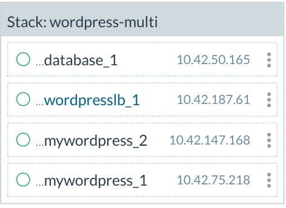](images/rancher_blog_Codesheppard-2-17.jpg)
When a WordPress container behind a Load Balancer fails, the Load
Balancer will automatically divert traffic to the next available host.
This is by no means unique to Rancher, and is a common way to balance
traffic on most applications. Though usually you will pay an hourly rate
for such service or maintain it yourself, Rancher allows you to quickly
and automatically set up an HAProxy loadbalancer, so we can get onto
building software instead of infrastructure. If we dig into the
container *r-wordpress-multi\_wordpresslb\_1* to check its HAProxy
configs, we can see that the config is periodically updated with the
containers in the Rancher-managed network:

```
$> docker exec -it r-wordpress-multi_wordpresslb_1 bash
 $root@wordpresslb_1> cat /etc/haproxy/haproxy.cfg
 ...
 frontend 6cd2e4b8-ea4c-4300-87f2-2a8f1fc96fec_80_frontend
 bind *:80
 mode http

default_backend 6cd2e4b8-ea4c-4300-87f2-2a8f1fc96fec_80_0_backend

backend 6cd2e4b8-ea4c-4300-87f2-2a8f1fc96fec_80_0_backend
 mode http
 timeout check 2000
 option httpchk GET / HTTP/1.0
 server cee0dd09-4307-4a5c-812e-df234b035694 10.42.188.31:80 check port 80 inter 2000 rise 2 fall 3
 server a7f20d4a-58fd-419e-8df2-f77e991fec3f 10.42.179.149:80 check port 80 inter 2000 rise 2 fall 3
 http-request set-header X-Forwarded-Port %[dst_port]

listen default
 bind *:42
 ...
```

You can also use achieve a similar result with DNS like we did for
Rancher HA in part 1, though Load Balancers offer additional features in
Rancher such as SSL certificates, advanced load balancing other than
round robin and etc.
[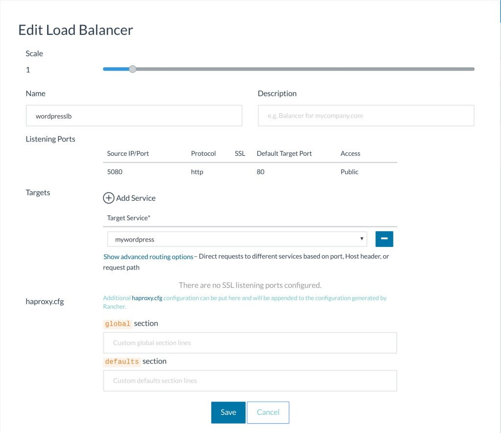](https://cdn.rancher.com/wp-content/uploads/2016/09/12134710/Codesheppard-2-18.jpg)
For more details on all of the features, I highly recommend checking out
the detailed Rancher documentation on Load Balancers
[here](https://docs.rancher.com/rancher/v1.2/en/cattle/adding-load-balancers/).

### Final Experiment, Killing the Database

Now for the final experiment: what happens when we kill the Database
Container? Well, the container comes back up and WordPress connects to
it. Though...oh no, WordPress is back in setup mode, and even worse,
all my posts are gone! What happened?

> Since the database depends on the data to be migrated, when we kill
> the container, it actually removes the volumes that contain our
> Wordpress data.

This is a major problem. Even if we can use a Load Balancer to scale all
these containers, it doesn’t matter if we can’t properly protect data
running on them! So in the next section, we will discuss data resiliency
on Rancher with Convoy and how to launch a replicated MySQL cluster to
make our WordPress setup more resilient inside Rancher. Stay tuned for
part 3, where we will dive into data resiliency in Rancher. *Nick Ma is
an Infrastructure Engineer who blogs about Rancher and Open Source. You
can visit Nick’s blog, [CodeSheppard.com](http://codesheppard.com/), to
catch up on practical guides for keeping your services sane and reliable
with open-source solutions.*
