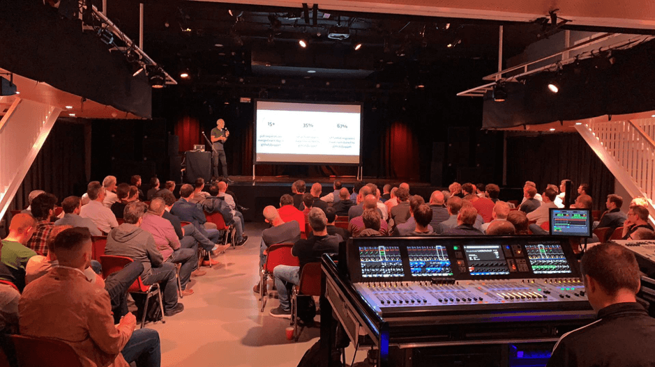
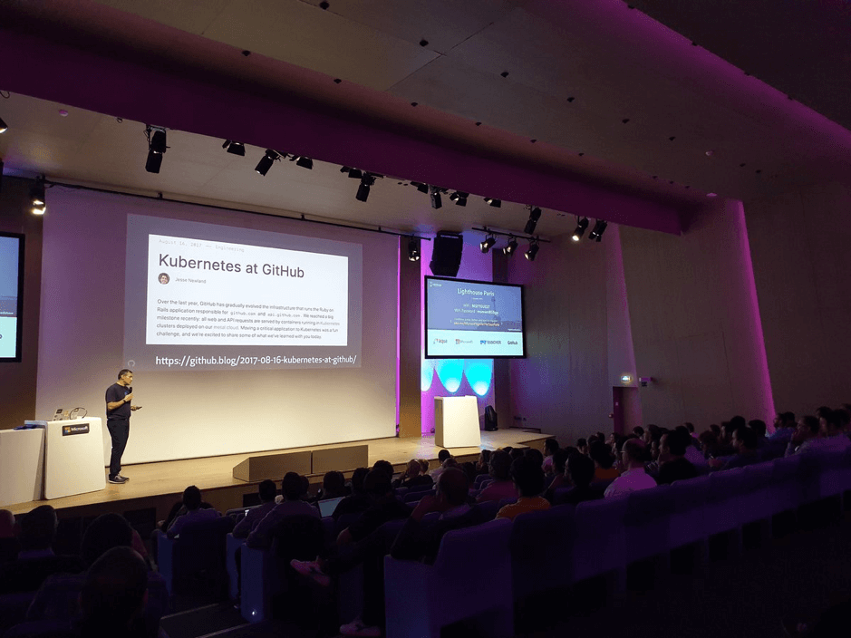
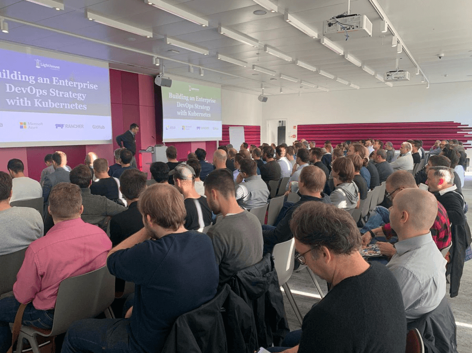
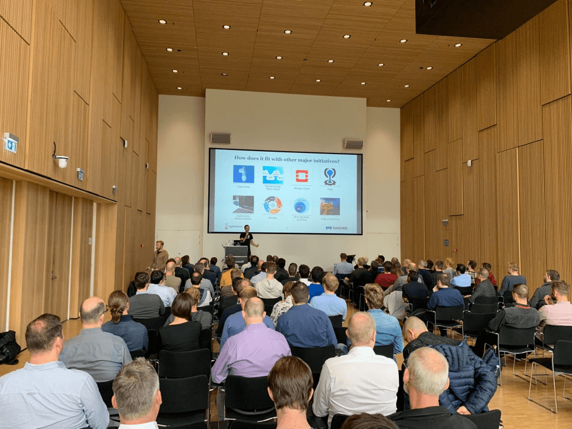
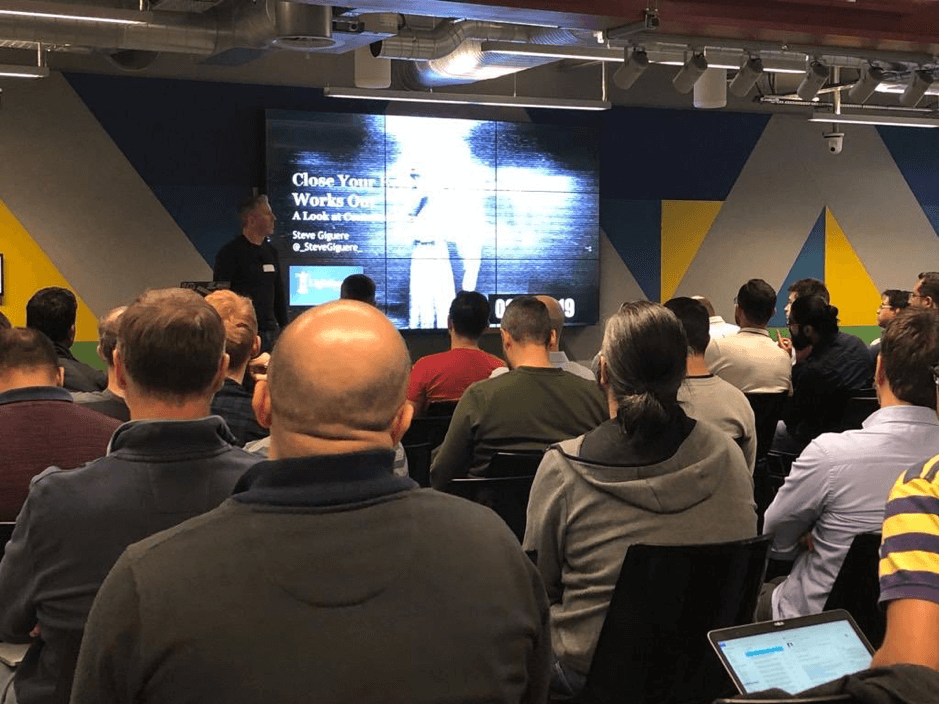

Having completed a series of twelve [Lighthouse Roadshow](https://lighthouseroadshow.com/) events across Europe and North America over the past six months, I’ve had time to reflect on what I’ve learnt about the rapid growth of the Kubernetes ecosystem, the importance of community and my personal development.
For those of you who haven’t heard of the Lighthouse series before, Rancher Labs first ran this roadshow in 2018 with Google, GitLab and Aqua Security. The theme was ‘Building an Enterprise DevOps Strategy with Kubernetes’. After selling out six venues across North America, I felt that its success could be repeated in Europe. We tested this theory in May by running the first 2019 Lighthouse in Amsterdam with Microsoft, GitHub and Aqua Security. The event sold out in just two weeks, and we had to move to a larger venue downtown to accommodate a growing waiting list.

Bas Peters from GitHub at Lighthouse Amsterdam – 16th May 2019

After the summer vacation period, the European leg of the Lighthouse re-started in earnest with events in Munich and Paris on consecutive days. The Paris event turned out to be the largest of the roadshow. Held at Microsoft’s magnificent Paris HQ, we packed their main auditorium with almost 300 delegates. In the weeks that followed the Lighthouse team also visited Copenhagen, London, Oslo, Helsinki, Stockholm and, finally, Dublin. Not to be outdone, Rancher’s US team organised a further three Lighthouse events with partners Amazon, GitLab, and Portworx during November.
Now home, sitting at my desk and reflecting on the lessons learnt, I’ve distilled them down to the following:

## Focus on context not product pitches

Organizing the content for so many consecutive events with many different speakers was a significant challenge. We had a mix of sales guys, tech evangelists, consultants and field sales engineers presenting. Those speakers that received the best response (and exchanged the most business cards during the coffee breaks) always delivered insight into the context in which their products exist. I share this lesson because I want to encourage those running similar events in this space to understand the value of insight. This is particularly true if you work for a company that doesn’t charge anything for their technology. In a market where there are no barriers to adopting software, the only way you can genuinely differentiate is the quality of the story you tell and the expert insight that you deliver.

Alain Helaili from GitHub at Lighthouse Paris – 11th Oct 2019

## Interest in Kubernetes is exploding

Of the almost 3000 IT professionals who registered for the roadshow globally, more than half are already using Kubernetes in production. So, what makes the excitement around Kubernetes different from previous hype-cycles? I would contend there are two principal differences:

1. **Low barrier to entry** - Kubernetes takes minutes to install on-prem or in the cloud. I regularly see enthusiastic sales and marketing people launching their first cluster in the public cloud. Compare that to something like OpenStack which, despite the existence of a variety of installers on the market, is hellish to get up and running. Unless you have access to skilled consultants from the beginning, the technical bar is set so high that only the most sophisticated teams can be successful.
2. **Mature and proven** - Kubernetes has, in one form or another, been around for over ten years orchestrating containers in the world’s largest IT infrastructures. Google introduced the Borg around 2004. Borg was a large-scale internal cluster management system, which ran many thousands of different applications, across many clusters, each with up to tens of thousands of machines. In 2014 the company released Kubernetes as an open-source version of Borg. Since then, hundreds of thousands of enterprises have deployed Kubernetes into production with all the public clouds now offering managed varieties of their own. Google rightly concluded that a rising tide would float all ships (and use more cloud compute!). Today Kubernetes is mature, proven and used everywhere. Sadly, you can’t say the same about OpenStack.

Yours truly opening proceedings at Lighthouse Munich – 10th Oct 2019

## Enterprises are still asking the same questions

While the adoption of Kubernetes is undeniably the most significant phenomenon in IT operations since virtualization, those enterprises that are considering it are asking the same questions as before:
1. Who should be responsible for it?
2. How does it fit into our cloud strategy?
3. How do we tie it into our existing services?
4. How do we address security?
5. How do we encourage broader adoption?
In what is still a relatively nascent market, its challenging questions like these that need to be answered by Kubernetes advocates transparently and in person if they are to be taken seriously. The stakes are high for early adopters, and they need assurance that the advice you offer is real, tangible and trusted by others. That’s why we created the Lighthouse Roadshow.

Olivier Maes from Rancher Labs at Lighthouse Copenhagen – 31st Oct 2019

## Community matters

Unless the ecosystem around new technology is open and well-governed, it will die. Companies or individuals that reject community members as freeloaders are consigning themselves to irrelevance. You can always find some people who are willing to jump through the hoops of licensing management or lock themselves into a single vendor. Still, most of today’s B2B tech consumers are looking to make their choices based on third-party validation. Community members may not pay for your software, but they contribute to your growth by endorsing your brand and sharing their own success stories.
The Lighthouse Roadshow is 100% community driven. We’re not interested in making a profit from ticket sales preferring instead to see how well our stories resonate with delegates. The more insight delivered, the more successful the event. The feedback from each of the Lighthouse venues has been hugely rewarding and the opportunities for growth have been incalculable. We couldn’t have achieved this if we just measured our success by tracking the conversion rate of delegate numbers to MQLs and close won opportunities.

Steve Giguere from Aqua Security at Lighthouse London – 8th Nov 2019

## Surrounding yourself with talent makes you better

It’s widely known that one of the best ways to improve on a skill is to practice it with someone better than you. During the Lighthouse Roadshow I had the unique privilege of attending every European event and listening to every talk, sometimes multiple times. The skills and knowledge of the speakers and professionalism of the event professionals who helped us was simply amazing.
I’m particularly grateful to my fantastic colleagues at Rancher Labs - Lujan Fernandez, Abbie Lightowlers, Olivier Maes, Tolga Fatih Erdem, Jeroen Overmaat, Elimane Prud’ hom, Nick Somasundram, Simon Robinson, Chris Urwin, Sheldon Lo-A-Njoe, Jason Van Brackel, Kyle Rome and Peter Smails. I’ve also been fortunate to work alongside rockstars from partner companies like Steve Giguere, Grace Cheung and Jeff Thorne at Aqua Security; Bas Peters, Richard Erwin and Anne-Christa Strik at GitHub; and Bozena Crnomarkovic Verovic, Dennis Gassen, Shirin Mohammadi, Maxim Salnikov, Sherry List, Drazen Dodik, Tugce Coskun, Anna-Victoria Fear, Juarez Junior and many others from Microsoft; Alex Diaz and Patrick Brennan from Portworx; Carmen Puccio from Amazon; and Dan Gordon from GitLab. I can’t help but feel inspired by all these fantastic people.
By the time we finished in Dublin, I felt invigorated and filled with new ideas. Looking back, I know that listening and sharing with these brilliant folks has encouraged me to step up my own game.

## More Resources

What to know more about how to build an enterprise Kubernetes Strategy? [Download our eBook.](https://more.suse.com/fy21-global-web-landing-page-how-to-build-enterprise-kubernetes-strategy)
