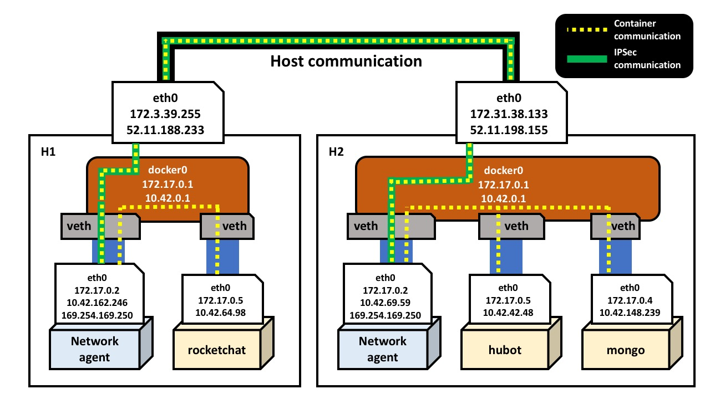

[[Rancher is a complete container management
solution](https://rancher.com), and to be a complete platform, we’ve
placed careful consideration into how we handle networking between
containers on our platform. So today, we’re posting a quick example to
illustrate how networking in Rancher works. While Rancher can be
deployed on a single node, or scaled to thousands of nodes, in this
walkthrough, we’ll use just a handful of hosts and
containers.]

### Setting up and Launching a Containerized Application

[Our first task is to set up our infrastructure, and for this exercise,
we’ll use AWS. Let’s deploy a master node in EC2, install Docker, and
start Rancher with the following command: ]

```
curl -sSL https://get.docker.com | sh - && sudo docker run -d --restart=always -p 8080:8080 rancher/server
```

[The Rancher server is now available at
][[52.40.47.157:8080]](http://52.40.47.157:8080)[
**(note:** *these IP addresses are released to the public once these AWS
instances are destroyed. Here, these IP addresses are for reference
only*). Through the EC2 console, we’ll also add two hosts, H1 and H2, on
which application containers will run. Here’s a logical setup of the
topology so far: one of the nodes is running the Rancher server
software, and the rest are running the Rancher
agent:] [](images/rancher_blog_Rancher-EC2-topology.jpg)
To illustrate networking between containers, we’ll need to launch a
containerized application. Rancher Catalog makes this easy. Here, we’ll
use Rocket.Chat. The Rocket.Chat template is comprised of three
container images, named mongo, rocketchat and hubot. Once launched,
Rocket.Chat is available at
[52.11.188.233:3000](http://52.11.188.233:3000). (For a more complete
walkthrough of launching an application from Rancher Catalog, [visit our
docs](https://docs.rancher.com/rancher/latest/en/catalog/) on the

subject).

### Exploring the Infrastructure

Once Rocket.Chat is launched, we can dive into the details of H1 and H2
using the Rancher UI. Click on the Infrastructure tab to see which
containers are running on which hosts: [](https://cdn.rancher.com/wp-content/uploads/2016/07/20152422/Rancher-RocketChat-infrastructure.jpg)
Here, the rocketchat container has been scheduled on H1, and the
remaining two containers, mongo and hubot have been scheduled on H2. In
this picture we can also see the network agent running on each node
(note that the network agent doesn’t start until there are containers
running on the host). The IP addresses of the various containers are
also shown here - these will be important for later! We can get more
details by downloading the machine config file for each host: [](https://cdn.rancher.com/wp-content/uploads/2016/07/20152734/Machine-Config-Download.jpg)
After downloading and extracting the machine configs, we can see the
private and public keys, and additional files related to each of the
hosts. Use the private keys from the machine configs to ssh into
the hosts. Subsequently for each machine, we’ll be able to use
`ifconfig` to identify the IP addresses of the network interfaces of
each host. Here’s an [abridged] result for H1, revealing the IP
address for the `docker0` bridge (`172.17.0.1`) and the physical `eth0`
network interface (`172.31.39.255`):

```
ubuntu@leo-alpha-h1:~$ ifconfig
docker0   Link encap:Ethernet  HWaddr 02:42:64:4e:c0:c6
          inet addr:172.17.0.1  Bcast:0.0.0.0  Mask:255.255.0.0
          inet6 addr: fe80::42:64ff:fe4e:c0c6/64 Scope:Link
          UP BROADCAST RUNNING MULTICAST  MTU:1500  Metric:1
          RX packets:1114933 errors:0 dropped:0 overruns:0 frame:0
          TX packets:1437072 errors:0 dropped:0 overruns:0 carrier:0
          collisions:0 txqueuelen:0
          RX bytes:198587596 (198.5 MB)  TX bytes:1813282482 (1.8 GB)
eth0      Link encap:Ethernet  HWaddr 02:b8:4d:31:40:f3
          inet addr:172.31.39.255  Bcast:172.31.47.255  Mask:255.255.240.0
          inet6 addr: fe80::b8:4dff:fe31:40f3/64 Scope:Link
          UP BROADCAST RUNNING MULTICAST  MTU:9001  Metric:1
          RX packets:2187296 errors:0 dropped:0 overruns:0 frame:0
          TX packets:1382626 errors:0 dropped:0 overruns:0 carrier:0
          collisions:0 txqueuelen:1000
         RX bytes:2627031496 (2.6 GB)  TX bytes:277190533 (277.1 MB)
```

Repeating the process with H2 reveals similar information; the IP
address for the `docker0` bridge is `172.17.0.1`, and the physical
`eth0` network interface (`172.31.38.133`). Now let’s dig into the
containers running on each of the hosts, and inspect the IP addresses of
each of the network interfaces. For H1, we can use `sudo docker ps` and
`sudo docker exec` on H1:

```
ubuntu@leo-alpha-h1:~$ sudo docker ps | awk '{print $1"t"$2}'
CONTAINER    ID
b6a27f5fd2fe rocketchat/rocket.chat:latest
f0cd5839d719 rancher/agent-instance:v0.8.1
132d6ad0c6b9 rancher/agent:v1.0.1

ubuntu@leo-alpha-h1:~$ sudo docker exec -it b6a27f5fd2fe /bin/bash
rocketchat@b6a27f5fd2fe:/app/bundle$ ip addr
17: eth0: <BROADCAST,MULTICAST,UP,LOWER_UP> mtu 1500 qdisc noqueue state UP group default
    link/ether 02:14:82:66:7d:fd brd ff:ff:ff:ff:ff:ff
    inet 172.17.0.5/16 scope global eth0
       valid_lft forever preferred_lft forever
    inet 10.42.64.98/16 scope global eth0
       valid_lft forever preferred_lft forever
    inet6 fe80::14:82ff:fe66:7dfd/64 scope link
       valid_lft forever preferred_lft forever
ubuntu@leo-alpha-h1:~$ sudo docker exec -it f0cd5839d719 /bin/bash
root@f0cd5839d719:/# ip addr
11: eth0: <BROADCAST,MULTICAST,UP,LOWER_UP> mtu 1500 qdisc noqueue state UP group default
    link/ether 02:14:82:82:b0:68 brd ff:ff:ff:ff:ff:ff
    inet 172.17.0.2/16 scope global eth0
       valid_lft forever preferred_lft forever
    inet 10.42.162.246/16 scope global eth0
       valid_lft forever preferred_lft forever
    inet 169.254.169.250/32 scope global eth0
       valid_lft forever preferred_lft forever
    inet6 fe80::14:82ff:fe82:b068/64 scope link
       valid_lft forever preferred_lft forever
```

Repeating this exercise for H2, and doing a careful inspection of the
results yields the following information about the containers running on
their respective hosts:

---

**HOST** **Container Name** **MAC Address** **IP addresses**
[H1] [rocket.chat] [02:14:82:66:7d:fd] [172.17.0.5/16] [10.42.64.98/16]
[H1] [agent-instance] [02:14:82:82:b0:68] [172.17.0.2/16] [10.42.162.246/16] [169.254.169.250/32]
[H2] [hubot] [02:14:82:36:a4:6c] [172.17.0.5/16] [10.42.42.48/16]
[H2] [mongo] [02:14:82:2d:a0:55] [172.17.0.4/16] [10.42.148.239/16]
H2 [agent-instance] [02:14:82:ab:9d:5d] [172.17.0.2/16] [10.42.69.59/16] [169.254.169.250/32]

---

We can see that each of the containers has one network interface
(`eth0`). Additionally, the Rancher network agent container
(agent-instance in the table above) has three IP addresses: one from the
Docker subnet (`172.17.X.X`), another from the Rancher subnet
(`10.42.X.X`), and the third from the Link Local (APIPA) subnet
(`169.254.X.X`). The application containers (hubot, mongo, and
rocket.chat) each have two IP addresses, one from the Docker subnet,
another from the Rancher subnet.

### Hops and Traceroutes

Let’s investigate traffic between some of the containers. From the
mongo container, ping the hubot container (on the same host):

```
root@ad4e749d2658:/# ping -c4 hubot
PING hubot.rocket-chat.rancher.internal (10.42.42.48): 48 data bytes
56 bytes from 10.42.42.48: icmp_seq=0 ttl=64 time=0.041 ms
56 bytes from 10.42.42.48: icmp_seq=1 ttl=64 time=0.046 ms
56 bytes from 10.42.42.48: icmp_seq=2 ttl=64 time=0.075 ms
56 bytes from 10.42.42.48: icmp_seq=3 ttl=64 time=0.060 ms
--- hubot.rocket-chat.rancher.internal ping statistics ---
4 packets transmitted, 4 packets received, 0% packet loss
round-trip min/avg/max/stddev = 0.041/0.055/0.075/0.000 ms
root@ad4e749d2658:/#
```

The hubot container is reachable from the mongo container, and checking
the traceroute confirms that there is only one jump required between
these containers:

```
root@ad4e749d2658:/# traceroute hubot
traceroute to hubot (10.42.42.48), 30 hops max, 60 byte packets
 1  ip-10-42-42-48.us-west-2.compute.internal (10.42.42.48)  0.029 ms  0.012 ms  0.015 ms
root@ad4e749d2658:/#
```

Now let’s check the traceroute of from the mongo container to the
rocket.chat container, which are located on different hosts:

```
root@ad4e749d2658:/# traceroute rocketchat
traceroute to rocketchat (10.42.64.98), 30 hops max, 60 byte packets
 1  * * *
 2  ip-10-42-162-246.us-west-2.compute.internal (10.42.162.246)  1.391 ms  1.229 ms  1.168 ms
 3  ip-10-42-64-98.us-west-2.compute.internal (10.42.64.98)  1.137 ms  1.108 ms  1.086 ms
root@ad4e749d2658:/#
```

Here we can see that the rocket.chat container is three hops away from
the mongo container, and that the network path goes through the IP
address `10.42.162.246`, the IP address of the network agent running on
H1.

### ARP Table and IPSec for the mongo container

Let’s check out the ARP table for the mongo container:

```
root@ad4e749d2658:/# cat /proc/net/arp
IP address HW type Flags HW address Mask Device
169.254.169.250 0x1 0x2 02:14:82:ab:9d:5d * eth0
10.42.64.98 0x1 0x2 02:14:82:ab:9d:5d * eth0
10.42.69.59 0x1 0x2 02:14:82:ab:9d:5d * eth0
10.42.42.48 0x1 0x2 02:14:82:36:a4:6c * eth0
172.17.0.1 0x1 0x2 02:42:6c:a6:5e:b8 * eth0
root@ad4e749d2658:/#
```

The ARP for the rocket.chat container’s IP address `10.42.64.98` has
resolved to MAC address `02:14:82:ab:9d:5d`, which is the same as that
for the network agent’s `eth0` interface of H2. Now let’s look at the
IPSec info:

```
root@9cdde771152c:/# swanctl --list-conns
conn-52.11.188.233:
  local:  %any
  remote: 52.11.188.233
  local pre-shared key authentication:
  remote pre-shared key authentication:
  child-52.11.188.233: TUNNEL
    local:  0.0.0.0/0
    remote: 0.0.0.0/0
root@9cdde771152c:/#
```

Here we can see that there’s a secure communication channel from the H2
network agent to that on H1 (`52.11.188.233`). The logical summary of
this section is below:
[](images/rancher_blog_networking_overview_1.1.jpg)

### Overlay Networking in Rancher

As we can see from inspecting the IP addresses of the containers on H1
and H2, the IP addresses assigned by Docker are not unique across hosts.
For example, the same IP address (`172.17.0.5`) is assigned to both the
rocket.chat container on H1, and to the hubot container on H2; it’s not
possible to uniquely address containers using the Docker IP addresses
alone. To overcome this problem, **Rancher assigns unique IP addresses
to all containers running across the cluster**, which in this case are
allocated from the subnet `10.42.0.0/16`.

### IPSec

At Rancher, security is of the utmost importance! Rancher is designed to
run on both public and private clouds, and makes no assumptions
regarding communication channels between any two given hosts. We want
any network traffic leaving a host to be secure, and chose to use IPSec
to create a complete mesh topology between hosts. While this has a
slight impact on performance, it makes Rancher networking secure by
default. In future releases, we intend to provide a configurable option
to turn off IPSec. Rancher uses
[strongSwan](https://www.strongswan.org/) for IPSec. [Charon
daemon](https://wiki.strongswan.org/projects/strongswan/wiki/charon),
which is part of strongSwan, is used for IKEv2 protocol implementation.
To see the full mesh topology details, we can use the command `swanctl`

```
root@f0cd5839d719:/# swanctl --list-sas
conn-52.11.198.155: #71, ESTABLISHED, IKEv2, 2146471635b90a25:1dc18102c0c48357
  local  '172.17.0.2' @ 172.17.0.2
  remote '172.17.0.2' @ 52.11.198.155
  AES_CBC-128/AES_XCBC_96/PRF_AES128_XCBC/MODP_2048
  established 524s ago, rekeying in 12694s
  child-52.11.198.155: #1, reqid 1234, INSTALLED, TUNNEL-in-UDP, ESP:AES_CBC-128/HMAC_SHA1_96
    installed 459878s ago
    in  cb2952a7,   0 bytes,    0 packets
    out c0992075,   0 bytes,    0 packets
    local  0.0.0.0/0
    remote 0.0.0.0/0
conn-52.11.198.155: #70, ESTABLISHED, IKEv2, ff2a5d9495f14efe:dda2d2a6df6a1cf3
  local  '172.17.0.2' @ 172.17.0.2
  remote '172.17.0.2' @ 52.11.198.155
  AES_CBC-128/AES_XCBC_96/PRF_AES128_XCBC/MODP_2048
  established 8076s ago, rekeying in 5913s
  child-52.11.198.155: #2, reqid 1234, INSTALLED, TUNNEL-in-UDP, ESP:AES_CBC-128/HMAC_SHA1_96
    installed 459859s ago
    in  cf604805, 13790077094 bytes, 11532487 packets
    out cb46151e, 776570467 bytes, 9019180 packets
    local  0.0.0.0/0
    remote 0.0.0.0/0
```

### Network Agent Services

If we list the running processes inside the Network Agent container, we
can see that there are several critical services running (rancher-dns,
rancher-net, etc). The rancher-net service is the core networking
service for Rancher, and is responsible for setting up IPSec using
strongSwan and charon. The source code for this service is available on
GitHub at <https://github.com/rancher/rancher-net>. Similarly, the
rancher-dns service is responsible for resolving the container names to
their respective IP addresses. The source code for this service is
available on Github at <https://github.com/rancher/rancher-dns>. Through
the `/etc/resolv.conf` file inside the application container, we can see
that the nameserver points to the IP address (`169.254.169.250`) of the
Network Agent.

```
rocketchat@b6a27f5fd2fe:/app/bundle$ cat /etc/resolv.conf
search us-west-2.compute.internal rocket-chat.rancher.internal rocketchat.rocket-chat.rancher.internal rancher.internal
nameserver 169.254.169.250
```

### Summary

In this article, we deployed Rancher to EC2, added hosts, started the
RocketChat application using the Rancher catalog, and investigated the
networking interfaces and properties of various running containers. We
also illustrated the overlay network within Rancher, and viewed the
helper services running inside the Network Agent container. We
constructed a high-level picture from the information gathered during
the exercise, and highlighted the secure communication between hosts
using IPSec.

### What’s Next

There are a few improvements on the way for networking within Rancher:

- **Adopting the CNI/libnetwork interface**. The current networking
  approach introduces a second IP address for each of the containers;
  this introduces some difficulties, as some applications work with
  only the first IP address assigned to the network interface. We plan
  to move to CNI/libnetwork so the network interface inside the
  container will only have one IP address. With this integration,
  users will also be able to leverage a greater range of networking
  technologies available within the community.
- **VXLAN support**. For native Rancher networking, we plan to add
  VXLAN as an option to provide an alternative to IPSec.
- **Multiple Networks**: In upcoming releases, we plan to expose
  multiple, but isolated networks for each environment supported by
  Rancher.

### Give us feedback!

I hope this walkthrough has provided valuable insight into how
networking in Rancher works. As always, please reach out to us via the
[forums](https://forums.rancher.com), or on Twitter
([@Rancher\_Labs](http://twitter.com/rancher_labs)) to voice any
questions or concerns - we have an excellent and passionate community of
users, and we love hearing from you!
