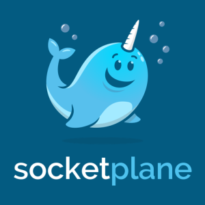

Today Docker acquired SDN software maker SocketPlane. Congratulations to both
Docker and SocketPlane teams. We have worked closely with SocketPlane
team since the early Docker [networking
discussions](https://github.com/docker/docker/issues/8951) and have a
great amount of respect for their technical abilities. We are also happy
to see Docker Inc. make a serious effort to bring SDN capabilities to
the Docker platform. Many customers have told us that the lack of
multi-host networking is one of the last remaining gaps that impede the
wide-spread production use of Docker containers. Today Docker containers
on multiple hosts cannot easily communicate with each other. Without
SDN, developers and operations teams have to resort to complicated port
mapping to get containers that are running on different hosts to talk to
each other. This dramatically complicates application deployment,
monitoring, upgrades, and service discovery.

At Rancher Labs, we are
developing two products: [RancherOS](https://rancher.com/rancher-os/ "RancherOS") and
[Rancher](https://rancher.com/rancher-io/ "Rancher.io"). RancherOS is a
minimalist Linux distribution designed specifically for running Docker
containers. It enables the type of networking services developed by
SocketPlane to be packaged and distributed as system containers. Rancher
is a container orchestration platform for managing large production
deployments of Docker containers. Rancher requires a multi-host
networking layer to be deployed underneath. In fact, the need for
multi-host networking is such that we developed a simple yet functional
SDN solution in Rancher itself. We look forward to working with
SocketPlane team as they drive the Docker networking API design so that
Rancher can work with multiple SDN implementations in the future.

As a member of the Docker ecosystem, Rancher’s success depends on an
increasing number of organizations embracing containers. We believe
Docker can only succeed if it fulfills its promise of becoming a
distributed application platform. A standardized Docker networking layer
is an important step in this direction.

If you’re interested in learning more about RancherOS, please join us for an online meet up on
March 31st.
