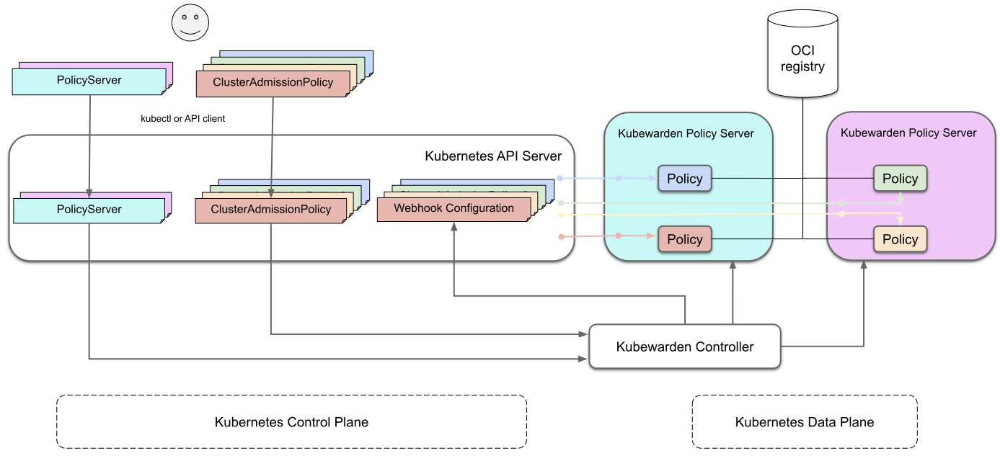

*Post originally published on*[*Kubewarden’s blog*](https://kubewarden.io/blog) *by Víctor Cuadrado Juan*


We are pleased to announce a new architecture for the Kubewarden stack in line with its journey to maturity:

The **PolicyServer** Custom Resource Definition (CRD) allows users to describe a policy-server deployment and bind **ClusterAdmissionPolicies** to a specific **PolicyServer** instance.

These two changes are accompanied by many improvements to make Kubewarden more comfortable for Kubernetes Administrators, such as validation for Kuberwarden Custom Resources, improvements in Helm Charts, status, and conditions for **ClusterAdmissionPolicies**.

For a comprehensive list, see the release notes of [kubewarden-crds-0.1.0](https://github.com/kubewarden/helm-charts/releases/tag/kubewarden-crds-0.1.0) and [kubewarden-controller-0.3.0](https://github.com/kubewarden/helm-charts/releases/tag/kubewarden-controller-0.3.0) Helm charts.

## What Does It Look Like?

In previous versions, the Kubewarden Controller instantiated a single deployment of the policy server. That policy server was configured via a ConfigMap, which contained the deployment options (image, replicas, etc.), and a list of policies to be loaded, with information on where to pull them from their configuration options.

With the addition of the new **PolicyServer** Custom Resource, administrators have a better UX since they can define as many policy servers as they need and get to select what PolicyServer each ClusterAdmissionPolicy targets. Let’s see a diagram of the new architecture:



On the diagram, notice the two separate PolicyServer Deployments in cyan and mauve (right), created as specified in the two PolicyServer resources (left).

Each policy server loads different policies – all ClusterAdmissionPolicies that target that specific policy server. The new PolicyServer Custom Resource is cluster-wide, which means that it is identifiable by its unique `name`. Here is an example of a PolicyServer named `tenant-a`:

```
---
apiVersion: policies.kubewarden.io/v1alpha2
kind: PolicyServer
metadata:
  name: tenant-a
spec:
  image: ghcr.io/kubewarden/policy-server:v0.1.10
  replicas: 1   serviceAccountName: policy-server
```

The PolicyServer Custom Resource also accepts an optional `spec.serviceAccountName` to be associated with (if not set, as here, the Namespace default ServiceAccount will be used).

A ClusterAdmissionPolicy targeting that PolicyServer needs to set `spec.policyServer` to `tenant-a`, as such:

```
---
apiVersion: policies.kubewarden.io/v1alpha2
kind: ClusterAdmissionPolicy
metadata:
  name: psp-capabilities
spec:
  policyServer: tenant-a
  module: registry://ghcr.io/kubewarden/policies/psp-capabilities:v0.1.3
  rules:
    - apiGroups: [""]
      apiVersions: ["v1"]
      resources: ["pods"]
      operations:
        - CREATE
        - UPDATE
  mutating: true
  settings:
    allowed_capabilities:
      - CHOWN
    required_drop_capabilities:
      - NET_ADMIN
```

For a more in-depth dive, look at our [architecture docs](https://docs.kubewarden.io/architecture.html) and the [Kubewarden CRDs documentation](https://github.com/kubewarden/kubewarden-controller/blob/main/docs/crds/README.asciidoc).

## What Does This Mean for Administrators?

With the possibility to use more than one PolicyServer, it is now up to the Kubernetes administrators on how they want to split and organize policy evaluations while that resilience grows.

While the old architecture was already HA, a noisy tenant/namespace or a frequently used policy in the past could bring the only policy server to a crawl and wreak havoc in the cluster (as all admission reviews for the cluster went through it to be screened).

For example, a Kubernetes Administrator can decide to isolate policy evaluations per tenant/namespace by creating a PolicyServer for each tenant workload. Or run mission-critical policies separately, making the whole infrastructure more resilient.

In the future, with an upcoming namespaced AdmissionPolicy Custom Resource, administrators will be able to give different tenants control over their admission policies, reducing administrative overload.

The new architecture also validates and mutates PolicyServers and ClusterAdmissionPolicies with dedicated admission controllers for a better UX. This means that administrators can rest comfortably when editing them, as catastrophic outcomes (such as all policies being dropped by a misconfigured PolicyServer, leading to DOS against the cluster) can never happen.

Also, ClusterAdmissionPolicies will, if no `spec.policyServer` is defined, bind to the PolicyServer named `default` (created by the Helm chart). In addition, [Finalizers](https://kubernetes.io/docs/concepts/overview/working-with-objects/finalizers/) are now added to all Kubewarden Custom Resources, which ensure orderly deletion by the Kubewarden Controller.

Including validating and mutating webhooks for Kuberwarden CRDs means that the controller webhook server needs to be securely hooked up to the Kubernetes API. In this case, it means using TLS certificates. We have chosen to integrate Kuberwarden with [cert-manager](https://cert-manager.io/) to simplify the installation. Our Helm Chart today has the option for automatically creating and setting up Self-Signed certs, or using your own cert-manager Issuer.

For ease of deployment, we have separated the CRDs into their own Helm chart: `kubewarden-crds`. This prepares the stack for smoother upgrades in the future. The Kubewarden Controller and default policy server stay in the `kubewarden-controller` Helm chart.

All of the new changes simplify managing clusters, making Kubewarden use via [Fleet](https://fleet.rancher.io/) more consistent and streamlined.

## A Hands-On Example

With a simple policy, let’s install Kubewarden and secure our cluster against privileged pods.

### Installing Kubewarden

Follow this example:

```
$ kubectl apply -f https://github.com/jetstack/cert-manager/releases/download/v1.5.3/cert-manager.yaml
$ kubectl wait --for=condition=Available deployment --timeout=2m -n cert-manager --all
$ helm repo add kubewarden https://charts.kubewarden.io
$ helm install --create-namespace -n kubewarden kubewarden-crds kubewarden/kubewarden-crds
$ helm install --wait -n kubewarden kubewarden-controller kubewarden/kubewarden-controller
```

This will install [cert-manager](https://cert-manager.io/), a dependency of Kubewarden, and then install the `kubewarden-crds` and `kubewarden-controller` Helm charts in the default configuration (which includes self-signed TLS certs). Shortly after, you will have the Kubewarden Controller running and one PolicyServer, named `default`, on the `kubewarden` namespace:

```
$ kubectl get policyservers
NAME      AGE
default   38s
```

The default configuration values should be good enough for most deployments (all options are documented [here](https://charts.kubewarden.io/#configuration)).

Now, you can use Kubewarden with Go, Rust, Swift, Open Policy Agent and Gatekeeper policies, as you are used to.

Let’s deploy our own policy server, named `my-policy-server`, and a Kubewarden Policy based on the [pod-privileged](https://github.com/kubewarden/pod-privileged-policy) policy, to be scheduled in that specific policy-server:

```
$ kubectl apply -f - <<EOF
---
apiVersion: policies.kubewarden.io/v1alpha2
kind: ClusterAdmissionPolicy
metadata:
  name: privileged-pods
spec:
  policyServer: my-policy-server
  module: registry://ghcr.io/kubewarden/policies/pod-privileged:v0.1.9
  rules:
    - apiGroups: [""]
      apiVersions: ["v1"]
      resources: ["pods"]
      operations:
        - CREATE
        - UPDATE
  mutating: false
---
apiVersion: policies.kubewarden.io/v1alpha2
kind: PolicyServer
metadata:
  name: my-policy-server
spec:
  image: ghcr.io/kubewarden/policy-server:v0.1.10
  replicas: 1   serviceAccountName: policy-server
EOF
```

```
$ kubectl get policyservers
NAME               AGE
default            1m12s
my-policy-server   29s
```

While deployment for the new PolicyServer is still deploying, the policy will be marked as `unschedulable` and move to `pending` once we are waiting for the PolicyServer to accept connections:

```
$ kubectl get clusteradmissionpolicies
NAME              POLICY SERVER      MUTATING   STATUS
privileged-pods   my-policy-server   false      pending
```

We can wait some seconds for the policy server to be up and the policy to be active:

```
$ kubectl wait --for=condition=PolicyActive clusteradmissionpolicy/privileged-pods
clusteradmissionpolicy.policies.kubewarden.io/privileged-pods condition met

$ kubectl get clusteradmissionpolicies
NAME              POLICY SERVER      MUTATING   STATUS
privileged-pods   my-policy-server   false      active
```

Now, if we try to create a Pod with at least one privileged container, it will not be allowed:

```
$ kubectl apply -f - <<EOF
apiVersion: v1
kind: Pod
metadata:
  name: privileged-pod
spec:
  containers:
    - name: nginx
      image: nginx:latest
      securityContext:
          privileged: true
EOF

Error from server: error when creating "STDIN": admission webhook "privileged-pods.kubewarden.admission" denied the request: User 'youruser:yourrole' cannot schedule privileged containers
```

# Wrap-Up

The new Kubewarden stack, with the new cluster-wide PolicyServer resource, allows fine-tuning of policies. At the same time, it makes the life of administrators easier with CR validations, workflow simplifications, and separation of concerns.

We hope you enjoy Kubewarden. We have many ideas about expanding and improving the project, and we would like to hear what you would like to see in the future: don’t hesitate to open an issue in any of the [github.com/kubewarden](https://github.com/kubewarden) projects or get in contact in the [#kubewarden Slack channel](https://kubernetes.slack.com/archives/C01T3GTC3L7)!

## **Next Steps: Learn More at the Kubewarden Meetup**

Join our Global Online Meetup: Kubewarden on Wednesday, August 10th, 2022, at 11 AM EST. Flavio Castelli from the Kubewarden team will tell you more about Kubewarden, give you a live demo and answer your questions. [Register now.](https://more.suse.com/global_rancher_online_meetup_kubewarden.html)
