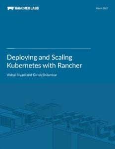

Modern microservices applications span multiple containers, and

sometimes a single app may use thousands of containers. When operating

at this scale, you need a container orchestration tool to manage all of

those containers. Managing them by hand is simply not feasible. This is

where Kubernetes comes in. Kubernetes manages Docker containers that are

used to package applications at scale. Since its launch in 2014,

Kubernetes has enjoyed widespread adoption within the container

ecosystem. It is fast becoming the de facto tool for orchestrating

containers at scale. What are the reasons for the meteoric rise of

Kubernetes, and what are the factors that will shape its future? Let’s

take a look by examining the major milestones in Kubernetes’ history.

### Milestone 1: Kubernetes 1.0 Released

V1.0 of Kubernetes was released in 2015. (The 2014 releases of

Kubernetes were beta versions.) V1.0 brought many key features like DNS,

load balancing, scaling, and application-level health checking.

Importantly, it allowed you to group your container clusters into pods

for better management. This is one feature that separates Kubernetes

from the rest of the pack. The most prominent concern around Kubernetes

back then was whether Kubernetes was production-ready. Docker itself was

barely a year old, and the container ecosystem was highly nascent.

Google has emphasized that prominent organizations like Box and Ebay use

Kubernetes in production, and since then, many organizations have come

out flaunting their use of the tool in their production environments.

Another concern has been Kubernetes’ steep learning curve. Designed at

Google before the advent of Docker, it doesn’t follow the Docker CLI,

API, Docker Compose, or YAML definitions. You need to manage containers

using Kubernetes’ opinionated methods. However, many organizations find

this worth the effort, considering the huge upside of having the most

capable and open container orchestrator available today, and being able

to confidently scale to thousands of containers.

### Milestone 2: Google hands Kubernetes over to the CNCF

Quickly get started with Rancher and Kubernetes following the

step-by-step instructions in the latest release of the Kubernetes

eBook Google’s open approach has been one of the key drivers

for Kubernetes’ industry-wide adoption. While Kubernetes was developed

at Google, once open-sourced, Google went all-out to integrate

Kubernetes with every possible cloud vendor and containerization

service— OpenStack, Azure, Mesosphere, and more. Back in March 2016,

Google gave complete control of Kubernetes over to the Cloud Native

Computing Foundation (CNCF). Kubernetes was the first project to be

accepted into the foundation. This is a big stamp of approval, showing

how production-ready Kubernetes is. By making it part of the CNCF,

Google has completely handed Kubernetes over to the container ecosystem

to decide its future. This is further testament to Google’s neutral

intentions when open-sourcing Kubernetes.

### Milestone 3: Kubernetes Incubator seeds product development

[Kubernetes Incubator](https://github.com/kubernetes/community/blob/master/incubator.md)

is a GitHub repository that hosts promising new Kubernetes projects. Its

goal is to bring consistency, and set standards to the efforts of

developers trying to extend and innovate around Kubernetes. In Feb 2016,

[Helm](https://github.com/kubernetes/helm) became the first project to

graduate from the Incubator. It is a package manager that packages

applications as Kubernetes charts. Helm, along with

[Dashboard](https://github.com/kubernetes/dashboard), has been

[integrated with Rancher as of v1.4](https://rancher.com/rancher-1-4/).

Other interesting Kubernetes Incubator projects include

[Kompose](https://github.com/kubernetes-incubator/kompose), which moves

Docker Compose files over to Kubernetes, and

[kube-aws](https://github.com/kubernetes-incubator/kube-aws), a tool to

manage Kubernetes clusters on AWS. These projects are bridging the gap

between Kubernetes and the rest of the container ecosystem. As

Kubernetes gains mainstream adoption, these tools will grow in

importance, and some may even become part of the main Kubernetes

platform.

### Kubernetes’ future: Powering niche platform solutions

Kubernetes is evolving at a rapid pace. It recently reached GA on Azure

Container Service. To mark the occasion, Kubernetes co-founder Brendan

Burns wrote a thought-provoking piece on [how Kubernetes will change the PaaS landscape](http://blog.kubernetes.io/2017/02/caas-the-foundation-for-next-gen-paas.html).

He sees industry-specific PaaS platforms emerging because of how easy

Kubernetes makes building a PaaS system on top of container

infrastructure. Beyond PaaS, there are even FaaS (function as a service)

platforms like [Fission](https://github.com/fission/fission) and

[funktion](https://github.com/funktionio/funktion/) being built with

Kubernetes. This way, Kubernetes is not just powering applications, but

enabling applications which can help create other powerful applications.

Kubernetes is still in its early days. As it matures, it will give rise

to a growing ecosystem of managed Kubernetes service providers. This is

critical to the adoption of Kubernetes in enterprises. While Kubernetes

has shown explosive growth in the first three years of its existence,

despite the lack of tooling and consensus around it, the next three

years and more will be marked by a maturing of both the tool itself, and

the ecosystem that supports it. Another way Kubernetes helps the

container ecosystem evolve faster is through the healthy competition it

gives Docker Swarm. Despite Docker’s decision to bake Swarm into the

Docker platform by default, the move has not slowed down Kubernetes’

growth. In fact, it’s becoming even more clear now that the industry is

rallying around Kubernetes as it prefers a more open and highly scalable

option to Docker’s Swarm. Kubernetes is one of the most active projects

on Github, and it enjoys strong support from every corner of the

industry. The strong consensus will see it become the leading container

orchestrator in 2017 and beyond. \*Twain began his career at Google,

where, among other things, he was involved in technical support for the

AdWords team. His work involved reviewing stack traces, resolving issues

affecting both customers and the Support team, and handling escalations.

Later, he built branded social media applications and automation scripts

to help startups better manage their marketing operations. Today, as a

technology journalist, he helps IT magazines and startups change the way

teams build and ship applications. \*
