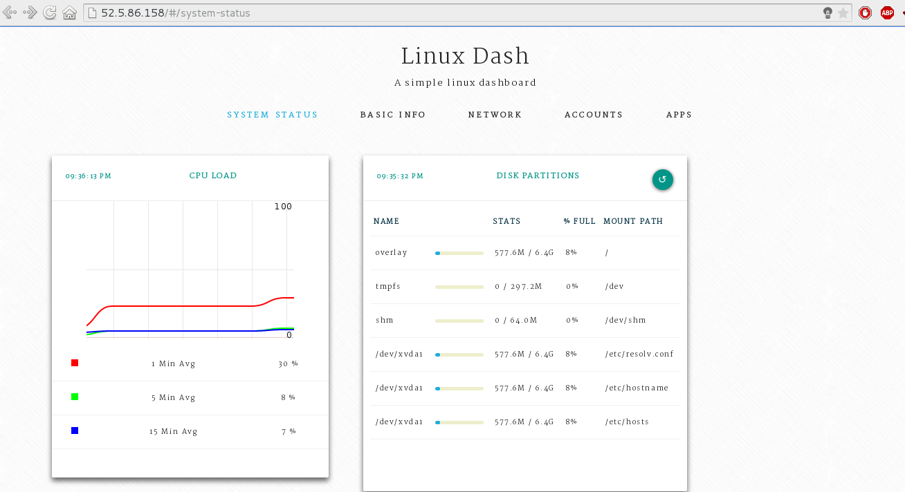
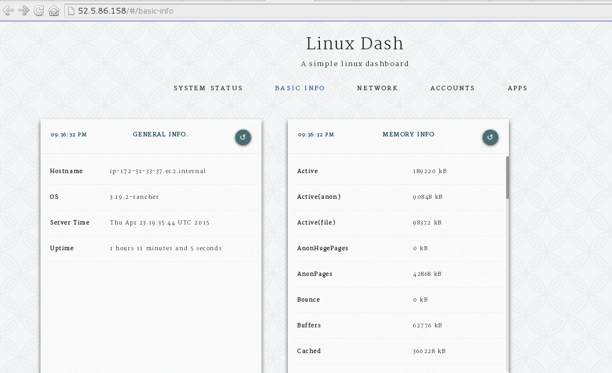

Last week Ivan Mikushin discussed adding [system services to RancherOS
using Docker
Compose](https://rancher.com/using-docker-compose-to-define-rancheros-system-services/).
Today I want to show you an exmaple of how to deploy Linux Dash as a
system service. Linux Dash is a simple, low overhead, and web supported
monitoring tool for Linux, you can read more about Linux Dash
[here](https://github.com/afaqurk/linux-dash). In this post i will add
Linux Dash as a system service to RancherOS version 0.3.0 which allows
users to add system services using **rancherctl** command. The Ubuntu’s
console is the only service that is currently available in RancherOS.

## Creating Linux Dash Docker Image

I build a 32MB node.js busybox image on top of the hwestphal/nodebox
image, with linux-dash installed which will run on port 80 by
default. The Docker file of this image:

```
FROM hwestphal/nodebox
MAINTAINER Hussein Galal

RUN opkg-install unzip
RUN curl -k -L -o master.zip https://github.com/afaqurk/linux-dash/archive/master.zip
RUN unzip master.zip
WORKDIR linux-dash-master
RUN npm install

ENTRYPOINT ["node","server"]
```

The image needs to be available on Docker Hub to be pulled later by
RancherOS, so we should build and push the image:

```
# docker build -t husseingalal/busydash busydash/
# docker push husseingalal/busydash
```

## **Starting Linux Dash As A System Service**

Linux Dash can be started as system service in RancherOS using
rancherctl service enable *<system-service>* while
*<system-service>* is the location of the yaml file that contains the
option for starting the system service in RancherOS. **linux-dash.yml**

```
dash:
image: husseingalal/busydash
privileged: true
links:
- network
labels:
- io.rancher.os.scope=system
restart: always
pid: host
ipc: host
net: host
```

To start the previous configuration as a system service, run the
following command on RancherOS:

```
~# rancherctl service enable /home/rancher/linux-dash/linux-dash.yml
```

By using this command, the service will also be added to the
**rancher.yml** file and set to enabled, but a reboot needs to occur in
order for it take effect. After rebooting, you can see that the dash
service has been started using rancherctl command:

```
rancher@xxx:~$ sudo rancherctl service list
enabled  ubuntu-console
enabled  /home/rancher/linux-dash/linux-dash.yml
```

And you can see that the Dash container has been started as a system
Docker container:

```
rancher@xxx:~$ sudo system-docker ps
CONTAINER ID        IMAGE                          COMMAND                CREATED             STATUS              PORTS               NAMES

447ada85ca78        rancher/ubuntuconsole:v0.3.0   "/usr/sbin/entry.sh    About an hour ago   Up About an hour                        console

fb7ce6f074e6        husseingalal/busydash:latest   "node server"          About an hour ago   Up About an hour                        dash

b7b1c734776b        userdocker:latest              "/usr/sbin/entry.sh    About an hour ago   Up About an hour                        userdocker

2990a5db9042        udev:latest                    "/usr/sbin/entry.sh    About an hour ago   Up About an hour                        udev

935486c2bf83        syslog:latest                  "/usr/sbin/entry.sh    About an hour ago   Up About an hour                        syslog
```

And to test the Web UI just enter the following url to your browser:
**http://server’s-ip**
[](images/rancher_blog_16.png)
[](images/rancher_blog_17.png)

## Conclusion

In version 0.3.0 of RancherOS, you have the ability to create and manage
your own RancherOS system services. System service in RancherOS make it
easy to enable is a Docker container that will start at the OS startup
and can be designed in Docker compose format. For more information about
system services in
RancherOS.
You can find instructions on how to download RancherOS from Github
