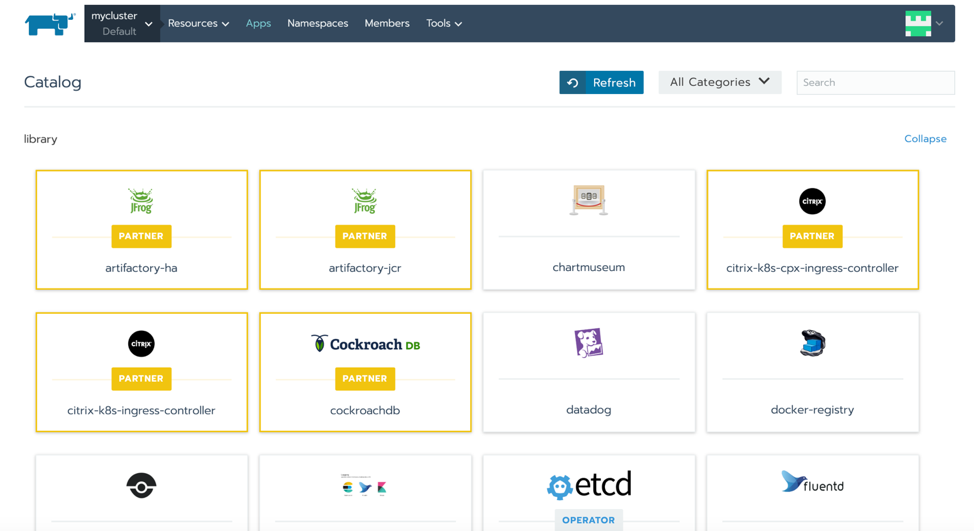
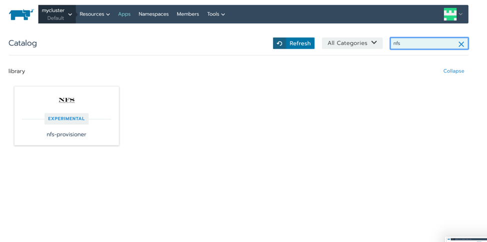
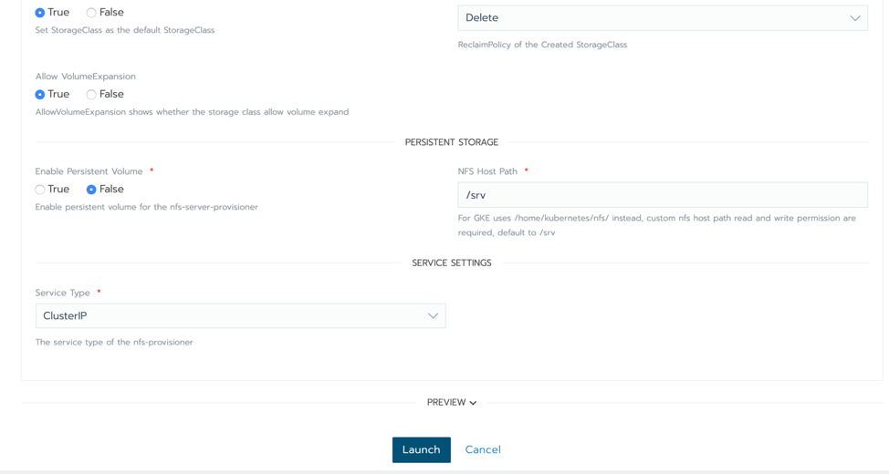
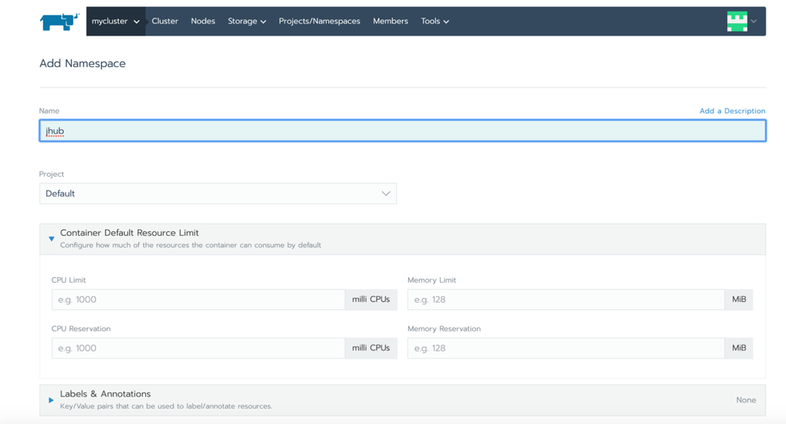
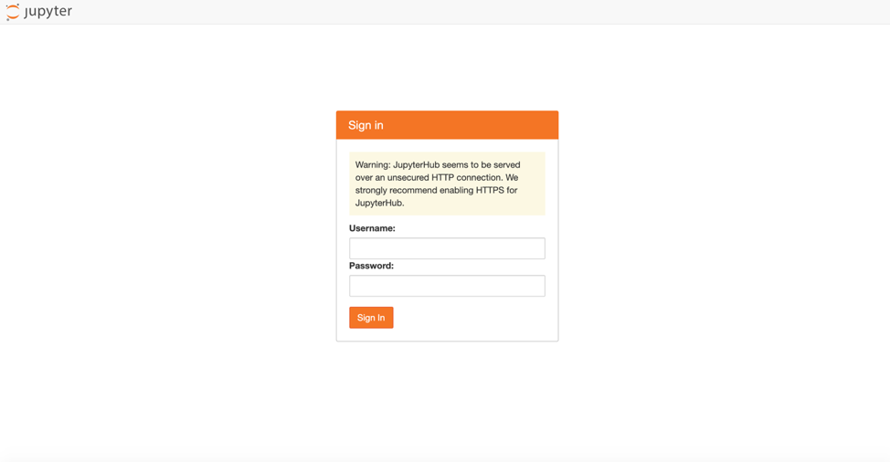
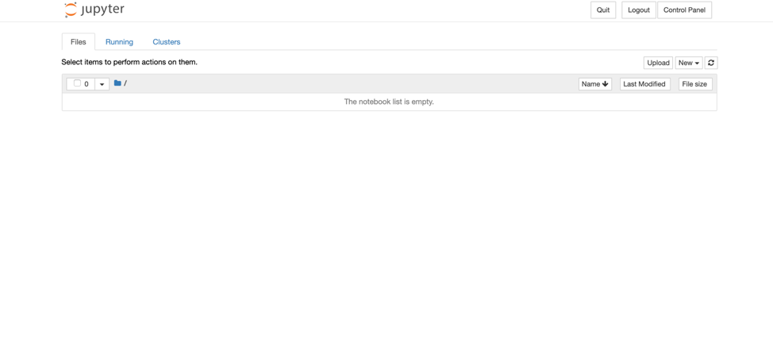
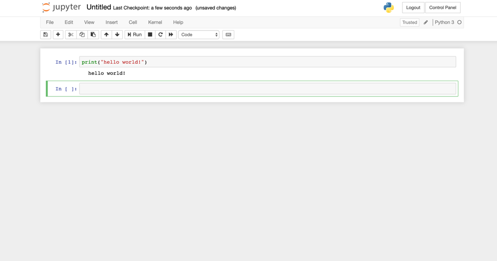

READ OUR FREE WHITE PAPER:How to Build an Enterprise Kubernetes Strategy[DOWNLOAD NOW](https://more.suse.com/fy21-global-web-landing-page-how-to-build-enterprise-kubernetes-strategy)

AI and Machine Learning are becoming critical differentiators in the technology landscape. By their nature, AI and ML are computation hungry workloads. They require best-in-class distributed computing environments to thrive. AI and ML present a perfect use case for Kubernetes, the distributed computing platform engineered at Google to run their massive workloads.

### What is JupyterHub?

[JupyterHub](https://jupyter.org/hub) is a multi-user data exploration tool that is often key for data science and machine learning research and development. It provides engineers, scientists, researchers and students the computational power of a cloud or data center while still being as easy to use as a local development environment. Essentially, JupyterHub gives users access to computational environments and resources without burdening them with installation and maintenance tasks. Users can work in their workspaces on shared resources, which can be managed efficiently by system administrators.

### Using Kubernetes in AI/ML Workloads

Kubernetes is great at allowing us to harness the power of a large distributed computing environment. Applying computing resources to a workload is easy because of its declarative (as opposed to imperative) design and its discovery-based approach to addressing servers. Often in AI/ML workloads, an engineer or researcher needs to allocate more resources. Kubernetes makes migrating that workload between physical infrastructure more feasible. In this article, we’ll show how to do just that by installing JupyterHub using Rancher.

### Installing JupyterHub Using Rancher

First, let’s assume we have a modern Kubernetes deployment in our Rancher environment. At the time of publication, the stable release of Kubernetes is 1.16. One of the prerequisites for JupyterHub is persistent storage, so you’ll want to think about how to provide that in this cluster. For purposes of demonstration, we can use the experimental NFS provisioner included in our catalog to provide persistent storage. Navigate to the App Catalog and select **Launch**. Then search for NFS provisioner. Leave the defaults as they are and click **Launch** at the bottom of the screen. If you already have a persistent storage solution, you can use that as well.


Navigating to the Rancher App Catalog


Searching for the NFS provisioner for persistent storage


Launching the NFS provisioner

Now that we have a storage provisioner and a default storage class defined, we can move on to deploying the application components. We’ll use Helm 3 to do this. [See the helm docs](https://helm.sh/docs/intro/install/) for installing the helm 3 client on your computer. Alternatively, you can also use the Rancher Catalog to deploy the helm chart, which doesn’t require any additional tooling. Be sure to [add the repo](https://rancher.com/docs/rancher/v2.x/en/catalog/custom/) to the Rancher catalog.

Before we use helm, we need to create a namespace for this application. In the Rancher UI, navigate to the cluster and select “Projects/Namespaces” in the top menu. There you can create a new namespace for JupyterHub. For this example, we’ll call the namespace “jhub”. Note of this name as we are going to use it in a bit.


Creating a namespace

Next, we can add the Helm repo for the JupyterHub chart we are going to use. If we are using the Rancher catalog, you’ll do this in the UI instead of the Helm CLI:

```
helm repo add jupyterhub https://jupyterhub.github.io/helm-chart/
helm repo update
```

After that, let’s create a config file that contains the settings we want to use with this chart. Let’s call the file config.yaml:

```
proxy:
  secretToken: "<secret token>"
ingress:
  enabled: true
  hosts:
    - <host name>
```

Let’s replace a couple of items to make them unique to our cluster. Replace secretToken with the output of:

```
openssl rand -hex 32
```

And replace  with a resolvable DNS name you plan to use to access the JyupiterHub UI.

Now that we’ve got that config file, we can install the chart. We are going to reference that config file, so make sure it exists in your current working directory:

```
RELEASE=jhub
NAMESPACE=jhub
helm upgrade --install $RELEASE jupyterhub/jupyterhub   --namespace $NAMESPACE    --version=0.8.2   --values config.yaml
```

Helm should now deploy the artifacts needed. It will take some time, but eventually you should be able to access the UI via the hostname you set earlier. You can check the status by going to the workloads tab in the Rancher UI as well. When we try the hostname we set in a browser, it should show the following login screen:


Hostname login screen

One issue at the time of this writing is a change made in Kubernetes 1.16 that causes Jyupiter Hub’s code to break when it tries to interact with the Kuberentes API. There is an issue [tracking this](https://github.com/jupyterhub/kubespawner/issues/354). For an immediate fix, we can run the following patch command:

```
kubectl patch deploy -n $NAMESPACE hub --type json --patch '[{"op": "replace", "path": "/spec/template/spec/containers/0/command", "value": ["bash", "-c", "nmkdir -p ~/hotfixncp -r /usr/local/lib/python3.6/dist-packages/kubespawner ~/hotfixnls -R ~/hotfixnpatch ~/hotfix/kubespawner/spawner.py << EOTn72c72n<             key=lambda x: x.last_timestamp,n---n>             key=lambda x: x.last_timestamp and x.last_timestamp.timestamp() or 0.,nEOTnnPYTHONPATH=$HOME/hotfix jupyterhub --config /srv/jupyterhub_config.py --upgrade-dbn"]}]'
```

That’s it: you now have a working JupyterHub environment deployed on Rancher. By default, JupyterHub uses PAM auth. So, to log in, any valid Linux user on your systems will work. When we login, we should be able to start creating new notebooks:


Jupyter login screen


Creating new notebooks

Alternatively, you can [check out the other auth options](https://zero-to-jupyterhub.readthedocs.io/en/latest/administrator/authentication.html) you might want to configure. For instance, you could use GitHub auth to allow users to login and create notebooks based on their Github ID. Once you choose an auth provider, update the config.yml file we worked on earlier per the instructions, and then re-run the helm upgrade command.

### Conclusion

In this article, we showed you how you can create scalable workspaces for data science and machine learning development by installing JupyterHub using Rancher. There are many more things you might consider for a full-featured JupyterHub installation, but today we’ve shown you how you can quickly set up a foundation. Enjoy the journey and let us know how it goes!

READ OUR FREE WHITE PAPER:How to Build an Enterprise Kubernetes Strategy[DOWNLOAD NOW](https://more.suse.com/fy21-global-web-landing-page-how-to-build-enterprise-kubernetes-strategy)
