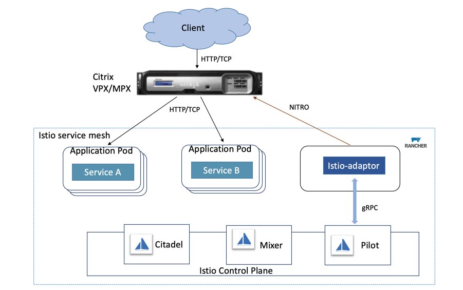

It has been five months since we [announced](/blog/announcing-harvester-open-source-hyperconverged-infrastructure-hci-software/) project Harvester, open source hyperconverged infrastructure (HCI) software built using Kubernetes. Since then, we’ve received a lot of feedback from the early adopters. This feedback has encouraged us and helped in shaping Harvester’s roadmap. Today, I am excited to announce the Harvester v0.2.0 release, along with the Beta availability of the project!

Let’s take a look at what’s new in [Harvester v0.2.0](https://github.com/harvester/harvester).

## Raw Block Device Support

We’ve added the raw block device support in v0.2.0. Since it’s a change that’s mostly under the hood, the updates might not be immediately obvious to end users. Let me explain more in detail:

In Harvester v0.1.0, the image to VM flow worked like this:

1. Users added a new VM image.
2. Harvester downloaded the image into the built-in MinIO object store.
3. Users created a new VM using the image.
4. Harvester created a new volume, and copied the image from the MinIO object store.
5. The image was presented to the VM as a block device, but it was stored as a file in the volume created by Harvester.

This approach had a few issues:

1. Read/write operations to the VM volume needed to be translated into reading/writing the image file, which performed worse compared to reading/writing the raw block device, due to the overhead of the filesystem layer.
2. If one VM image is used multiple times by different VMs, it was replicated many times in the cluster. This is because each VM had its own copy of the volume, even though the majority of the content was likely the same since they’re coming from the same image.
3. The dependency on MinIO to store the images resulted in Harvester keeping MinIO highly available and expandable. Those requirements caused an extra burden on the Harvester management plane.

In v0.2.0, we’ve took another approach to tackle the problem, which resulted in a simpler solution that had better performance and less duplicated data:

1. Instead of an image file on the filesystem, now we’re providing the VM with raw block devices, which allows for better performance for the VM.
2. We’ve taken advantage of a new feature called Backing Image in the Longhorn v1.1.1, to reduce the unnecessary copies of the VM image. Now the VM image will be served as a read-only layer for all the VMs using it. Longhorn is now responsible for creating another copy-on-write (COW) layer on top of the image for the VMs to use.
3. Since now Longhorn starts to manage the VM image using the Backing Image feature, the dependency of MinIO can be removed.

A comprehensive view of images in Harvester

From the user experience perspective, you may have noticed that importing an image is instantaneous. And starting a VM based on a new image takes a bit longer due to the image downloading process in Longhorn. Later on, any other VMs using the same image will take significantly less time to boot up, compared to the previous v0.1.0 release and the disk IO performance will be better as well.

## VM Live Migration Support

In preparation for the future upgrade process, VM live migration is now supported in Harvester v0.2.0.

VM live migration allows a VM to migrate from one node to another, without any downtime. It’s mostly used when you want to perform maintenance work on one of the nodes or want to balance the workload across the nodes.

One thing worth noting is, due to potential IP change of the VM after migration when using the default management network, we highly recommend using the VLAN network instead of the default management network. Otherwise, you might not be able to keep the same IP for the VM after migration to another node.

You can read more about [live migration support here](https://github.com/harvester/harvester/blob/master/docs/live-migration.md).

## VM Backup Support

We’ve added VM backup support to Harvester v0.2.0.

The backup support provides a way for you to backup your VM images outside of the cluster.

To use the backup/restore feature, you need an S3 compatible endpoint or NFS server and the destination of the backup will be referred to as the backup target.

You can get more details on how to set up the backup target in Harvester [here](https://github.com/harvester/harvester/blob/master/docs/backup-restore.md).

Easily manage and operate your virtual machines in Harvester

In the meantime, we’re also working on the snapshot feature for the VMs. In contrast to the backup feature, the snapshot feature will store the image state inside the cluster, providing VMs the ability to revert back to a previous snapshot. Unlike the backup feature, no data will be copied outside the cluster for a snapshot. So it will be a quick way to try something experimental, but not ideal for the purpose of keeping the data safe if the cluster went down.

## PXE Boot Installation Support

PXE boot installation is widely used in the data center to automatically populate bare-metal nodes with desired operating systems. We’ve also added the PXE boot installation in Harvester v0.2.0 to help users that have a large number of servers and want a fully automated installation process.

You can find more information regarding how to do the PXE boot installation in Harvester v0.2.0 [here](https://github.com/harvester/harvester/blob/master/docs/pxe-installation.md).

We’ve also provided a few examples of doing iPXE on public bare-metal cloud providers, including Equinix Metal. More information is available [here](https://github.com/harvester/ipxe-examples/blob/main/equinix/README.md).

## Rancher Integration

Last but not least, Harvester v0.2.0 now ships with a built-in Rancher server for Kubernetes management.

This was one of the most requested features since we announced Harvester v0.1.0, and we’re very excited to deliver the first version of the Rancher integration in the v0.2.0 release.

For v0.2.0, you can use the built-in Rancher server to create Kubernetes clusters on top of your Harvester bare-metal clusters.

To start using the built-in Rancher in Harvester v0.2.0, go to `Settings`, then set the `rancher-enabled` option to `true`. Now you should be able to see a `Rancher` button on the top right corner of the UI. Clicking the button takes you to the Rancher UI.

Harvester and Rancher share the authentication process, so once you’re logged in to Harvester, you don’t need to redo the login process in Rancher and vice versa.

If you want to create a new Kubernetes cluster using Rancher, you can follow the steps [here](http://if%20you%20want%20to%20create%20a%20new%20kubernetes%20cluster%20using%20ranc/). A reminder that VLAN networking needs to be enabled for creating Kubernetes clusters on top of the Harvester, since the default management network cannot guarantee a stable IP for the VMs, especially after reboot or migration.

## What’s Next?

Now with v0.2.0 behind us, we’re working on the v0.3.0 release, which will be the last feature release before Harvester reaches GA.

We’re working on many things for v0.3.0 release. Here are some highlights:

- Built-in load balancer
- Rancher 2.6 integration
- Replace K3OS with a small footprint OS designed for the container workload
- Multi-tenant support
- Multi-disk support
- VM snapshot support
- Terraform provider
- Guest Kubernetes cluster CSI driver
- Enhanced monitoring

You can get started today and give Harvester v0.2.0 a try via our [website](https://harvesterhci.io/).

Let us know what you think via the Rancher User Slack [#harvester](https://rancher-users.slack.com/archives/C01GKHKAG0K) channel. And start contributing by filing issues and feature requests via our [github page](https://github.com/harvester/harvester).

## Enjoy Harvester!
