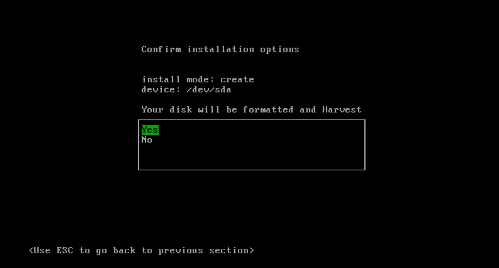
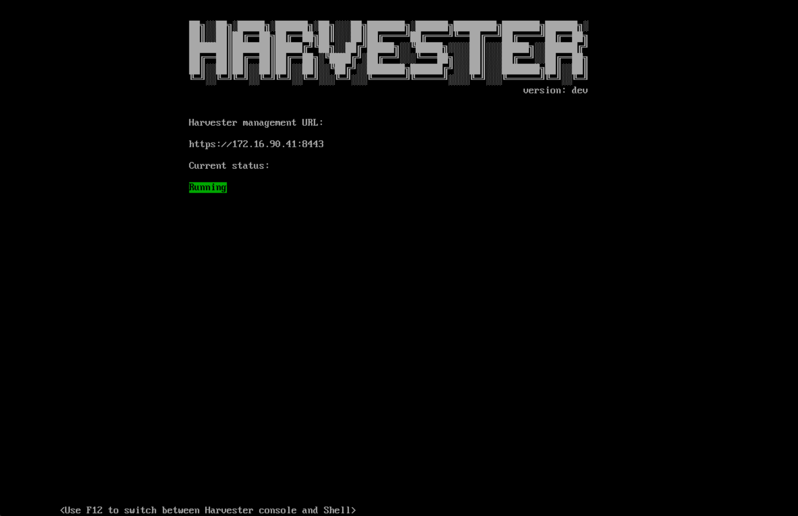
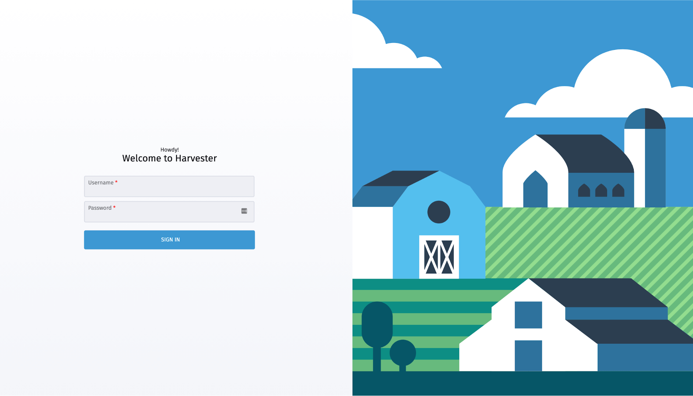
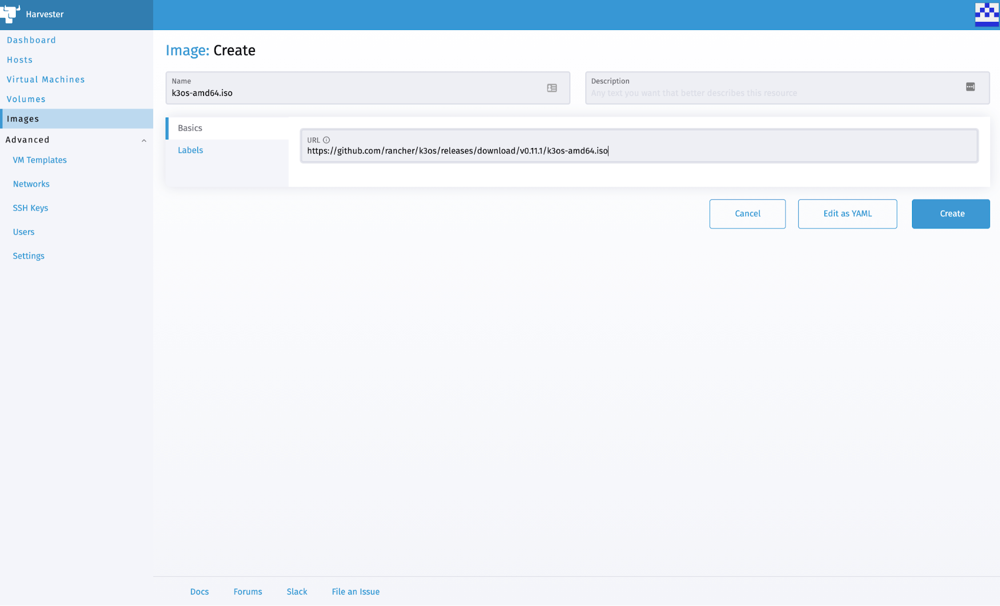
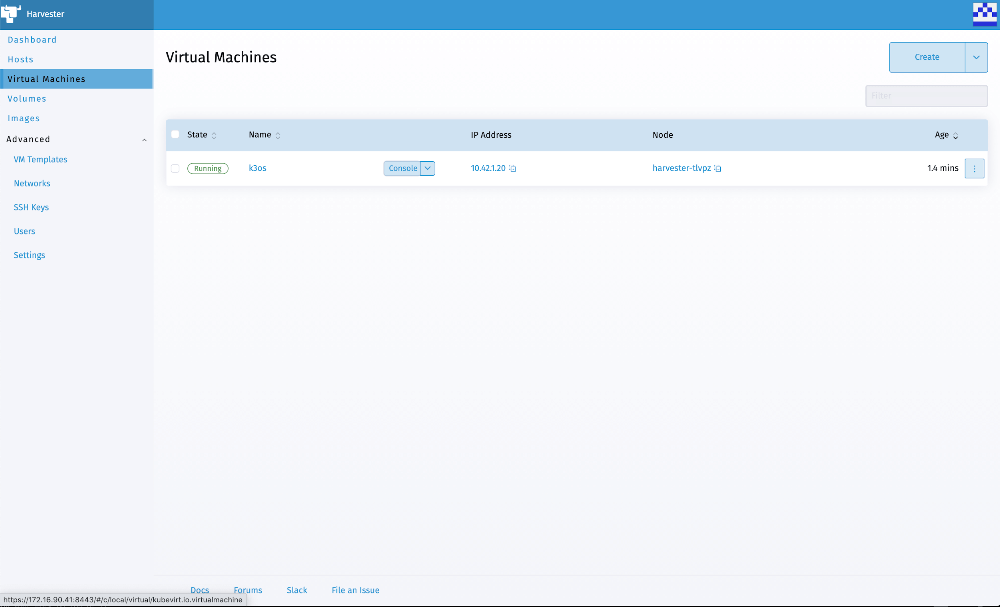
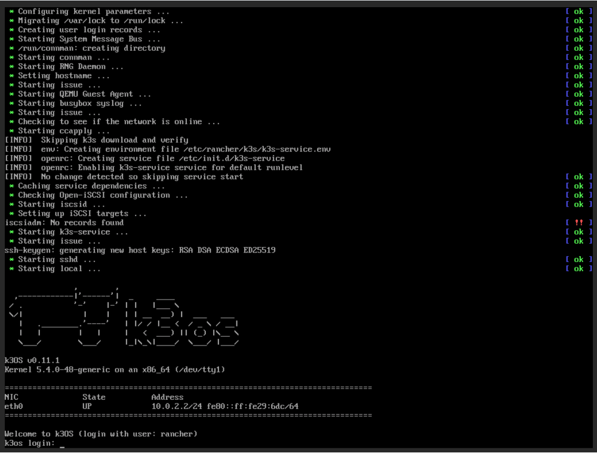

Today, I am excited to announce project [Harvester](http://harvesterhci.io/), open source hyperconverged infrastructure (HCI) software built using Kubernetes. Harvester provides fully integrated virtualization and storage capabilities on bare-metal servers. No Kubernetes knowledge is required to use Harvester.

## Why Harvester?

In the past few years, we’ve seen many attempts to bring VM management into container platforms, including our own RancherVM, and other solutions like KubeVirt and Virtlet. We’ve seen some demand for solutions like this, mostly for running legacy software side by side with containers. But in the end, none of these solutions have come close to the popularity of industry-standard virtualization products like vSphere and Nutanix.

We believe the reason for this lack of popularity is that all efforts to date to manage VMs in container platforms require users to have substantial knowledge of container platforms. Despite Kubernetes becoming an industry standard, knowledge of it is not widespread among VM administrators. They are familiar with concepts like ISO images, disk volumes, NICs and VLANS – not concepts like pods and PVCs.

*Enter Harvester.*

Project Harvester is an open source alternative to traditional proprietary hyperconverged infrastructure software. Harvester is built on top of cutting-edge open source technologies including Kubernetes, KubeVirt and [Longhorn](https://longhorn.io/). We’ve designed Harvester to be easy to understand, install and operate. Users don’t need to understand anything about Kubernetes to use Harvester and enjoy all the benefits of Kubernetes.

## Harvester v0.1.0

Harvester v0.1.0 has the following features:

### Installation from ISO

You can download ISO from the release page on Github and install it directly on bare-metal nodes. During the installation, you can choose to create a new cluster or add the current node into an existing cluster. Harvester will automatically create a cluster based on the information you provided.

### Install as a Helm Chart on an Existing Kubernetes Cluster

For development purposes, you can install Harvester on an existing Kubernetes cluster. The nodes must be able to support KVM through either hardware virtualization (Intel VT-x or AMD-V) or nested virtualization.

### VM Lifecycle Management

Powered by KubeVirt, Harvester supports creating/deleting/updating operations for VMs, as well as SSH key injection and cloud-init.

Harvester also provides a graphical console and a serial port console for users to access the VM in the UI.

### Storage Management

Harvester has a built-in highly available block storage system powered by Longhorn. It will use the storage space on the node, to provide highly available storage to the VMs inside the cluster.

### Networking Management

Harvester provides several different options for networking.

By default, each VM inside Harvester will have a management NIC, powered by Kubernetes overlay networking.

Users can also add additional NICs to the VMs. Currently, VLAN is supported.

The multi-network functionality in Harvester is powered by Multus.

### Image Management

Harvester has a built-in image repository, allowing users to easily download/manage new images for the VMs inside the cluster.

The image repository is powered by MinIO.

## Install

To install Harvester, just load the Harvester ISO into your bare-metal machine and boot it up.

For the first node where you install Harvester, select **Create a new Harvester cluster**.

Later, you will be prompted to enter the password that will be used to enter the console on the host, as well as “Cluster Token.” The Cluster Token is a token that’s needed later by other nodes that want to join the same cluster.

Then you will be prompted to choose the NIC that Harvester will use. The selected NIC will be used as the network for the management and storage traffic.

Once everything has been configured, you will be prompted to confirm the installation of Harvester.

Once installed, the host will be rebooted and boot into the Harvester console.

Later, when you are adding a node to the cluster, you will be prompted to enter the management address (which is shown above) as well as the cluster token you’ve set when creating the cluster.

See [here](https://youtu.be/97ADieBX6bE) for a demo of the installation process.

Alternatively, you can install Harvester as a Helm chart on your existing Kubernetes cluster, if the nodes in your cluster have hardware virtualization support. See [here](https://github.com/rancher/harvester/tree/master/deploy/charts/harvester) for more details. And [here](https://youtu.be/TG0GaAD_6J4) is a demo using Digital Ocean which supports nested virtualization.

## Usage

Once installed, you can use the management URL shown in the Harvester console to access the Harvester UI.

The default user name/password is documented [here](https://github.com/rancher/harvester/blob/master/docs/authentication.md).

Once logged in, you will see the dashboard.

The first step to create a virtual machine is to import an image into Harvester.

Select the **Images** page and click the **Create** button, fill in the URL field and the image name will be automatically filled for you.

Then click **Create** to confirm.

You will see the real-time progress of creating the image on the **Images** page.

Once the image is finished creating, you can then start creating the VM using the image.

Select the **Virtual Machine** page, and click **Create**.

Fill in the parameters needed for creation, including volumes, networks, cloud-init, etc. Then click **Create**.

VM will be created soon.

Once created, click the **Console** button to get access to the console of the VM.

See [here](https://youtu.be/wVBXkS1AgHg) for a UI demo.

## Current Status and Roadmap

Harvester is in the early stages. We’ve just released the v0.1.0 (alpha) release. Feel free to give it a try and let us know what you think.

We have the following items in our roadmap:

1. Live migration support
2. PXE support
3. VM backup/restore
4. Zero downtime upgrade

If you need any help with Harvester, please join us at either our [Rancher forums](https://forums.rancher.com/) or [Slack](https://slack.rancher.io/), where our team hangs out.

If you have any feedback or questions, feel free to file an issue on our [GitHub page](https://github.com/rancher/harvester/issues).

Thank you and enjoy Harvester!
