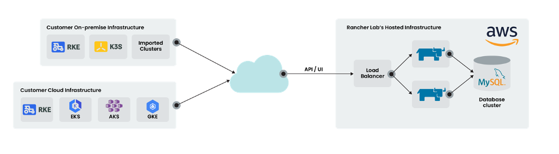

We’ve heard from many of our customers and prospects that they love Rancher but just don’t have the staff and expertise to operate the platform. Figuring out the compute, storage and networking architecture can be a challenge. Performing upgrades, backups and troubleshooting can also be time consuming. Monitoring the environment and knowing when to scale up or down, horizontally or vertically, is yet another thing to worry about. With so many cloud-based solutions out there, why is there not a hosted solution for Rancher?

## Hosted Rancher to the Rescue

I’m pleased to announce our new hosted service offering: Hosted Rancher. We have been hard at work on this new service and are excited to share this news. Hosted Rancher is exactly what it sounds like. We install and manage Rancher for you in our cloud environment. When we release a new version of Rancher, we’ll handle your upgrade. If there’s a kernel or software patch, we have you covered. Your DevOps team can focus entirely on using Rancher to manage your Kubernetes clusters, instead of worrying about how to operate it. You get a fully functional Rancher installation on dedicated infrastructure. Rancher will manage your Kubernetes clusters in AWS, Azure, Google Cloud and DigitalOcean, as well as your on-premise VM-based or bare metal clusters.

Hosted Rancher: high-level architecture

## Hosted Rancher: Under the Hood

Let’s take a look under the hood to see how we built Hosted Rancher. We followed several best practices, including infrastructure as code (IaC), immutable infrastructure and a “Shift Left” approach. We chose Packer, Terraform and GitHub as the tooling. We’ve baked a fair amount of what is needed to deploy our infrastructure into the OS image. This allows us to quickly bring up new environments. Combined with the ease of swapping out OS images in a live environment, we can provide patches and software updates quickly with minimal or no downtime.

## K3s Lightweight Kubernetes Distro

It was also important to us to “eat our own dog food,” or as I like to say, “drink our own champagne.” Starting with Rancher v2.4, you can run your highly available cluster on top of K3s, Rancher’s lightweight Kubernetes distribution. It’s simple and fast and consumes fewer resources than traditional Kubernetes distributions. K3s also allows us to use a relational backend database cluster. We choose Amazon’s Aurora offering, which is part of their RDS service.

We are also using Rancher to manage Rancher. What does that mean? Each Rancher K3s-based cluster we spin up is managed by our operations Rancher cluster. We even deploy Rancher on each customer’s Hosted Rancher infrastructure using the Rancher application catalog. This allows us to use our operations Rancher cluster to monitor and upgrade all our customer’s Hosted Ranchers.

## World-Class Support

What about support? At Rancher Labs, we pride ourselves on our world-class support. We normally far exceed our response times for severity 1 and 2 tickets filed by our customers. See our [Terms of Service](https://rancher.com/support-maintenance-terms/) for more on that. In addition to the world-class support we offer to our Platinum and Standard customers, we will offer a 99.9 percent SLA for Hosted Rancher.

Our roadmap for Hosted Rancher is still taking shape and we look forward to your feedback. Security and compliance are very important to us. We are using encryption and security best practices wherever possible and exploring industry standards such as SOC 2 and ISO compliance.

## Next Steps

Want to see how Hosted Rancher works? [Please contact our sales team](https://rancher.com/contact/) for a demo. Meanwhile, [see what’s new in Rancher 2.4](https://rancher.com/products/rancher/2.4).
