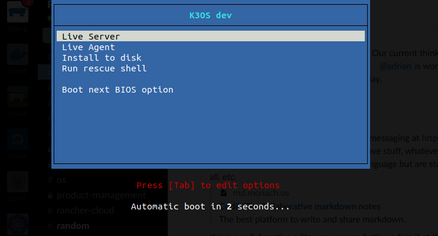

k3OS Online MeetupLearn to install and run k3OS and k3s in resource constrained environments like the edge, configure and update k3OS, and scale Kubernetes management with k3OS and k3s.[Watch the Meetup](https://info.rancher.com/introducing-k3os-online-meetup)

Today we launched a new open source project called [k3OS](https://k3os.io/). K3OS is a Linux distro built for the sole purpose of running Kubernetes clusters. In fact, it is a Linux distro and the [k3s](https://k3s.io/) Kubernetes distro in one! As soon as you boot up a k3OS node, you have Kubernetes up and running. When you boot up multiple k3OS nodes, they form a Kubernetes cluster. K3OS is perhaps the easiest way to stand up [Kubernetes clusters](https://rancher.com/kubernetes/) on any server.

## Why a Combined Linux and Kubernetes Distro?

At Rancher Labs, we have been building Kubernetes distros that run on popular Linux distros like Ubuntu, CentOS, and RHEL for many years. We have always encountered an issue in Kubernetes operations: the need to patch and upgrade Linux and Kubernetes separately. This leads to a couple of challenges:

1. Some operations teams patch Kubernetes aggressively but neglect to patch the underlying Linux operating system. This practice introduces significant security risks to the Kubernetes cluster. Unpatched CVEs in the underlying operating system threaten the security of the entire cluster.
2. Other operations teams patch the underlying Linux installation, but they do so at an independent schedule without coordinating with their Kubernetes installation. Even though Kubernetes is designed to withstand individual node reboots, uncoordinated operating system upgrades can cause multiple nodes to become unavailable at the same time. This can cause the Kubernetes master to lose quorum or disrupt the application workload.

Both Linux and Kubernetes are part of the foundational computing platform. Combining a Linux distro with a Kubernetes distro into a Kubernetes OS simplifies Kubernetes cluster operations and improves system security and reliability.

## An Operating System Managed by Kubernetes

K3OS combines a Linux distro with k3s, and it goes one step further to enable Linux system administration through Kubernetes. You no longer need to login to servers to manage them. The operations team can reconfigure Linux or trigger the upgrade of the entire Kubernetes cluster using a kubectl command. The upgrade process will cover both Kubernetes and the underlying Linux distro. The upgrade process can drain nodes and sequence server reboots to minimize workload disruption and eliminate the risk of quorum loss.

## Minimum Attack Surface for Improved Security

In creating k3OS, we were able to eliminate all components in normal Linux distros that are not required to run Kubernetes. For example, k3OS does not need a sophisticated init system like systemd or a package manager.

Wherever possible we built on existing open source Linux distros with proven community support and security focus. We use the Ubuntu kernel which has excellent up-to-date support for recent kernel versions. We leverage the tooling and packaging of the lightweight Alpine Linux distro.

## Lightweight Linux+Kubernetes for Edge Computing

K3OS is ideally suited for deploying k3s clusters in resource-constrained computing environments. At Rancher Labs, we are creating a suite of technologies to enable Kubernetes to become the platform of choice for edge computing:

1. K3OS with its embedded k3s clusters will power application workloads on edge devices.
2. Rancher 2.x will play the role of a fleet manager, providing centralized management of tens of thousands of k3OS nodes and k3s clusters.

We hope you are as excited as we are about what k3OS can bring to Kubernetes operations. Visit the k3OS website at [https://k3os.io](https://k3os.io/) or watch the recording of our [online meetup](https://info.rancher.com/introducing-k3os-online-meetup) where we demo k3OS features and discuss the technical details.

k3OS Online MeetupLearn to install and run k3OS and k3s in resource constrained environments like the edge, configure and update k3OS, and scale Kubernetes management with k3OS and k3s.[Watch the Meetup](https://info.rancher.com/introducing-k3os-online-meetup)
