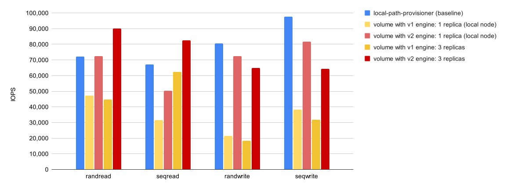
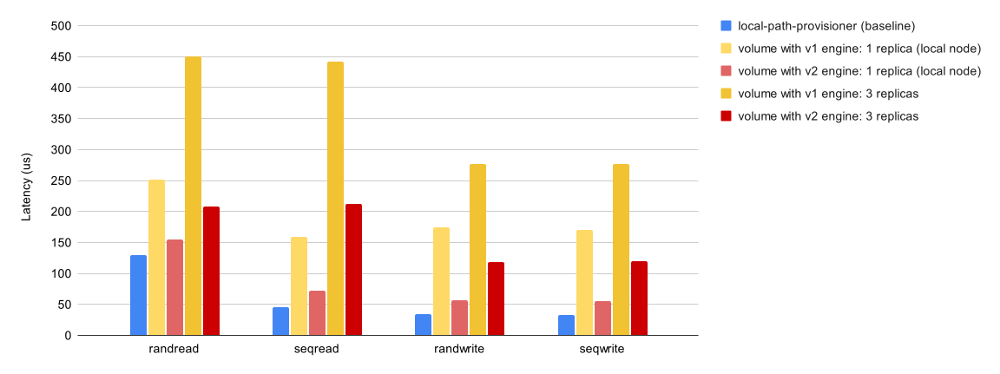

The Longhorn team is excited to announce the latest minor release, [version 1.6.0](https://github.com/longhorn/longhorn/releases/tag/v1.6.0)! This release introduces several features, enhancements, and bug fixes that are intended to improve system quality and the overall user experience.

Specifically, this release includes a further feature preview of the highly anticipated [Longhorn Data Engine Version 2.0](https://longhorn.io/docs/1.6.0/v2-data-engine/quick-start/), platform-agnostic deployment, node maintenance, and improvements to stability, performance, and resilience.

The Longhorn team appreciates the community contributions and is looking forward to receiving feedback regarding this release.

### Longhorn Data Engine Version 2.0 Feature (Technical Preview)

The core functions of the Longhorn Data Engine Version 2.0 (v2 Data Engine) have been significantly enhanced; you can now seamlessly perform volume backup and restore operations between the version 1 and 2 data engines, paving the way for volume migration between the two data engines in the future.

Longhorn’s V2 Data Engine harnesses the power of the SPDK to elevate its overall performance. The integration significantly reduces I/O latency while simultaneously boosting IOPS and throughput. The enhancement provides a high-performance storage solution capable of meeting diverse workload demands.

Longhorn Performance - IOPS:

In comparison to the V1 engine, Longhorn saw a 2 to 4 times improvement for write, 2 to 3 times improvement for random read, and single replica IOPS is comparable with that of the local disk.

Longhorn Performance - Latency:

In comparison to the V1 engine, Longhorn saw a 50-70% decrement for latency and the single replica read/write latency was comparable with that of the local disk.

For more information on the performance improvements, see the [performance documentation](https://longhorn.io/docs/1.6.0/v2-data-engine/performance/).

The Longhorn team will continue to develop features for the V1 Data Engine and to prepare the V2 Data Engine for use in all types of environments.

### Platform-Agnostic Deployment

Longhorn is designed to seamlessly operate on general-purpose Linux distributions, and on certain container-optimized systems such as [SLE Micro](https://www.suse.com/products/micro/). In response to numerous requests, v1.6.0 was enhanced to allow installation of Longhorn components on [Talos](https://www.talos.dev/), which is a secure, immutable, and minimal Kubernetes OS. v1.6.0 also includes OKD support, thanks to the community for this feature.

The Longhorn team is committed to making Longhorn an adaptive storage solution and anticipates receiving feedback regarding your preferred platforms.

### Space Efficiency

Longhorn also now allows you to configure the maximum snapshot count and the maximum aggregate snapshot size for all volumes and for specific volumes. Both settings, whether applied globally or individually, aid in space estimation and management. Earlier Longhorn versions do not provide mechanisms for controlling or predicting the quantity and size of volume snapshots.

### Other notable changes

Other notable changes in the Longhorn 1.6.0 release include:

- Longhorn has been validated with popular GitOps solutions, including [Flux](https://github.com/longhorn/longhorn/issues/6343), [Argo CD](https://github.com/longhorn/longhorn/issues/6434), and [Fleet](https://github.com/longhorn/longhorn/issues/6935).
- Support for block volume encryption
- Two new node drain policy options: *Block For Eviction* and *Block For Eviction If Contains Last Replica*
- Backing Image Management, which allow you to create and restore backups of backing images

### More information

For information about issues identified after this release, see [Release-Known-Issues](https://github.com/longhorn/longhorn/wiki/Release-Known-Issues). For information about important changes, including feature incompatibility, deprecation, and removal, see [Important Notes](https://longhorn.io/docs/1.6.0/deploy/important-notes/) in the Longhorn documentation. If you would like to know more about the release notes, please check them out [here](https://github.com/longhorn/longhorn/releases/tag/v1.6.0). For more information on supportability, see the [support matrix](https://www.suse.com/suse-longhorn/support-matrix/all-supported-versions/longhorn-v1-6-x/) and the [lifecycle](https://www.suse.com/lifecycle/#longhorn) page.

We invite you to start exploring and using Longhorn v1.6.0. You can share your feedback with us through our [Slack channel](https://rancher-users.slack.com/archives/CC2UQM49Y) or [GitHub](https://github.com/longhorn/longhorn/).

##
