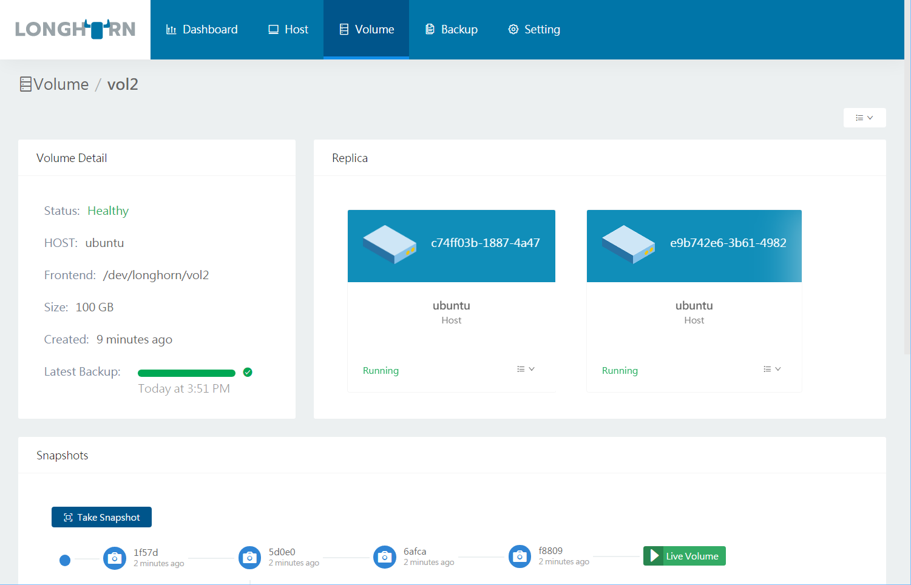
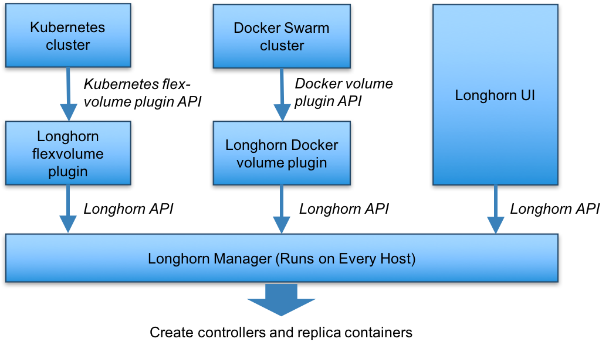
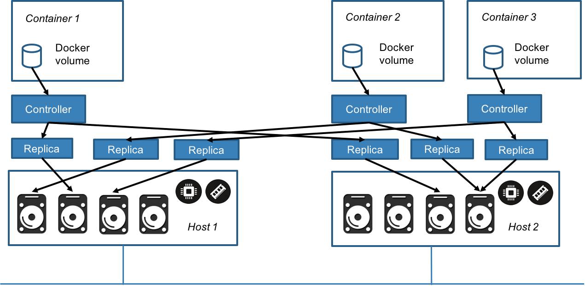
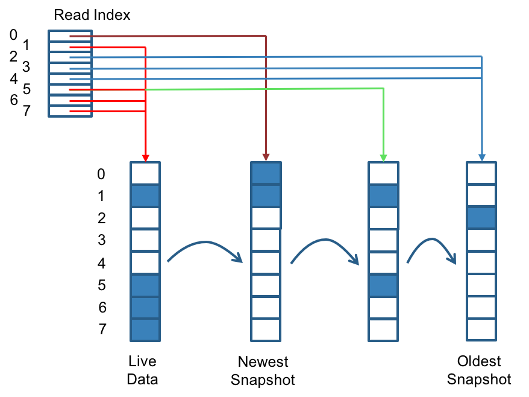
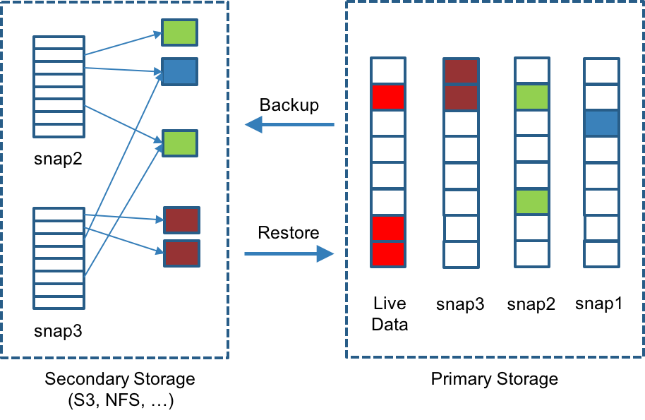
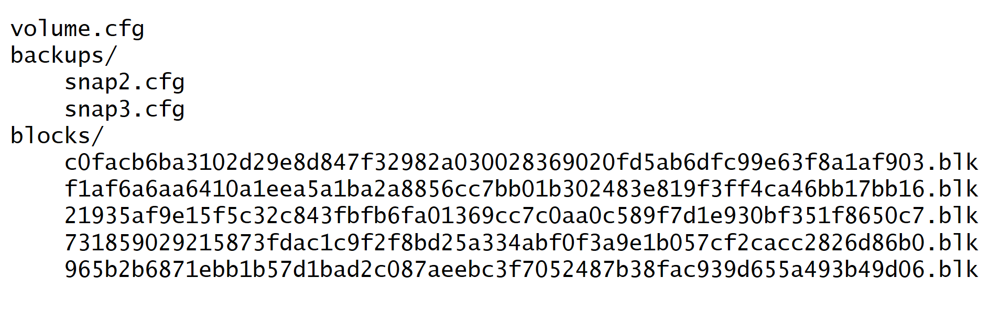
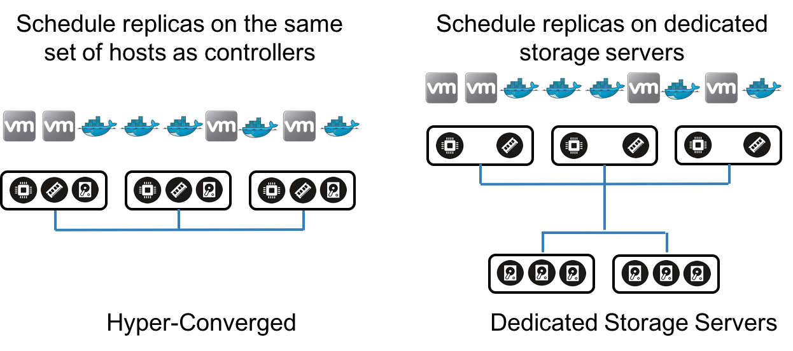

*Editor’s note: On June 2, 2020, Rancher Labs announced the [general availability of Longhorn](/blog/longhorn-simplifies-distributed-block-storage-in-kubernetes/), an enterprise-grade, cloud-native container storage solution. Longhorn directly answers the need for an enterprise-grade, vendor-neutral persistent storage solution that supports the easy development of stateful applications within Kubernetes.*

I’m super excited to unveil [Project Longhorn](https://github.com/rancher/longhorn), a new way to build distributed block storage for container and cloud deployment models. Following the principles of microservices, we have leveraged containers to build distributed block storage out of small independent components, and use container orchestration to coordinate these components to form a resilient distributed system.

## Why Longhorn?

To keep up with the growing scale of cloud- and container-based deployments, distributed block storage systems are becoming increasingly sophisticated. The number of volumes a storage controller serves continues to increase. While storage controllers in the early 2000s served no more than a few dozen volumes, modern cloud environments require tens of thousands to millions of distributed block storage volumes. Storage controllers have therefore become highly complex distributed systems.

Distributed block storage is inherently simpler than other forms of distributed storage such as file systems. No matter how many volumes the system has, each volume can only be mounted by a single host. Because of this, it is conceivable that we should be able to partition a large block storage controller into a number of smaller storage controllers, as long as those volumes can still be built from a common pool of disks and we have the means to orchestrate the storage controllers so they work together coherently.

We created the Longhorn project to push this idea to the limit. We believe this approach is worth exploring as each controller only needs to serve one volume, simplifying the design of the storage controllers. Because the failure domain of the controller software is isolated to individual volumes, a controller crash will only impact one volume.

Longhorn leverages the tremendous body of knowledge and expertise developed in recent years on how to orchestrate a very large number of containers and virtual machines. For example, instead of building a highly-sophisticated controller that can scale to 100,000 volumes, Longhorn makes storage controllers simple and lightweight enough so that we can create 100,000 separate controllers. We can then leverage state-of-the-art orchestration systems like Swarm, Mesos, and Kubernetes to schedule these separate controllers, drawing resources from a shared set of disks as well as working together to form a resilient distributed block storage system.

The microservices-based design of Longhorn has some other benefits. Because each volume has its own controller, we can upgrade the controller and replica containers for each volume without causing a noticeable disruption in IO operations. Longhorn can create a long-running job to orchestrate the upgrade of all live volumes without disrupting the on-going operation of the system. To ensure that an upgrade does not cause unforeseen issues, Longhorn can choose to upgrade a small subset of the volumes and roll back to the old version if something goes wrong during the upgrade.

These practices are widely adopted in modern microservices-based applications, but they are not as common in storage systems. We hope Longhorn can help make the practices of microservices more common in the storage industry.

## Overview of Features

At a high level, Longhorn allows you to:

- **Pool local disks or network storage** mounted in compute or dedicated storage hosts.
- **Create block storage volumes for containers and virtual machines.** You can specify the size of the volume, IOPS requirements, and the number of synchronous replicas you want across the hosts that supply the storage resource for the volume. Replicas are thin-provisioned on the underlying disks or network storage.
- **Create a dedicated storage controller for each volume.** This is perhaps the most unique feature of Longhorn compared to most existing distributed storage systems, which are typically built with sophisticated controller software and can serve anywhere from hundreds to millions of volumes. With the one controller per volume approach, Longhorn turns each volume into a microservice.
- **Schedule multiple replicas across multiple compute or storage hosts.** Longhorn monitors the health of each replica and performs repairs, rebuilding the replica when necessary.
- **Operate storage controllers and replicas as Docker containers.** A volume with three replicas, for example, will result in four containers.
- **Assign multiple storage “frontends” for each volume.** Common front-ends include a Linux kernel device (mapped under /dev/longhorn) and an iSCSI target. A Linux kernel device is suitable for backing Docker volumes whereas an iSCSI target is more suited for backing QEMU/KVM and VMware volumes.
- **Create volume snapshots and AWS EBS-style backups.** You can create up to 254 snapshots for each volume, which can be backed up incrementally to NFS or S3-compatible secondary storage. Only changed bytes are copied and stored during backup operations.
- **Specify schedules for recurring snapshot and backup operations.** You can specify the frequency of these operations (hourly, daily, weekly, monthly, and yearly), the exact time at which these operations are performed (e.g., 3:00am every Sunday), and how many recurring snapshots and backup sets are kept.

Longhorn is 100% open source software. You can download [Longhorn on GitHub](https://github.com/rancher/longhorn).

## Quick Start Guide

Longhorn is easy to setup and easy to use. You can setup everything you need to run Longhorn on a single Ubuntu 16.04 server. Just make sure Docker is installed, and the `open-iscsi` package is installed. Run the following commands to setup Longhorn on a single host:

```
git clone https://github.com/rancher/longhorn
cd longhorn/deploy
./longhorn-setup-single-node-env.sh
```

The script pulls and starts multiple containers, including the etcd key-value store, Longhorn volume manager, Longhorn UI, and Longhorn docker volume plugin container. After this script completes, it produces the following output:

```
Longhorn is up at port 8080
```

You can leverage the UI by connecting to `http://<hostname_or_IP>:8080`.
The following is the volume details screen:



You can now create persistent Longhorn volumes from the Docker CLI:

```
docker volume create -d longhorn vol1
docker run -it --volume-driver longhorn -v vol1:/vol1 ubuntu bash
```

The single-host Longhorn setup runs etcd and all volume replicas on the same host, and is therefore not suitable for production use. The [Longhorn GitHub
page](https://github.com/rancher/longhorn) contains additional instructions for a production-grade multi-host setup using separate etcd servers, Docker swarm mode clusters, and a separate NFS server for storing backups.

## Longhorn and Other Storage Systems

We wrote Longhorn as an experiment to build distributed block storage using containers and microservices. Longhorn is not designed to compete with or replace existing storage software and storage systems for the following reasons:

- Longhorn is narrowly focused on distributed block storage. Distributed file storage, on the other hand, is much harder to build. Software systems like Ceph, Gluster, Infinit (acquired by Docker), Quobyte, Portworx, and StorageOS, as well as storage systems from NetApp, EMC, etc., offer distributed file systems, a unified storage experience, enterprise data management, and many other enterprise-grade features not supported by Longhorn.
- Longhorn requires an NFS share or S3-compatible object storage to store volume backups. It therefore works with network file storage from NetApp, EMC Isilon, or other vendors, as well as S3-compatible object storage endpoints from AWS S3, Minio, SwiftStack, Cloudian, etc.
- Longhorn lacks enterprise-grade storage features such as deduplication, compression, and auto-tiering as well as the ability to stripe a large volume into smaller chunks. As such, Longhorn volumes are limited by the size and performance of an individual disk. The iSCSI target runs as a user-level process. It lacks the performance, reliability, and multi-path support of the enterprise-grade iSCSI systems we see in distributed block storage products such as Dell EqualLogic, SolidFire, and Datera.

We built Longhorn to be simple and composable, and hope that it can serve as a testbed for ideas around building storage using containers and microservices. It is written entirely in Go (commonly referred to as golang), the language of choice for modern systems programming. The remainder of the blog post describes Longhorn in detail. It provides a preview of the system as it stands today — not every feature described has been implemented. However, we will continue the work to bring the vision of project Longhorn to reality.

## Volume as a Microservice

The Longhorn volume manager container runs on each host in the Longhorn cluster. Using Rancher or Swarm terminology, the Longhorn volume manager is a global service. If you are using Kubernetes, the Longhorn volume manager is considered a DaemonSet. The Longhorn volume manager handles the API calls from the UI or the volume plugins for Docker and Kubernetes. You can find a [description of Longhorn APIs](https://github.com/rancher/longhorn-manager/wiki/Longhorn-Manager-API) here.

The figure below illustrates the control path of Longhorn in the context
of Docker Swarm and Kubernetes.



When the Longhorn manager is asked to create a volume, it creates a controller container on the host the volume is attached to as well as the hosts where the replicas will be placed. Replicas should be placed on separate hosts to ensure maximum availability.

In the figure below, there are three containers with Longhorn volumes. Each Docker volume has a dedicated controller, which runs as a container. Each controller has two replicas and each replica is a container. The arrows in the figure indicate the read/write data flow between the Docker volume, controller container, replica containers, and disks. By creating a separate controller for each volume, if one controller fails, the function of other volumes is not impacted.



For example, in a large-scale deployment with 100,000 Docker volumes each with two replicas, there will be 100,000 controller containers and 200,000 replica containers. In order to schedule, monitor, coordinate, and repair all these controllers and replicas a storage orchestration system is needed.

## Storage Orchestration

Storage orchestration schedules controllers and replicas, monitors various components, and recovers from errors. The Longhorn volume manager performs all the storage orchestration operations needed to manage the volume life cycles. You can find the details of [how the Longhorn volume manager performs storage orchestration](https://github.com/longhorn/longhorn-manager/wiki/Longhorn-Manager-Design) here.

The controller functions like a typical mirroring RAID controller, dispatching read and write operations to its replicas and monitoring the health of the replicas. All write operations are replicated synchronously. Because each volume has its own dedicated controller and the controller resides on the same host the volume is attached to, we do not need a high availability (HA) configuration for the controller. The Longhorn volume manager is responsible for picking the host where the replicas will reside. It then checks the health of all the replicas and performs the necessary operations to rebuild faulty replicas.

## Replica Operations

Longhorn replicas are built using Linux sparse files, which support thin provisioning. We currently do not maintain additional metadata to indicate which blocks are used. The block size is 4K. When you take a snapshot, you create a differencing disk. As the number of snapshots grows, the differencing disk chain could get quite long. To improve read performance, Longhorn therefore maintains a read index that records which differencing disk holds valid data for each 4K block.

In the following figure, the volume has eight blocks. The read index has eight entries and is filled up lazily as read operation takes place. A write operation resets the read index, causing it to point to the live data.



The read index is kept in memory and consumes one byte for each 4K block. The byte-sized read index means you can take as many as 254 snapshots for each volume. The read index consumes a certain amount of in-memory data structure for each replica. A 1TB volume, for example, consumes 256MB of in-memory read index. We will potentially consider placing the read index in memory-mapped files in the future.

## Replica Rebuild

When the controller detects failures in one of its replicas, it marks the replica as being in an error state. The Longhorn volume manager is responsible for initiating and coordinating the process of rebuilding the faulty replica as follows:

- The Longhorn volume manager creates a blank replica and calls the controller to add the blank replica into its replica set.
- To add the blank replica, the controller performs the following operations:
  - Pauses all read and write operations.
  - Adds the blank replica in WO (write-only) mode.
  - Takes a snapshot of all existing replicas, which will now have a blank differencing disk at its head.
  - Unpauses all read the write operations. Only write operations will be dispatched to the newly added replica.
  - Starts a background process to sync all but the most recent differencing disk from a good replica to the blank replica.
  - After the sync completes, all replicas now have consistent data, and the volume manager sets the new replica to RW (read-write) mode.
- The Longhorn volume manager calls the controller to remove the faulty replica from its replica set.

It is not very efficient to rebuild replicas from scratch. We can improve rebuild performance by trying to reuse the sparse files left from the faulty replica.

## Backup of Snapshots

I love how Amazon EBS works — every snapshot is automatically backed up to S3. Nothing is retained in primary storage. We have, however, decided to make Longhorn snapshots and backup slightly more flexible. Snapshot and backup operations are performed separately. EBS-style snapshots can be simulated by taking a snapshot, backing up the differences between this snapshot and the last snapshot, and deleting the last snapshot.

We also developed a recurring backup mechanism to help you perform such operations automatically. We achieve efficient incremental backups by detecting and transmitting the changed blocks between snapshots. This is a relatively easy task since each snapshot is a differencing file and only stores the changes from the last snapshot. To avoid storing a very large number of small blocks, we perform backup operations using 2MB blocks. That means that, if any 4K block in a 2MB boundary is changed, we will have to backup the entire 2MB block. We feel this offers the right balance between manageability and efficiency.

In the following figure, we have backed up both snap2 and snap3. Each backup maintains its own set of 2MB blocks, and the two backups share one green block and one blue block. Each 2MB block is backed up only once. When we delete a backup from secondary storage, we of course cannot delete all the blocks it uses. Instead we perform garbage collection periodically to clean up unused blocks from secondary storage.



Longhorn stores all backups for a give volume under a common directory. The following figure depicts a somewhat simplified view of how Longhorn stores backups for a volume. Volume-level metadata is stored in volume.cfg.

The metadata files for each backup (e.g., snap2.cfg) are relatively small because they only contain the offsets and check sums of all the 2MB blocks in the backup. The 2MB blocks for all backups belonging to the same volume are stored under a common directory and can therefore be shared across multiple backups. The 2MB blocks (.blk files) are compressed. Because check sums are used to address the 2MB blocks, we achieve some degree of deduplication for the 2MB blocks in the same volume.



Volume-level metadata is stored in volume.cfg. The metadata files for each backup (e.g., snap2.cfg) are relatively small because they only contain the offsets and check sums of all the 2MB blocks in the backup. The 2MB blocks for all backups belonging to the same volume are stored under a common directory and can therefore be shared across multiple backups. The 2MB blocks (.blk files) are compressed. Because check sums are used to address the 2MB blocks, we achieve some degree of deduplication for the 2MB blocks in the same volume.

## Two Deployment Models

The Longhorn volume manager performs the task of scheduling replicas to nodes. We can tweak the scheduling algorithm to place the controller and replica in different ways. The controller is always placed on hosts where the volume is attached. The replicas, on the other hand, can either go on the same set of compute servers running the controller or on a dedicated set of storage servers. The former constitutes a hyper-converged deployment model whereas the latter constitutes a dedicated storage server model.



## What We Have Accomplished and Unfinished Tasks

A useful set of Longhorn features are working today. You can:

- Create distributed volumes on a Docker Swarm cluster, and consume those volumes in Docker containers.
- Perform fault detection and rebuild replicas.
- Create snapshots, backups, and recurring snapshots and backups.
- Leverage the fully functional UI and API.

We will continue to improve the codebase to add the following features in the coming weeks and months:

- Kubernetes flexvolume driver for Longhorn.
- Rancher integration, enabling automated deployment of Longhorn clusters from the Rancher catalog.
- Ability to upgrade controller and replica container without bringing the volume offline.
- An event log for Longhorn orchestration activities (such as replica rebuild).
- Ability to backup to S3 as well as NFS. The code for S3 backup already exists, but we need a mechanism to manage API credentials.
- Replica scheduling based on disk capacity and IOPS. Currently we use a simple anti-affinity-based scheduler to pick hosts for replicas.
- Support for multiple disks on the same host.
- Volume stats, including throughput and IOPS.
- Authentication and user management of the Longhorn UI and API.
- Volume encryption.
- Performance tuning. We have done quite a bit of stress testing, but have done very little performance tuning so far. Our friends at OpenEBS recently published some initial [benchmark results](https://blog.openebs.io/initial-performance-numbers-with-openebs-94d2df2599d0), which showed that Longhorn performance appeared acceptable.

## Acknowledgements

It takes a lot of people and effort to build a storage system. The initial ideas for Project Longhorn was formed during a discussion Darren Shepherd and I had in 2014 when we started Rancher Labs. I was very impressed with the work Sage Weil did to build Ceph, and felt we could perhaps decompose a sophisticated storage system like Ceph into a set of simple microservices built using containers. We decided to focus on distributed block storage since it is easier to build than a distributed file system.

We hired a small team of engineers, initially consisting of Oleg Smolsky and Kirill Pavlov, and later joined by Jimeng Liu, to build a set of C++ components that constitute the initial controller and replica logic. Darren Shepherd and Craig Jellick built the initial orchestration logic for volume life cycle management and replica rebuild using the Rancher platform’s orchestration engine (Cattle). Sheng Yang built the Convoy Docker volume driver and Linux device integration using the Linux TCMU driver. We were also able to leverage Sheng Yang’s work on incremental backup of device mapper volumes in Convoy. Sangeetha Hariharan led the QA effort for the project as we attempted to integrate the initial system and make everything work.

Building that initial system turned out to be a great learning experience. About a year ago, we proceeded with a rewrite. Darren simplified the core controller and replica logic and rewrote the Longhorn core components in Go. TCMU required too many kernel patches. Though we were able to upstream the required kernel patches, we missed the merge window for popular Linux distributions like Ubuntu 16.04 and CentOS 7.x. As a result, off-the-shelf Linux distros do not contain our TCMU patches.

Sheng Yang, who ended up owning the Longhorn project, rewrote the frontend using [Open-iSCSI](http://www.open-iscsi.com/) and [tgt](http://stgt.sourceforge.net/). Open-iSCSI is a standard Linux utility available on all Linux server distributions. It comes pre-installed on Ubuntu 16.04. Tgt is a user-level program we can bundle into containers and distribute with Longhorn. Ivan Mikushin rewrote the Longhorn orchestration logic from Rancher orchestration to standalone Go code and, as we later found out, following a pattern similar to the CoreOS etcd operator. Logan Zhang and Aaron Wang developed the Longhorn UI. Several outside teams have collaborated with us during the project. Shenzhen Cloudsoar Networks, Inc. funded some of the development efforts. The CoreOS Torus project wrote a [Go TCMU
driver](https://github.com/coreos/go-tcmu). [OpenEBS](https://www.openebs.io/) incorporated Longhorn into their product.

## Check Out Our Code

If you are interested in learning more about the code and design of the project, check out the [source code and docs](https://github.com/rancher/longhorn). You can file issues on [GitHub](https://github.com/rancher/longhorn)
or visit the Longhorn [forum](https://forums.rancher.com/c/longhorn).
