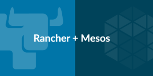

[I
am excited to announce that Rancher officially supports Mesos, one of
the most popular distributed cluster managers on the market today. Mesos
is able to manage a large number of computing hosts and schedule
computing jobs to these hosts according to their CPU, memory, and
storage needs. ]

[But Mesos is much more than a distributed resource manager and
scheduler. In the past few years, the
][[Mesos
community]](http://mesos.apache.org/)[ has
developed a rich set of frameworks to automate the deployment and
operations of large-scale distributed applications such as Hadoop,
Elasticsearch, Spark, and Kafka. With Mesos support, Rancher greatly
simplifies the effort required to run Mesos clusters and Mesos
frameworks.]

[It is a straightforward, 3-step process to set up and run Mesos
clusters on Rancher:]

- **Step 1: Create a Mesos environment** [Starting from the
  v1.1.0-dev2 open source release, you are able to create Mesos
  environments in addition to Kubernetes and Swarm
  environments]

Adding a Mesos environment with Rancher

- **Step 2: Add hosts to the Mesos environment** [Once you create a
  Mesos environment, you can add hosts into a Mesos cluster from a
  variety of infrastructure providers including public clouds, bare
  metal servers, and virtualization
  clusters:]

Adding hosts with the Mesos environment in Rancher

- **Step 3: Deploy Mesos frameworks** [Once the Mesos master and slave
  agents are up, you can select to deploy any number of Mesos
  frameworks from the Rancher Catalog. You can expect the number of
  Mesos frameworks in the Rancher catalog to grow as the Rancher
  community continues to contribute.]

Mesos community catalog within Rancher

[We’ve put together a short walkthrough of this process, along with a
demonstration of the automated upgrade
capabilities.]

[By using Mesos and Mesos frameworks on Rancher, you benefit from all
the capabilities Rancher brings to run containers in
production:]

1. [Rancher automates the deployment and upgrade of the Mesos cluster
   itself, which includes the Zookeeper cluster, Mesos master cluster,
   and Mesos slave agents. Rancher deploys Zookeeper, Mesos master, and
   Mesos slave as containers, monitors their health, and coordinates
   the upgrade of a running Mesos cluster without impacting the
   workload.]
2. [Rancher provides a catalog of Mesos frameworks and automates the
   deployment and upgrade of these Mesos frameworks. Rancher deploys
   each of these Mesos frameworks as containers. The Mesos framework
   then interacts with Mesos master and Zookeeper to schedule workload.
   Rancher coordinates the upgrade of Mesos frameworks as new versions
   become available.]
3. [Rancher enables users to create multiple Mesos clusters and enforce
   advanced Role Based Access Control (RBAC) policies on these
   clusters. Users can grant and restrict access to their Mesos
   clusters to other users.]
4. [Rancher allows users to create hosts from any infrastructure
   provider, including public clouds, private clouds, virtualization
   clusters, and bare metal servers.]
5. [Rancher implements software-defined networking which enables
   containers running on different hosts and clouds to communicate with
   each other.]
6. [Rancher implements persistent storage services which enables users
   to run stateful applications using Mesos
   frameworks.]
7. [Rancher provides load balancer service and DNS integration for
   Mesos users.]
8. [Rancher enables development teams in large organizations to have
   their choice of container orchestration and scheduling technologies
   by supporting all popular platforms including Kubernetes, Docker
   Swarm, and Mesos. In addition, Rancher enables applications and
   services hosted in these different platforms to interoperate with
   each other.]

[We previewed some of these capabilities with EMC earlier this year,
showcasing EMC’s [RackHD](http://rackhd.readthedocs.io/en/latest/),
[ScaleIO](http://www.emc.com/storage/scaleio/index.htm), and
[REX-Ray](https://github.com/emccode/rexray)
products:]

- [Create a Mesos environment on Rancher]
- [Use [RackHD](http://rackhd.readthedocs.io/en/latest/)to add a
  number of bare metal hosts into the Mesos
  cluster]
- [Deploy [ScaleIO](http://www.emc.com/storage/scaleio/index.htm)as
  persistent storage system for the Mesos
  cluster]
- [Deploy a [REX-Ray](https://github.com/emccode/rexray) driver and
  use that to access ScaleIO]
- [Deploy a custom application on the Mesos cluster from the Rancher
  catalog]
- [Use Rancher to provision additional hosts from a public cloud,
  leverage Rancher SDN to connect containers on bare metal hosts and
  the public cloud, and then scale the application up to run on more
  hosts.]

[You can walk through a [click-by-click
demonstration](http://interactivedemos.emc.com/opensource/) of the
integration above (courtesy EMC), or view a video of the process
][[here]](https://vimeo.com/166417189)[
– it is remarkable what Rancher, Mesos, RackHD, ScaleIO and REX-Ray can
accomplish together.]

[For more information regarding Mesos support on Rancher, visit us at
[MesosCon North
America](http://events.linuxfoundation.org/events/mesoscon-north-america),
today and tomorrow (we’re at Booth S9) or get started with one of our
[free, monthly online training
sessions.](https://attendee.gotowebinar.com/rt/7313748307005707010) You
can also register for our June Online Meetup, where we’ll be
introducing our new Rancher support for Mesos. ]
