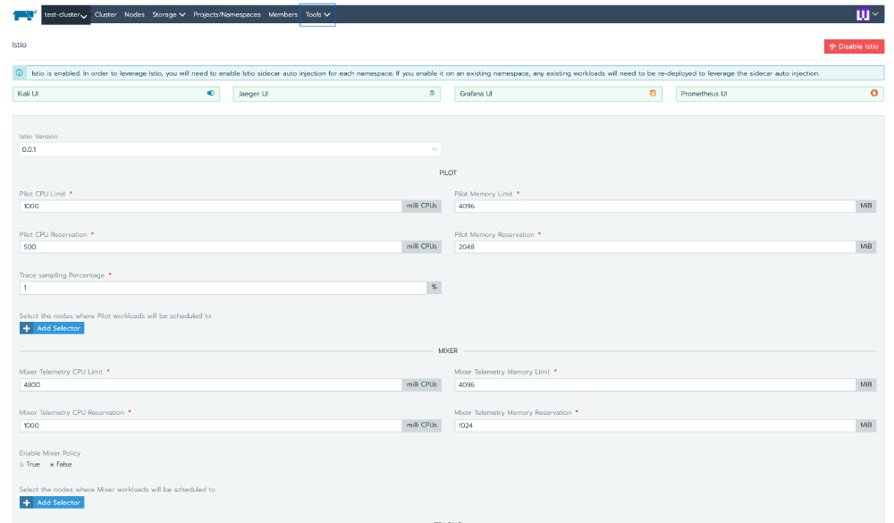
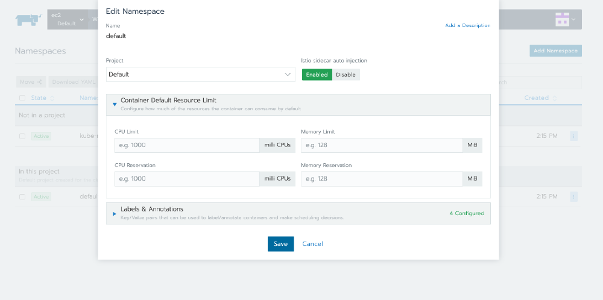
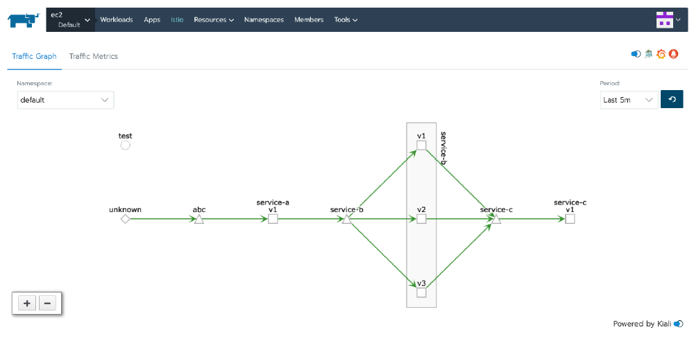
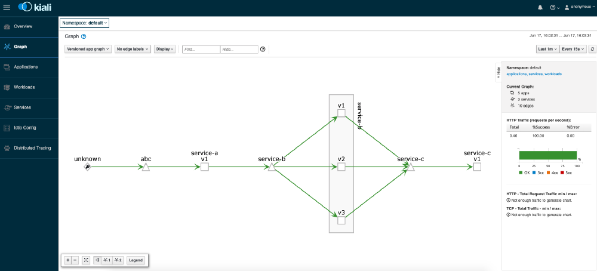

Today we are announcing support for Istio with Rancher 2.3 in Preview mode.

## Why Istio?

[Istio](https://istio.io/), and service mesh generally, has developed a huge amount of excitement

in the Kubernetes ecosystem. Istio promises to add fault tolerance, canary rollouts, A/B testing, monitoring

and metrics, tracing and observability, and authentication and authorization, eliminating the need for

developers to instrument or write specific code to enable these capabilities. In effect, developers can just

focus on their business logic and leave the rest to Kubernetes and Istio.

The claims above aren’t new. About 10 years ago, PaaS vendors made exactly the same claim and even delivered

on it to an extent. The problem was that their offerings required specific languages, frameworks, and, for

the most part, only worked with very simple applications. The workloads were also tied to the vendor’s

unique implementation, which meant that if you wanted your applications to use the PaaS services, you were

potentially locked-in for a very long time.

With containers and Kubernetes, these limitations are virtually nonexistent. As long as you can containerize

your application, Kubernetes can run it for you.

## How Istio Works in Rancher 2.3 Preview 2

Our users count on us to make managing and operating Kubernetes and related tools and technologies easy,

without locking them in to a specific cloud vendor. With Istio, we take the same approach.

In this Preview mode, we provide users with a simple UI to enable Istio under the Tools menu. Reasonable

default configurations are provided but can be changed as required:

In order to monitor your traffic, Istio needs to inject an Envoy sidecar. In Rancher 2.3 Preview, users can

enable automatic sidecar injection for each namespace. Once this option is selected, Rancher will inject the

sidecar container into each workload:

Rancher’s simplified installation and configuration of Istio comes with a built-in, supported [Kiali dashboard](https://www.kiali.io/) for traffic and telemetry visualization, [Jaeger](https://www.jaegertracing.io/) for tracing, and even its own [Prometheus](https://prometheus.io/) and [Grafana](https://grafana.com/) (separate

instances than the ones used for Advanced Monitoring).

After you deploy workloads in the namespaces with automatic sidecar injection enabled, head over to the Istio

menu entry and observe the traffic as it flows across your microservice applications:

Clicking on Kiali, Jaeger, Prometheus, or Grafana will take you to the respective UI of each tool, where you

can find more details and options:

As mentioned earlier, the power of Istio is its ability to bring features like fault tolerance, circuit

breaking, canary deployment, and more to your services. To enable these, you will need to develop and apply

the appropriate YAML files. Istio is not supported for Windows workloads yet, so it should not be enabled in

Windows clusters.

## Conclusion

Istio is one of the most talked about and requested features in the Rancher and Kubernetes communities today.

However, there are also a lot of questions around the best way to deploy and manage it. With Rancher 2.3.0

Preview 2, our goal is to make this journey quick and easy.

For release notes and installation steps, please visit

https://github.com/rancher/rancher/releases/tag/v2.3.0-alpha5
