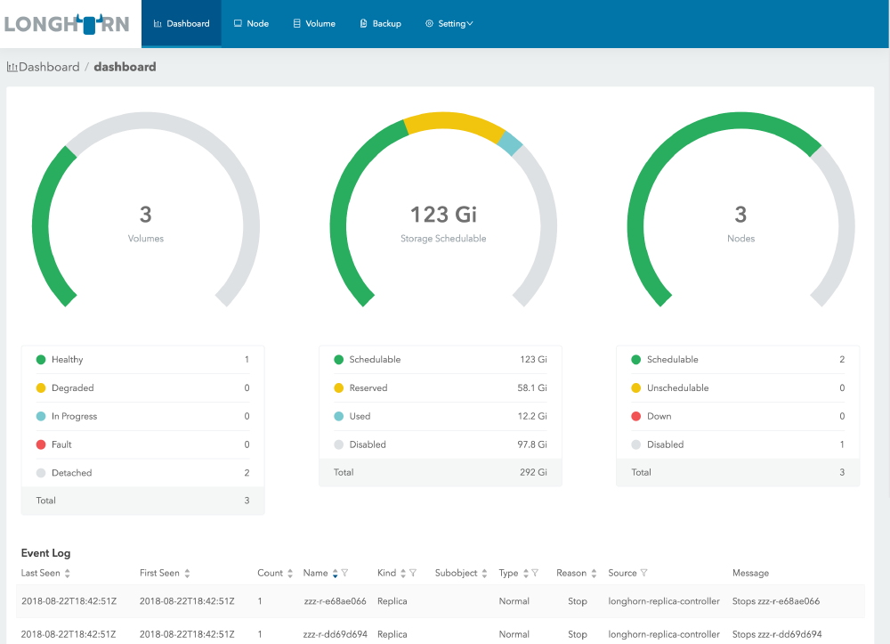
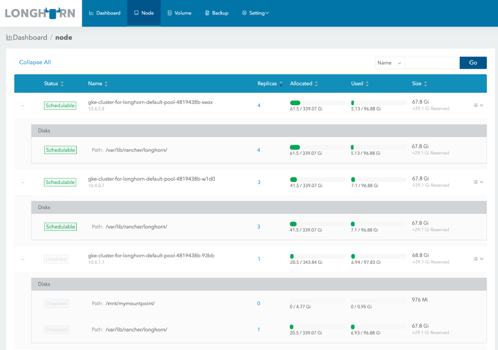
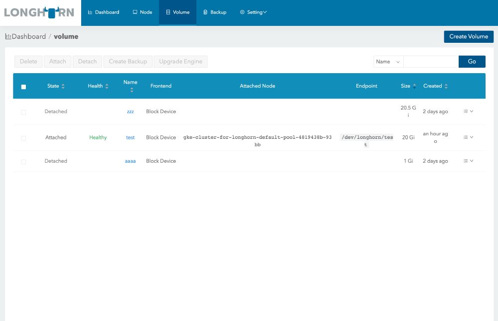

Hi,

This is Sheng Yang from Rancher Labs. Today I am very excited to announce that, after five months of hard
work, Longhorn v0.3.0 is now available at https://github.com/rancher/longhorn ! Longhorn v0.3.0 is also
available now through the app catalog in Rancher 2.0.

As you may recall, we released Longhorn v0.2 back in March, with support for Kubernetes. We got great
feedback from that release, and many feature requests as well. For the last five months, we’ve worked very
hard to meet your expectations. Now we’re glad to present you the feature-packed Longhorn v0.3.0 release!

### Newly designed UI

We’ve greatly improved Longhorn UI in v0.3. Now the user can see the status of the system in the dashboard.
We’ve added multi-select and group operations for the volumes. Also, the websocket support has been added so
it is no longer necessary to refresh the page to update the UI. Instead, the UI updates itself when the
backend state changes. All those changes should improve the user experience immensely.

Here are some screenshots of the updated UI:

Dashboard

Node page

Volume page

### Container Storage Interface (CSI)

For v0.2, the most common issue we got from users is the misconfiguration of Flexvolume driver directory
location. As a result, Kubernetes may not be able to connect to the Longhorn Driver at all. Kubernetes
doesn’t provide information regarding the location of Flexvolume driver and the user would need to figure
that out manually. In v0.3, we’ve added support for the latest Container Storage Interface, which needs no
configuration beforehand to install. See [here](https://github.com/rancher/longhorn/blob/v0.3.0/README.md#requirement-for-the-csi-driver)
for the details about the requirement and how to install Longhorn with CSI driver.

For the users who are continuing to use Flexvolume and have to figure out the volume plugin locations, we’ve
included a script to help user. Check it [here](https://github.com/rancher/longhorn/tree/v0.3.0#kubernetes-driver-requirements).

### S3 as the backup target

One of the key features of Longhorn is volume backup. It can back up the local snapshots and transfer it to a
secondary storage, like NFS. One of the most requested features in v0.2 is supporting S3 as the backup
target. We’ve made it possible with v0.3. See [here](https://github.com/rancher/longhorn/blob/v0.3.0/README.md#backup) for how to use S3 as
the backup target for Longhorn.

### Multiple disks with capacity based scheduling

Longhorn v0.2 placed volumes randomly on disks regardless of available disk space. In v0.3, we support
multiple disks per node, and we’ve rewritten our scheduler to provide capacity based scheduling. The user
now can enable/disable scheduling for any node or disk and find out how much of the disks are used. We’ve
also provided various options for the user to customize how Longhorn would schedule volumes on top of
available disk space. See [here](https://github.com/rancher/longhorn/blob/v0.3.0/docs/multidisk.md) for the details.

### Base image

Inv0.3, we support the base image feature. The base image in Longhorn is a packaged Docker image, following
the [RancherVM](https://github.com/rancher/vm) image spec. So if the user has a read-only image
which needs to be shared between multiple volumes, it can be done using the base image feature. See [here](https://github.com/rancher/longhorn/blob/v0.3.0/docs/base-image.md) for how to create and
use the base image feature.

### iSCSI frontend

We’ve added iSCSI as a supported frontend by Longhorn. Previously we only supported using block device as the
frontend to access the volume content. We believe adding iSCSI frontend should benefit traditional
hypervisors that prefer iSCSI as the interface to the block devices. See [here](https://github.com/rancher/longhorn/blob/v0.3.0/docs/iscsi.md) for the details about
iSCSI frontend support.

### Engine live upgrade

The last but not the least, we’ve put in a framework to support upgrading Longhorn engine without bringing
down the volume. As you may recall, Longhorn engines include one controller and multiple replicas. Now while
the volume is running, we can swap out the old version of controller and replica and put in a new version on
the fly. So you can deploy new versions of Longhorn storage software without volume downtime.

Noted that even though you can live upgrade Longhorn engine from v0.3 to future versions, you cannot live
upgrade from v0.2 to v0.3.

## Upgrade

Longhorn v0.3 supports upgrade of all of its software components by leveraging Kubernetes. See the
instructions for the upgrade [here](https://github.com/rancher/longhorn/blob/v0.3.0/docs/upgrade.md).

Notice for the users installed Longhorn v0.1 using Rancher app catalog, **do not use the
`upgrade` button in the UI**. Currently the upgrade cannot be done correctly via the
Rancher app catalog. Please follow the instruction above to manually upgrade your old Longhorn system.

## Future release plan

We will release minor stable releases starting from v0.3. The user can always upgrade to the stable at
https://github.com/rancher/longhorn or deploy Longhorn from Rancher app catalog. The next minor release is
v0.3.1. You can see the issues tracker for the release [here](https://github.com/rancher/longhorn/milestone/4).

You can see the release plan for the next major release (v0.4) [here](https://github.com/rancher/longhorn/wiki/Longhorn-v0.4).

## Final words

Give Longhorn a try.

As you try Longhorn software please be aware that Longhorn is still a work in progress. It’s currently an
alpha quality project. We don’t recommend to use it in the production environment.

If you find any issues, feel free to file it using our Github [issues](https://github.com/rancher/longhorn/issues). You can also contact us using [Rancher forum](https://forums.rancher.com/c/longhorn), or [Slack](https://slack.rancher.io/).

Enjoy!
