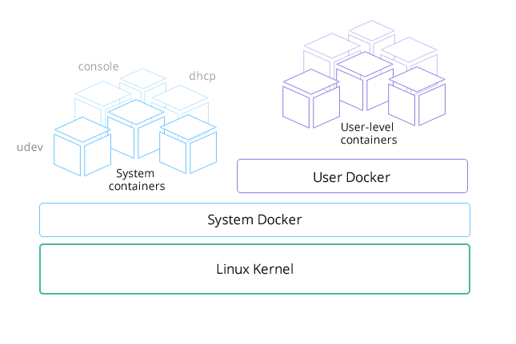

Today I would like to announce a new open source project called
RancherOS – the smallest, easiest way to run Docker in production and
at scale. RancherOS is the first operating system to fully embrace
Docker, and to run all system services as Docker containers. At Rancher
Labs we focus on building tools that help customers run Docker in
production, and we think RancherOS will be an excellent choice for
anyone who wants a lightweight version of Linux ideal for running
containers.

##

## How RancherOS began

The first question that arises when you are thinking about putting
Docker in production is which OS to use. The simplest answer is to run
Docker on your favorite Linux distribution. However, it turns out the
real answer is a bit more nuanced. After running Docker on just about
every distro over the last year, I eventually decided to create a
minimalist Linux distribution that focuses explicitly on running Docker
from the very beginning. Docker is a fast-moving target. With a constant
drum beat of releases, it is sometimes difficult for Linux distributions
to keep up. In October 2013, I started working very actively with
Docker, eventually leading to an open source project called Stampede.io.
At that time I decided to target one Linux distribution that I thought
to be the best for Docker since it was included by default. With
Stampede.io, I was pushing the boundaries of what was possible with
Docker and able to do some fun things like run libvirt and KVM in Docker
containers. Consequentially I always needed the latest version of
Docker, which was problematic. At the time, Docker was releasing new
versions each month (currently Docker is on a two month release cycle).
It would often take over a month for new Docker versions to make it to
the stable version of the Linux distro. Initially, this didn’t seem like
a bad proposition because undoubtedly, a new Docker release couldn’t be
considered “stable” on day one, and I could always use alpha releases of
my distribution of choice. However, alpha distribution releases include
other recently released software, not just Docker but alpha kernel and
alpha versions of other software. With RancherOS we addressed this by
limiting the OS to just the things we need to run Docker, specifically,
the Linux kernel, Docker and the bare minimum amount of code needed to
join the two together. Picking which version of RancherOS to run is as
easy as saying which version of Docker you wish to run. The sole purpose
of RancherOS is to run Docker and therefore our release schedule is
closely aligned. All other software included in the distribution is
considered stable, even if you just picked up the latest and greatest
Docker version.

## An OS where everything is a container

When most people think of Docker they think about running applications.
While Docker is excellent at that, it can also be used to run system
services thanks to recently added capabilities. Since first starting
Rancher (our Docker orchestration product), we’ve wanted the entire
orchestration stack to be packaged by and run in Docker - not just the
application we were managing. This was initially quite difficult, since
the orchestration stack needed to interact with the lower level
subsystems. Nevertheless, we carried on with many “hacks” to make it
possible. Once we determined the features we needed within Docker, we
helped and encouraged the development of those items. Finally, with
Docker 1.5, we were able to remove the hacks, paving the way for
RancherOS. Docker now allows sufficient control of the PID, IPC,
network namespaces and capabilities. This means it is now possible to
run systems oriented processes within Docker containers. In RancherOS we
run absolutely everything in a container, including system services such
as udev, DHCP, ntp, syslog, and cloud-init.

## A Linux distro without systemd

I have been running systemd and Docker together for a long time. When I
was developing Stampede.io I initially architected the system to run on
a distribution that heavily leveraged systemd. I started to notice a
number of strange errors when testing real world failure scenarios.
Having previously run production cloud infrastructure, I cared very much
about reliably managing things at scale. Having seen odd errors with
systemd and Docker I started digging into the issue. You can see most of
my comments in this [Docker
issue](https://github.com/docker/docker/issues/6791) and this [mailing
list
thread](https://groups.google.com/d/msg/coreos-dev/wf7G6rA7Bf4/wpI44Kfy8ZsJ).
As it turns out, systemd cannot effectively monitor Docker containers
due to the incompatibility with the two architectures. While systemd
monitors the Docker client used to launch the Docker container, this is
not really helpful and I worked hard with both Docker and systemd
communities to fix the issue. I even went so far as to create an open
source project called
[systemd-docker](https://github.com/ibuildthecloud/systemd-docker). The
purpose of the project was to create a wrapper for Docker that attempted
to make these two systems work well together. While it fixed many of the
issues, there were still some corner cases I just couldn’t address.
Realizing things must change in either Docker or systemd I shifted focus
to talking to
[both](http://lists.freedesktop.org/archives/systemd-devel/2014-October/023944.html)
of
[them](https://botbot.me/freenode/docker-dev/2014-07-10/?msg=17771621&page=7).
With the announcement of Rocket more effort is being put into making
systemd a better container runtime. Rocket, as it stands today, is
largely a [wrapper around
systemd](http://www.ibuildthecloud.com/blog/2014/12/03/is-docker-fundamentally-flawed/).
Additionally, systemd itself has since added native support for pulling
and running [Docker
images](https://plus.google.com/+LennartPoetteringTheOneAndOnly/posts/SkKuBF1XaNF) which
seems to indicate that they are more interested in subsuming container
functionalities in systemd than improving interoperability with Docker.
Ultimately, all signs continue to point to no quick resolution between
these two projects. When looking at our use case for RancherOS, we
realized we did not need systemd to run Docker. In fact, we didn’t need
any other supervisor to sit at PID 1. Docker was sufficient in itself.
What we have done with RancherOS is run what we call “System Docker” as
PID 1. All containers providing core system services are run from System
Docker, which also launches another Docker daemon which we call “User
Docker” under which we run user containers. This separation is quite
practical. Imagine a user did `docker rm -f $(docker ps -qa)`. You run
the risk of them deleting the entire operating system.

## Minimalist Linux distributions

As users look at shifting workloads to containers, dependencies on the
host system become dramatically less. All current minimalist Linux
distributions have taken advantage of this fact, allowing them to
drastically slim down their footprint. I love the model distributions
such as CoreOS have pioneered and we have been inspired by them. By
constraining the use case of RancherOS to running Docker, we decided
only core system services (logging, device management, alerting) and
access (console, ssh) were required. With the ability to run these
services in containers, all we needed was the container system itself
and a bit of bootstrap code (to get networking up, for example). If you
take this one step further and put the server under the management of a
clustering/orchestration system, you can even minimize the need to run a
full console.

## First Meetup

On March 31st, I’ll be hosting an online meet up to demonstrate
RancherOS, discuss some of the features we are working on, and answer
any questions you might have. If you would like to learn more, please
register now:

## Conclusion

When we looked at simplifying large scale deployments of Docker, there
were no solutions available that truly embraced Docker. We started the
RancherOS project because we love Docker and feel we can significantly
simplify the Linux distribution necessary to run it. Hopefully, this
will allow users to focus more on their container workloads and less on
managing the servers running them. If you’re primary requirement for
Linux is to run Docker, we’d love for you to give RancherOS a try and
let us know what you think. You can find everything
at <https://github.com/rancher/os>.
