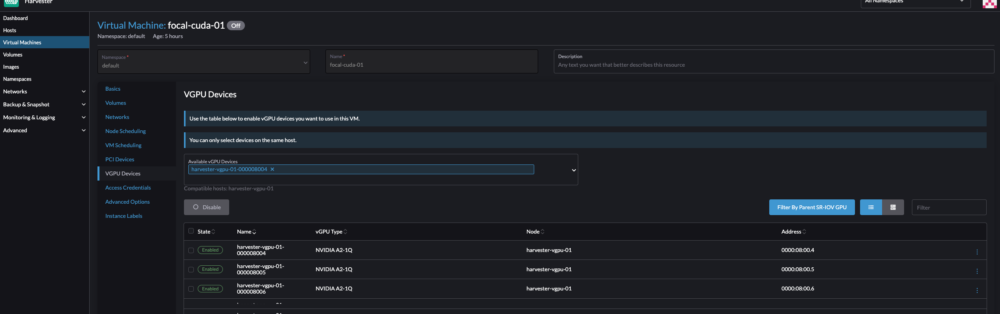
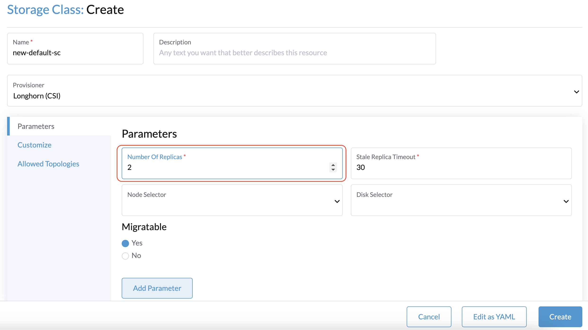
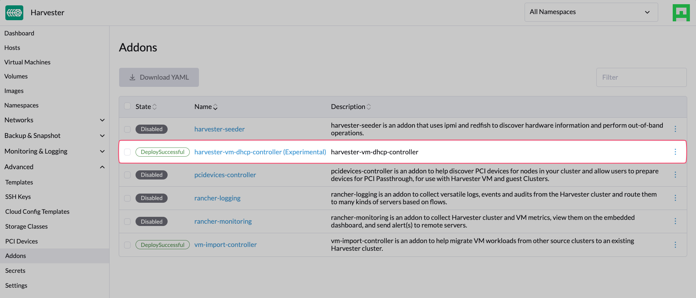

Last week - on the 15th of March 2024 - the Harvester team excitingly shared their *latest* release, [version 1.3.0](https://github.com/harvester/release-notes/blob/main/v1.3.0.md).

The 1.3.0 release has a focus on some frequently requested features, such as vGPU support and support for two-node clusters with a witness node for high availability. As well as a technical preview of ARM enablement for Harvester and cluster management using [Fleet](https://fleet.rancher.io/).

Let's dive into the 1.3.0 release and the standout features...
> *Please note that at this time Harvester does not support upgrades from stable version 1.2.1 to the latest version 1.3.0. Harvester will eventually support upgrading from v1.2.2 to v1.3.0. Once that version is released, you must first upgrade a Harvester cluster to v1.2.2 before upgrading to v1.3.0.*

### vGPU Support

Starting with Harvester v1.3.0, you now have the capability to share NVIDIA GPU's supporting SRIOV based virtualisation as vGPU (virtual GPU) devices. In Kubernetes, a vGPU is a type of mediated device that allows multiple VMs to share the compute capability of a physical GPU. You can assign a vGPU to one or more VMs created by Harvester. See the [documentation](https://docs.harvesterhci.io/v1.3/advanced/vgpusupport) for more information.

### Two-Node Clusters with a Witness node for High Availability

Harvester v1.3.0 supports two-node clusters (with a witness node) for implementations that require high availability but without the footprint and resources associated with larger deployments. You can assign the witness role to a node to create a high-availability cluster with two management nodes and one witness node. See the [documentation](https://docs.harvesterhci.io/v1.3/advanced/witness) for more information.

### Optimization for Frequent Device Power-Off/Power-On

Harvester v1.3.0 is optimized for environments wherein devices are frequently powered off and on, possibly because of intermittent power outages, recurring device relocation, and other reasons. In such environments, clusters or individual nodes are abruptly stopped and restarted, causing VMs to fail to start and become unresponsive. This release addresses the general issue and reduces the burden on cluster operators who may not possess the necessary troubleshooting skills.

### Managed DHCP (Experimental Add-on)

Harvester v1.3.0 allows you to configure IP pool information and serve IP addresses to VMs running on Harvester clusters using the embedded Managed DHCP feature. Managed DHCP, which is an alternative to the standalone DHCP server, leverages the *vm-dhcp-controller* add-on to simplify cluster deployment. The *vm-dhcp-controller* add-on reconciles CRD objects and syncs the IP pool objects that serve DHCP requests. See the [documentation](https://docs.harvesterhci.io/v1.3/advanced/addons/managed-dhcp) for more information.

### ARM Support (Technical Preview)

You can install Harvester v1.3.0 on servers using ARM architecture. This is made possible by recent updates to KubeVirt and RKE2, key components of Harvester that now both support ARM64.

### Fleet Management (Technical Preview)

Starting with v1.3.0, you can use Fleet to deploy and manage objects (such as VM images and node settings) in Harvester clusters. Support for Fleet is enabled by default and does not require Rancher integration, but you can use Fleet to explore Harvester clusters imported into Rancher.

Big thanks to the Harvester development team who worked tirelessly on this release - an incredible effort by all!

We now invite you to start exploring and using Harvester v1.3.0. We have appreciated all the feedback we've received so far; thanks for being involved and interested in the Harvester project - keep it coming! You can share your feedback with us through our [Slack channel](https://rancher-users.slack.com/archives/C01GKHKAG0K) or [GitHub](https://github.com/harvester/harvester).

Keep an eye out for the next minor version release, 1.4.0, due in Spring this year. A sneak peak of the roadmap is available [here](https://github.com/harvester/harvester/wiki/Roadmap#v140).
