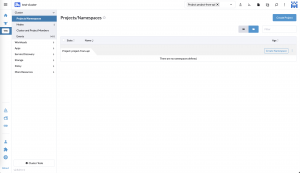
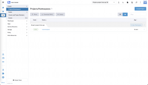
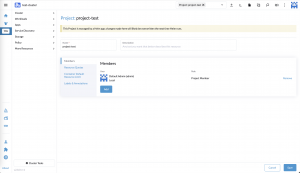

It is our pleasure to introduce the first officially supported API with Rancher v2.8: the Rancher Kubernetes API, or RK-API for short.

Since the introduction of Rancher v2.0, a publicly supported API has been one of our most requested features. The Rancher APIs, which you may recognize as v3 (Norman) or v1 (Steve), have never been officially supported and can only be automated using our Terraform Provider.

The driving motivation behind our new RK-API is to manage Rancher like you would manage Kubernetes. Leveraging the [Custom Resources](https://kubernetes.io/docs/concepts/extend-kubernetes/api-extension/custom-resources/) already used by Rancher Manager and communicating directly with the Kubernetes API. By using Custom Resources, any Kubernetes compatible tooling, such as kubectl or GitOps engines like Fleet, will make automating Rancher easy and accessible.

With the release of Rancher v2.8.0, we are bringing the first phase of our supported CRDs: Projects, GlobalRoles, RoleTemplates, GlobalRoleBindings, Clu sterRoleTemplateBindings and ProjectRoleTemplateBindings, with more on the way. Once upgraded, you can begin to interact immediately with these Custom Resources via the RK-API in any existing cluster.

Now, let's see how it works.

## **Creating and modifying resources**

Projects are a great example of how useful this new API can be. If I wanted to create a project in a managed cluster, instead of creating it in the dashboard, I could simply apply a project yaml directly to my Rancher's management cluster.

First, you will need a Kubeconfig for the Rancher management cluster. The [API's quickstart guide](https://ranchermanager.docs.rancher.com/v2.8/api/quickstart) explains how to make one.

Next, I will retrieve my downstream cluster's ID. Note that this is the metadata.name of the cluster, not the displayName.

Then I can use that to create a project in that cluster, in this case with a randomly generated project name:

```
$ kubectl get clusters.management.cattle.io
```

```
NAME           AGE
c-m-bsg27dgn   13m
local          76m
```

```
$ kubectl create -f - <<EOF
apiVersion: management.cattle.io/v3
kind: Project
metadata:
  generateName: p-
  namespace: c-m-bsg27dgn
spec:
  clusterName: c-m-bsg27dgn
  displayName: project-from-api
EOF
```

Now we can see in the UI that a project exists:To understand what each of these fields means and which are required, you can simply use `kubectl explain project` as you would with Kubernetes Resources.

```
$ kubectl explain projects.management.cattle.io
```

```
KIND:     Project
VERSION:  management.cattle.io/v3
DESCRIPTION:
     Project is a group of namespaces. Projects are used to create a
     multi-tenant environment within a Kubernetes cluster by managing namespace
     operations, such as role assignments or quotas, as a group.
FIELDS:
   apiVersion    <string>
     APIVersion defines the versioned schema of this representation of an.....
```

To modify or use the project, first look up the name of the project in the cluster namespace since it was created with an unpredictable ID using metadata generateName.

Deleting or editing the project is now simple; reference it under the cluster namespace:

```
$ kubectl --namespace c-m-bsg27dgn get projects
```

```
NAME           AGE
p-9x7lg        45s
```

```
$ kubectl --namespace c-m-bsg27dgn edit project p-9x7lg
```

One important note is that custom resources can live in the Rancher management cluster or the managed (downstream) cluster. Projects and namespaces are one such example. While the project resources exist in the management cluster, the namespace resources exist in the managed cluster. So, in order to create a namespace in your new project, you would need to switch your [Kubeconfig](https://kubernetes.io/docs/tasks/access-application-cluster/configure-access-multiple-clusters/) to the managed cluster, then simply create the namespace with the proper annotation:

```
field.cattle.io/projectId: <cluster- id>:<project-id>
```

For example:

```
$ kubectl apply -f - <<EOF
apiVersion: v1
kind: Namespace
metadata:
  name: mynamespace
  annotations:
    field.cattle.io/projectId: c-m-bsg27dgn:p-9x7lg
EOF
```

Now we can see that namespace exists:



## **Using the API via GitOps**

One of the exciting applications of this new API is the ability to deploy resources with a modern infrastructure pipeline. In this example, we'll use Rancher's built-in Continuous Delivery system, also called Fleet. To start, you can create a git repo that contains the following in project/project.yml:

```
apiVersion: management.cattle.io/v3
kind: Project
metadata:
  name: project-test
  namespace: c-m-bsg27dgn
spec:
  clusterName: c-m-bsg27dgn
  displayName: project-test
```

Then, apply this in Rancher by creating a GitRepo, which will deploy the project to the management cluster:

```
$ kubectl apply -f - <<EOF
apiVersion: fleet.cattle.io/v1alpha1
kind: GitRepo
metadata:
  name: test
namespace: fleet-local
spec:
repo: "REPO_URL"
branch: main
paths:
- projects
EOF
```

Once applied, you'll find your new project created in the managed cluster. Let's take this one final step: adding a user to the project.

If we check the project, we'll see it now has a project member added; success! You can see how the management of resources at scale is as easy as editing or copying a few files.



```
apiVersion: management.cattle.io/v3
kind: ProjectRoleTemplateBinding
metadata:
  name: add-proj-member
  namespace: project-test
projectName: c-m-bsg27dgn:project-test
roleTemplateName: project-member
userName: user-gvmvn
```

## **Summary**

While only a limited set of CRDs are going live in 2.8.0, they are some of the most widely requested, and many more are currently being developed for upcoming releases. We believe this new API will be a large benefit to customers, as well as a commitment to the stability and documentation of Rancher Manager and its features.

For more details, see the new [documentation page](https://ranchermanager.docs.rancher.com/v2.8/api/api-reference). These include a quick-start, API reference and common workflows.
