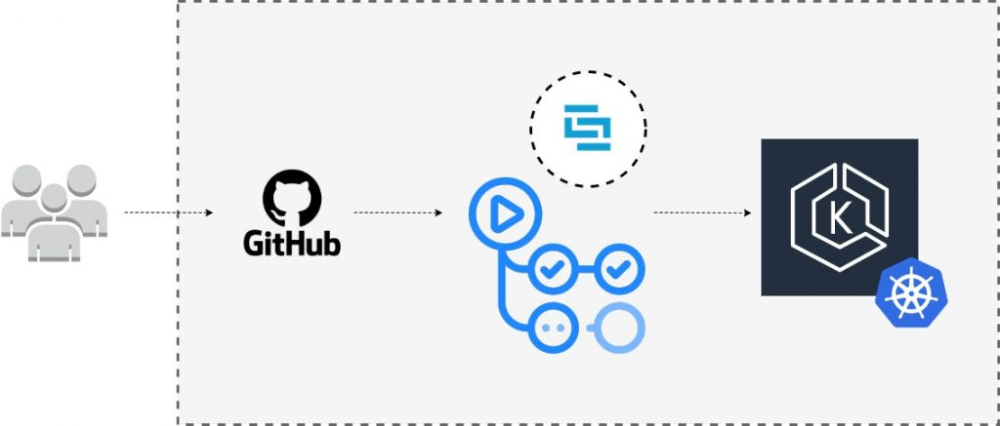
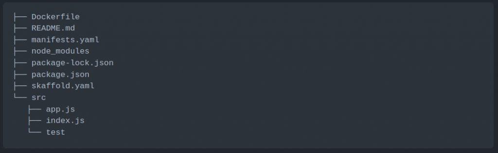
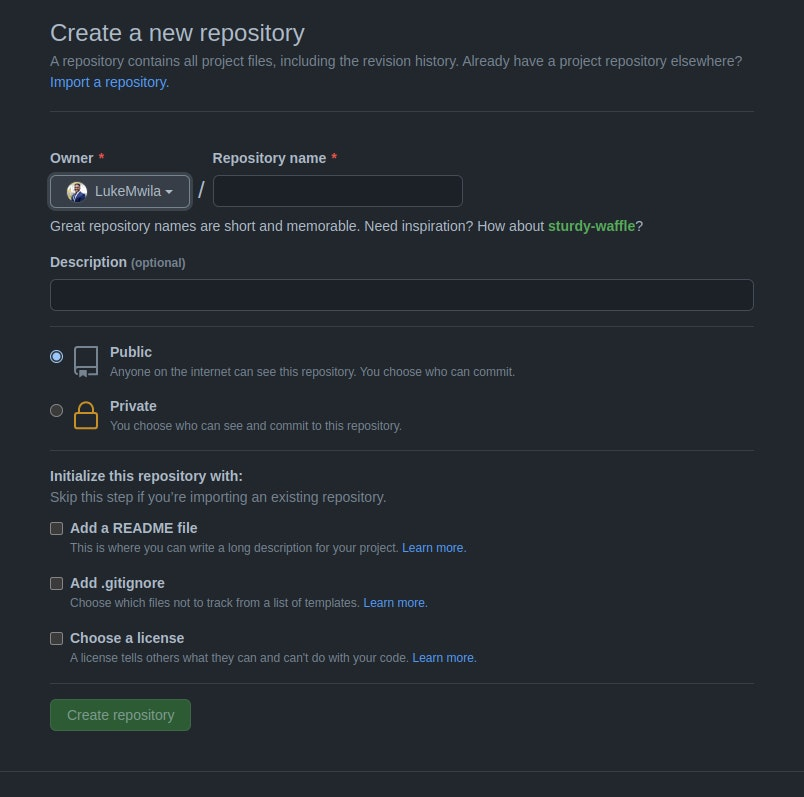
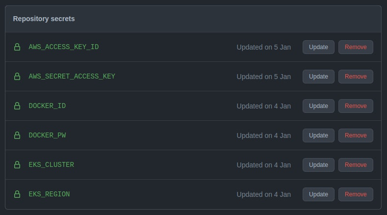
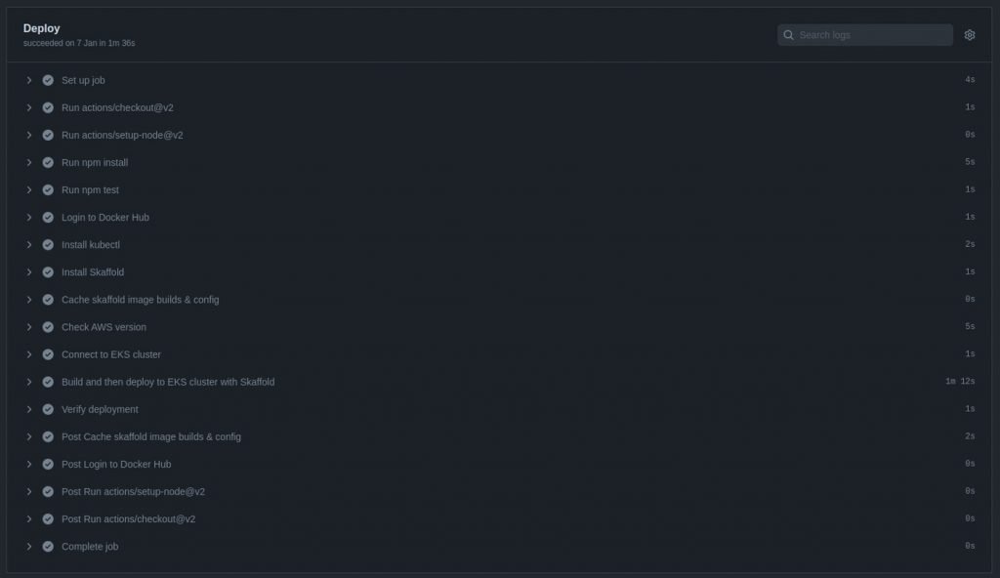

Creating a DevOps workflow to optimize application deployments to your Kubernetes cluster can be a complex journey. I recently demonstrated how to optimize your local K8s development workflow with [Rancher Desktop](https://rancherdesktop.io/) and [Skaffold](https://skaffold.dev/). If you haven’t seen it yet, you can watch it by viewing the video below.
https://www.youtube.com/embed/0-g0UJ11wt4
You might be wondering, “What happens next?” How do you extend this solution beyond a local setup to a real-world pipeline with a remote cluster? This tutorial responds to that question and will walk you through how to create a CI/CD pipeline for a Node.js application using Skaffold and GitHub Actions to an EKS cluster.

All the source code for this tutorial can be found in [this repository](https://github.com/LukeMwila/nodejs-skaffold-app).

### Objectives

By the end of this tutorial, you'll be able to:

1. Configure your application to work with Skaffold

2. Configure a CI stage for automated testing and building with GitHub Actions

3. Connect GitHub Actions CI with Amazon EKS cluster

4. Automate application testing, building, and deploying to an Amazon EKS cluster.

### Prerequisites

To follow this tutorial, you’ll need the following:

-An AWS account.

-AWS CLI is installed on your local machine.
-AWS profile configured with the AWS CLI. You will also use this profile for the CI stage in GitHub Actions.
-A DockerHub account.
-Node.js version 10 or higher installed on your local machine.
-kubectl is installed on your local machine.
-Have a basic understanding of JavaScript.
-Have a basic understanding of IaC (Infrastructure as Code).
-Have a basic understanding of Kubernetes.
-A free GitHub account, with git installed on your local machine.
-An Amazon EKS cluster. You can clone [this repository](https://github.com/LukeMwila/amazon-eks-cluster) that contains a Terraform module to provision an EKS cluster in AWS. The repository README.md file contains a guide on how to use the module for cluster creation. Alternatively, you can use `eksctl` to create a cluster automatically. Running an Amazon EKS cluster will cost you $0.10 per hour. Remember to destroy your infrastructure once you are done with this tutorial to avoid additional operational charges.

###

### Understanding CI/CD Process

Getting your CI/CD process right is a crucial step in your team's DevOps lifecycle. The CI step is essentially automating the ongoing process of integrating the software from the different contributors in a project's version control system, in this case, GitHub. The CI automatically tests the source code for quality checks and makes sure the application builds as expected.

The continuous deployment step picks up from there and automates the deployment of your application using the successful build from the CI stage.

###

### Create Amazon EKS cluster

As mentioned above, you can clone or fork [this repository](https://github.com/LukeMwila/amazon-eks-cluster) that contains the relevant Terraform source code to automate the provisioning of an EKS cluster in your AWS account. To follow this approach, ensure that you have Terraform installed on your local machine. Alternatively, you can also use [eksctl](https://eksctl.io/) to provision your cluster. The AWS profile you use for this step will have full administrative access to the cluster by default. To communicate with the created cluster via kubectl, ensure your AWS CLI is configured with the same AWS profile.

You can view and confirm the AWS profile in use by running the following command:

```
aws sts get-caller-identity
```

Once your K8s cluster is up and running, you can verify the connection to the cluster by running `*kubectl cluster-info*` or `*kubectl config current-context`*.

### Application Overview and Dockerfile

The next step is to create a directory on your local machine for the application source code. This directory should have the following folder structure (in the code block below). Ensure that the folder is a git repository by running the `*git init`* command.



#### Application Source Code

To create a **package.json** file from scratch, you can run the `*npm init*` command in the root directory and respond to the relevant questions you are prompted with. You can then proceed to install the following dependencies required for this project.

```
npm install body-parser cors express 
npm install -D chai mocha supertest nodemon
```

After that, add the following scripts to the generated package.json:

```
scripts: {
  start: "node src/index.js",
  dev: "nodemon src/index.js",
  test: "mocha 'src/test/**/*.js'"
},
```

Your final package.json file should look like the one below.

```
{
  "name": "nodejs-express-test",
  "version": "1.0.0",
  "description": "",
  "main": "index.js",
  "scripts": {
    "start": "node src/index.js",
    "dev": "nodemon src/index.js",
    "test": "mocha 'src/test/**/*.js'"
  },
  "repository": {
    "type": "git",
    "url": "git+<your-github-uri>"
  },
  "author": "<Your Name>",
  "license": "ISC",
  "dependencies": {
    "body-parser": "^1.19.0",
    "cors": "^2.8.5",
    "express": "^4.17.1"
  },
  "devDependencies": {
    "chai": "^4.3.4",
    "mocha": "^9.0.2",
    "nodemon": "^2.0.12",
    "supertest": "^6.1.3"
  }
}
```

Update the **app.js** file to initialize the [Express web framework](https://expressjs.com/) and add a single route for the application.

```
// Express App Setup
const express = require('express');
const http = require('http');
const bodyParser = require('body-parser');
const cors = require('cors');

// Initialization
const app = express();
app.use(cors());
app.use(bodyParser.json());

// Express route handlers
app.get('/test', (req, res) => {
  res.status(200).send({ text: 'Simple Node App Is Working As Expected!' });
});

module.exports = app;
```

Next, update the **index.js** in the root of the src directory with the following code to start the webserver and configure it to listen for traffic on port `*8080*`.

```
const http = require('http');
const app = require('./app');

// Server
const port = process.env.PORT || 8080;
const server = http.createServer(app);
server.listen(port, () => console.log(`Server running on port ${port}`));
```

The last step related to the application is the test folder which will contain the index.js file with code to test the single route you've added to our application.

You can redirect to the **index.js** file in the test folder and add code to test the route you added to the application.

```
const { expect } = require('chai');
const { agent } = require('supertest');
const app = require('../app');

const request = agent;

describe('Some controller', () => {
  it('Get request to /test returns some text', async () => {
    const res = await request(app).get('/test');
    const textResponse = res.body;
    expect(res.status).to.equal(200);
    expect(textResponse.text).to.be.a('string');
    expect(textResponse.text).to.equal('Simple Node App Is Working As Expected!');
  });
});
```

#### Application Dockerfile

Later on, we will configure Skaffold to use Docker to build our container image. You can proceed to create a Dockerfile with the following content:

```
FROM node:14-alpine
WORKDIR /usr/src/app
COPY ["package.json", "package-lock.json*", "npm-shrinkwrap.json*", "./"]
RUN npm install 
COPY . .
EXPOSE 8080
RUN chown -R node /usr/src/app
USER node
CMD ["npm", "start"]
```

###

### Kubernetes Manifest Files for Application

The next step is to add the manifest files with the resources that Skaffold will deploy to your Kubernetes cluster. These files will be deployed continuously based on the integrated changes from the CI stage of the pipeline. You will be deploying a Deployment with three replicas and a LoadBalancer service to proxy traffic to the running Pods. These resources can be added to a single file called **manifests.yaml**.

```
apiVersion: apps/v1
kind: Deployment
metadata:
 name: express-test
spec:
 replicas: 3
 selector:
   matchLabels:
     app: express-test
 template:
   metadata:
     labels:
       app: express-test
   spec:
     containers:
     - name: express-test
       image: <your-docker-hub-account-id>/express-test
       resources:
          limits:
            memory: 128Mi
            cpu: 500m
       ports:
       - containerPort: 8080
---
apiVersion: v1
kind: Service
metadata:
  name: express-test-svc
spec:
  selector:
    app: express-test
  type: LoadBalancer
  ports:
  - protocol: TCP
    port: 8080
    targetPort: 8080
```

###

### Skaffold Configuration File

In this section, you'll populate your Skaffold configuration file (**skaffold.yaml**). This file will determine how your application is built and deployed by the Skaffold CLI tool in the CI stage of your pipeline. Your file will specify Docker as the image builder with the Dockerfile you created earlier to define the steps of how the image should be built. By default, Skaffold will use the *gitCommit* to tag the image create the Deployment manifest file with this image tag.

This configuration file will also contain a step for testing the application's container image by executing the `*npm run test*` command that we added to the scripts section of the **package.json** file. Once the image has been successfully built and tested, it will be pushed to your Docker Hub account in the repository that you specify in the tag prefix.

Finally, we'll specify that we want Skaffold to use kubectl to deploy the manifest file resources in the **manifest.yaml** file.

The complete configuration file will look like this:

```
apiVersion: skaffold/v2beta26
kind: Config
metadata:
  name: nodejs-express-test
build:
  artifacts:
  - image: <your-docker-hub-account-id>/express-test
    docker:
      dockerfile: Dockerfile
test:
  - context: .
    image: <your-docker-hub-account-id>/express-test
    custom:
      - command: npm run test
deploy:
  kubectl:
    manifests:
    - manifests.yaml
```

###

### GitHub Secrets and GitHub Actions YAML File

In this section, you will create a remote repository for your project in GitHub. In addition to this, you will add secrets for your CI environment and a configuration file for the GitHub Actions CI stage.

Proceed to create a repository in GitHub and complete the fields you will be presented with. This will be the remote repository for the local one you created in an earlier step.



After you've created your repository, go to the repo **S****ettings** page. Under **S****ecurity**, select **Secrets > Actions**. In this section, you can create sensitive configuration data that will be exposed during the CI runtime as environment variables.

Proceed to create the following secrets:

-AWS\_ACCCESS\_KEY\_ID - This is the AWS-generated Access Key for the profile you used to provision your cluster earlier.
-AWS\_SECRET\_ACCESS\_KEY - This is the AWS-generated Secret Access Key for the profile you used to provision your cluster earlier.
-DOCKER\_ID - This is the Docker ID for your DockerHub account.
-DOCKER\_PW - This is the password for your DockerHub account.
-EKS\_CLUSTER - This is the name you gave to your EKS cluster.
-EKS\_REGION - This is the region where your EKS cluster has been provisioned.


Lastly, you are going to create a configuration file (**main.yml**) that will declare how the pipeline will be triggered, the branch to be used, and the steps that your CI/CD process should follow. As outlined at the start, this file will live in the **.github/workflows** folder and will be used by GitHub Actions.

The steps that we want to define are as follows:

-Expose our Repository Secrets as environment variables
-Install Node.js dependencies for the application
-Log in to Docker registry
-Install kubectl
-Install Skaffold
-Cache skaffold image builds & config
-Check that the AWS CLI is installed and configure your profile
-Connect to the EKS cluster
-Build and deploy to the EKS cluster with Skaffold
-Verify deployment

You can proceed to update the **main.yml**file with the following content.

```
name: 'Build & Deploy to EKS'
on:
  push:
    branches:
      - main
env:
  AWS_ACCESS_KEY_ID: ${{ secrets.AWS_ACCESS_KEY_ID }}
  AWS_SECRET_ACCESS_KEY: ${{ secrets.AWS_SECRET_ACCESS_KEY }}
  EKS_CLUSTER: ${{ secrets.EKS_CLUSTER }}
  EKS_REGION: ${{ secrets.EKS_REGION }}
  DOCKER_ID: ${{ secrets.DOCKER_ID }}
  DOCKER_PW: ${{ secrets.DOCKER_PW }}
jobs:
  deploy:
    name: Deploy
    runs-on: ubuntu-latest
    env:
      ACTIONS_ALLOW_UNSECURE_COMMANDS: 'true'
    steps:
      # Install Node.js dependencies
      - uses: actions/checkout@v2
      - uses: actions/setup-node@v2
        with:
          node-version: '14'
      - run: npm install
      - run: npm test
      # Login to Docker registry
      - name: Login to Docker Hub
        uses: docker/login-action@v1
        with:
          username: ${{ secrets.DOCKER_ID }}
          password: ${{ secrets.DOCKER_PW }}
      # Install kubectl
      - name: Install kubectl
        run: |
          curl -LO "https://dl.k8s.io/release/$(curl -L -s https://dl.k8s.io/release/stable.txt)/bin/linux/amd64/kubectl"
          curl -LO "https://dl.k8s.io/$(curl -L -s https://dl.k8s.io/release/stable.txt)/bin/linux/amd64/kubectl.sha256"
          echo "$(<kubectl.sha256) kubectl" | sha256sum --check

          sudo install -o root -g root -m 0755 kubectl /usr/local/bin/kubectl
          kubectl version --client
      # Install Skaffold
      - name: Install Skaffold
        run: |
          curl -Lo skaffold https://storage.googleapis.com/skaffold/releases/latest/skaffold-linux-amd64 && \
          sudo install skaffold /usr/local/bin/
          skaffold version
      # Cache skaffold image builds & config
      - name: Cache skaffold image builds & config
        uses: actions/cache@v2
        with:
          path: ~/.skaffold/
          key: fixed-${{ github.sha }}
      # Check AWS version and configure profile
      - name: Check AWS version
        run: |
          aws --version
          aws configure set aws_access_key_id $AWS_ACCESS_KEY_ID
          aws configure set aws_secret_access_key $AWS_SECRET_ACCESS_KEY
          aws configure set region $EKS_REGION
          aws sts get-caller-identity
      # Connect to EKS cluster
      - name: Connect to EKS cluster 
        run: aws eks --region $EKS_REGION update-kubeconfig --name $EKS_CLUSTER
      # Build and deploy to EKS cluster
      - name: Build and then deploy to EKS cluster with Skaffold
        run: skaffold run
      # Verify deployment
      - name: Verify the deployment
        run: kubectl get pods
```

Once you've updated this file, you can commit all the changes in your local repository and push them to the remote repository you created.

```
git add .
git commit -m "other: initial commit"
git remote add origin <your-remote-repository>
git push -u origin <main-branch-name>
```

### Reviewing Pipeline Success

After pushing your changes, you can track the deployment in the Actions page of the remote repository you set up in your GitHub profile.




### Conclusion

This tutorial taught you how to create automated deployments to an Amazon EKS cluster using Skaffold and GitHub Actions. As mentioned in the introduction, all the source code for this tutorial can be found in [this repository](https://github.com/LukeMwila/nodejs-skaffold-app). If you're interested in a video walk-through of this post, you can watch the video below.
https://www.youtube.com/embed/NPUBIkQayRw

Make sure to destroy the following infrastructure provisioned in your AWS account:

-Load Balancer created by service resource in Kubernetes.
-Amazon EKS cluster
-VPC and all networking infrastructure created to support EKS cluster

**Let’s continue the conversation! [Join the SUSE & Rancher Community](https://community.suse.com/) where you can further your Kubernetes knowledge and share your experience.**
