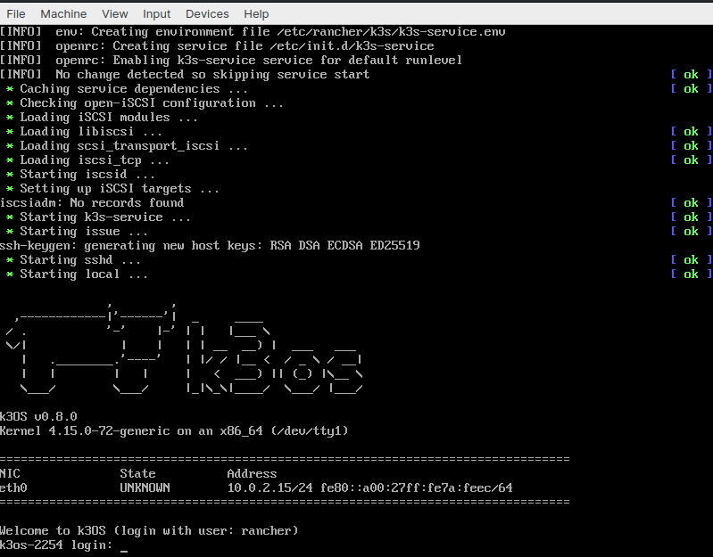
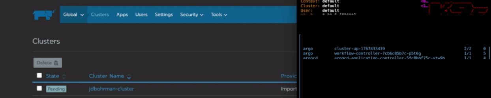

The certified Kubernetes distribution built for IoT & Edge computing[Download K3S](https://k3s.io/)

## Introduction

As the Kubernetes ecosystem grows, new technologies are being developed that enable a wider range of applications and use cases. The growth of edge computing has driven a need for some of these technologies to enable the deployment of Kubernetes to low-resource infrastructure to the network edge. In this blog post, we are going to introduce you to one method of deploying k3OS to the edge. You can use this method to automatically register your edge machine to a Rancher instance as a control plane. We will also discuss some of the benefits of automating deployments to physical machines.

Rancher Labs developed [k3OS](https://github.com/rancher/k3os) to address this exact use case. The goal of the k3OS project is to create a compact and edge-focused Kubernetes OS packaged with Rancher Labs’ [K3s](https://k3s.io/), the certified Kubernetes distribution built for IoT and edge computing. This enables easy deployment of applications to resource-constrained environments such as devices deployed at the edge.

While still in its infancy, k3OS is battle tested and is being used in production in a variety of environments. To fully grasp the full benefits of edge computing, you need to conserve as much space as possible on the infrastructure you are deploying to.

## Introducing the Argo Project

[Argo](https://argoproj.github.io/) is a Cloud Native Computing Foundation project designed to alleviate some of the pain of running compute-intensive workloads in container-native environments. The [Argo Workflows](https://argoproj.github.io/projects/argo) sub-project is an open source container-native workflow engine for orchestrating parallel jobs in Kubernetes. It is implemented as a Kubernetes Custom Resource Definition (CRD), which is essentially an extention of the Kubernetes API.

With Argo Workflows, we can define workflows where every step in the workflows is a container, and model multi-step workflows as a sequence of tasks or capture the dependencies between tasks using a directed acyclic graph (DAG). This is useful when automating the deployment and configuration of edge-native services. We will see many of these aspects of Argo Workflows come into play later on in this demo.

## Step 1. Setting Up a Demo Environment

To simulate a working *edge* site, we will need to spin up k3OS on a local VM and then use an Argo Workflow to phone into a remote Rancher instance. In this section we will:

- Download the k3OS `iso` [here](https://k3os.io/)
- Deploy Rancher
- Install Argo Workflows

### Set Up Local VM (Edge)

The steps for installing [VirtualBox](https://www.virtualbox.org/wiki/Downloads) are outside the scope of this demonstration. Once we have VirtualBox installed, we’ll start it up and go through the initial process of setting up the VM and attaching the k3OS iso. Once we’ve done that, we will start up the machine and this intro screen will greet us:



At this point, we will open up a terminal and add the `k3OS` VM to our `config.yaml` file. We can use this handy helper script:

```
# Pull k3OS credentials
get_vm() {
gsed -i '/127.0.0.1/d' ~/.ssh/known_hosts
scp -P 3022 rancher@127.0.0.1:/etc/rancher/k3s/k3s.yaml ~/.kube/current_k3os_vm.yaml
sed 's/6443/4443/g' ~/.kube/current_k3os_vm.yaml > ~/.kube/current_k3os_master.yaml
export KUBECONFIG=~/.kube/current_k3os_master.yaml
rm ~/.kube/current_k3os_vm.yaml
}
```

**Note**: Need to port forward 3022 and 4443

Once we’ve successfuly pulled the `.kubeconfig` file, we should be ready to deploy the control plane.

### Deploy Rancher (Cloud)

To deploy Rancher to a cloud environment, perform the following steps:

1. Clone or download [this](https://github.com/rancher/quickstart) repository to a local folder
2. Choose a cloud provider and navigate into the provider’s folder
3. Copy or rename `terraform.tfvars.example` to `terraform.tfvars` and fill in all required variables
4. Run `terraform init`
5. Run `terraform apply`

When provisioning has finished, Terraform will output the URL to connect to the Rancher server. Two sets of Kubernetes configurations will also be generated:

```
Apply complete! Resources: 16 added, 0 changed, 0 destroyed.

Outputs:

rancher_node_ip = xx.xx.xx.xx
rancher_server_url = https://xx-xx-xx-xx.nip.io
workload_node_ip = yy.yy.yy.yy
```

`kube_config_server.yaml` contains credentials to access the RKE cluster supporting the Rancher server
`kube_config_workload.yaml` contains credentials to access the provisioned workload cluster

For more details on each cloud provider, refer to the documentation in their respective folders in the repo.

### Step 2. Install Argo Workflows

**Install Argo CLI**:

Download the latest Argo CLI from the [Argo releases page](https://github.com/argoproj/argo/releases).

**Install the controller**:

In this step, we’ll install Argo Workflows to extend the Kubernetes API with the **Workflows** CRD. This will allow us to chain multiple “jobs” together in sequence. Installing Argo Workflows is as easy as switching to your k3OS cluster and running:

```
kubectl create namespace argo
kubectl apply -n argo -f https://raw.githubusercontent.com/argoproj/argo/stable/manifests/install.yaml
```

**Note**: On Google Kubernetes Engine (GKE), you may need to grant your account the ability to create new clusterroles.

```
kubectl create clusterrolebinding YOURNAME-cluster-admin-binding --clusterrole=cluster-admin --user=YOUREMAIL@gmail.com
```

### Step 3. Configure the Service Account to Run Workflows

**Roles, RoleBindings and ServiceAccounts**

In order for Argo to support features such as artifacts, outputs, access to secrets, etc. it needs to communicate with Kubernetes resources using the Kubernetes API. To do that, Argo uses a ServiceAccount to authenticate itself to the Kubernetes API. You can specify which Role (i.e. which permissions) the ServiceAccount that Argo uses by binding a Role to a ServiceAccount using a RoleBinding.

Then, when submitting Workflows, specify which ServiceAccount Argo uses:

```
argo submit --serviceaccount <name>
```

When no ServiceAccount is provided, Argo will use the default ServiceAccount from the namespace from which runs, which will almost always have insufficient privileges by default.

**Granting admin privileges**

In this demo, we will grant the `default` `ServiceAccount` admin privileges (i.e., we will bind the `admin` `Role` to the `default` `ServiceAccoun` of the current namespace):

```
kubectl create rolebinding default-admin --clusterrole=admin --serviceaccount=argo:default -n argo
```

**Note**: This will grant admin privileges to the `default` `ServiceAccount` in the namespace that the command is run from, so you will only be able to run Workflows in the namespace where the `RoleBinding` was made.

### Step 4. Running the Workflow

From here, you can submit Argo Workflows via the CLI in a variety of ways:

```
argo submit -n argo --watch https://raw.githubusercontent.com/argoproj/argo/master/examples/hello-world.yaml
argo submit -n argo --watch https://raw.githubusercontent.com/argoproj/argo/master/examples/coinflip.yaml
argo submit -n argo --watch https://raw.githubusercontent.com/argoproj/argo/master/examples/loops-maps.yaml
argo list -n argo
argo get xxx-workflow-name-xxx -n argo
argo logs xxx-pod-name-xxx -n argo #from get command above
```

You can also create Workflows directly with kubectl. However, the Argo CLI offers additional features, such as YAML validation, workflow visualization, parameter passing, retries and resubmits and suspend and resume.

```
kubectl create -n argo -f https://raw.githubusercontent.com/argoproj/argo/master/examples/hello-world.yaml
kubectl get wf -n argo
kubectl get wf hello-world-xxx -n argo
kubectl get po -n argo --selector=workflows.argoproj.io/workflow=hello-world-xxx
kubectl logs hello-world-yyy -c main -n argo
```

So let’s create a `workflow.yaml` file and add all of the content here into it:

```
apiVersion: argoproj.io/v1alpha1
kind: Workflow
metadata:
  name: cluster-up
spec:
  serviceAccountName: argo-serviceaccount
  entrypoint: main
  templates:
    - name: main
      steps:
        - - name: rancher-dance
            template: rancher-dance

    - name: rancher-dance
      inputs:
        artifacts:
          - name: kubectl
            path: /bin/kubectl
            mode: 0755
            http:
              url: https://storage.googleapis.com/kubernetes-release/release/v1.18.0/bin/linux/amd64/kubectl
      container:
        image: giantswarm/tiny-tools:3.10
        command:
          - /bin/sh
          - -c
          - |
            echo "Log in to Rancher"
            LOGIN_RESPONSE=$(curl -s "https://$RANCHER_URI/v3-public/localProviders/local?action=login" 
              -H 'content-type: application/json' 
              --data-binary '{"username":"'$RANCHER_USER'","password":"'$RANCHER_PASS'"}')

            LOGIN_TOKEN=$(echo $LOGIN_RESPONSE | jq -r .token)

            echo "Obtain Rancher API token"
            API_RESPONSE=$(curl -s "https://$RANCHER_URI/v3/token" 
              -H 'content-type: application/json' 
              -H "Authorization: Bearer $LOGIN_TOKEN" 
              --data-binary '{"type":"token","description":"automation"}')

            API_TOKEN=$(echo $API_RESPONSE | jq -r .token)

            echo "Configure server-url"
            RANCHER_SERVER_URL="https://$RANCHER_URI/latest/meta-data/public-ipv4"
            curl -s 'https://$RANCHER_URI/v3/settings/server-url' 
              -H 'content-type: application/json' -H "Authorization: Bearer $API_TOKEN" 
              -X PUT --data-binary '{"name":"server-url","value":"'$RANCHER_SERVER_URL'"}'

            echo "Create the cluster, or get the info on an existing cluster"
            CLUSTER_RESPONSE=$(curl -sf "https://$RANCHER_URI/v3/cluster" 
              -H 'content-type: application/json' -H "Authorization: Bearer $API_TOKEN" 
              --data-binary '{"type": "cluster",
                "name": "'$CLUSTER_NAME'",
                "enableClusterAlerting":true,
                "enableClusterMonitoring":false}'
                || curl -s "https://$RANCHER_URI/v3/cluster?name=$CLUSTER_NAME" 
                -H 'content-type: application/json' 
                -H "Authorization: Bearer $API_TOKEN" 
                | jq ".data | .[]" )

            echo "Extract the cluster ID"
            CLUSTER_ID=$(echo $CLUSTER_RESPONSE | jq -r .id)

            echo "Generate the cluster registration token"
            CLUSTER_JSON=$(curl -s "https://$RANCHER_URI/v3/clusterregistrationtoken" 
              -H 'content-type: application/json' -H "Authorization: Bearer $API_TOKEN" 
              --data-binary '{"type":"clusterRegistrationToken","clusterId":"'$CLUSTER_ID'"}')

            echo "Extract the cluster registration token"
            CLUSTER_TOKEN=$(echo $CLUSTER_JSON | jq -r .token)

            echo "Notify Slack of import"
            curl -s "https://$RANCHER_URI/v3/notifiers" 
              -H 'content-type: application/json' 
              -H "Authorization: Bearer $API_TOKEN" 
              --data-binary  '{"clusterId":"'$CLUSTER_ID'",
                "name":"slack-alerter",
                "namespaceId":"",
                "pagerdutyConfig":null,
                "sendResolved":true,
                "slackConfig":{"url":"'$SLACK_WEBHOOK_URI'"},
                "smtpConfig":null,
                "webhookConfig":null,
                "wechatConfig":null}'

            echo "Retrieve and Apply Manifests"
            kubectl apply -f "https://$RANCHER_URI/v3/import/$CLUSTER_TOKEN.yaml"
        env:
          - name: RANCHER_URI
            value: "x.x.x.x.x.x"
          - name: CLUSTER_NAME
            valueFrom:
              configMapKeyRef:
                name: cluster-name
                key: CLUSTER_NAME
          - name: RANCHER_USER
            valueFrom:
              secretKeyRef:
                name: rancher-credentials
                key: RANCHER_USER
          - name: RANCHER_PASS
            valueFrom:
              secretKeyRef:
                name: rancher-credentials
                key: RANCHER_PASS
          - name: SLACK_WEBHOOK_URI
            value: <your-slack-webhook>
```

At a high level, this workflow is essentially taking a script and running as a pod in our cluster with certain variables that allow it to:

- Log in to the Rancher API
- `cURL` a Rancher API token with `TinyTools`
- Set the URL of the Rancher Server as a variable
- Extract the cluster ID
- Retrieve and apply the manifests

Next we’ll want to cd into the directory with our workflow and run:

```
argo submit -n argo workflow.yaml
```

You can then watch the workflow provision a pod called `cluster-up` in your cluster that will connect to Rancher:



### Conclusion: Why Automate Tasks at the Edge

Now that you’ve gotten an introduction to automating edge deployments with k3OS and Argo, let’s discuss some of the reasons why this type of automation is important. Automating these tasks is beneficial when spinning up physical machines for operations such as Industrial Internet of Things (IIOT), where the people interacting with the machines are hardware technicians as opposed to cloud engineers.

At the edge, often the provisioning of physical machines is laborious – but shouldn’t have to be done one at a time. With this approach, technicians can simply insert something like a USB that will kick off an ISO and run a script to kick off the provisioning of the machines, along with the registration to the control plane that you see here.

We hope you enjoyed this post. Stay tuned for for more topics about edge computing coming soon.

The certified Kubernetes distribution built for IoT & Edge computing[Download K3S](https://k3s.io/)
