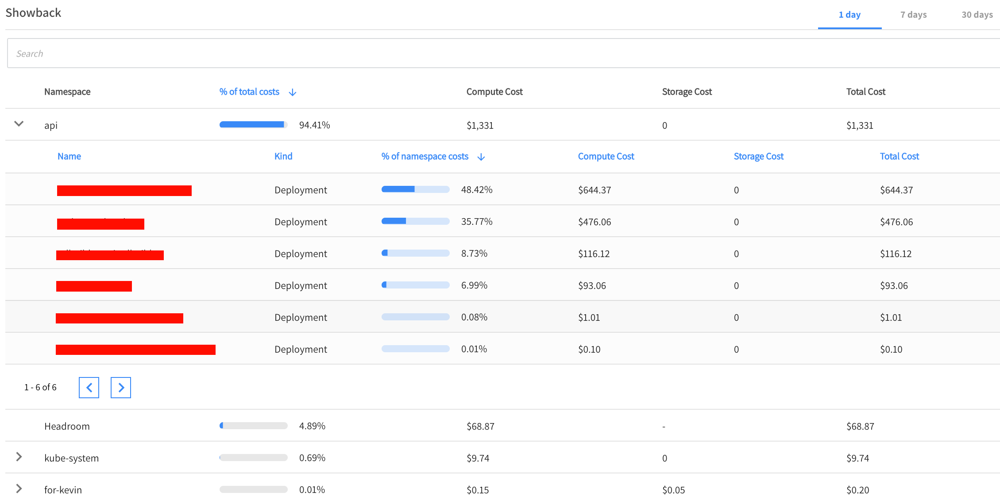
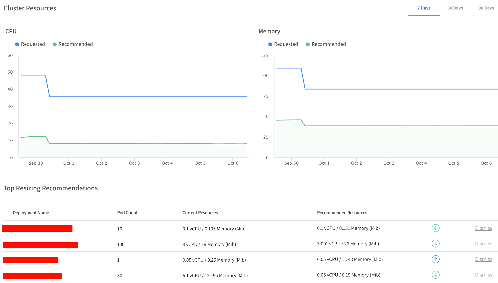
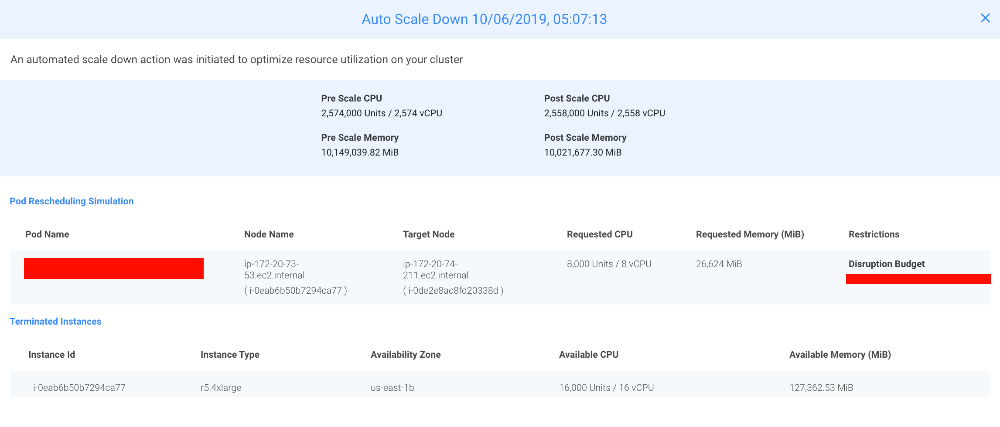

Over the last few years, we have seen a significant shift with companies moving away from developing heavy, monolithic applications and instead adopting new approaches like microservices and even serverless applications. These allow companies to work in a faster and more agile way. Speed and agility are important when a task like deploying a new piece of code to production multiple times a day is normal behavior for a modern environment.

While the shift to microservices enables faster, more agile deployment, infrastructure also needs to evolve and become more dynamic. The new workflow benefits from automation to run tests and deploy new application versions.

## Kubernetes Management with Rancher

Rancher deploys and manages Kubernetes clusters on any infrastructure, from datacenter to edge. It includes tools for running Kubernetes across your enterprise, including all of the resources for both operations and development teams. Rancher addresses the operational and security challenges of provisioning and managing multiple Kubernetes clusters while providing DevOps teams with integrated tools for running containerized workloads.

## Spotinst Ocean

While Rancher provides an efficient way to deploy and manage the Kubernetes cluster itself, there is still the need to manage the underlying cluster nodes. When running within a cloud provider, the resources are usually expensive, and because of that, resource efficiency is essential.

Cloud computing providers retain excess compute resources to support surges in demand, so during slower periods, significant amounts of those resources are sitting idle. To increase the usage of this excess capacity, they offer access to the excess capacity with discounts of up to 80%! However, there is a catch, as those instances can be taken away with almost no warning (from 30 seconds to 2 minutes, depending on the cloud provider).

Spotinst Ocean uses both historical and statistical data to allow reliable usage of this affordable excess capacity, with enterprise-level SLAs for high availability.

## Introducing Serverless Containers

Both containers and serverless are technologies that enterprises are adopting, while Kubernetes is becoming the industry standard for container orchestration.

When working with containerized environments in the cloud, you always have to make sure that your underlying infrastructure has the right resources to accommodate all the services you run on top of it. This is important both from an infrastructure utilization and availability standpoint, as well as to ensure costs stay within budget. However, this can be a time-consuming and error-prone process.

To address this, cloud providers have begun offering Serverless Containers, where the provider supplies the underlying infrastructure (usually with premium pricing), and the end-user is completely separated from it.

Spotinst Ocean provides an entirely different Serverless Container experience, with all the infrastructure management automated by Spotinst while still allowing the user to fine-tune the selection of the underlying cluster nodes for better performance. Additionally, Spotinst Ocean runs the container workloads on Spot Instances (the excess capacity mentioned above), so costs are fully optimized.

## Automating Container Infrastructure Management with Spotinst Ocean

As a Serverless Container offering, Ocean continuously monitors your cluster for pending resources, recognizes the resource requirements specified for the different pending Pods, and launches the correct infrastructure accordingly. It uses different instance types, sizes, and even different pricing models, allowing you to utilize any unused instance reservations, to achieve a highly allocated and cost-effective cluster.

Ocean also supports Kubernetes constraints in the form of NodeSelectors, affinity and anti-affinity rules, and taints and tolerations. When using these within your deployment, Ocean scales the cluster up or down according to your application’s needs.

In this way, Ocean removes the barrier of planning and managing the underlying infrastructure for your applications. All you have to do is run a new application, Pod, or Deployment, and Ocean takes care of launching the infrastructure you need.

Ocean provides useful dashboards and tools to optimize and fully understand the usage of the Kubernetes cluster. Dashboards include:

- **Showback** - Provides you with a breakdown of the cluster pricing per namespace and deployment

- **Right-Sizing** - The Pod and Deployment requests are necessary to achieve optimal performance and minimal waste. This feature provides recommendations for requested resources for the entire cluster and per Deployment, based on the requests and compared to the actual utilization.

- **Scaling Information** - Gives you a glimpse into Ocean’s decision-making procedure, helping you understand different scaling processes within your Ocean-managed cluster.

- **Headroom** - Ocean allows you to configure a small number of resources that are kept on top of your cluster to allow rapid scaling of new pods that cannot wait for new instances to launch. You can configure the CPU and Memory per unit and the number of units that you’d like held in reserve.

## Summary

Containerized applications continue to proliferate across public cloud infrastructure. Together, Rancher and Spotinst Ocean offer simple, cost-effective management of Kubernetes clusters in the cloud while eliminating the overhead of planning and managing the underlying infrastructure for your applications.
