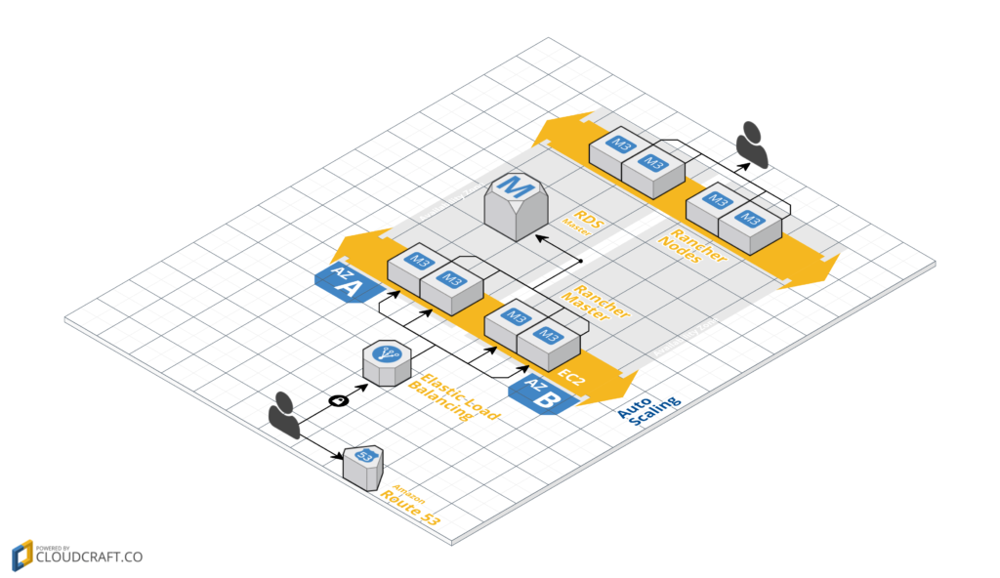

A Detailed Overview of Rancher's ArchitectureThis newly-updated, in-depth guidebook provides a detailed overview of the features and functionality of the new Rancher: an open-source enterprise Kubernetes platform. [Get the eBook](https://more.suse.com/fy21-global-web-landing-page-rancher2-technical-architecture) In my [prior posts](https://rancher.com/author/nick-ma/), I’ve written

about how to ensure a highly resilient workloads using Docker, Rancher,

and various open source tools. For this post, I will build on this prior

knowledge, and to setup an AWS infrastructure for Rancher with some

commonly used tools.

If you check out the

repository [here](https://github.com/codesheppard/terraform-rancher-starter-template),

you should be able to follow along and setup the same infrastructure.

The final output of our AWS infrastructure will look like the following

picture:

 In case you missed

the prior posts, they’re [available on the Rancher blog](https://rancher.com/author/nick-ma/) and cover some reliability

talking points. Lets use those learning and create a running stack.

### Host VM Creation

The sections we will build are the three lower yellow section:

 **Golden Image**

First, we will need a solution to create Docker hosts that use a

reliable combination of storage drivers and OS. We would also like to

replace these with different parts in the future. So we build our base

VM, or the “golden image” as it is more commonly referred to. As for

the tools, [Packer](https://www.packer.io/) will be used to communicate

with the AWS API for creating VM images (and various other cloud

providers). [Ansible](https://www.ansible.com/) will be used to describe

the provisioning steps in a readable manner. The full source can be

found

[here](https://github.com/codesheppard/packer-catalog/tree/master/ubuntu_1404_aufs3), if

you want to jump ahead. Since the previous chain of posts on reliability

used Ubuntu 14.04, our example will provision a VM with Ubuntu 14.04

using AUFS3 for the Docker storage driver. To start, we create a Packer

configuration called `ubuntu_1404_aufs3.json`. In this case, my config

searches for the AMI ID for most recent 14.04 AMI ID on AWS us-east

through `source_ami_filter`, which as of writing returns `ami-af22d9b9`.

It also creates a 40GB drive attached as `/dev/sdb`, which we will use

to store Docker data; We are using Docker 1.12.3, because it is

supported in the latest [Rancher’s compatibility matrix](https://docs.rancher.com/rancher/v1.4/en/hosts/#supported-docker-versions).

```
 {
 "variables": {
 "aws_access_key": "",
 "aws_secret_key": "",
 "docker_version": "1.12.4"
 },
 "builders": [{
 "type": "amazon-ebs",
 "access_key": "{{user `aws_access_key`}}",
 "secret_key": "{{user `aws_secret_key`}}",
 "region": "us-east-1",
 "source_ami_filter": {
 "filters": {
 "virtualization-type": "hvm",
 "name": "*ubuntu/images/hvm-ssd/ubuntu-trusty-14.04-amd64-server-*",
 "root-device-type": "ebs"
 },
 "most_recent": true
 },
 "ami_virtualization_type": "hvm",
 "instance_type": "m3.medium",
 "ssh_username": "ubuntu",
 "ami_name": "Docker {{user `docker_version`}} Ubuntu 14.04 AUFS3 {{timestamp}}",
 "launch_block_device_mappings": [{
 "device_name": "/dev/sdb",
 "volume_size": 40,
 "volume_type": "gp2",
 "delete_on_termination": true
 }],
 "tags": {
 "OS_Version": "Ubuntu",
 "Release": "14.04",
 "StorageDriver": "AUFS3",
 "Docker_Version": "{{user `docker_version`}}"
 }
 }]
 }

 $> packer validate ubuntu_1404_aufs3.json
 Template validated successfully.
```

Great! It passes validation, but if we actually ran it, Packer would

just create a copy of the base AMI with a 40GB drive attached, which

isn’t very helpful. To make it useful, we will also need to provision

Docker on it. Packer has built-in hooks for various configuration

management (CM) tools such as Ansible, Chef, and Puppet. In our case, we

will use the Ansible provisioner.

```
{
"variables": ["..."],
"builders": ["..."],

"provisioners": [
{
"type": "ansible",
"playbook_file": "./playbook.yml",
"extra_arguments": [
"--extra-vars",
"docker_pkg_name='docker-engine={{user `docker_version`}}-0~ubuntu-trusty'"
]
}
]
}
```

The contents of our `playbook.yml` is as follows:

```
---
- name: Install Docker on Ubuntu 14.04
hosts: all
# run as root
become: true
become_user: root

pre_tasks:
- name: format the extra drive
filesystem:
dev: /dev/xvdb
fstype: ext4
- name: mount the extra drive
mount:
name: /secondary
# ubuntu renames the block devices to xv* prefix
src: /dev/xvdb
fstype: ext4
state: mounted
roles:
- role: angstwad.docker_ubuntu
docker_opts: "--graph /secondary --storage-driver=aufs"
```

Prior to running the tool, we will need to grab the Docker installation

role at the root directory containing `ubuntu_1404_aufs3.json`, and run

`ansible-galaxy install angstwad.docker_ubuntu -p` to download a

pre-configured Docker installation role. The

popular [angstwad.docker\_ubuntu](https://github.com/angstwad/docker.ubuntu) role

exposes a lot of options for Docker installation on Ubuntu and follows

the official Docker installation tutorial closely. Finally, we execute

the script below and await our new base image. The end result will be

your base Docker image going forward.

```
 $> packer build ubuntu_1404_aufs3.json
 ... output
 ... output
 ==> amazon-ebs: Creating the AMI: Docker 1.12.4 Ubuntu 14.04 AUFS3 1486965623
 amazon-ebs: AMI: ami-1234abcd
 ==> amazon-ebs: Waiting for AMI to become ready...
```

### AWS Infrastructure Creation

To start creating infrastructure components, please checkout the

following repository for a Rancher architecture template on AWS

**Networking Layer** Next up, most AWS services require setting up a VPC

to provision services without errors. To do this, we will create a

separate VPC with public subnets. The following provides a straight

forward way to setup a standard template. Check out the networking

module

[here](https://github.com/codesheppard/terraform-rancher-starter-template/blob/master/networking/vpc.tf).

In `main.tf`, our entry file for the infrastructure we reference our

network configurations from `./database`, followed by passing in

parameters into our module:

```
module "networking" {
source = "./networking"

aws_region = "${var.aws_region}"
tag_name = "${var.tag_name}"
aws_vpc_cidr = "${var.aws_vpc_cidr}"
aws_public_subnet_cidrs = "${var.aws_public_subnet_cidrs}"
}
```

You can now run the creation of our simple network layer.

```
terraform plan -target="module.networking"
... output ...
Plan: 6 to add, 0 to change, 0 to destroy.

$> terraform apply -target="module.networking"
... output ...
module.networking.aws_subnet.rancher_ha_c: Creation complete
module.networking.aws_subnet.rancher_ha_b: Creation complete
module.networking.aws_subnet.rancher_ha_a: Creation complete
module.networking.aws_route.rancher_ha: Creation complete
```

Apply complete! Resources: 6 added, 0 changed, 0 destroyed. **HA Rancher Server** Next up, let’s setup our networking and use our AMI to setup

HA mode on Rancher. To start, we automate the HA setup of Rancher. With

the latest update to HA process in 1.2+, Rancher no longer requires a

bootstrap node and interdependent steps to put up a HA cluster. The new

steps are:

- Create an External Database (RDS in this post)
- Create a free SSL cert for the HA loadbalancer
- Use an external loadbalancer to route between the 3 nodes (ELB in

  this post)
- Launch HA nodes with an additional flag `--advertise-address` and

  Port Forwarding on `9345`.

With the removal of the bootstrap node, the automation of HA Rancher

setup becomes much easier. Lets begin by creating our external database.

**Create an External Database** Continuing in `main.tf`, we then stand

up our RDS database.

```
 module "database" {
 source = "./database"

vpc_id = "${module.networking.vpc_id}"
 database_subnet_ids = [
 "${module.networking.vpc_subnet_a}",
 "${module.networking.vpc_subnet_b}",
 "${module.networking.vpc_subnet_c}",
 ]
 database_port = "${var.database_port}"
 database_name = "${var.database_name}"
 database_username = "${var.database_username}"
 database_password = "${var.database_password}"
 database_instance_class = "${var.database_instance_class}"
 }
```

The database will then create security groups that consist of subnets

defined in our networking layer. You can see the complete database

terraform template [on GitHub](https://github.com/codesheppard/terraform-rancher-starter-template/blob/master/database/rds.tf).

```
 $> terraform plan -target="module.database"
 ... output ...
 Plan: 3 to add, 0 to change, 0 to destroy.

$> terraform apply -target="module.database"
 ... output ...
 module.database.aws_db_instance.rancherdb: Still creating... (4m20s elapsed)
 module.database.aws_db_instance.rancherdb: Creation complete

Apply complete! Resources: 3 added, 0 changed, 0 destroyed.
```

**Creating a Free Cert for our ELB** For this walkthrough, we use AWS

Certificate Manager (ACM) to manage a SSL cert for our Rancher HA cert.

You can look up how to request a free SSL certificate on the [ACM docs](http://docs.aws.amazon.com/acm/latest/userguide/gs-acm-request.html).

The process of requesting a cert from ACM contains manual steps to

verify the domain name, so we don’t automate this section. Once

provisioned, referencing the SSL certificate is as simple as adding the

following data resource, you can view the file [on GitHub](https://github.com/codesheppard/terraform-rancher-starter-template/blob/master/rancher_server_ha/cert.tf).

```
 data "aws_acm_certificate" "rancher_ha_cert" {
 domain = "${var.fqdn}"
 statuses = ["ISSUED"]
 }
```

**Creating the HA Server Group** Next up we create an ELB setup with its

accompanying security groups. Afterwards, we will add in three EC2 hosts

for Rancher to reside in.

```
 module "rancher_server_ha" {
 source = "./rancher_server_ha"

vpc_id = "${module.networking.vpc_id}"
 tag_name = "${var.tag_name}"

# ssled domain without protocol e.g. moo.test.com
 acm_cert_domain = "${var.acm_cert_domain}"
 # domain with protocol e.g. https://moo.test.com
 fqdn = "${var.fqdn}"

# ami that you created with packer
 ami = {
 us-east-1 = "ami-f05d91e6"
 }

subnet_ids = [
 "${module.networking.vpc_subnet_a}",
 "${module.networking.vpc_subnet_b}",
 "${module.networking.vpc_subnet_c}",
 ]

# database variables to be passed into Rancher Server Nodes
 database_port = "${var.database_port}"
 database_name = "${var.database_name}"
 database_username = "${var.database_username}"
 database_password = "${var.database_password}"
 database_endpoint = "${module.database.endpoint}"
 }
```

The details of the HA Server template creates security groups, ELBs, and

autoscaling groups. This may take a few moments to stand up, as we will

need to wait for EC2 instances to start up.

```
 $> terraform plan -target="module.rancher_server_ha"
 ... output ...
 Plan: 11 to add, 0 to change, 0 to destroy.

$> terraform apply -target="module.rancher_server_ha"
 ... output ...

Apply complete! Resources: 11 added, 0 changed, 0 destroyed.
```

[Cloud Config on HA Instance] We

provision our server node resources inside `./files/userdata.template`

file. It essentially fills in variables to create a cloud-init config

for our instance. The [cloud init docs](http://cloudinit.readthedocs.io/en/latest/index.html) writes a

file called `start-rancher.sh` and then executes it on instance start.

You can view the details of the file

[here](https://github.com/codesheppard/terraform-rancher-starter-template/blob/master/rancher_server_ha/files/userdata.template).

[Point DNS at the ELB] Now you can

point your DNS server at our Rancher ELB that we created. Navigate to

[ELB console](https://console.aws.amazon.com/ec2/v2/home?region=us-east-1#LoadBalancers:search=rancher-ha) from

there you should see the created ELB. You then grab the DNS name for the

ELB and on your domain name provider, add a CNAME record to it. For

example, in this post, I setup Rancher on rancher.domain.com and then

access the admin panel on `https://rancher.domain.com`.

### **Rancher Node Setup**

At this point, we have already setup the Rancher server and we can add

custom hosts or use the Rancher-provided hosts drivers. If we want to

try more automation, here is a potential way to automate autoscaled

slave node clusters on AWS. From the Rancher UI, we follow the

documentation for [adding custom hosts](https://rancher.com/docs/rancher/v1.6/en/hosts/custom/). We will

need to grab a few variables to pass into our cluster setup template. At

the time of writing the custom host command is:

```
 sudo docker run -d --privileged -v /var/run/docker.sock:/var/run/docker.sock -v /var/lib/rancher:/var/lib/rancher rancher/agent:${rancher_agent_version} ${rancher_reg_url}

# Example at the time of writing.
 rancher_reg_url = https://rancher.domain.com/v1/scripts/AAAAABBBBB123123:150000000000:X9asiBalinlkjaius91238
 rancher_agent_version = v1.2.0
```

After pulling a those variables, we can then run the node creation step.

Since this is a separate process than setting up HA, in the file we

initially comment out this the creation of the Rancher nodes.

```
 $> terraform plan -target="module.rancher_nodes"
 ... output ...
 Plan: 3 to add, 0 to change, 0 to destroy.

$> terraform apply -target="module.rancher_nodes"
 ... output ...

Apply complete! Resources: 3 added, 0 changed, 0 destroyed.
```

After a few moments, you should see your Rancher host show up in your

Rancher UI.

### Summary

That was a lot steps, but with this template, we can now build each

Terraform component separately and iterate on the infrastructure layers,

kind of like how Docker images are built up. The nice thing about all

these various components is replaceability. If you don’t like the

choice of OS for the Docker Host, then you can change up the Packer

configurations and update the AMI ID in Terraform. If you don’t like

the networking layer, then take a peek at the Terraform script to update

it. This setup is just a starter template to get Rancher up and your

projects started. By no means is this the best way to standup Rancher,

but the layout of Terraform should allow for continuous improvement as

your project takes off. **Additional Improvements**

- The VPC shown here resides in the public subnet (for simplicity),

  but if you want to secure the network traffic between the database

  and servers, you’ll need to update the networking (this would

  require a rebuild).
- We might be able to look into passing our Rancher nodes into a

  separate project instead of commenting it out.
- Also, we should take a look at how to backup state on Terraform in

  case we lose the folder for state. So a bit more setup into S3

  backup would help for those who plan to use this in production.
- EFS can also be a candidate into the script to add distributed files

  system support to our various nodes.
- Cross region RDS

  replication: [terraform-community-modules/tf\_aws\_rds](https://github.com/terraform-community-modules/tf_aws_rds)
- Use Terraform VPC module managed by the terraform

  community: [terraform-community-modules/tf\_aws\_vpc](https://github.com/terraform-community-modules/tf_aws_vpc)

### Collection of Reference Architectures

There are many reference architectures from various community members

and Rancher contributors that are created by the community. They are

further references after testing this template, and you can reference

their structures to improve on the infrastructure.

**Terraform**

- github.com/mlaccetti/terraform-aws-rancher-ha
- <https://github.com/cloudnautique/terraform-rancher>

For advanced networking variants, there is also a

Cloudformation reference

[here](https://github.com/cloudnautique/terraform-rancher) *Nick Ma is an Infrastructure Engineer who blogs about Rancher and Open Source. You can visit Nick’s blog, [CodeSheppard.com](http://www.codesheppard.com), to catch up on practical guides for keeping your services sane and reliable with open-source solutions.*A Detailed Overview of Rancher's ArchitectureThis newly-updated, in-depth guidebook provides a detailed overview of the features and functionality of the new Rancher: an open-source enterprise Kubernetes platform. [Get the eBook](https://more.suse.com/fy21-global-web-landing-page-rancher2-technical-architecture)
