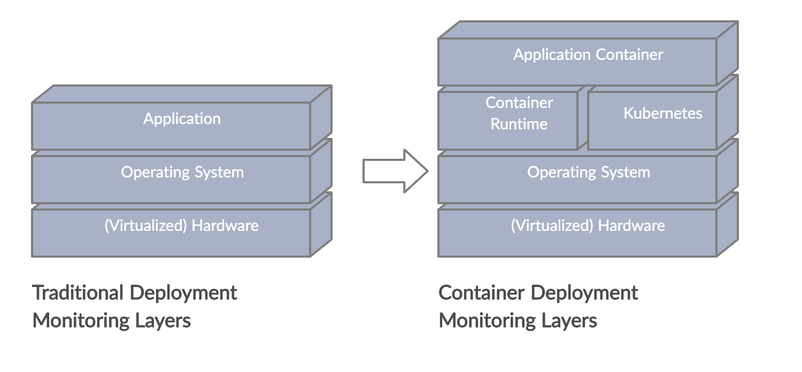
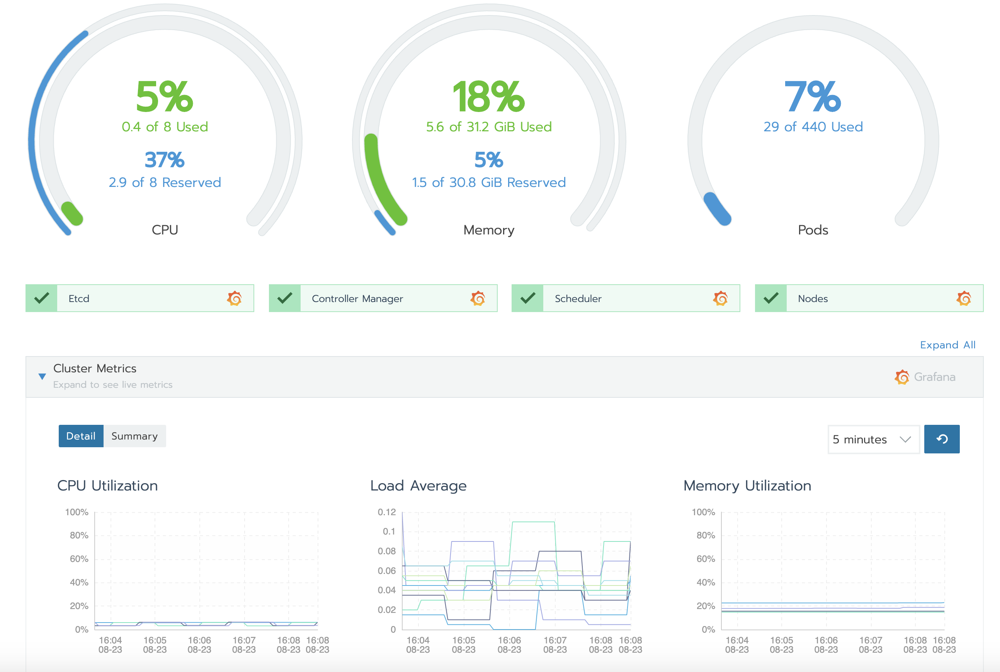
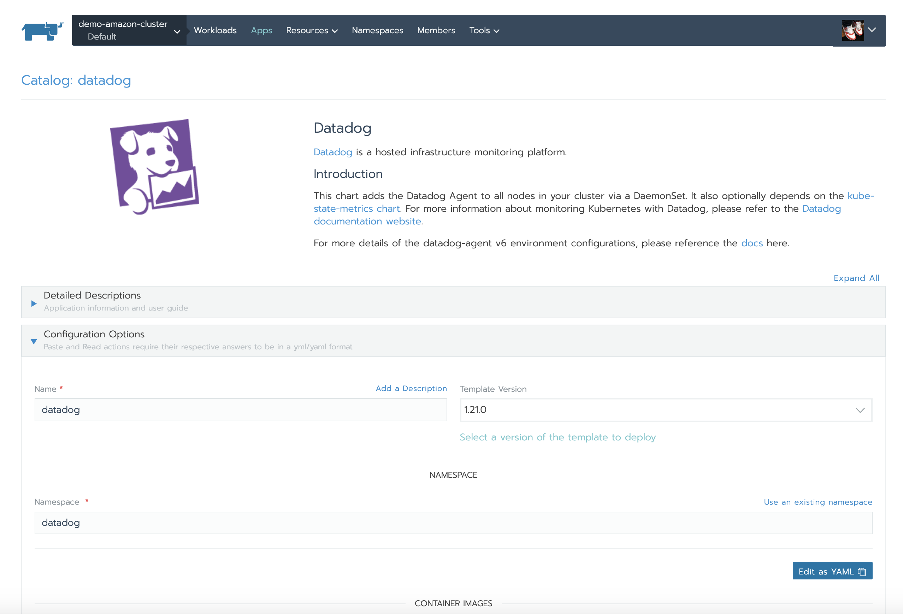

## Introduction

Kubernetes solves the problem of orchestrating containerized applications at scale by replacing the manual processes involved in their deployment, operation, and scaling with automation. While this enables us to run containers in production with great resiliency and comparably low operational overhead, the Kubernetes control plane and the container runtime layer have also increased the complexity of the IT infrastructure stack.

In order to reliably run Kubernetes in production, it is therefore essential to ensure that any existing monitoring strategy targeted at traditional application deployments is enhanced to provide the visibility required to operate and troubleshoot these additional container layers. In this guide, we’ll discuss what additional items need to be monitored and some popular tools to help keep an eye on your applications and infrastructure.

## What to Monitor

A proper monitoring strategy for containerized applications needs to provide visibility into the additional infrastructure layers introduced by Kubernetes orchestration and the container runtime. This leads to the question of what components make up these layers, how to probe their state, and what conditions to alert on.

### Kubernetes Control Plane

The Kubernetes control plane constitutes the brain of the cluster. It’s service components (often referred to as “master components”) provide — among many of other things — container orchestration, compute resource management, and the central API for users and services. An unhealthy control plane will sooner or later affect the availability of applications or ability of users to manage their workloads.

The control plane components include:

- Kubernetes API server
- Controller Manager
- Scheduler
- etcd key-value store

Basic monitoring of these components would involve an HTTP check that queries the health check endpoint (`/healthz`) exposed by instances of these services or by scraping the `componentstatus` endpoint in the Kubernetes API (try `kubectl get componentstatus`).

In addition to simple binary health checks, control plane components expose internal metrics via a Prometheus HTTP endpoint (`/metrics`) that can be ingested into a time-series database. While most of the metric data is primarily useful for retrospective or live issue debugging, some metrics, like latency, request, or error counts, can be used for proactive alerting.

### Kubernetes Infrastructure Services

Beyond the master components, there are a number of other services running in the cluster that provide critical infrastructure functions, such as DNS and service discovery (`kube-dns`, `coredns`) or traffic management (`kube-proxy`). Like control plane components, these components usually provide HTTP endpoints for health checks as well as internal metrics via a Prometheus endpoint. For an example of this, take a look at the functionality provided by the [`coredns` metrics plugin](https://github.com/coredns/coredns/tree/master/plugin/metrics).

### Kubernetes System Resources

Monitoring Kubernetes system resource metrics gives visibility into the amount of compute resources (CPU, memory, and disk) available in the cluster and allows you to track usage down to the pod or node level. A prime example of why you want to monitor system resources is the scenario where allocatable resources in the cluster are starved and you need to act, by adding additional worker nodes, for instance.

Resource metrics are provided by the [Metrics Server](https://kubernetes.io/docs/tasks/debug-application-cluster/resource-metrics-pipeline), a central component that collects usage data from all nodes. The aggregated data can then be queried via the Metrics API endpoint available at `/apis/metrics.k8s.io/`.

### Kubernetes Objects

Kubernetes uses a number of API abstractions that are involved in ensuring the availability of your application containers such as deployments, pods, persistent volumes, and nodes. The [`kube-state-metrics`](https://github.com/kubernetes/kube-state-metrics) server makes metrics on the state and health of these API object available. Including this data in your monitoring allows you to detect failing pods, track the orchestration performance of your cluster, or be alerted when worker nodes become unhealthy for example.

## Monitoring Tools

The above description of what to monitor in Kubernetes is not nearly complete enough to allow you to build a [Kubernetes monitoring tool](https://www.suse.com/c/observability-kubernetes-monitoring-tools-what-they-are-metrics-to-track-and-how-to-choose-one/) from scratch. Luckily, there are a number of excellent monitoring solutions available that offer first-class Kubernetes integration.

What follows is a short, opinionated introduction to two of the available solutions with the aim of giving you a starting point for your own research.

### Prometheus and Grafana

**Deployment type:** On-premise

Build originally as an in-house solution by the team at SoundCloud, Prometheus has become the de-facto standard within the cloud-native ecosystem for metrics-based monitoring and alerting. It works by periodically scraping Prometheus compatible metrics from HTTP endpoints exposed by the instrumented applications. It then persists the data to it’s time-series database. Due to its large number of application-specific integrations (called exporters) and its excellent integration with Kubernetes, you can roll out monitoring of your entire stack, from servers to Kubernetes pods and applications, within minutes.

Since Prometheus only offers a basic dashboard, it is often deployed in tandem with Grafana, a powerful open source analytical and visualization tool.

One potential drawback to using Prometheus is that querying metrics or creating custom dashboards in Grafana may involve a somewhat steep learning curve. Users will need to learn and use the Prometheus-specific PromQL query language to do this work.

This is somewhat mitigated by the great number of existing integrations available. For instance, with Rancher, you can enable Prometheus-based monitoring with the click of a button and observe the state of your cluster with the Rancher GUI and the embedded Grafana dashboards. This also helps you avoid having to learn PromQL to configure alerting since Rancher has an included alert management GUI.

### Datadog

**Deployment type:** SaaS and Agent

Datadog is a SaaS-based monitoring solution that provides monitoring, alerting, and analytics for infrastructure, applications, and services. It uses an agent-based architecture that combines a small daemon process running directly on servers or in a container with a SaaS-based data analytics platform.

One of Datadog’s many noteworthy features is its ability to auto-discover how to monitor containerized applications. It does this through a number of builtin checks for standard applications like Redis or mainstream application servers as well as user configured checks. Another nice touch is that it fully supports monitoring applications that are instrumented with Prometheus endpoints.

Datadog has mature integrations for Kubernetes and Docker that allow the agent to collect events and metrics throughout the entire container stack. These can then then be used to configure customer alerts via a nice graphical UI.

One thing to keep in mind when using Datadog is that its storage and analytics platform is cloud-based. Users must be comfortable with their infrastructure and application monitoring data being stored and processed outside their own premises and managed by a third party.

If you are using Rancher to manage your Kubernetes environments, you can easily install the Datadog agent using the Rancher application catalog:

### Legacy Monitoring

If you are building your Kubernetes platform in a greenfield environment, you probably don’t need to worry about classic monitoring solutions. You can instead try out on one of the above solutions or investigate other cloud-native monitoring options.

Often though, you do have an existing monitoring solution in place. Maybe a classic monitoring solution like Nagios or Zabbix, for example. In these cases, you might consider continuing to use the original system to monitor the hardware resources and operating system of cluster nodes. You can introduce an additional monitoring component on top to provide visibility into the Kubernetes control plane, container runtime, and containerized applications.

Running two monitoring solutions side-by-side can create some operational problems however. For example, difficulties can arise when attempting to configure centralized alerting or when attempting to correlate events and metrics from different sources.

One solution to this problem is integrating the data of both systems. For example, you could feed the data collected by the secondary system into the primary monitoring solution, or vice-versa. There are tools available, like this [Zabbix exporter](https://github.com/MyBook/zabbix-exporter) to help load data from one system to another. Once that is configured, you’ll be able to use a single data source for alerting and dashboards.

If your existing monitoring solution already provides integration with Kubernetes (for instance, if you are using Elastic Metricbeat), you might not have to introduce an additional component in your monitoring stack at all. In those situations, you can just configure additional checks and alerting rules to get your [Kubernetes monitoring](/blog/introduction-to-kubernetes-monitoring/) in place.

## Conclusion

In this guide, we looked at some of the essential subsystems of Kubernetes to monitor and alert on. While Kubernetes environments require some of the same monitoring attention as traditional systems, there are some additional components that benefit from extra visibility. Fortunately, many monitoring systems have well-tested Kubernetes integrations and newer cloud-native monitoring systems offer solutions architected specifically with Kubernetes in mind. With many high quality options available, it’s often easier than it initially appears to get monitoring configured for clustered environments.
