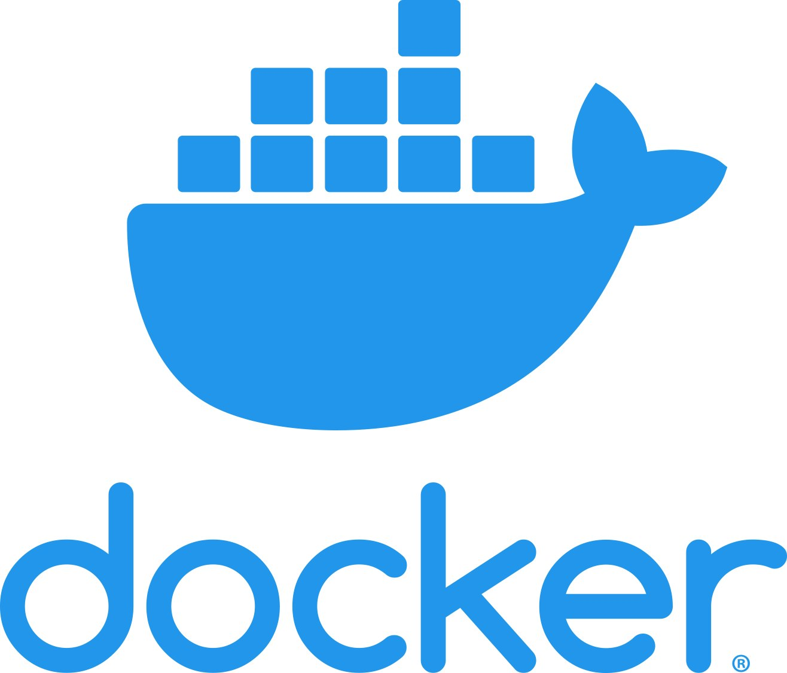
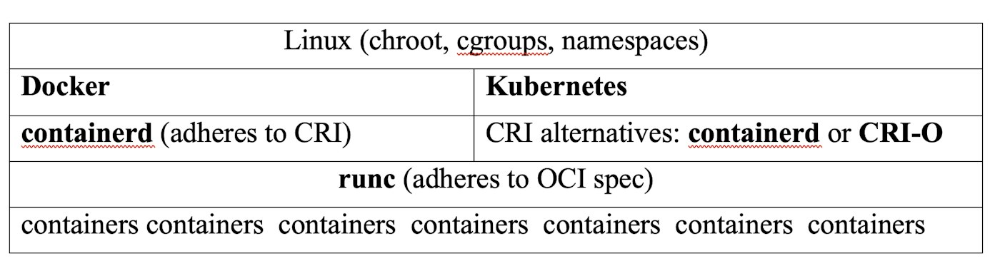
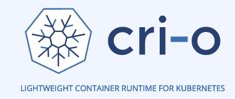
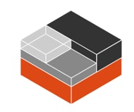

## A deep dive into container stacks and the choices the ecosystem provides

Docker appeared in 2013 and popularized the idea of containers to the point that most people still equate the notion of a container to a “Docker container.”

Being first in its category, Docker set some standards that newcomers must adhere to. For example, there is a large repository of Docker system images. All of the alternatives had to use the same image format while trying, at the same time, to change one or more parts of the entire stack on which Docker was based.

In the meantime, new container standards appeared, and the container ecosystem grew in different directions. Now there are many ways to work with containers besides Docker.

In this blog post, I will

- introduce *chroot*, *cgroups* and *namespaces* as the technical foundation of containers
- define the software stack that Docker is based upon
- state the standards that Docker and Kubernetes adhere to and then
- describe alternative solutions which try to replace the original Docker containers with better and more secure components.

## Software Stack for Containers

Linux features such as chroot calls, cgroups and namespaces help containers run in isolation from all other processes and thus guarantee safety during runtime.

### Chroot

All Docker-like technologies have their roots in a *root* directory of a Unix-like operating system (OS). Above the root directory is a root file system and other directories.

On Linux, root directory is both the basis of file system and the start of all other directories. This is dangerous in the long term, as any unwanted deletion in the root directory affects the entire OS. That’s why a system call **chroot()** exists. It creates additional root directories, such as one to run legacy software, another to contain databases, etc.

To all those environments, **chroot** appears to be a true root directory, but in reality, it just prepends pathnames to any name starting with. The real root directory still exists; any process can refer to any location beyond the designated root.

### Linux cgroups

Control groups (*cgroups*) have been a feature of the Linux kernel since version 2.6.24 in 2008. A cgroup will limit, isolate and measure usage of system resources (memory, CPU, network and I/O) for several processes at once.

Let's say we want to prevent our users from sending many email messages from the server. We create a cgroup with memory limit of 1GB and 50 percent of CPU and add the application process id to the group. The system will throttle down the email-sending process when these limits are reached. It may even kill the process, depending on the hosting strategy.

### Namespaces

Linux *namespace* is another useful abstraction layer. A namespace allows us to have many process hierarchies, each with its own nested “subtree.” A namespace can use a global resource and present it to its members as if it were their own resource.

Here’s an example. A Linux system starts with a process identifier (PID) of 1 and all other processes will be contained in its tree. PID namespace allows us to span a new tree, with its own PID 1 process. There are now two PIDs with the value of 1. Each namespace can spawn its own namespaces and the same process can have several PIDs attached to it.

A process in a child namespace will have no idea of the parent's process existence, while the parent namespace will have access to the entire child namespace.

There are seven types of namespaces: cgroup, IPC, network, mount, PID, user and UTS.

### Network Namespace

Some resources are scarce. By convention, some ports have predefined roles and should not be used for anything else: port 80 only serves HTTP calls, port 443 only serves HTTPS calls and so on. In a shared hosting environment, two or more sites can listen to HTTP requests from port 80. The one that first got hold of it, would not let any other app access the data on that port. That first app would be visible on the Internet, while all the others would be invisible.

The solution is to use *network namespaces,* with which inner processes will see different network interfaces.

In one network namespace, the same port can be open, while in another, it may be shut down. For this to work, we must adopt additional “virtual” network interfaces, which belong to several namespaces simultaneously. There also must be a router process somewhere in the middle, to connect requests coming to a physical device to the appropriate namespace and the process in it.

Complicated? Yes! That’s why Docker and similar tools are so popular. Let’s now introduce Docker and see how it compares to its alternatives.

## Docker: Containers Everyone!

Before containers came to rule the world of cloud computing, virtual machines were quite popular. If you have a Windows machine but want to develop mobile apps for iOS, you can either buy a new Mac (expensive but excellent solution) or install its virtual machine onto the Windows hardware (a cheap but slow and unreliable solution). VMs can also be clumsy, they often gobble up resources that they do not need and are usually slow to start (up to a minute).

Enter containers.

**Containers are standard units of software that have everything needed for the program to run: the operating system, databases, images, icons, software libraries, code and everything else.** A container also runs in isolation from all other containers and even from the OS itself. Containers are lightweight compared to VMs, so they can start fast and are easily replaced.

To run isolated and protected, containers are based on chroot, cgroups and namespaces.

The *image*of a container is a template from which the application is formed on the actual machine. Creating as many containers as needed from a single image is possible. A text document called Dockerfile contains all the information needed to assemble an image.

The true revolution that Docker brought was **creation of a registry of docker images** and **the development of Docker engine**, with which those images ran everywhere in the same manner. Being the first and widely adopted, an implicit world standard for container images was formed and all eventual competitors had to pay attention to it.

### CRI and OCI

*Open Container Initiative* or [OCI](https://opencontainers.org/)  publishes specifications for images and containers. It was started in 2015 by Docker and was accepted by Microsoft, Facebook, Intel, VMWare, Oracle and many other industry giants.

OCI also implements the specification It is called **runc**and dealsdirectly with containers, creates them, runs them and so on.

*Container Runtime Interface* or [CRI](https://cri-o.io/) is a Kubernetes API that defines how Kubernetes interacts with container runtimes. It also is standardized so you can choose which CRI implementation to adopt.

## Software Stack for Containers with CRI and OCI

The software stack that runs containers will have Linux as its most basic part:

Note that **containerd** and **CRI-O** both adhere to the CRI and OCI specifications. For Kubernetes, it means that it can use either **containerd** or **CRI-O** without the user ever noticing the difference. It can also use any of the other alternatives that we are now going to mention – which was exactly the goal when software standards such as OCI and CRI were created and adopted.

## Docker Software Stack

The software stack for [Docker](https://www.docker.com/) is

-- **docker-cli**, Docker command line interface for developers

-- **containerd**, originally written by Docker, later spun off as an independent project; it implements the CRI specification

-- **runc**, which implements the OCI spec

-- **containers** (using chroot, cgroups, namespaces, etc.)

The software stack for Kubernetes is almost the same; instead of **containerd**, Kubernetes uses **CRI-O**, a CRI implementation created by Red Hat/IBM and others.

### containerd

[containerd](https://containerd.io/docs/getting-started/) runs as a daemon on Linux and Windows. It loads images, executes them as containers, supervises low-level storage and takes care of the entire container runtime and lifecycle.

Containerd started as a part of Docker in 2014 and in 2017 became a part of Cloud Native Computing Foundation ([CNCF](https://www.cncf.io/)). The CNCF is a vendor-neutral home for Kubernetes, Prometheus, Envoy, containerd, CRI-O, podman and other cloud-based software.

### runc

runc is a reference implementation for the OCI specification. It creates and runs containers and the processes within them. It uses lower-level Linux features, such as cgroups and namespaces.

Alternatives to **runc** include kata-runtime, gVisor and CRI-O.

[kata-runtime](https://github.com/kata-containers/runtime) implements the OCI specification using hardware virtualization as individual lightweight VMs. Its runtime is compatible with OCI, CRI-O and containerd, so it works seamlessly with Docker and Kubernetes.

[gVisor](https://gvisor.dev/docs/) from Google creates containers that have their own kernel. It implements OCI through a program called **runsc**, which integrates with Docker and Kubernetes. A container with its own kernel is more secure than without, but it is not a panacea, and there is a penalty to pay in resource usage with that approach.

###

[CRI-O](https://cri-o.io/), a container stack designed purely for Kubernetes, was the first implementation of the CRI standard. It pulls images from any container registry and serves as a lightweight alternative to using Docker.

Today it supports **runc** and **Kata Containers** as the container runtimes, but any other OC-compatible runtime can also be plugged in (at least, in theory).

It is a CNCF incubating project.

## Podman

[Podman](https://podman.io/) is a daemon-less Docker alternative. Its commands are intentionally as compatible with Docker as possible, so you can make an alias and start using word “docker” instead of “podman” in a CLI interface.

Podman aims to replace Docker, so sticking to the same set of commands makes sense. Podman tries to improve on two problems in Docker.

First, Docker is always executing with an internal daemon. The daemon is single process, running in the background. If it fails, the whole system will fail.

Second, Docker runs as a background process with root privileges, so when you give access to a new user, you are actually giving access to the entire server.

Podman is a remote Linux client that runs containers directly from the operating system. You also can run them completely rootless.

It downloads images from DockerHub and runs them in exactly the same way as Docker, with exactly the same commands.

Podman runs the commands and the images as user other than root, so it is more secure than Docker.

On the other hand, many tools developed for Docker are not available on Podman, such as [Portainer](https://www.portainer.io/) and Watchtower. Moving away from Docker means sacrificing your established workflow.

Podman has a similar directory structure to [buildah](https://buildah.io/), [skopeo](https://github.com/containers/skopeo) and [CRI-I](http://cri-o/). Its pods are also very similar to Kubernetes pods.

Developed by RedHat, Podman is a player to watch in this space.

## Honorable Mention: LXC/LXD

Introduced in 2008, LXC (LinuX Containers) stack was the first upstream-kernel container on Linux. The first version of Docker used LXC but in a later development, they moved away, having implemented **runc**.

The goal of LXC is to run multiple *isolated Linux virtual environments* on a control host using a single Linux kernel. To that end, it uses cgroups functionality without needing to start any virtual machines; it also uses namespaces to completely isolate the application from the underlying system.

LXC aims to create system containers, almost like you would have in a virtual machine – but without the overhead that comes from trying to emulate the entire virtualized hardware.

LXC does not emulate hardware and packages but contains only the needed applications, so it executes almost at the bare metal speed. In contrast, virtual machines contain the entire OS, then emulate hardware such as hard drives, virtual processor and network interfaces.

So, LXC is small and fast while VMs are big and slow. On the other hand, virtual environments cannot be packaged into ready-made and quickly deployable machines and are difficult to manage through GUI management consoles. LXC requires high technical skills, and the result may be an optimized machine that is incompatible with other environments.

## LXC vs Docker Approach

LXC Is like a supercharged chroot on Linux and produces “small” servers that boot faster and need less RAM. Docker, however, offers much more:

- **Portable deployment across machines**: the object that you create with one version of Docker can be transferred and installed onto any other Docker-enabled Linux host.
- **Versioning**: Docker can track versions in a git-like manner – you can create new versions of a container, roll them back and so on.
- **Reusing components**: With Docker, you can stack already created packages into new packages. If you want a LAMP environment, you can install its components once and then reuse them as an already pre-made LAMP image.
- **Docker image archive**: hundreds of thousands of Docker images can be downloaded from dedicated sites, and it is very easy to upload a new image to one such repository.

Finally, LXC is geared toward *system admins* while Docker is more geared to *developers.* That's why Docker is more popular.

## LXD

LXD has a privileged daemon that exposes a REST API over a local UNIX socket and over the network (if enabled). You can access it through a command line tool, but it always communicates with REST API calls. It will always function the same whether the client is on your local machine or somewhere on a remote server.

LXD can scale from one local machine to several thousand remote machines. Like Docker, it is image-based, with images available for the more popular Linux distributions. [Canonical,](http://www.canonical.com/) the company that owns Ubuntu, is financing the development of LXD, so it will always run on the latest versions of Ubuntu and other similar Linux operating systems.

LXD integrates seamlessly with [OpenNebula](https://opennebula.io/) and [OpenStack](https://www.openstack.org/) standards.

Technically, LXD is written “on top” of LXC (both are using the same *liblxc*library and Go language to create containers) but the goal of LXD is to improve user experience compared to LXC.

## Docker Forever or Not?

Docker boasts 11 million developers, 7 million applications and 13 billion monthly image downloads. To say that Docker is still the leader would be an understatement. However, this article shows that replacing one or more parts of the Docker software stack is possible, often without compatibility problems. Alternatives do exist, with security as the main goal compared to what Docker offers.
