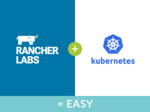
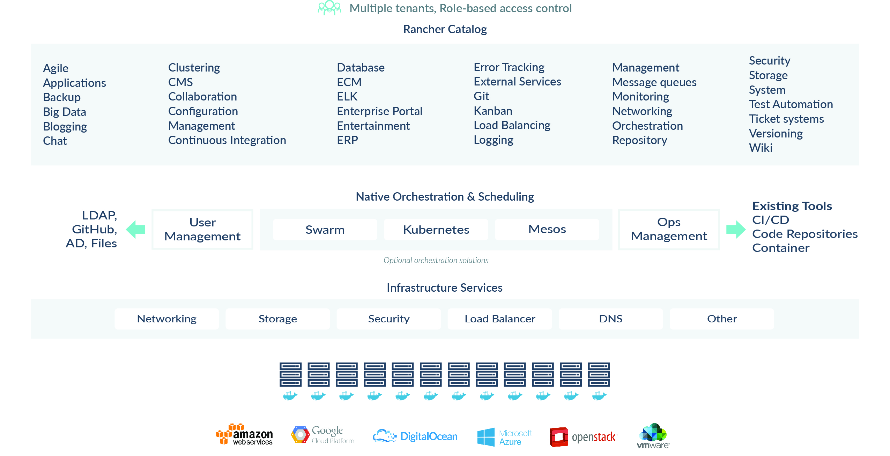

### If you’re going to successfully deploy containers in production, you need more than just container orchestration

## Kubernetes is a valuable tool

Kubernetes is an open-source container orchestrator for deploying and

managing containerized applications. Building on 15 years of experience

running production workloads at Google, it provides the advantages

inherent to containers, while enabling DevOps teams to build

container-ready environments which are customized to their needs.

The Kubernetes architecture is comprised of loosely coupled components

combined with a rich set of APIs, making Kubernetes well-suited

for running highly distributed application architectures, including

microservices, monolithic web applications and batch applications. In

production, these applications typically span multiple containers across

multiple server hosts, which are networked together to form a cluster.

Kubernetes provides the orchestration and management capabilities

required to deploy containers for distributed application workloads. It

enables users to build multi-container application services and schedule

the containers across a cluster, as well as manage the health of the

containers. Because these operational tasks are automated, DevOps team

can now do many of the same things that other application platforms

enable them to do, but using containers.

## But configuring and deploying Kubernetes can be hard

It’s commonly believed that Kubernetes is the key to successfully

operationalizing containers at scale. This may be true if you are

running a single Kubernetes cluster in the cloud or have reasonably

homogenous infrastructure. However, many organizations have a diverse

application portfolio and user requirements, and therefore have more

expansive and diverse needs. In these situations, setting up and

configuring Kubernetes, as well as automating infrastructure deployment,

gives rise to several challenges:

1. Creating a Kubernetes environment that is customized to the DevOps

   teams’ needs
2. Automating the deployment of multiple Kubernetes clusters
3. Managing the health of Kubernetes clusters (e.g. detecting and

   recovering from etcd node problems)
4. Automating the upgrade of Kubernetes clusters
5. Deploying multiple clusters on premises and/or across disparate

   cloud providers
6. Ensuring enterprise readiness, including access to 24x7 support
7. Customizing then repeatedly deploying multiple combinations of

   infrastructure and other services (e.g. storage, networking, DNS,

   load balancer)
8. Deploying and managing upgrades for Kubernetes add-ons such as

   Dashboard, Helm and Heapster

## Rancher is designed to make Kubernetes easy

Containers make software development easier by making code portable

across development, test, and production environments. Once in

production, many organizations look to Kubernetes to manage and scale

their containerized applications and services. But setting up,

customizing and running Kubernetes, as well as combining the

orchestrator with a constantly changing set of technologies, can be

challenging with a steep learning curve. The Rancher container

management platform makes it easy for you to manage all aspects of

running containers. You no longer need to develop the technical skills

required to integrate and maintain a complex set of open source

technologies. Rancher is not a Docker orchestration tool—it is the

most complete container management platform. Rancher includes everything

you need to make Kubernetes work in production on any infrastructure,

including:

- A certified and supported Kubernetes distribution with simplified

  configuration options
- Infrastructure services including load balancers, cross-host

  networking, storage drivers, and security credentials management
- Automated deployment and upgrade of Kubernetes clusters
- Multi-cluster and multi-cloud suport
- Enterprise-class features such as role-based access control and 24x7

  support

#### **We included a fully supported Kubernetes distro**

The certified and supported Kubernetes distribution included with

Rancher makes it easy for you to take advantage of proven, stable

Kubernetes features. Kubernetes can be launched via the easy to use

Rancher interface in a matter of minutes. To ensure a consistent

experience across all public and private cloud environments, you can

then leverage Rancher to manage underlying containers, execute commands,

and fetch logs. You can also use it to stay up-to-date with the

latest stable Kubernetes release as well as adopt upstream bug fixes in

a timely manner. You should never again be stuck with old, outdated and

proprietary technologies. The Kubernetes Dashboard can be automatically

started via Rancher, and made available for each Kubernetes environment.

Helm is automatically made available for each Kubernetes environment as

well, and a convenient Helm client is included in the out-of-the-box

kubectl shell console.

#### **We make Kubernetes enterprise- and production-ready**

Rancher makes it easy to adopt open source Kubernetes while complying

with corporate security and availability standards. It provides

enterprise readiness via a secure, multi-tenant environment, isolating

resources within clusters and ensuring separation of controls. A private

registry can be configure that is used by Kubernetes and tightly coupled

to the underlying cluster (e.g. Google Cloud Platform registry can be

used only in a GCP cluster, etc.). Features such as role-based access

control, integration with LDAP and active directories, detailed audit

logs, high-availability, metering (via Heapster), and encrypted

networking are available out of the box. Enterprise-grade 24x7x365

support provides you with the confidence to deploy Kubernetes and

Rancher in production at any scale.

#### \*\*Multi-cluster, multi-cloud deployments? No problem \*\*

Quickly get started with Rancher and Kubernetes by following the

step-by-step instructions in the latest release of the [Kubernetes eBook](https://info.rancher.com/deploying-scaling-kubernetes-ebook).

Rancher makes it possible to run multi-node, multi-cloud clusters, and

even deploy stateful applications. With Rancher, Kubernetes clusters

can span multiple resource pools and clouds. All hosts that are added

using Docker machine drivers or manual agent registration will

automatically be added to the Kubernetes cluster. The simple to use

Rancher user interface provides complete visibility into all hosts, the

containers running in those hosts, and their overall status.

## But you need more than just container orchestration...

Kubernetes is maturing into a stable platform. It has strong adoption

and ecosystem growth. However, it’s important not to lose sight that

the end goal for container adoption is to make it easier and more

efficient for developers to create applications and for operations to

manage them. Application deployment and management requires more than

just orchestration. For example, services such as load balancers and

DNS are required to run the applications.

#### **Customizable infrastructure services**

The Rancher container management platform makes it easy to define and

save different combinations of networking, storage and load balancer

drivers as environments. This enables users to repeatedly deploy

consistent implementations across any infrastructure, whether it is

public cloud, private cloud, a virtualized cluster, or bare-metal

servers. The services integrated with Rancher include:

- Ingress controller with multiple load balancer implementations

  (HAproxy, traefik, etc.)
- Cross-host networking drivers for IPSEC and VXLAN
- Storage drivers
- Certificate and security credentials management
- Private registry credential management
- DNS service, which is a drop-in replacement for SkyDNS
- Highly customizable load balancer

If you choose to deploy an ingress controller on native Kubernetes, each

provider will have its own code base and set of configuration values.

However, Rancher load balancer has a high level of customization to meet

user needs. The Rancher ingress controller provides the flexibility to

select your load balancer of choice—including HAproxy, Traefik, and

nginx—while the configuration interface remains the same. Rancher also

provides the ability to scale the load balancer, customize load balancer

source ports, and schedule the load balancer on a specific set of hosts.

#### A complete container management platform

You’ve probably figured this out for yourself by now but, to be clear,

Rancher is NOT a container orchestrator. It is a complete container

management platform that includes everything you need to manage

containers in production. You can quickly deploy and run multiple

clusters across multiple clouds with a click of the button using Rancher

or select from one of the integrated and supported container

orchestrator distributions, including Kubernetes as well as Mesos,Docker

Swarm and Windows. Pluggable infrastructure services provide the basis

for portability across infrastructure providers Whether running

containers on a single on-premises cluster or multiple clusters running

on Amazon AWS and other service providers, Rancher is quickly becoming

the container management platform of choice for thousands of Kubernetes

users.

## Get started with containers, Kubernetes, and Rancher today!

For step-by-step instructions on how to get started with Kubernetes

using the Rancher container management platform, please refer to the

Kubernetes eBook, which is available

[here](https://info.rancher.com/deploying-scaling-kubernetes-ebook). Or,

if you are heading to KubeCon 2017 in Berlin, stop by booth S17 and we

can give you an in-person demonstration. *Louise is the Vice President of Marketing at Rancher Labs where she is focused on defining and executing impactful go-to-market strategy and marketing programs by analyzing customer needs and market trends. Prior to joining Rancher, Louise was Marketing Director for IBM’s Software Defined Infrastructure portfolio of big data, cloud native and high performance computing management solutions. Before the company was acquired by IBM in 2012, Louise was Director of Marketing at Platform Computing. She has 15+ years of marketing and product management experience, including roles at SGI and Sun Microsystems. Louise holds an MBA from Santa Clara University’s Leavey School of Business and a Bachelor’s degree from University of California, Davis. You can follow Louise in Twitter [@lwestoby](https://twitter.com/lwestoby).*
