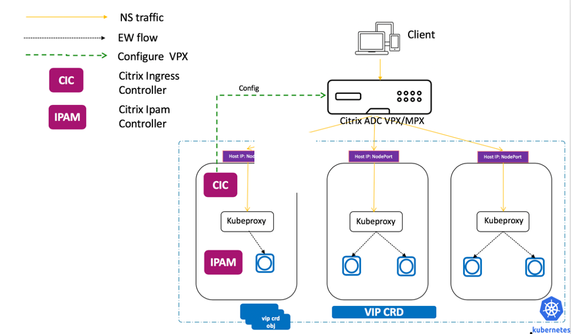
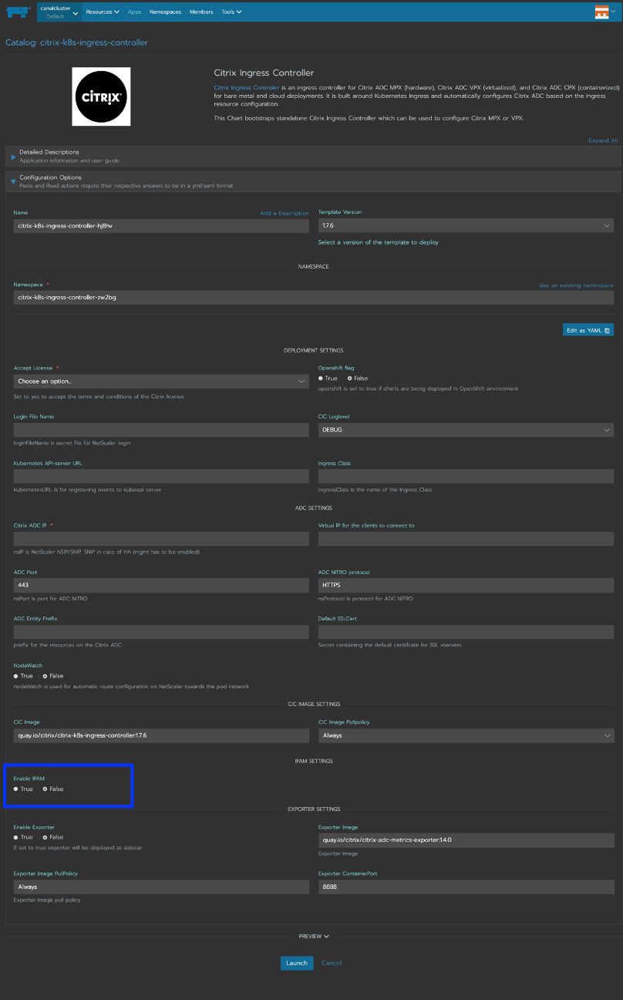
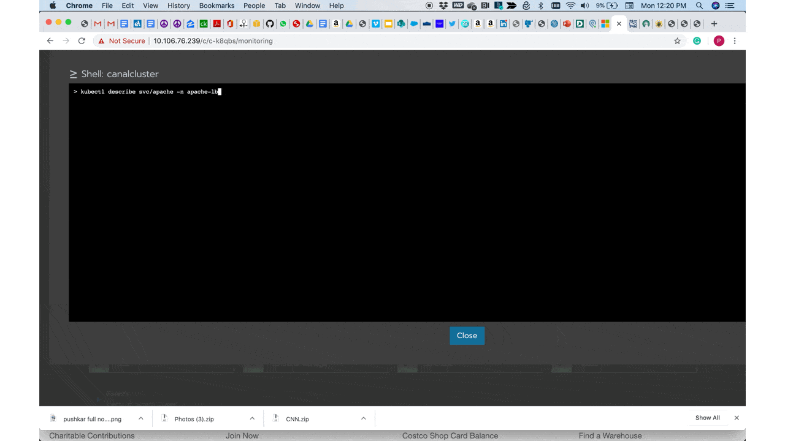
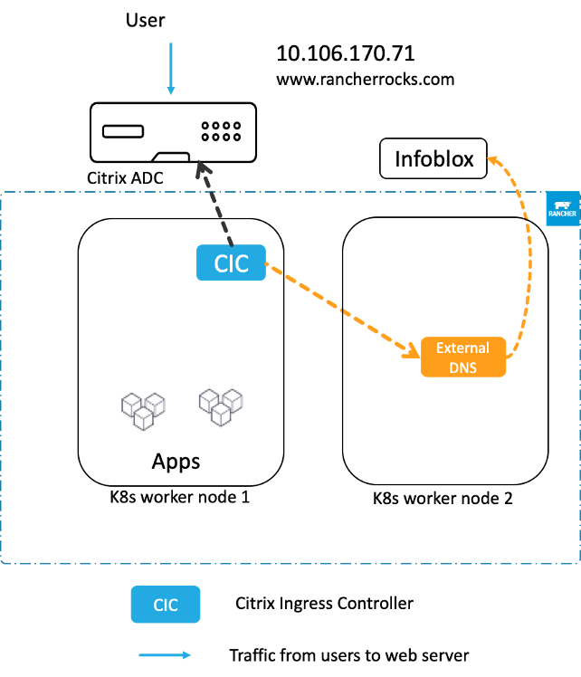

Read our free white paper: How to Build a Kubernetes Strategy[Download Now](https://more.suse.com/fy21-global-web-landing-page-how-to-build-enterprise-kubernetes-strategy)

The public cloud offers great scalability and flexibility for customers and is a model where service providers make many decisions on their behalf. For example, in cloud service providers like Google Cloud Platform (GCP), Amazon Web Service (AWS) or Microsoft Azure, a cloud load balancer is spun up on demand. The load balancer gets an IP address automatically and your application is ready to be served.

The Citrix ADC cloud-native portfolio brings that same experience to customers using Rancher on-premise. In this blog, we’ll explore how Citrix ADC and Rancher work together to offer a seamless cloud balancer deployment.

Kubernetes provides services that define a logical set of pods, as well as policies to access them. These services can be used to expose microservices both inside and outside the cluster. There are three primary types of services you can use: [ClusterIP](https://kubernetes.io/docs/concepts/services-networking/service/#publishing-services-service-types), [NodePort](https://kubernetes.io/docs/concepts/services-networking/service/#nodeport) and [LoadBalancer](https://kubernetes.io/docs/concepts/services-networking/service/#loadbalancer). Each provides a different paradigm through which services are exposed.

We’ll look at a service of type LoadBalancer and how it can be used to provision an external load balancer with [Citrix ADC](https://www.citrix.com/products/citrix-adc/) on Rancher clusters. We can achieve this using [Citrix Ingress Controller](https://developer-docs.citrix.com/projects/citrix-k8s-ingress-controller/en/latest/) (CIC) and [Citrix IPAM Controller](https://developer-docs.citrix.com/projects/citrix-k8s-ingress-controller/en/latest/crds/vip/).

## Service of Type LoadBalancer

Service of type LoadBalancer in Kubernetes enables you to directly expose services to the outside world without using an ingress resource. It’s generally made available only by cloud providers, who spin up their own native cloud load balancers and assign an external IP through which the service can be accessed. This helps users to deploy microservices easily and expose them to the outside world.

By default, in a Rancher cluster, service of type LoadBalancer simply exposes NodePorts for the service. We will use this to configure an external Citrix load balancer like Citrix MPX or VPX, which are being used on-prem by our customers.

Citrix Ingress Controller watches the Kubernetes API server and configures the ingress device – the Citrix ADC – whenever changes occur. Citrix Ingress Controller supports service of type LoadBalancer on Rancher clusters, as well. If such a service is created in the cluster, the Citrix Ingress Controller will automatically configure the service on the external load balancer, and you can access the service using the external IP. The Citrix Ingress Controller assigns this IP to the LoadBalancer service with the help of the citrix-ipam-controller, an auxiliary pod that runs parallel to the CIC and manages IP addresses.

How the citrix-ipam-controller Works
The citrix-ipam-controller pod runs in the cluster and is responsible for managing IP addresses. At start up, the IP address ranges pass through the yaml file to the citrix-ipam-controller, which uses them to allocate IPs to each load balancer service on that cluster. The deployment architecture looks like this:



The citrix-ipam-controller also requires you to install a [Custom Resource Definition](https://developer-docs.citrix.com/projects/citrix-k8s-ingress-controller/en/latest/crds/vip/) (CRD) for internal communication between the Citrix Ingress Controller and the citrix-ipam-controller. The vip CRD is a custom resource definition that contains fields for service-name, namespace and IP address.

Once the service is deployed in the cluster, the Citrix Ingress Controller creates a vip CRD instance for that service. The citrix-ipam-controller allocates IPs to these vip CRD objects. Then the CIC consumes these CRD objects for configuring the VPX. The citrix-ipam-controller allocates an IP address to access the service from outside.

The picture below summarizes the steps involved in IPAM and CIC to configure Citrix ADC


The Citrix Ingress Controller, along with citrix-ipam-controller, provides an end-to-end solution for service of type LoadBalancer in a Rancher cluster. There, it can take care of IP management and configuration of the external load balancer.

## Service of Type LoadBalancer: An Example Deployment

Here’s how to deploy a service of type LoadBalancer. You can find the related yamls here.

1. Deploy vip.yaml to create the VIP crd
   kubectl create -f vip.yaml
2. Deploy cic-vpx.yaml with –ipam=citrix-ipam-controller passed as argument
   kubectl create -f cic.yaml
   OR
   Use Rancher APP catalog to enable IPAM
   
3. Deploy the ipam\_deploy.yaml file to run ipam controller
   Update the appropriate routable IP range with a valid CIDR in ipam\_deploy.

   ```
       yaml for example: - name: "VIP_RANGE"
       value: ' [“10.99.98.0/24”, {“Demo”: [“10.106.170.71”]}]'
   ```

   Note in the command above, I am going to force IPAM to give me IP address 10.106.170.71
   To learn more about VIP\_RANGE refer VIP RANGE

   ```
       kubectl create -f ipam_deploy.yaml
   ```
4. Create any service of type LB, the service used here is a sample app
   kubectl create -f apache-serv.yaml

   ```
       apiVersion: v1
       kind: Service
       metadata:
       annotations:
       service.citrix.com/ipam-range: "Demo"
       name: apache
       labels:
       name: apache
       spec:
       externalTrafficPolicy: Local
       type: LoadBalancer
       selector:
       name: apache
       ports: - name: http
       port: 80
       targetPort: http
       selector:
       app: apache
   ```

The service of type LoadBalancer is available to use after the pods are up and running. You can view the service with ‘kubectl get svc’ and test it using curl http://10.106.170.71



## Integration with ExternalDNS

If the DNS entry of assigned IP address is finished, then cloud load balancer–like functionality can be completed. For this we can use External DNS, which integrates seamlessly with Citrix Cloud Native Stack. Here is the snippet on service type loadbalancer deployment:

```
    apiVersion: v1
    kind: Service
    metadata:
      annotations:
        service.citrix.com/ipam-range: "Demo"
        external-dns.alpha.kubernetes.io/hostname: “www.rancherrocks.com”
      name: apache
      labels:
        name: apache
    spec:
      externalTrafficPolicy: Local
      type: LoadBalancer
      selector:
        name: apache
      ports:
      - name: http
        port: 80
        targetPort: http
      selector:
        app: apache
```

The image below shows the entire communication between Citrix Ingress Controller and ExternalDNS with InfoBlox. The IP address assigned by Citrix IPAM controller is automatically added in DNS entry mapping www.rancherrocks.com to IP address assigned by IPAM.



## What’s Next?

Learn more about the service of type Load Balancer feature and citrix-ipam-controller [here](https://github.com/citrix/citrix-k8s-ingress-controller/blob/eeef81b85b9be2374c25490052aab45159413ad3/docs/network/type_loadbalancer.md). And keep an eye out. We integrate Citrix Ingress Controller’s service of type LoadBalancer functionality with other externally available IP management implementations to provide more flexibility.

Read our free white paper: How to Build a Kubernetes Strategy[Download Now](https://more.suse.com/fy21-global-web-landing-page-how-to-build-enterprise-kubernetes-strategy)
