In the [first part of
this post](https://rancher.com/building-a-nodejs-app-using-mongodb-and-rancher-part-1/ "Building a NodeJS App using MongoDB and Rancher – Part 1"),
I created a full Node.js application stack using MongoDB as the
application’s database and Nginx as a load balancer that distributed
incoming requests to two Node.js application servers. I created the
environment on Rancher and using Docker containers.

In this post I will go through setting up Rancher authentication with
GitHub, and creating a webhook with GitHub for automatic
deployments.

## []Rancher Access Control

Starting from version 0.5, Rancher can be configured to restrict
access to a set of GitHub users and organization members (you can read a
blog about it
[here](https://rancher.com/rancher-now-supports-github-oauth/ "Rancher now supports GitHub OAuth")).
Using this feature ensures that no one other than authorized users can
access Rancher server through the web UI.

After setting up the rancher server, you should see message that says
“Access Control is not configured” :

[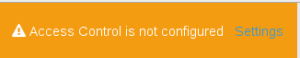](https://cdn.rancher.com/wp-content/uploads/2015/03/10145411/Raccesscontrol.png)

Click on settings and on the Access Control panel you will be
instructed on how to setup and register new application with GitHub. The
instructions will provide you with a
[link](https://github.com/settings/applications) to GitHub application settings.

Now on GitHub Application Settings page, click on Register new
application:

[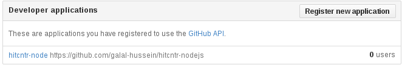](images/rancher_blog_R2.png)

Now you will put some information about Rancher’s server:

Application name: any name you choose

Homepage URL: Rancher server url

Application description: any description

Authorization callback URL: also Rancher server url.

[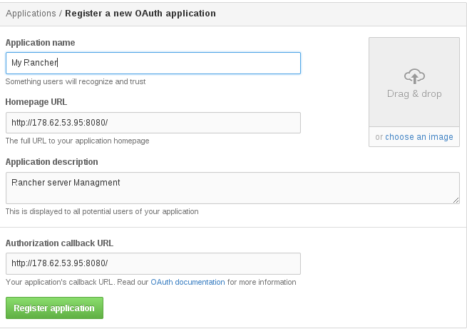](images/rancher_blog_R3.png)

After clicking on Register Application, you will be provided with
a Client ID and Client Secret, which are both used to register the user
to the Rancher server:

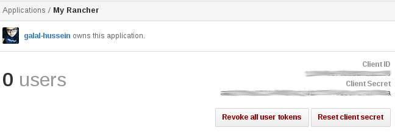

Now add the Client ID and Client Secret to the Rancher management
server, click on Authenticate with Github:

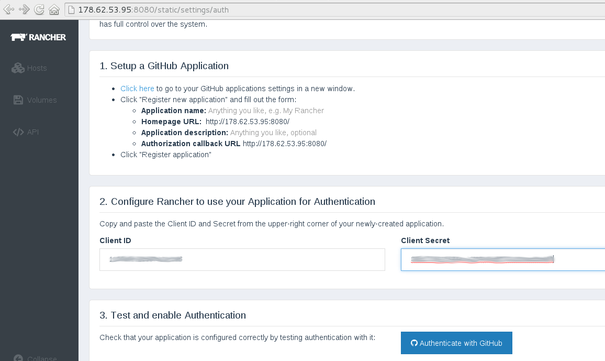

If everything went well, you should see something like the
following:

[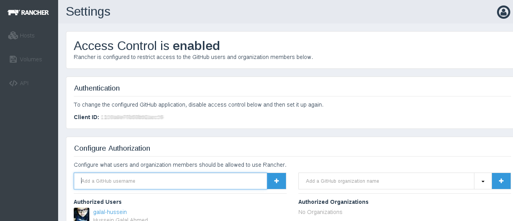](images/rancher_blog_R6.png)

Now you have authorized a GitHub user account to your Rancher
management server, and can start adding users and organizations from
GitHub to Rancher projects.

## []Automatic Deployment Using Webhooks

Webhooks can provide an efficient way for changing the application’s
content using HTTP callbacks for specific events, in this configuration
I will register a couple of webhooks with GitHub to send a POST request
to a custom URL.

There are a number of ways to create an automatic deployment setup for
your app, I decided to use the following approach:

- Create a webhook on Github for each push.
- Modify the Node.js Docker instances with:
- A webhook handler in Node.js. - A script that pulls the new
  pushed repo.
- Start the Application with Nodemon, supervisor, or PM2 to restart on
  each modification.
- Start the Handler with any port, and proxy this port to the
  corresponding port of the host machine.

[](images/rancher_blog_R7.png)

Let’s go through our solution in more detail:

### The new Node.js Application Container

First we need to modify the Node.js Docker image which i created in the
first post. Now it has to contain the Hook handler program plus the
re-deploy script, also we should start the main application using
Nodemon, the new **Dockerfile**:

```
# Dockerfile For Node.js App
FROM ubuntu:14.04
MAINTAINER hussein.galal.ahmed.11@gmail.com
ENV CACHED_FLAG 1

# Install node and npm
RUN apt-get update -qq && apt-get -y upgrade
RUN apt-get install -yqq nodejs npm git git-core

# Install nodemon
RUN npm install -g nodemon
VOLUME [ "/var/www/nodeapp" ]

# Add redeploy script and hook handler
ADD ./run.sh /tmp/run.sh
ADD ./redeploy.sh /tmp/redeploy.sh
ADD ./webhook.js /tmp/webhook.js
WORKDIR /var/www/nodeapp
 # Expose both ports (app port and the hook handler port)
EXPOSE 8000
EXPOSE 9000

# Run The App
ENTRYPOINT ["/b2in/bash", "/tmp/run.sh"]
```

You should notice that a two new files were added to this Dockerfile:
the webhook.js which is the hook handler, and redeploy.sh script which
is basically a git pull from the GitHub repo.

### The webhook.js handler

I wrote the **webhook** handle in NodeJS:

```
var http = require('http')
var createHandler = require('github-webhook-handler')
var handler = createHandler({ path: '/', secret: 'secret' })
var execFile = require('child_process').execFile;
//Create Server That Listen On Port 9000
http.createServer(function (req, res) {
  handler(req, res, function (err) {
    res.statusCode = 404
    res.end('no such location')
  })
}).listen(9000)

//Hook Handler on Error
handler.on('error', function (err) {
  console.error('Error:', err.message)
})

//Hook Handler on Push
handler.on('push', function (event) {
console.log('Received a push event for %s to %s',
    event.payload.repository.name,
    event.payload.ref)
 execFile('/tmp/redeploy.sh', function(error, stdout, stderr) {
                    console.log('Error: '+error)
console.log( 'Redeploy Completed' );
            });
})
```

I won’t go into the details of the code, but here are some notes that
you should consider:

- I used
  [github-webhook-handler](https://github.com/rvagg/github-webhook-handler) library.
- The handler will use a secret string that will be configured later
  using GitHub.
- The handler will listen on port 9000.
- The handler will execute redeploy.sh.

The **redeploy.sh script**:

```
sleep 5
cd /var/www/nodeapp
git pull
```

The last script is the run script which used to start the handler and
the application:

```
MONGO_DN=mongo
if [ -n "$MONGO_IP" ]
then
echo "$MONGO_IP $MONGO_DN" >> /etc/hosts
fi
ln -s /usr/bin/nodejs /usr/bin/node
chmod a+x /tmp/redeploy.sh

#fetch the app
git clone https://github.com/galal-hussein/hitcntr-nodejs.git .
cd /tmp
npm install github-webhook-handler
nodejs webhook.js &

# Run the Application
cd /var/www/nodeapp
nodemon index.js
```

Now build and push the image like I did in the previous post.

### Add Webhook With Github

To create a webhook on Github, open the repository → settings →
Webhooks & Services then Add Webhook:

[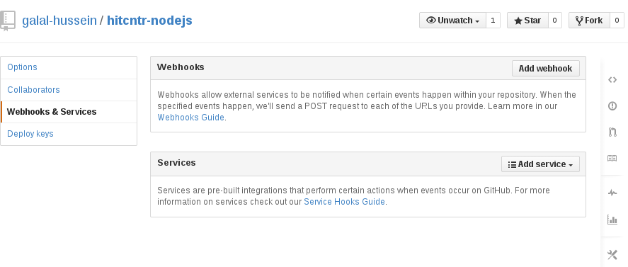](images/rancher_blog_hooks1.png)

Now add a custom url which will be notified when the specified events
happen:

[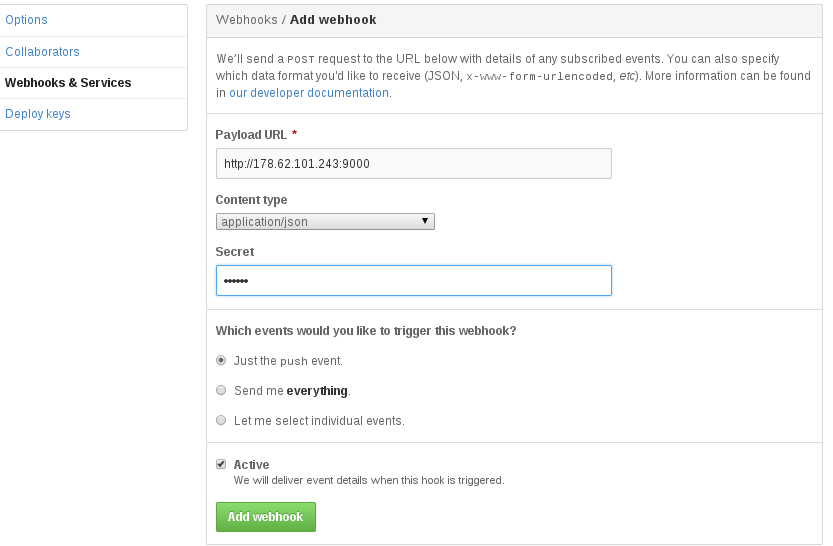](images/rancher_blog_hooks3.png)

You should add the secret token which we specified previously in the
handler’s code. Add a second webhook but this time with the url of
the second application, then build the application stack like we did in
the previous post, but this time proxy port 9000 at the Node container:

[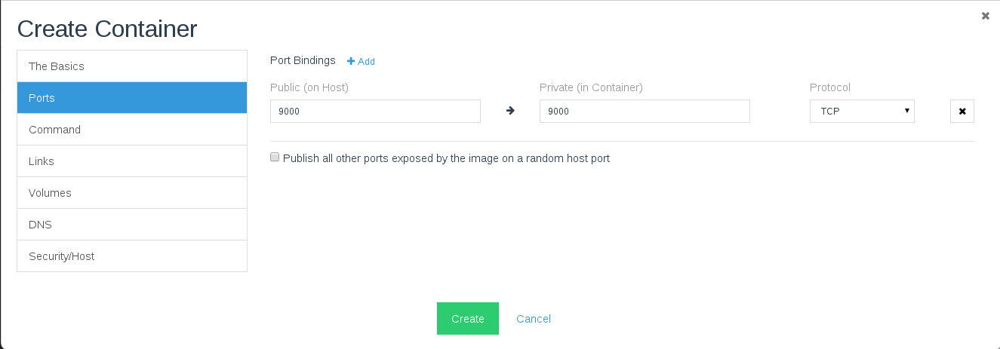](images/rancher_blog_hooks35.png)

After building the stack check the Github webhooks, and you should see
something like this:

[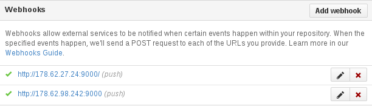](images/rancher_blog_hooks4.png)

Now let’s test the webhooks, if you accessed the url of the Nginx web
server you will see something like this:

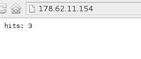

Now commit any changes to your code and push it on Github, and the
changes will be applied immediately to the app servers, in our case I
changed the “hits” to be “Webhooks Worked, Hits”:

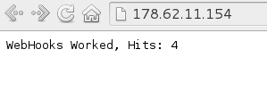

## Conclusion

In this two post series, I created a simple Node.js application with
MongoDB as a NoSQL database and used Rancher to build the whole stack
with Docker containers. In the second post I used the authentication
feature of Rancher with GitHub accounts, then I used webhooks to build
an automatic deployment solution.

I hope this helps you understand how to leverage Rancher, Docker and
GitHub to better manage application deployments.

If you’d like to learn more about using Rancher, please don’t hesitate
to schedule a demo and discussion with one of our
engineers.
