Build a CI/CD Pipeline with Kubernetes and RancherRecorded Online Meetup of best practices and tools for building pipelines with containers and kubernetes. [Watch the training](https://rancher.com/events/2018/2018-08-07-onlinemeetup-building-a-cicd-pipeline-with-k8s/) [](https://cdn.rancher.com/wp-content/uploads/2015/04/24142158/RancherVPN.png)Since

I started playing with Docker I have been thinking that its network

implementation is something that will need to be improved before I could

really use it in production. It is based on container links and service

discovery but it only works for host-local containers. This creates

issues for a few use cases, for example when you are setting up services

that need advanced network features like broadcasting/multicasting for

clustering. In this case you must deploy your application stack

containers in the same Docker host, but it makes no sense to deploy a

whole cluster in the same physical or virtual host. Also I would like

containers networking to function without performing any action like

managing port mappings or exposing new ports. This is why networking is

one of my favorite features of Rancher, because it overcomes Docker

network limitations using a software defined network that connects all

docker containers under the same network as if all of them were

physically connected. This feature makes it much easier to interconnect

your deployed services because you don’t have to configure anything. It

just works. \*\*\*\* \*\*\*\*However I was still missing the possibility to

easily reach my containers and services from my PC as if I also was on

the same network again without configuring new firewall rules or mapping

ports. That is why I created a Docker image that extends Rancher network

using OpenVPN. This allows any device that may run OpenVPN client

including PCs, gateways, and even mobile devices or embedded systems to

access your Rancher network in an easy and secure way because all its

traffic is encrypted. There are many use cases and possibilities for

using this, I list some examples:

- Allow all users in your office to access your containers
- Enabling oncall sysadmins to access your containers from anywhere at

  any time
- Or the example that we are carrying out: allowing a user who works

  at home to access your containers

And all this without reconfiguring your Rancher environment every time

that you grant access to someone. In this post we are installing a

minimalistic Continuous Integration (CI) environment on AWS using

Rancher and RancherOS. The main idea is to create a scenario where a

developer who teleworks can easily access our CI environment, without

adding IPs to a whitelist, exposing services to the Internet nor

performing special configurations. To do so we are installing and

configuring these docker images:

- jenkins: a Jenkins instance to compile a sample WAR hosted in

  github. Jenkins will automatically deploy this application in tomcat

  after compiling it.
- tutum/tomcat:7.0 - a Tomcat instance for deploying the sample WAR
- nixel/rancher-vpn-server: a custom OpenVPN image I have created

  specially to extend Rancher network

And we are using a total of 4 Amazon EC2 instances:

- 1 for running Rancher Server
- 1 for running VPN server
- 1 for running Tomcat server
- 1 for running Jenkins

\****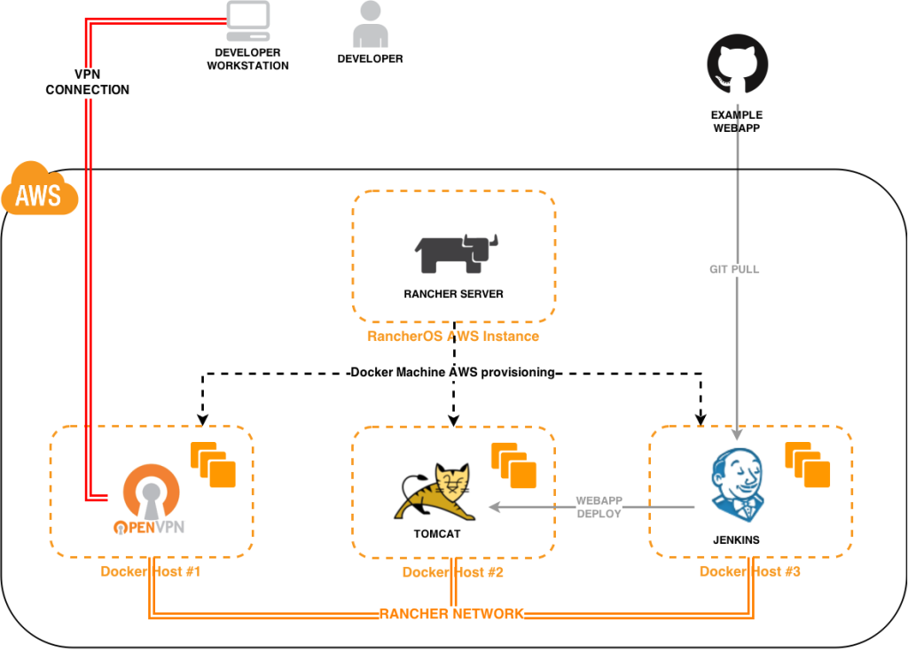***\* At the end the

developer will be able to browse to Jenkins and Tomcat webapp using his

VPN connection. As you will see, this is easy to achieve because you are

not configuring anything for accessing Tomcat or Jenkins from your PC,

you just launch a container and you are able to connect to it.

## **Preparing AWS cloud**

You need to perform these actions on AWS before setting up the CI

environment. **Creating a Key Pair** Go to EC2 Console and enter *Key Pairs* section. When you create the Key Pair your browser will download

a private key that you will need later for connecting to your Rancher

Server instance using SSH if you want to. Save this file because you

won’t be able to download it from AWS anymore. **Creating a Security Group** Before creating a Security Group go to VPC Console and choose

one VPC and Subnet where you will deploy your EC2 instances. Copy the

VPC ID and Subnet ID and CIDR. Go to EC2 Console and create a Security

Group named **Rancher** which will allow this inbound traffic:

- Allow 22/tcp, 2376/tcp and 8080/tcp ports from any source, needed

  for Docker machine to provision hosts
- Allow 500/udp and 4500/udp ports from any source, needed for Rancher

  network
- Allow 9345/tcp and 9346/tcp ports from any source, needed for UI

  features like graphs, view logs, and execute shell
- Allow 1194/tcp and 2222/tcp ports from any source, needed to publish

  our VPN server container

Be sure to select the appropriate VPC in the Security Group dialog.

**Creating an Access Key** On EC2 Console click your name in the top

menu bar and go to *Security Credentials*. Expand *Access Keys (Access Key ID and Secret Access Key)* option and create a new Access Key.

Finally click *Download Key File* because again you won’t be able to do

it later. You will need this for Rancher Server to create Docker hosts

for you.

## **Installing Rancher Server**

Create a new instance on EC2 console that uses **rancheros-0.2.1** AMI,

search for it in *Community AMIS* section. For this tutorial I am using

a basic t1.micro instance with 8GB disk, you may change this to better

fit your environment needs. Now enter *Configure Instance Details*

screen and select the appropriated *Network* and *Subnet*. Then expand

*Advanced Details* section and enter this user data:

```
#!/bin/bash
docker run -d -p 8080:8080 rancher/server:v0.14.2
```

This will install and run Rancher Server 0.14.2 when the instance boots.

Before launching the new instance be sure to choose the Security Group

and Key Pair we just created before. Finally go to Instances menu and

get your Rancher Server instance public IP. After some minutes navigate

to

[http://RANCER\_SERVER\_PUBLIC\_IP:8080](http://rancer_server_public_ip:8080)

and you will enter Rancher UI.

## **Provisioning Docker hosts**

In this section we are creating our Docker hosts. Go to Rancher UI and

click *Add Host* button, confirm your Rancher Server public IP and then

click *Amazon EC2* provider. In this form you need to enter the

following data: *host name, Access Key, Secret Key, Region, Zone, VPC ID, Subnet ID,* and *Security Group*. Be sure to enter the appropriated

values for *Region, Zone, VPC ID* and *Subnet ID* because they must

match those used by Rancher Server instance. You must specify Security

Group name instead its ID, in our case it is named **Rancher**.

[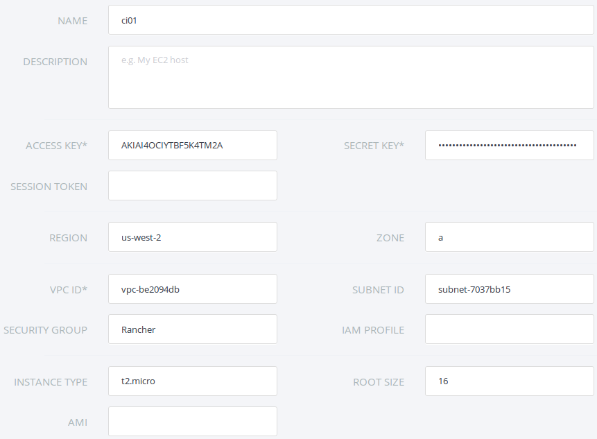](images/rancher_blog_rancher-create-host.png)

Repeat this step three times so Rancher will provision our three Docker

hosts. After some minutes you will see your hosts running in Rancher UI.

[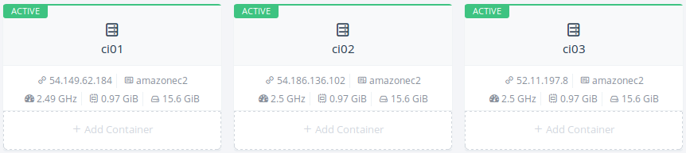](images/rancher_blog_rancher-hosts-list.png)

## **Installing VPN container**

Now it’s time to deploy our VPN server container that will extend the

Rancher network. Go to your first host, click *Add Container* button and

follow these steps:

1. Enter a name for this container like **rancher-vpn-server**
2. Enter docker image: **nixel/rancher-vpn-server:latest**
3. Add this TCP port map: 1194 (on Host) to 1194 (in Container)
4. Add this TCP port map: 2222 (on Host) to 2222 (in Container)

Now expand *Advanced Options* section and follow these steps:

1. In *Volume* section add this new volume to persist VPN

   configuration: **/etc/openvpn:/etc/openvpn**
2. In *Networking* section be sure to select *Managed Network on docker0*
3. In *Security/Host* section be sure to enable the *Give the container full access to the host* checkbox

After a while you will see your rancher-vpn-server container running on

your first host.

[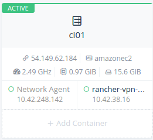](images/rancher_blog_rancher-vpn-server-container.png)

Now you are about to use another nice Rancher feature. Expand your

rancher-vpn-server container menu and click View Logs button as you can

see in the following image:

[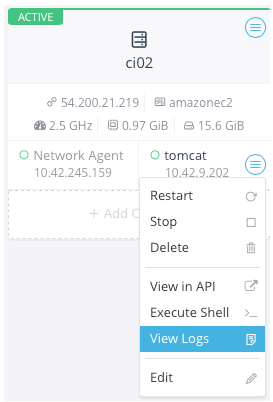](images/rancher_blog_rancher-tomcat-view-container-logs.png)

Now scroll to top and you will find the information you need in order to

connect with your VPN client. We are using this data later.

\*\*\*\* [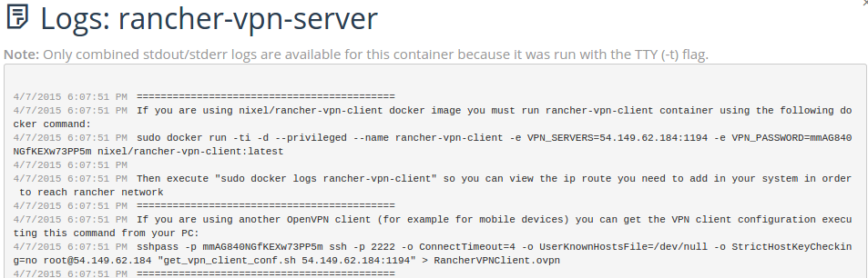](images/rancher_blog_rancher-vpn-server-logs.png)\*\*\*\*

## **Installing Tomcat container**

To install Tomcat container you have to click *Add Container* button on

your second host and follow these steps:

1. Enter a name for this container like **tomcat**
2. Enter docker image: **tutum/tomcat:7.0**
3. \****No port map is required***\*
4. Expand *Advanced Options* and in Networking section be sure to

   select *Managed Network on docker0*

After a while you will see your Tomcat container running on your second

host.

[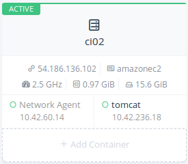](images/rancher_blog_rancher-tomcat-server-container.png)

Now open Tomcat container logs in order to get its admin password, you

are needing it later when configuring Jenkins.

[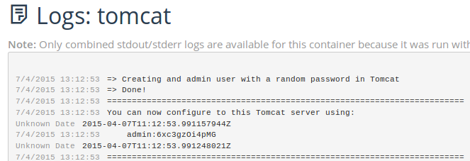](images/rancher_blog_rancher-tomcat-logs.png)

## **Installing Jenkins container**

Click Add Container button on your third host and execute the following

steps:

1. Enter a name for this container like **jenkins**
2. Enter docker image: **jenkins**
3. **No port map is required**

Now expand *Advanced Options* section and follow these steps:

1. In *Volume* section add this new volume to persist Jenkins

   configuration: **/var/jenkins\_home**
2. In *Networking* section be sure to select *Managed Network on docker0*

After a while you will see your Jenkins container running on your third

host.

[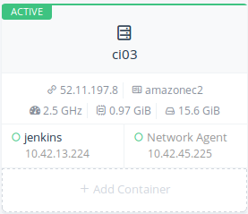](images/rancher_blog_rancher-jenkins-container.png)

## **Putting it all together**

In this final step you are going to install and run the VPN client.

There are two ways to get the client working: using a Docker image I

have prepared that does not require any configuration, or using any

OpenVPN client that you will need to configure. Once the VPN client is

working you are browsing to Jenkins in order to create an example CI job

that will deploy the sample WAR application on Tomcat. You will finally

browse to the sample application so you can see how all this works

together. **Installing Dockerized VPN client** In a PC with Docker

installed you will execute the command that we saw before in

rancher-vpn-server container logs. According to my example I will

execute this command:

```
sudo docker run -ti -d --privileged --name rancher-vpn-client -e VPN_SERVERS=54.149.62.184:1194 -e VPN_PASSWORD=mmAG840NGfKEXw73PP5m nixel/rancher-vpn-client:latest
```

Adapt it to your environment. Then show rancher-vpn-client container

logs:

```
sudo docker logs rancher-vpn-client
```

You will see a message printing the route you need to add in your system

in order to be able to reach Rancher network.

[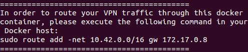](images/rancher_blog_rancher-vpn-client-route.png)

In my case I’m executing this command:

```
sudo route add -net 10.42.0.0/16 gw 172.17.0.8
```

At this point you are able to ping all your containers, no matter in

which host they run. Now your PC is actually connected to Rancher

network and you can reach any container and service running on your

Rancher infrastructure. If you repeat this step in a Linux Gateway at

your office you will, in fact, expose Rancher network to all the

computers connected in your LAN, which is really interesting.

**Installing a custom OpenVPN client** If you prefer to use an existing

or custom OpenVPN client, you can do it. You will need your OpenVPN

configuration file that you can get executing the SSH command that we

got before in rancher-vpn-server container log. In my case I can get

RancherVPNClient.ovpn file executing this command:

```
sshpass -p mmAG840NGfKEXw73PP5m ssh -p 2222 -o ConnectTimeout=4 -o UserKnownHostsFile=/dev/null -o StrictHostKeyChecking=no root@54.149.62.184 "get_vpn_client_conf.sh 54.149.62.184:1194" > RancherVPNClient.ovpn
```

Now, for example, you can execute OpenVPN executing this command:

```
/usr/sbin/openvpn --config RancherVPNClient.ovpn
```

You can also use OpenVPN iOS/Android application with this

RancherVPNClient.ovpn file and you will also be able to access your

Rancher network from your mobile or tablet. Again, you can extend your

VPN for all users in your LAN if you repeat this step in a Linux Gateway

in your office. **Configuring Jenkins** Now it’s time to configure

Jenkins to compile and deploy our sample WAR in Tomcat. Browse to

[http://JENKINS\_CONTAINER\_IP:8080](http://jenkins_container_ip:8080)

(in my case <http://10.42.13.224:8080>) and you will see Jenkins

Dashboard.

[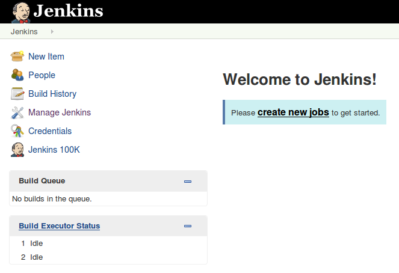](images/rancher_blog_jenkins-dashboard.png)

Before starting you must install Github Plugin and Maven following these

steps:

1. Click *Manage Jenkins* menu option and then *Manage Plugins*
2. Go to *Available* tab and search for Github plugin, named “**Github Plugin**”. Activate its checkbox
3. Click *Download now and install after restart* button
4. When the plugin is installed enable checkbox *Restart Jenkins when installation is complete and no jobs are running,* and then wait for

   Jenkins to be restarted
5. When Jenkins is running again, go to *Manage Jenkins* and click

   *Configure System*
6. In Maven section click *Add Maven* button, enter a name for the

   installation and choose last maven version.
7. Click Save button to finish

[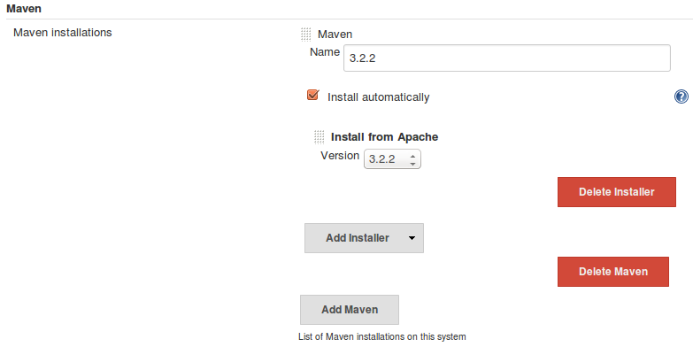](images/rancher_blog_jenkins-install-maven.png)

When you are back in Dashboard click *create new jobs* link and follow

these instructions:

- Enter a job name, for example **CI\_Sample**
- Choose *Maven project* option and click OK
- In *Source Code Management* section choose *Git* and enter this

  *Repository URL*: <https://github.com/nixelsolutions/sample-war.git>

[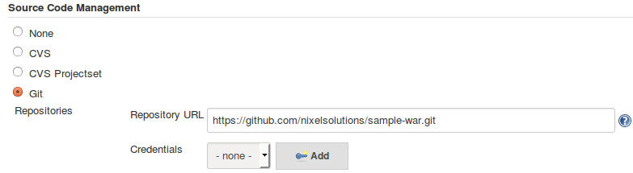](images/rancher_blog_jenkins-git-url.png)

- In *Build* section enter the following maven *goals and options*.

  Replace **TOMCAT\_CONTAINER\_IP** with the IP assigned to your

  Tomcat container (10.42.236.18 in my case) and

  **TOMCAT\_ADMIN\_PASSWORD** with the password we saw before for

  admin user (6xc3gzOi4pMG in my case).

```
clean package tomcat7:redeploy -DTOMCAT_HOST=TOMCAT_CONTAINER_IP -DTOMCAT_PORT=8080 -DTOMCAT_USER=admin -DTOMCAT_PASS=TOMCAT_ADMIN_PASSWORD
```

I am setting this maven configuration:

```
clean package tomcat7:redeploy -DTOMCAT_HOST=10.42.236.18 -DTOMCAT_PORT=8080 -DTOMCAT_USER=admin -DTOMCAT_PASS=6xc3gzOi4pMG
```

- Save your job

---

[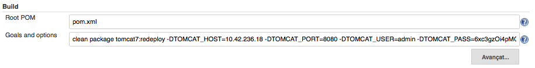](images/rancher_blog_jenkins-maven-goals.png)

Now you can click *Build Now* button to run your job. Open your

execution (listed in *Build History* table) and then click *Console Output* option. If you go to the bottom you will see something like

this:

[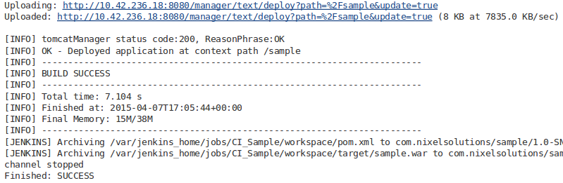](images/rancher_blog_jenkins-job-result.png)

**Testing the sample application** Now browse to

[http://TOMCAT\_CONTAINER\_IP:8080/sample/](http://tomcat_container_ip:8080/sample/)

and you will see this page showing information about Tomcat server and

your browser client.

[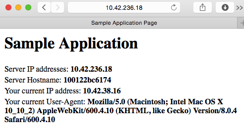](images/rancher_blog_sample-application.png)

## **Conclusion**

In this post we have installed a basic Continuous Integration

environment as an example to make your Docker containers reachable from

your PC, your LAN, and even a mobile device or any system that can

execute an OpenVPN client. This is possible thanks to Rancher Network, a

great functionality that improves Docker networking by connecting your

containers under the same network. What we actually did was to extend

Rancher network using an OpenVPN link that is really easy to configure

with Docker, and secure to use because all your traffic is being

encrypted. This functionality can help many companies to better manage

the way they give access to their containers from any unknown or

uncontrolled network. Now you don’t need to think anymore about exposing

or mapping ports, changing firewall rules, or taking care about what

services you publish to the Internet. For more information on managing

docker with Rancher, please join our next online meetup, where we’ll be

demonstrating Rancher, Docker Compose, service discovery and many other

capabilities. *Manel Martinez is a Linux systems engineer with experience in the design and management of scalable, distributable and highly available open source web infrastructures based on products like KVM, Docker, Apache, Nginx, Tomcat, Jboss, RabbitMQ, HAProxy, MySQL and XtraDB. He lives in Spain, and you can find him on Twitter [@manel\_martinezg](http://twitter.com/manel_martinezg).*Build a CI/CD Pipeline with Kubernetes and RancherRecorded Online Meetup of best practices and tools for building pipelines with containers and kubernetes. [Watch the training](https://rancher.com/events/2018/2018-08-07-onlinemeetup-building-a-cicd-pipeline-with-k8s/)
