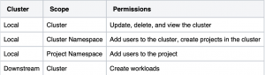

In 2.8, Rancher added a new field to the GlobalRoles resource (inheritedClusterRoles), which allows users to grant permissions on all downstream clusters. With the addition of this field, it is now possible to create a custom global role that grants user-configurable permissions on all current and future downstream clusters.

This post will outline how to create this role using the new Rancher Kubernetes API, which is currently the best-supported method to use this new feature.

## **Background on RBAC, the local cluster and restricted admin**

Rancher internally functions on an operator model, similar to other common Kubernetes tools. When giving users permission to perform actions in Rancher, those users need a variety of different permissions, both in the local cluster (where Rancher is installed) and in a downstream cluster. For example, consider a user who needs full ownership access to a cluster. This user needs at least permissions to modify the cluster, add users to the cluster, create projects in the cluster, add users to projects in the cluster and create workloads in the cluster. That would result in permissions in at least the following places:Each of these scopes would require a different role and binding, which would need to be updated if the user needed the permissions adjusted (for example, to get more or less permissions). Rancher's RBAC resources exist to solve this problem by allowing users to manage access to these resources without needing to manage individual Kubernetes native RBAC objects (such as roles/roleBindings/clusterRoles/clusterRoleBindings). Each of the objects targets a different scope inside Rancher, with GlobalRoles/GlobalRoleBindings granting access to the entire Rancher install, ClusterRoleTemplateBindings granting access to a specific cluster and ProjectRoleTemplateBindings granting access to a specific project.

In the past, GlobalRoles mostly gave permissions at the Cluster scope of the local cluster. Since Rancher stores much of its state in the local cluster, this was viewed as a way to give permissions across the entire installation. Only two roles existed that gave permissions on downstream clusters - Admin and Restricted Admin. Users had no way to create a less-powerful user, who also had permissions on downstream clusters.

Ultimately, this leads to the deprecation of Restricted Admin. The role didn't meet everyone's requirements and wasn't flexible enough to be adjusted by end-users. To solve this issue, we introduced the inheritedClusterRoles field to allow users to get permissions on all downstream clusters without needing to be bound to the "cluster-owner" permission given by Restricted Admin.

## **Creating a Rancher-wide read-only role**

With the ability to grant arbitrary permissions on all downstream clusters, we can now create a Rancher-wide read-only role. This role can be used to allow users to view activity in all downstream clusters without also granting the ability to change those clusters (or any resources in those clusters). The below shows an example GlobalRole (ready for use with the Rancher Kubernetes API):

```
apiVersion: management.cattle.io/v3
kind: GlobalRole
metadata:
  name: global-read-only
inheritedClusterRoles:
  - projects-view
rules:
- apiGroups:
    - management.cattle.io
  resources:
    - preferences
  verbs: 
    - '*'
- apiGroups:
    - management.cattle.io
  resources:
    - settings
    - rancherusernotifications
    - features
    - roletemplates
    - globalroles
    - globalrolebindings
    - authconfigs
    - users
    - nodedrivers
    - principals
    - fleetworkspaces
    - podsecurityadmissionconfigurationtemplates
    - podsecuritypolicytemplates
    - cisbenchmarkversions
    - cisconfigs
    - rkeaddons
    - rkek8sserviceoptions
    - rkek8ssystemimages
  verbs: 
    - get
    - list
    - watch
- apiGroups:
    - catalog.cattle.io
  resources:
    - clusterrepos
  verbs:
    - get
    - list
    - watch
```

First, you'll notice that we gave the project's view role as the inheritedClusterRole. projects-view is a built-in RoleTemplate (which you can view in the UI) - it is basically the Kubernetes view role with a few extra permissions. This will provide us with read-only access to the downstream clusters.

You'll also notice that we gave permissions to several resources in the rules field. This field grants permissions at the cluster scope (meaning that it can give access to non-namespaced resources or access to namespaced resources in every namespace) of the local cluster.

The first set of permissions grants write permissions to preferences. These are required to allow Rancher to remember user-specific UI settings, so our users will need to write permissions to this resource to allow the UI to remember their choices. You can see this (and other basic permissions) in the User-Base global role, which is a good starting point for building custom GlobalRoles.

The second set of permissions grants read permissions to various Rancher resources. These include RBAC resources (globalRoles, globalRoleBindings, roleTemplates), authentication resources (users, authconfigs, principals), and some permissions related to cluster configuration (rkeaddons and podSecurityAdmissionConfigurationTemplates). Most of these resources are cluster-scoped, and you'll note that this doesn't include permissions to credential sources (such as cloud credentials, secrets or tokens). This is to prevent our read-only user from gaining extra permissions not provided by this role.

The third set of permissions are read permissions and grant access to the clusterrepos resource. Since this resource is in a different API group than the others, we include it in a separate rule so that we don't accidentally grant access to similarly named resources in the management.cattle.io API group.

You'll notice that these rules did not include the following permissions:

- Permissions for resources related to a single cluster (such as clusters or clusterRoleTemplateBindings)
- Permissions for resources related to a single project (such as projects or projectRoleTemplateBindings)
- Permissions for core resources (such as pods or deployments).

This is because we will rely on the projects-view permission in the inheritedClusterRoles field to grant permissions for those clusters. Granting permissions to these resources through the rules field could introduce a security risk since it would let our users see items related to the local cluster, which functions as Rancher's database. Even read-only access to these items could allow users to escalate beyond their intended permissions. For this reason, it's recommended to review the permissions in the rules field carefully and to use the current built-ins as a guide to help determine potentially unsafe access.

Once the above role is put into a yaml file and a kubeconfig is obtained to Rancher's local cluster, the GlobalRole can be created through kubectl:

```
kubectl create -f globalRole.yaml
```

Users can be bound to this role using the Rancher Kubernetes API or the UI.

## **Summary**

We believe this new tool is a powerful way for system administrators to grant Rancher-wide access without needing to grant the high level of permissions included by the built-in Admin and Restricted Admin GlobalRoles. With this new field, users can grant permissions on all downstream clusters simultaneously, with more flexibility to suit their custom use cases.

For more details, see the [documentation page](https://ranchermanager.docs.rancher.com/v2.8/how-to-guides/new-user-guides/authentication-permissions-and-global-configuration/manage-role-based-access-control-rbac/global-permissions#globalrole-permissions-on-downstream-clusters) for Global Permissions.
