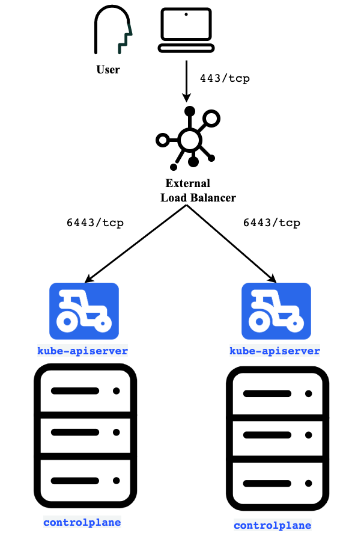

## Introduction

As Kubernetes becomes more and more prevalent as a container orchestration system, it is important to properly architect your Kubernetes clusters to be highly available. This guide covers some of the options that are available for deploying highly available clusters, as well as an example of deploying a highly available cluster.

In this article, we will be using the Rancher Kubernetes Engine (RKE) as the installation tool for our cluster. However, the concepts outlined here can easily be translated to other Kubernetes installers and tools.

## Overview

We’ll be going over a few of the core components that are required to make a highly available Kubernetes cluster function:

- Control plane
- etcd
- Ingress (L7) considerations
- Node configuration best practices

Load Balancer type services are not included in this guide, but are also a consideration you should keep in mind. This is omitted due to the cloud-specific nature of the various load balancer implementations. If working with a on-premise deployment, it’s highly recommended to look at a solution like [MetalLB](https://metallb.universe.tf/).

## High Availability of the Control Plane

When using `rke` to deploy a Kubernetes cluster, `controlplane` designated nodes have a few unique components deployed onto them. These include:

- `kube-apiserver`
- `kube-controller-manager`
- `kube-scheduler`

To review, the `kube-apiserver` component runs the [Kubernetes API server](https://kubernetes.io/docs/reference/command-line-tools-reference/kube-apiserver/). It is important to keep in mind that API server availability must be maintained to ensure the functionality of your cluster. Without a functional API endpoint for your cluster, the cluster will come to a halt. For example, the `kubelet` on each node will not be able to update the API server, the controllers will not be able to operate on the various control objects, and users will not be able to interact with the Kubernetes cluster using `kubectl`.

The `kube-controller-manager` component runs the various controllers that operate on the Kubernetes control objects, like Deployments, DaemonSets, ReplicaSets, Endpoints, etc. More information on this component can be found [here](https://kubernetes.io/docs/reference/command-line-tools-reference/kube-controller-manager/).

The `kube-scheduler` component is responsible for scheduling Pods to nodes. More information on the `kube-scheduler` can be found [here](https://kubernetes.io/docs/reference/command-line-tools-reference/kube-scheduler/).

The `kube-apiserver` is capable of being run in parallel across multiple nodes, providing a highly available solution when requests are balanced/failed over between nodes. When using RKE, the internal component of the API server load balancing is handled by the `nginx-proxy` container. User-facing API server communication must be configured out-of-band in order to ensure maximum availability.

### User (External) Load Balancing of the `kube-apiserver`

Here is a basic diagram outlining a configuration for external load balancing of the `kube-apiserver`:


External LB for RKE API

In the diagram above, there is a Layer 4 load balancer listening on `443/tcp` that is forwarding traffic to the two control plane hosts via `6443/tcp`. This ensures that in the event of a control plane host failure, users are still able to access the Kubernetes API.

RKE has the ability to add additional hostnames to the `kube-apiserver` cert SAN list. This is useful when using an external load balancer that has a different hostname or IP (as they should) than the nodes that are serving API server traffic. Information on configuring this functionality can be found [in the RKE docs on authentication](https://rancher.com/docs/rke/latest/en/config-options/authentication/).

To set up the example shown in the diagram, the RKE `cluster.yml` configuration snippet to include the `api.mycluster.example.com` load balancer in the `kube-apiserver` list would look like:

```
authentication:
    strategy: x509
    sans:
      - "api.mycluster.example.com"
```

If you are adding the L4 load balancer after the fact, it is important that you perform an [RKE certificate rotation](https://rancher.com/docs/rke/latest/en/cert-mgmt/#rotating-a-certificate-on-an-individual-service-while-using-the-same-ca) operation in order to properly add the additional hostname to the SAN list of the `kube-apiserver.pem` certificate.

Additionally, the `kube_config_cluster.yml` file will not be configured to access the API server through the load balancer, but rather through the first `controlplane` node in the list. It will be necessary to generate a specific `kube_config` file for users to utilize that includes the L4 API server load balancer as the `server` value.

### User (Cluster Internal) Load Balancing of the `kube-apiserver`

By default, `rke` designates `10.43.0.1` as the internal Kubernetes API server endpoint (based on the default service cluster CIDR of `10.43.0.0/16`). A ClusterIP service and endpoint named `kubernetes` are created in the `default` namespace which resolve to the IP that is designated to the Kubernetes API server.

In a default-configured RKE cluster, the ClusterIP is load balanced using `iptables`. More specifically, it uses `NAT pre-routing` to masquerade traffic to the desired Kubernetes API server endpoint with the probability determined by the number of API server hosts available. This provides a generally highly available solution for the Kubernetes API server internally, and libraries which connect to the API server from within pods should be able to handle failover through retry.

#### `kubelet` / `kube-proxy` Load Balancing of the `kube-apiserver`

The `kubelet` and `kube-proxy` components on each Kubernetes cluster node are configured by `rke` to connect to `127.0.0.1:6443`. You may be asking yourself, “how does `127.0.0.1:6443` resolve to anything on a worker node?” The reason this works is due to the existence of an `nginx-proxy` container on each non-`controlplane` designated node. The `nginx-proxy` is a simple container that performs L4 round robin load balancing across the known `controlplane` node IPs with health checking, ensuring that the nodes are able to continue operating even during transient failures.

## High Availability of etcd

etcd, when deployed, has high availability functionality built into it. When deploying a highly available Kubernetes cluster, it is very important to ensure that etcd is deployed in a multi-node configuration where it can achieve quorum and establish a leader.

When planning for your highly available etcd cluster, there are a few aspects to keep in mind:

- Node count
- Disk I/O capacity
- Network latency and throughput

Information on performance tuning etcd in highly available architectures can be found [in the related section of the etcd docs](https://etcd.io/docs/v3.3.12/op-guide/performance/).

### Quorum

In order to achieve quorum, etcd must have a majority of members available and in communication with each other. As such, odd numbers of members are best suited for etcd. Increased failure tolerance is achieved as the number of members grows. Keep in mind that more is not always better in this case. When you have too many members, etcd can actually slow down due to the Raft consensus algorithm that etcd uses to propagate writes among members. A table comparing the total number of nodes and the number of node failures that can be tolerated is shown below:

| Recommended for HA | Total etcd Members | Number of Failed Nodes Tolerated |
| --- | --- | --- |
| No | 1 | 0 |
| No | 2 | 0 |
| Yes | 3 | 1 |
| No | 4 | 1 |
| Yes | 5 | 2 |

### etcd Deployment Architecture

When deploying multiple etcd hosts with `rke` in a highly available cluster, there are two generally accepted architectures. One is where `etcd` is co-located with the `controlplane` components, thus allowing for optimized use of compute resources. This is generally only recommended for small to medium sized clusters where compute resources may be limited. This configuration works as `etcd` is primarily memory based (as it operates within memory) whereas the `controlplane` components are generally compute intensive. In production-critical environments, it can be preferable to run `etcd` on dedicated nodes with hardware ideal for running `etcd`.

 

 

The other architecture relies on a dedicated external etcd cluster that are not co-located with any other `controlplane` components. This provides greater redundancy and availability at the expense of operating some additional nodes.

## Ingress (L7) Considerations

Kubernetes Ingress objects allow specifying host and path based routes in order to serve traffic to users of the applications hosted within a Kubernetes cluster.

### Ingress Controller Networking

There are two general networking configurations that you can choose between when installing an ingress controller:

- Host network
- Cluster network

The first model, host network, is where the ingress controller runs on a set of nodes on the same network namespace as the host. This exposes port 80 and 443 of the ingress controller on the host directly. To external clients, it appears that the host has a web server listening `80/tcp` and `443/tcp`.

The second option, cluster network, is where the ingress controller is run on the same cluster network as the workloads within the cluster. This deployment model is useful when using services of type `LoadBalancer` or using a `NodePort` service to mux the host’s capabilities, while providing an isolation plane for the ingress controller to not share the hosts’ network namespace.

For the purposes of this guide, we will explore the option of deploying the ingress controller to operate on the host network, as `rke` configures the ingress controller in this manner by default.

### Ingress Controller Deployment Model

By default, `rke` deploys the Nginx ingress controller as a DaemonSet which runs on all worker nodes in the Kubernetes cluster. These worker nodes can then be load balanced or have dynamic or round robin DNS records configured in order to land traffic at the nodes. In this model, application workloads will be co-located alongside the ingress controller. This works for most small-to-medium sized clusters, but when running workloads that are not profiled or heterogeneous, it is possible for CPU or memory contention to cause the ingress controller to not serve traffic properly. In these scenarios, it can be preferable to designate specific nodes to run the ingress controller. In this model, it is still possible to perform round robin DNS or dynamic DNS, but load balancing tends to be the more preferred solution in this case.

As of today, `rke` only supports setting a `node selector` to control scheduling of the ingress controller, however a [feature request](https://github.com/rancher/rke/issues/1066) is open to bring the capability to place tolerations on the ingress controller as well as placing taints on nodes allowing for more fine-grained ingress controller deployments.

### Ingress Controller DNS Resolution/Routing

As mentioned earlier, are two options to balance traffic when utilizing ingress controllers in this manner. The first is to simply create DNS records that point to your ingress controllers and the second is to run a load balancer which will load balance across your ingress controllers. Let’s take a closer look at these options now.

### Direct to Ingress Controller

In some models of deployment, it can be preferable to use a technique such as round-robin DNS or some other type of dynamic DNS solution to serve traffic for your application. Tools such as [external-dns](https://github.com/kubernetes-incubator/external-dns) allow such dynamic configuration of DNS records to take place. In addition, Rancher Multi-Cluster App uses [external-dns](https://github.com/kubernetes-incubator/external-dns) to dynamically configure DNS entries.

### Load Balanced Ingress Controllers

When operating a highly available cluster, it is often desirable to operate a load balancer in front of the ingress controllers whether to perform SSL offloading or to provide a single IP for DNS records.

## Using RKE to Deploy a Production-Ready Cluster

When using `rke` to deploy a highly-available Kubernetes cluster, a few configuration tweaks should be made.

A sample `cluster.yml` file is provided here for a hypothetical cluster with the following 10 nodes:

- 2 controlplane
- 3 etcd
- 2 ingress
- 3 worker nodes

In this hypothetical cluster, there are two VIP/DNS entries, the first of which points towards the API servers on `6443/tcp` and the second of which points to the `ingress controllers` on ports `80/tcp` and `443/tcp`.

The following YAML will deploy each of the above nodes with RKE:

```
nodes:
    - address: controlplane1.mycluster.example.com
      user: opensuse
      role:
        - controlplane
    - address: controlplane2.mycluster.example.com
      user: opensuse
      role:
        - controlplane

    - address: etcd1.mycluster.example.com
      user: opensuse
      role:
        - etcd
    - address: etcd2.mycluster.example.com
      user: opensuse
      role:
        - etcd
    - address: etcd3.mycluster.example.com
      user: opensuse
      role:
        - etcd

    - address: ingress1.mycluster.example.com
      user: opensuse
      role:
        - worker
      labels:
        app: ingress
    - address: ingress2.mycluster.example.com
      user: opensuse
      role:
        - worker
      labels:
        app: ingress

    - address: worker1.mycluster.example.com
      user: opensuse
      role:
        - worker
    - address: worker2.mycluster.example.com
      user: opensuse
      role:
        - worker
    - address: worker3.mycluster.example.com
      user: opensuse
      role:
        - worker

authentication:
    strategy: x509
    sans:
      - "api.mycluster.example.com"

ingress:
    provider: nginx
    node_selector:
      app: ingress
```

## Conclusion

In this guide, we discussed some of the requirements of operating a highly available Kubernetes cluster. As you may gather, there are quite a few components that need to be scaled and replicated in order to eliminate single points of failure. Understanding the availability requirements of your deployments, automating this process, and leveraging tools like RKE to help configure your environments can help you reach your targets for fault tolerance and availability.
