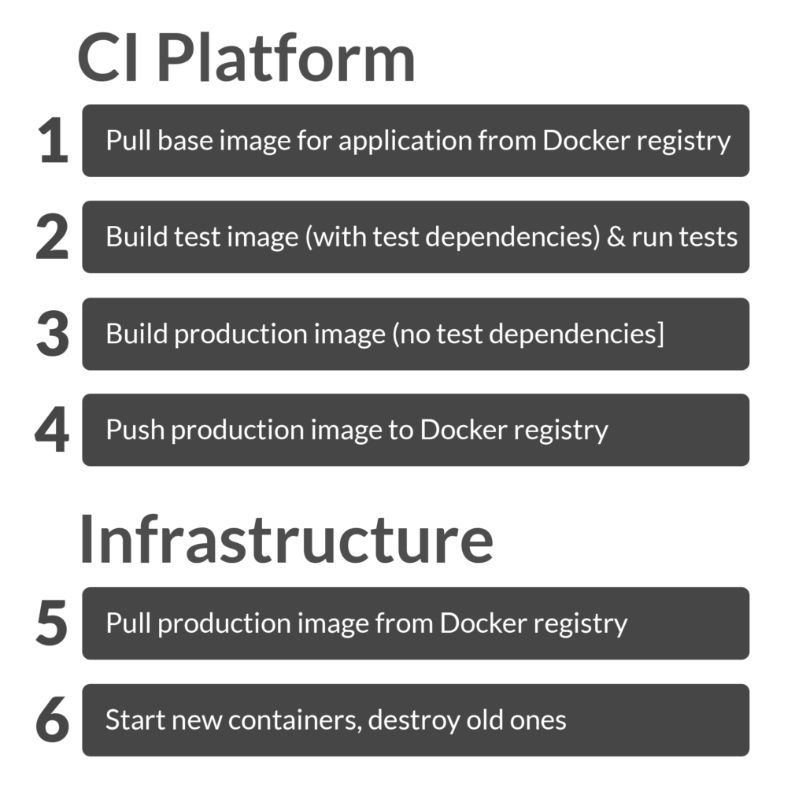

Build a CI/CD Pipeline with Kubernetes and RancherRecorded Online Meetup of best practices and tools for building pipelines with containers and kubernetes. [Watch the training](https://rancher.com/events/2018/2018-08-07-onlinemeetup-building-a-cicd-pipeline-with-k8s/) At [Higher Education](http://highereducation.com), we’ve tested and used

quite a few CI/CD tools for our Docker CI pipeline. Using Rancher and

Drone CI has proven to be the simplest, fastest, and most enjoyable

experience we’ve found to date. From the moment code is pushed/merged

to a deployment branch, code is tested, built, and deployed to

production in about half the time of cloud-hosted solutions - as little

as three to five minutes (Some apps take longer due to a larger

build/test process). Drone builds are also extremely easy for our

developers to configure and maintain, and getting it setup on Rancher is

just like everything else on Rancher - very simple.

### Our Top Requirements for a CI/CD Pipeline

The CI/CD pipeline is really the core of the DevOps experience and is

certainly the most impactful for our developers. From a developer

perspective, the two things that matter most for a CI/CD pipeline are

speed and simplicity. Speed is #1 on the list, because nothing’s worse

than pushing out one line of code and waiting for 20 minutes for it to

get to production. Or even worse…when there is a production issue, a

developer pushes out a hot fix only to have company dollars continue to

grow wings and fly away as your deployment pipeline churns. Simplicity

is #2, because in an ideal world, developers can build and maintain

their own application deployment configurations. This makes life easier

for everyone in the long run. You certainly don’t want developers

knocking on your (Slack) door every time their build fails for some

reason.

### Docker CI/CD Pipeline Speed Pain points

While immutable containers are far superior to maintaining stateful

servers, they do have a few drawbacks – the biggest one being

deployment speed: It’s slower to build and deploy a container image

than to simply push code to an existing server. Here are all the places

that a Docker deployment pipeline can spend time:  1) [CI: pull base image for application from

Docker registry] 2) [CI: build test image (with test dependencies) and

run tests] 3) [CI: build production image (no test dependencies)] 4)

[CI: push application image to Docker Registry] 5) [Infrastructure:

pull application image from Docker Registry] 6) [Stop old containers,

start new ones] Depending on the size of your application

and how long it takes to build, latency with the Docker registry (steps

1, 4, 5) is probably where most of your time will be spent during a

Docker build. Application build time (steps 2, 3) might be a fixed

variable, but it also might be drastically affected by the memory or CPU

cores available to the build process. If you’re using a cloud-hosted CI

solution, then you don’t have control over where the CI servers run

(registry latency might be *really* slow) and you might not have control

over the type of servers/instances running (application build might be

slow). There will also be a lot of repeated work for every build such

as downloading base images for every build.

### Enter Drone CI

Drone runs on your Rancher infrastructure much like a tool like Jenkins

would, but, unlike Jenkins, Drone is Docker-native - every part of your

build process is a container. Running on your infrastructure speeds up

the build process, since base images can be shared across builds or even

projects. You can also avoid a LOT of latency if you push to a Docker

registry that is on your own infrastructure such as ECR for AWS. Drone

being Docker-native removes a lot of configuration friction as well.

Anyone who’s had to configure Jenkins knows that this is a big plus. **A standard Drone deployment does something like this:**

- Run a container to notify Slack that a build has started
- Configure any base image for your “test” container, code gets

  injected and tests run in the container
- Run a container that builds and pushes your production image (to

  Docker Hub, AWS ECR, etc)
- Run a container that tells Rancher to upgrade a service
- Run a container to notify Slack that a build has completed/failed

A .drone.yml file looks strikingly similar to a docker-compose.yml file

– just a list of containers. Since each step has a container dedicated

to that task, configuration of that step is usually very simple.

### Getting Drone Up and Running

The to do list here is simple:

- Register a new GitHub OAuth app
- Create a Drone environment in Rancher
- Add a “Drone Server” host and one or more “Drone Worker” hosts
  - Add a `drone=server` tag to the Drone Server host
- Run the Drone stack

The instance sizes are up to you - at Higher Education we prefer fewer,

more powerful workers, since that results in faster builds. (We’ve

found that one powerful worker tends to handle builds just fine for

teams of seven) Once your drone servers are up, you can run this stack:

```
version: '2'
services:
  drone-server:
    image: drone/drone:0.5
    environment:
      DRONE_GITHUB: 'true'
      DRONE_GITHUB_CLIENT: <github client>
      DRONE_GITHUB_SECRET: <github secret>
      DRONE_OPEN: 'true'
      DRONE_ORGS: myGithubOrg
      DRONE_SECRET: <make up a secret!>
      DRONE_GITHUB_PRIVATE_MODE: 'true'
      DRONE_ADMIN: someuser,someotheruser,
      DRONE_DATABASE_DRIVER: mysql
      DRONE_DATABASE_DATASOURCE: user:password@tcp(databaseurl:3306)/drone?parseTime=true
    volumes:
    - /drone:/var/lib/drone/
    ports:
    - 80:8000/tcp
    labels:
      io.rancher.scheduler.affinity:host_label: drone=server
  drone-agent:
    image: drone/drone:0.5
    environment:
      DRONE_SECRET: <make up a secret!>
      DRONE_SERVER: ws://drone-server:8000/ws/broker
    volumes:
    - /var/run/docker.sock:/var/run/docker.sock
    command:
    - agent
    labels:
      io.rancher.scheduler.affinity:host_label_ne: drone=server
      io.rancher.scheduler.global: 'true'
```

This will run one Drone Server on your `drone=server` host, and one

drone agent on every other host in your environment. Backing Drone with

MySQL via the `DATABASE_DRIVER` and `DATASOURCE` values are optional,

but highly recommended. We use a small RDS instance. Once the stack is

up and running, you can login to your Drone Server IP address and turn

on a repo for builds (from the Account menu). You’ll notice that

there’s really no configuration for each repo from the Drone UI. It all

happens via a .drone.yml file checked into each repository.

### Adding a Build Configuration

To build and test a node.js project, add a .drone.yml file to your repo

that looks like this:

```
pipeline:
  build:
    image: node:6.10.0
    commands:
      - yarn install
      - yarn test
```

It’s simple and to-the-point, your build step simply sets the container

image that the repository code gets put in and specifies the commands to

run in that container. Anything else will be managed with [Drone plugins](http://plugins.drone.io), which are just containers designed

for one task. Since plugins live in Docker Hub, *you don’t install them*, just add them to your .drone.yml file A more full-featured build

like I mentioned above uses Slack, ECR, and Rancher plugins to create

this .drone.yml:

```
pipeline:
  slack:
    image: plugins/slack
    webhook: <your slack webhook url>
    channel: deployments
    username: drone
    template: "<{{build.link}}|Deployment #{{build.number}} started> on <http://github.com/{{repo.owner}}/{{repo.name}}/tree/{{build.branch}}|{{repo.name}}:{{build.branch}}> by {{build.author}}"
    when:
      branch: [ master, staging ]
  build:
    image: <your base image, say node:6.10.0>
    commands:
      - yarn install
      - yarn test
    environment:
      - SOME_ENV_VAR=some-value
  ecr:
    image: plugins/ecr
    access_key: ${AWS_ACCESS_KEY_ID}
    secret_key: ${AWS_SECRET_ACCESS_KEY}
    repo: <your repo name>
    dockerfile: Dockerfile
    storage_path: /drone/docker
  rancher:
    image: peloton/drone-rancher
    url: <your rancher url>
    access_key: ${RANCHER_ACCESS_KEY}
    secret_key: ${RANCHER_SECRET_KEY}
    service: core/platform
    docker_image: <image to pull>
    confirm: true
    timeout: 240
  slack:
    image: plugins/slack
    webhook: <your slack webhook>
    channel: deployments
    username: drone
    when:
      branch: [ master, staging ]
      status: [ success, failure ]
```

While this may be 40 lines, it’s extremely readable and 80% of this is

copy and paste from the Drone plugin docs. (Try doing all of these

things in a cloud hosted CI platform and you’ll likely have a day’s

worth of docs-reading ahead of you.) Notice how each plugin really

doesn’t need much configuration. If you want to use Docker Hub instead

of ECR, use the [Docker plugin](http://plugins.drone.io/drone-plugins/drone-docker/) instead.

That about it! In a few minutes, you can have a fully-functioning CD

pipeline up and running. It’s also a good idea to use the Rancher

Janitor catalog stack to keep your workers’ disk space from filling up,

just know that the less-often you clean up, the faster your builds will

be, as more layers will be cached. *Will Stern is a Software Architect for HigherEducation and also provides Docker training through LearnCode.academy and O’Reilly Video Training.*Build a CI/CD Pipeline with Kubernetes and RancherRecorded Online Meetup of best practices and tools for building pipelines with containers and kubernetes. [Watch the training](https://rancher.com/events/2018/2018-08-07-onlinemeetup-building-a-cicd-pipeline-with-k8s/)
