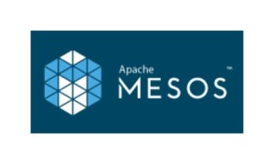
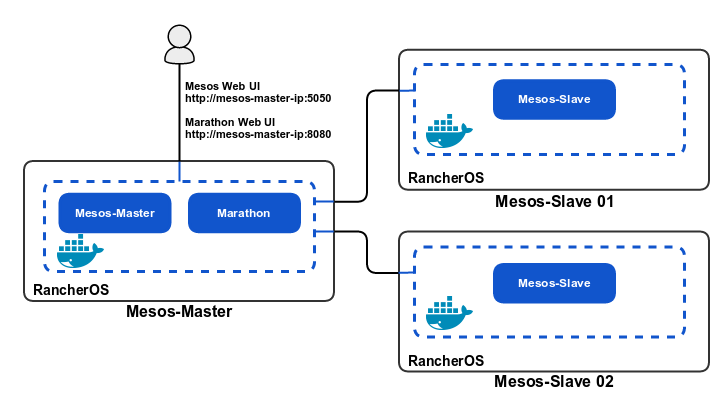
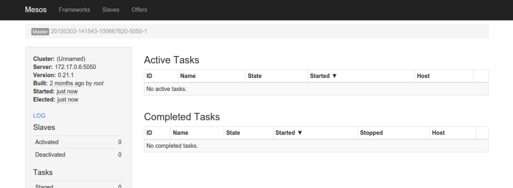
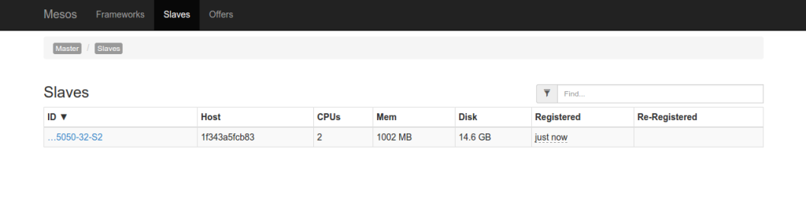
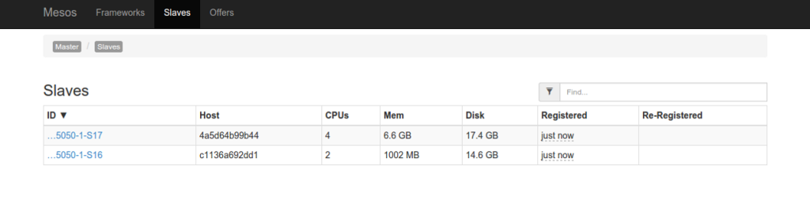
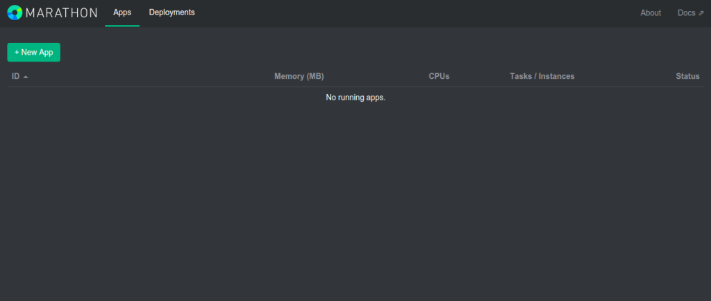

[](https://cdn.rancher.com/wp-content/uploads/2015/03/20153253/APACHE-MESOS-e1426866225926.jpg)
\*This post is now a bit out of date. Since posting this article we’ve
released the [Rancher container
management](https://rancher.com/rancher) platform, and added [full
support for Mesos
environments](https://rancher.com/announcing-mesos-support-in-rancher/).
You can read more about it at
[rancher.com/mesos](https://rancher.com/mesos/). \* In this tutorial, I
will explain how to deploy a Mesos cluster in containers running on
RancherOS and then make our deployment portable across different cloud
platforms and virtualization systems. If you’re not familiar with
Apache Mesos, it is an open-source project that provides an elastic and
highly available clustering framework. With its efficient resource
isolation, it is possible to easily build and manage many distributed
systems running on heterogeneous resources. Combined with Apache
Zookeeper and the Marathon Framework, it provides a powerful platform
for deploying applications. RancherOS is a brand new Linux distribution
that is designed to run Docker.

### Environment setup:

We are going to build a simple cluster with 3 nodes, each of them
running a Mesos installation. A master node is needed to manage all
other slave nodes. We will use an initial system with RancherOS, and
then run a Mesos node in a standard Ubuntu:14.04 container.
[](images/rancher_blog_mesos_rancheros.png)
You can find a lots of information on installing and getting started
with RancherOS on GitHub
[[[here]]](https://github.com/rancher/os).
I’ve started by creating three virtual machines running RancherOS on
VMware. Once we have our three RancherOS servers running, we need to
make them persistent in order to save all the software installation to
disk. This requires running the following command on each node:

```
rancher@rancherOS:$> docker run --privileged -it debian mkfs.ext4 -L RANCHER_STATE /dev/sda
```

A reboot is necessary, after which we have to create a Dockerfile and
specify instructions to create our Mesos images (again, this is required
for each node).

### Docker Mesos Master node:

The latest Mesos solution can be built from the
[Github](https://github.com/apache/mesos) repository. But to keep it
simple and speed up the process, we will use the package built and
hosted by Mesosphere. We create a Dockerfile in some directory, and put
all of the necessary instructions into it. Starting with a fresh Ubuntu
14.04, we then import Mesosphere Archive Automatic Signing Key and add
the Mesosphere Ubuntu 14.04 repo:

```
From ubuntu:14.04
RUN echo "deb http://repos.mesosphere.io/ubuntu/ trusty main" > /etc/apt/sources.list.d/mesosphere.list && 
    apt-key adv --keyserver keyserver.ubuntu.com --recv E56151BF && 
    apt-get update
```

Once that is complete, download and install the latest Mesosphere
package, it will include Mesos, Zookeeper and Marathon:

```
RUN apt-get install -y mesosphere
```

Inform Docker that we will listen on the 5050 port for the Mesos Web UI.

```
EXPOSE 5050
```

We can now run the Mesos master node with a simple *mesos-master*
command, but we need to specify the *work\_dir* param. To make this
easier, we add an entry point for Docker:

```
CMD ["mesos-master", "--work_dir=/var/log/mesos"]
```

Let’s build all this:

```
rancher@mesos-master-rancherOS:$> docker build -t mesos-master .
```

And finaly run it into RancherOS, without forgetting the 5050 port:

```
rancher@mesos-master-rancherOS:$> docker run -p 5050:5050 -t -d mesos-master
```

From this point on, we can manage our cluster from the Mesos Web UI at
http://mesos-master-ip:5050
[](https://cdn.rancher.com/wp-content/uploads/2015/03/20153253/mesos-ui-default.png)

### Docker Mesos slave 01 node:

We start by repeating the initial Ubuntu and Mesos install with a
Dockerfile:

```
From ubuntu:14.04
RUN echo "deb http://repos.mesosphere.io/ubuntu/ trusty main" > /etc/apt/sources.list.d/mesosphere.list && 
    apt-key adv --keyserver keyserver.ubuntu.com --recv E56151BF && 
    apt-get update

RUN apt-get install -y mesos
```

Since we don’t want to run a master node but a slave, we can install
only the Mesos software without Marathon, and then remove Zookeeper:

```
RUN service zookeeper stop
RUN apt-get -y remove --purge zookeeper
```

To be sure, we disable the Mesos master from any default configuration:

```
RUN echo manual > /etc/init/mesos-master.override
```

And we add a default entrypoint for the container:

```
CMD ["mesos-slave", "--master=mesos-master-ip:5050"]
```

Now we need to run it on our slave node in Docker:

```
rancher@mesos-slave01-rancherOS:$> docker run -t -d mesos-slave
```

We can now check in our Mesos Web UI and see the new host:
[](https://cdn.rancher.com/wp-content/uploads/2015/03/20153253/mesos-slaves-01.png)

### Adding additional Mesos nodes:

Now we can repeat the same instructions and add an additional hosts. As
each host is added, it should appear in the UI.
[](https://cdn.rancher.com/wp-content/uploads/2015/03/20153253/mesos-slaves-02.png)

### Adding Marathon:

I ran into a few bugs with getting the Marathon software I installed
from the Mesosphere repo to run consistently on Docker. Marathon and
Zookeeper didn’t run automatically sometimes and I needed to manually
start them from the container. If you run into this, just find the
container ID using the [*docker ps*] command,
and run the following:

```
rancher@mesos-master-rancherOS:$> docker exec CONTAINER-ID service zookeeper restart
rancher@mesos-master-rancherOS:$> docker exec CONTAINER-ID service marathon start
```

If the Marathon software installed from the Mesosphere repo still
doesn’t start, we can download and use the latest Marathon release. To
do this, modify the Dockerfile used for the master node, and add this
lines just after installing Mesosphere:

```
ADD http://downloads.mesosphere.com/marathon/v0.7.5/marathon-0.7.5.tgz /tmp/marathon-0.7.5.tgz
RUN cd /opt/ && tar xvf /tmp/marathon-0.7.5.tgz && mv marathon-0.7.5 marathon
```

This will download, extract and put the Marathon software files into the
right directory. We still need to manually run Marathon, but let’s
automate this. Create a *start.sh* file beside your Dockerfile, and add
these lines:

```
service zookeeper restart
mesos-master --work_dir=/var/log/mesos &
/op/marathon/bin/start --master zk://localhost:2181/mesos --zk zk://localhost:2181
```

And in the Dockerfile:

```
ADD ./start.sh /start.sh
RUN chmod +x /start.sh
EXPOSE 8080
EXPOSE 5050
CMD [“/bin/bash”, “/start.sh”]
```

Now we can build and run our new docker instance, again without
forgetting to add the 8080 port:

```
rancher@mesos-master-rancherOS:$> docker build -t mesos-master .
rancher@mesos-master-rancherOS:$> docker run -p 5050:5050 -p 8080P:8080 -t -d mesos-master
```

Once you have marathon up and running you should be able to access the
Marathon web interface at http://mesos-master-ip:8080
[](https://cdn.rancher.com/wp-content/uploads/2015/03/20153253/mesos-marathon.png)

### Conclusion:

At this point, you have a Mesosphere cluster up and ready to deploy your
applications on. RancherOS gives us a simple platform for deploying
containers, and works well with tools like Mesos and Marathon. As
RancherOS matures, it will be interesting to see how the system services
capabilities can make creating Mesos, Kubernetes or
Docker Swarm clusters easier to deploy and manage. You can find more
information about [RancherOS](https://github.com/rancher/os) and
[Apache Mesos](https://github.com/apache/mesos) on GitHub. On April
29th, our next online meetup is taking place. You can register
below. *Hassen is a Linux System/Network
engineer and developer living in Paris, who loves playing with open
source tools, and is addicted to hardware hacking and working with
Arduino.*
