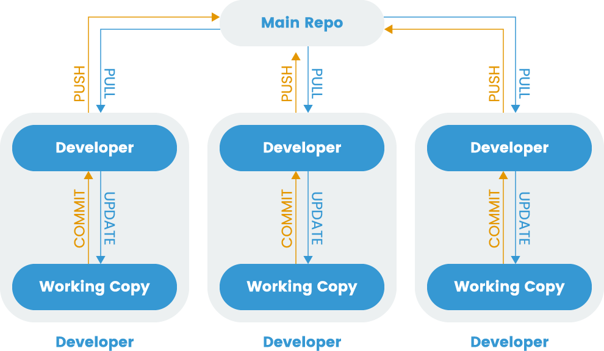
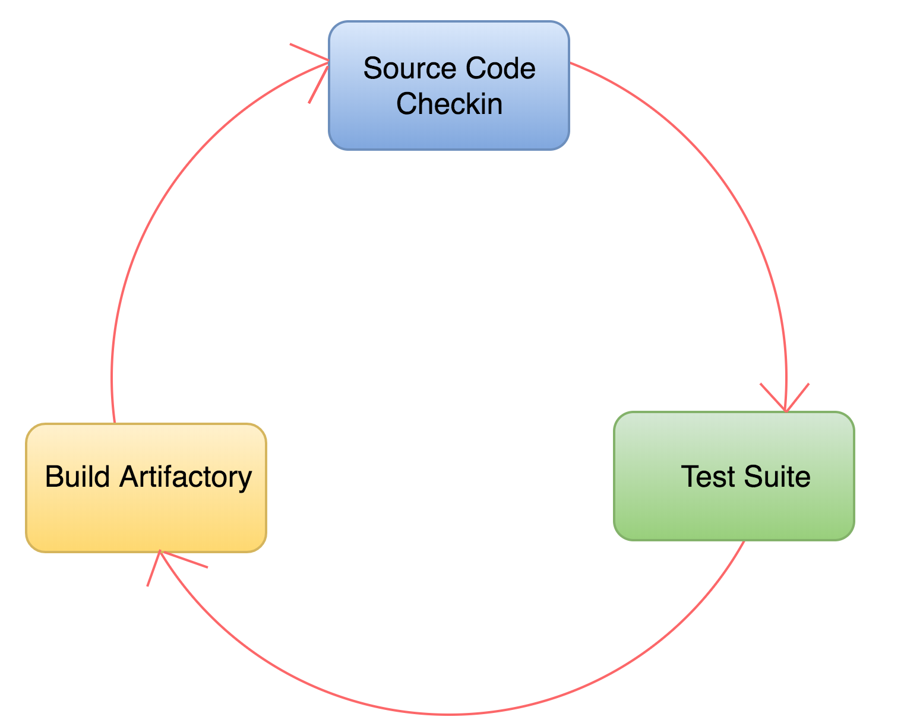
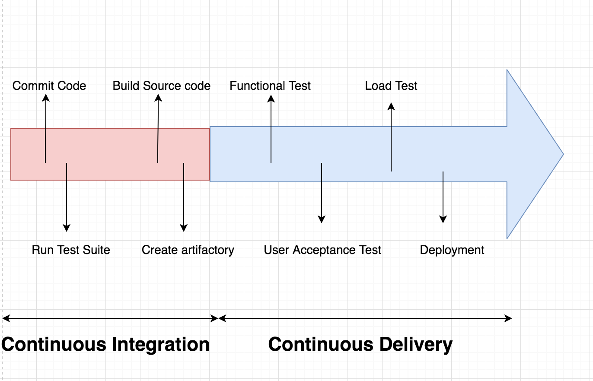
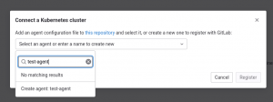
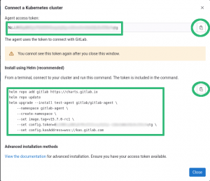
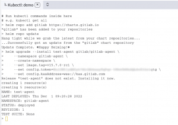

## Introduction

The demands of modern software development combined with complexities of deploying to varied infrastructure can make creating applications a tedious process. As applications grow in size and scope, and development teams become more distributed and diverse, the overall process required to produce and release software quickly and consistently becomes more difficult.

To address these issues, teams began exploring new strategies to automate their build, test, and release processes to help deploy new changes to production faster. This lead to the development of continuous integration and continuous delivery.

In this guide we will explain what CI/CD is and how it helps teams produce well-tested, reliable software at a faster pace. We will then talk about how to build robust CI/CD pipelines integrated with Kubernetes.

## Prerequisite Requirements

Before exploring CI/CD and its benefits in depth, we should discuss some prerequisite technologies and practices that these systems build off of.

### Automated Build Processes

In software development, the build process converts code that developers produce into useable pieces of software that can be executed. For compiled languages like Go or C, this stage involves running the source code through a compiler to produce a standalone binary file. For interpreted languages like Python or PHP, there is no compilation step, but the code may still need to be frozen at a specific point in time, bundled with dependencies, and packaged for easier distribution. These processes result in an artifact that is often called a “build” or “release”.

While developers can create builds manually, this has a number of disadvantages. The shift from active development to creating a build introduces a context switch, forcing individuals to halt more productive work and focusing on the build process. Furthermore, because each developer is producing artifacts on their own, inconsistencies are also likely to arise.

To address these concerns, many teams configure automated build pipelines. These systems monitor source code repositories and automatically kick off a preconfigured build process when changes are detected. This limits the amount of human involvement and ensures that a consistent process is followed on each build.

There are many build tools designed to help you automate these steps. For example, within the Java ecosystem, the following tools are popular:

- **Ant:** Apache’s Ant is an open source Java library. Created in 2000, Ant is the original build tool in the Java space and is still frequently used today.
- **Maven:** Apache’s Maven is a build automation tool written primarily with Java projects in mind. Unlike Apache Ant, Maven follows the philosophy of [convention over configuration](https://en.wikipedia.org/wiki/Convention_over_configuration), requiring configuration only for the aspects of the build process that deviate from reasonable defaults.
- **Gradle:** Reaching version 1.0 in 2012, Gradle tries to incorporate the strengths of both Ant and Maven by incorporating Maven’s modern features without losing the flexibility provided by Ant. Build instructions are written in a dynamic language called Groovy. Despite being a newer tool in this space, it’s seen widespread adoption.

### Version Control

Most modern software development requires frequent collaboration within a shared codebase. Version control systems (VCS) are employed to help maintain project history, allow work on discrete features in parallel, and resolve conflicting changes. The VCS allows projects to easily adopt changes and to roll back in case of problems. Developers can work on projects on their local machines and use the VCS to manage the different branches of development.

Every change recorded in a VCS is called a **commit**. Each commit catalogs the changes to the codebase and includes metadata like a description that can be helpful when reviewing the commit history or merging updates.

Fig. 1 Distributed Version Control

While version control is a valuable tool to help manage many different changes within a single codebase, distributed development often introduces challenges. Developing in independent branches of the codebase without regularly merging into a shared integration branch can make it difficult to incorporate changes later on. To avoid this, developers started adopting a practice called **continuous integration**.

### Continuous Integration (CI)

Continuous Integration (CI) is a process that allows developers to integrate work into a shared branch often, enhancing collaborative development. Frequent integration helps dissolve silos, reducing the size of each commit to lower the chance of merge conflicts.

A robust ecosystem of tools have been developed to encourage CI practices. These systems integrate with VCS repositories to automatically run build scripts and test suites when new changes are detected. Integration tests ensure that different components function together as a group, allowing teams to catch compatibility bugs early. Continuous integration produces builds that are thoroughly tested and reliable.

Fig. 2 Continuous Integration process

## Continuous Delivery and Continuous Deployment (CD)

Continuous delivery and continuous deployment are two strategies that build off of the foundation that continuous integration provides. **Continuous delivery** extends the continuous integration process by deploying builds that pass the integration test suite to a pre-production environment. This makes it straightforward to evaluate each build in a production-like environment so that developers can easily validate bug fixes or test new features without additional work. Once deployed to the staging area, additional manual and automated testing is possible.

**Continuous deployment** takes this approach one step further. Once a build passes automated tests in a staging environment, a continuous deployment system can automatically deploy the build to production servers. In other words, every “green build” is live and available to customers for early feedback. This enables teams to release of new features and bug fixes instantly, backed by the guarantees provided by their testing processes.

Fig. 3 Roadmap for CI/CD Flow Diagram

## Advantages of CI and CD

Continuous integration, delivery, and deployment provide some clear improvements to the software development process. Some of the primary benefits are outlined below.

### Fast Feedback Loop

A fast feedback loop is essential to implementing a rapid development cycle. To receive timely feedback, it is essential that software reaches the end user quickly. When properly implemented, CI/CD provides a platform to achieve this goal by making it simple to update production deployments. By requiring each change to go through rigorous testing, CI helps reduce the risks associated with each build and consequently allows teams to release valuable features to customers quickly and easily.

### Increased Visibility

CI/CD is usually implemented as a pipeline of sequential steps, visible to the entire team. As a result, each team members can track the state of build in the system and identify the build responsible for any test failures. By providing insight into the current state of the codebase, it is easier to plan the best course of action. This level of transparency offers a clear answer the question, “did my commit break the build?”

### Simplified Troubleshooting

Since the goal of CI is to integrate and test every change made to the codebase, it is safer to make small commits and merge them into the shared code repository early. As a result, when a bug is found, it is easier to identify the change that introduced the problem. Afterwards, depending on the magnitude of the issue, the team can choose to either roll back the change or write and commit a fix, decreasing the overall time to resolution in production.

### Higher Quality Software

Automating the build and deployment processes not only shortens the development cycle. It also helps teams produce higher quality software. By ensuring that each change is well-tested and deployed to at least one pre-production environment, teams can push changes to production with confidence. This is possible only when there is good test coverage of all levels of the codebase, from unit tests to more complex system tests.

### Fewer Integration Issues

Because the automated test suite runs on the builds automatically produced with every commit, it is possible to catch and fix most integration issues early. This gives developers early insight into other work currently being done that might affect their code. It tests that code written by different contributors works together from the earliest possible moment instead of later when there may be additional side effects.

### More Time Focused on Development

CI/CD systems rely on automation to produce builds and move new changes through the pipeline. Because manual intervention is not required, building and testing no longer require dedicated time from the development team. Instead, developers can concentrate on making productive changes to the codebase, confident that the automated systems will notify them of any problems.

## Setting up a Kubernetes CI/CD Pipeline

Now that we’ve covered some of the primary advantages of adopting a CI/CD development workflow, let’s talk about how to build a CI/CD pipeline integrated with Kubernetes. The pipeline will allow us to automatically deploy changes committed to our source code repository.

While many different CI/CD solutions are available with integrations with Kubernetes, for simplicity, we’ll demonstrate with the CI/CD functionality offered by hosted GitLab.com. This is a specific example, but the general lessons should apply to other CI/CD systems.

### Prerequisites

In order to follow along with the demonstration, you’ll need the following infrastructure components:

1. A Rancher cluster for deploying workloads to
2. A [gitlab](https://gitlab.com) login

Once you’ve fulfilled the above requirements, you’re ready to get started setting up a pipeline.

## GitLab.com setup

For demonstration purposes, we are going to use one of the templates that GitLab provides. The first step is to login to gitlab.com via <https://gitlab.com/users/sign_in>.

### Create a Project

After logging in, the next step is to create a project:

- Click **New project**
- Choose the **Create from template** tab
- Click **use template** under **Ruby on Rails**
- Set **Project name**
- Click **Create Project**
- Wait for the project to finish importing

Your new project should now be accessible.

## Add the Kubernetes Endpoint to Your Project

Under **Infrastructure** icon on the left pane choose **Kubernetes cluster**.

Then choose **Connect a cluster**.It will ask you to "Select an agent or enter a name to create new", we will type "test-agent" as shown below:

And select **Create agent test-agent** then click **Register**.

Then Gitlab will show us a window with the instructions on how to install the agent into our cluster as seen on the screenshot below:

Notice the information highlighted in green, on the top-left part we have the "Agent access token", this is the token the agent will use to connect to GitLab, do not lose or share this with anybody else.

On the bottom-left part we have the "Install using Helm" instructions, this are the instructions to setup the agent in your cluster.

On the right part we have the icon we can click to copy these into the clipboard.

We will copy the instructions to install the agent and with them go to Rancher or a Terminal and execute them.

- In Rancher, we can click in the icon highlighted in green to open a shell:

- A terminal will open below, where we can paste the commands and execute them:

Now back to the Gitlab page, if we hit refresh we will see the agent is connected.

## Enabling Auto DevOps

In the GitLab UI, go into the **Settings – CI/CD** menu and expand **Auto DevOps**. Afterwards, click the **Default to Auto DevOps pipeline** check button, the rest we leave it with the defaults.

Click **Save changes**.

You can go into **CI/CD – Pipelines** and then click on **Run pipeline** and again **Run pipeline**.

At the end you should see all the steps with a green sign.

## Conclusion

In this guide, we covered the basics of CI/CD pipelines. We first talked about their prerequisite technologies and then took a look at some of the critical advantages adopting a CI/CD process can provide. Afterwards, we demonstrated how to set up a CI/CD pipeline using GitLab.com as an example integration. As we mentioned earlier, although we targeted a specific platform in this guide, the Kubernetes portion should work for the majority of CI/CD Kubernetes integrations.
