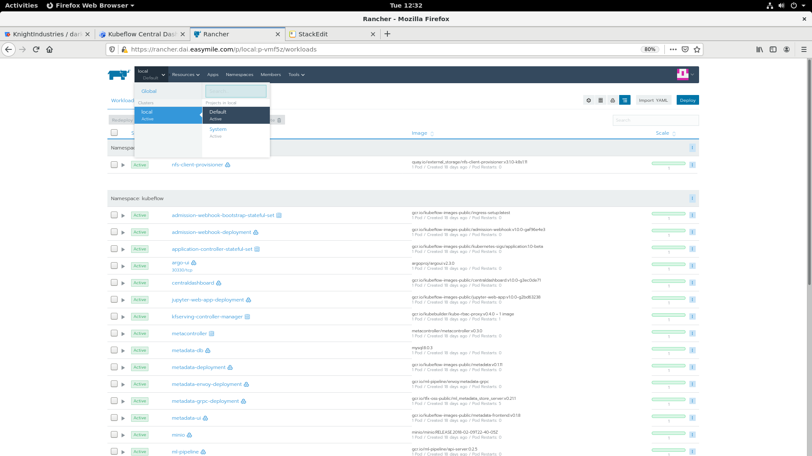
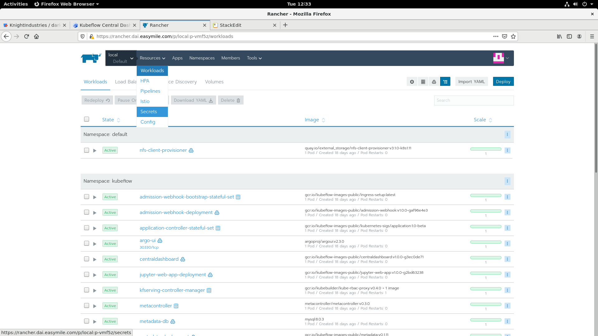
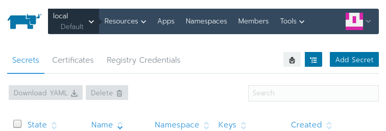
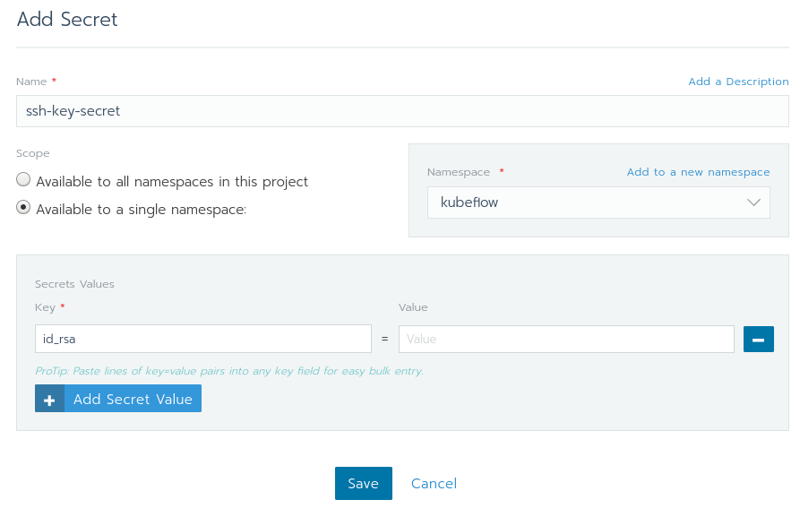
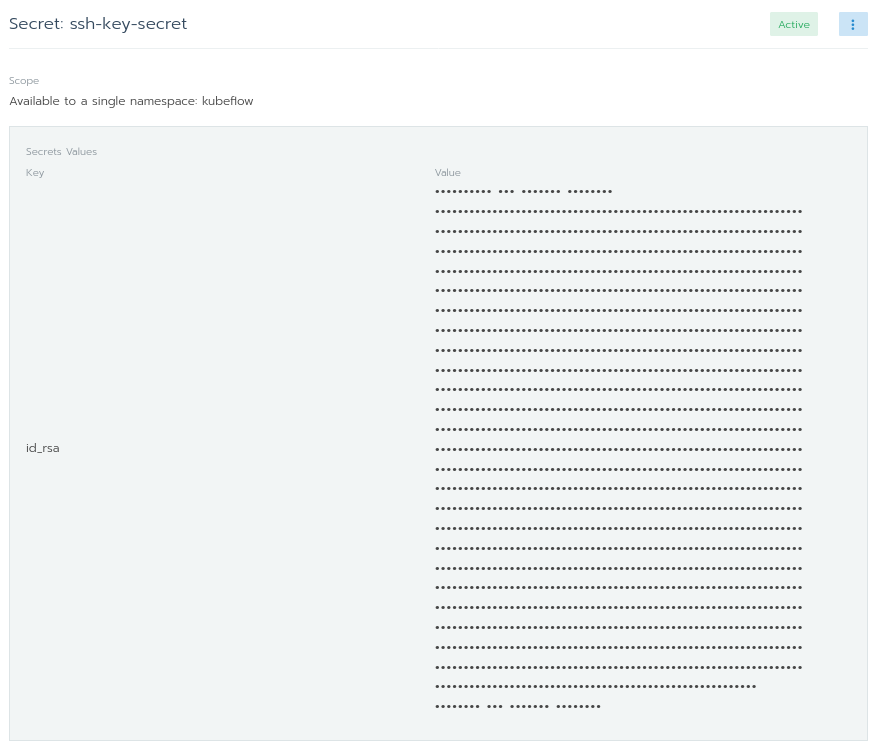
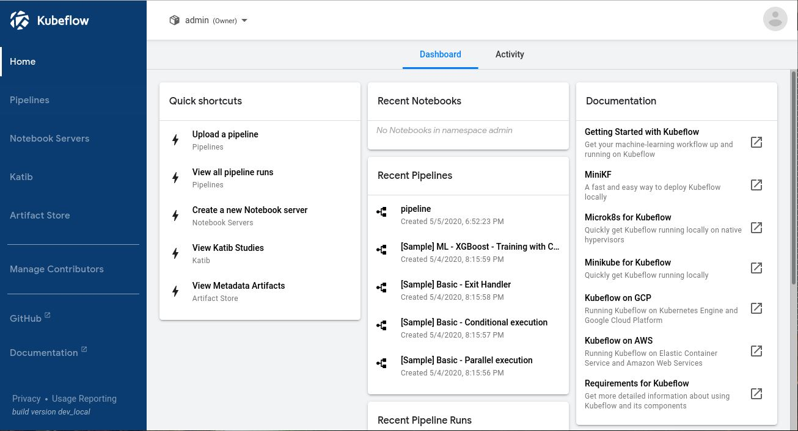
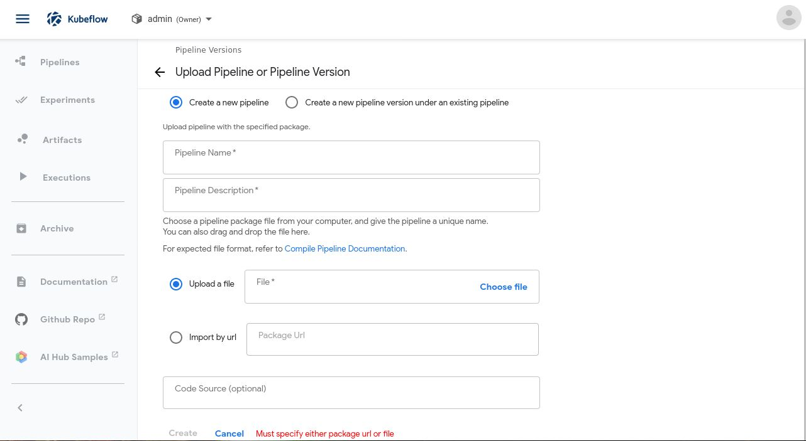
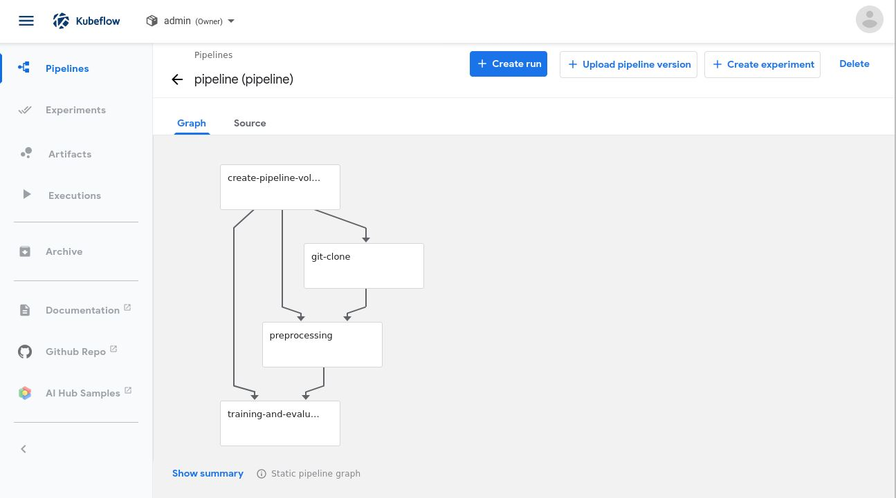
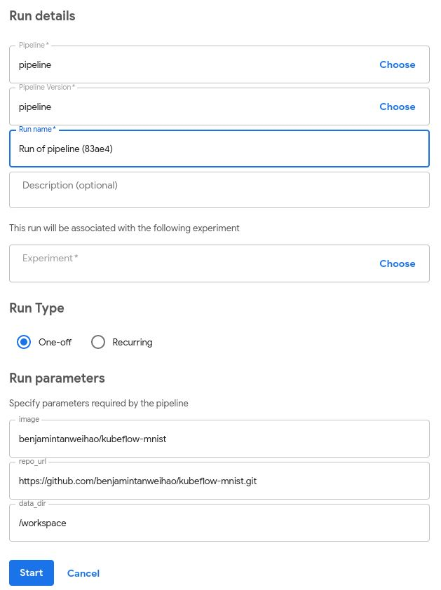
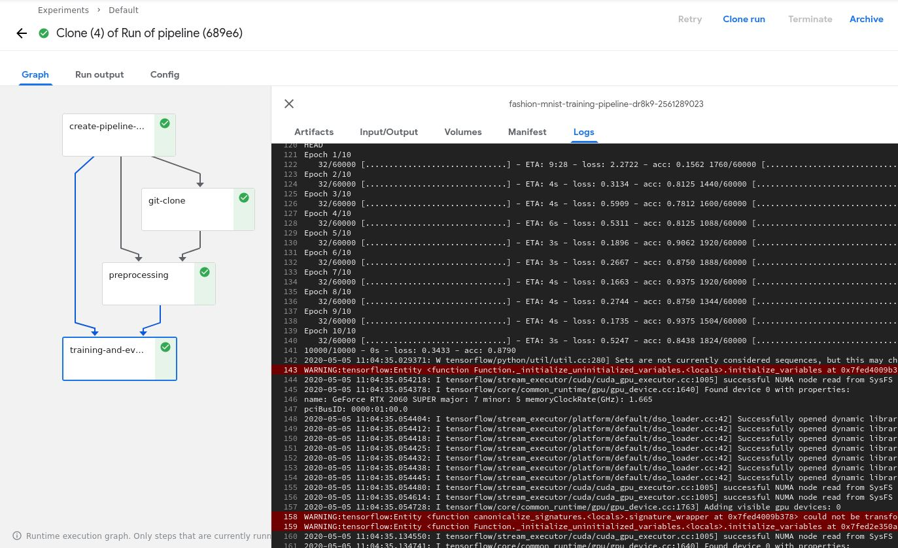

Read our free white paper: How to Build a Kubernetes Strategy[Download Now](https://more.suse.com/fy21-global-web-landing-page-how-to-build-enterprise-kubernetes-strategy)

In [part one](/blog/2020/introduction-to-machine-learning-pipeline) of this series, I introduced you to Kubeflow, a machine learning platform for teams that need to build machine learning pipelines.

In this section, we will learn how to take an existing machine learning project and turn it into a Kubeflow machine learning pipeline, which in turn can be deployed onto Kubernetes. As you are going through this exercise, think about how you can convert your existing machine learning projects into a Kubeflow one.

I will use the Fashion MNIST as an example since model sophistication is not the main objective. For this simple example, I will divide the pipeline into 3 stages:

- Git clone the repository
- Download and re-process the Training and Test data
- Training Evaluation

Of course, you are free to break up your pipeline in any way that make sense for your use case, and nothing is stopping you from extending the pipeline.

## Getting the Code

You can download the code from GitHub:

```
% git clone https://github.com/benjamintanweihao/kubeflow-mnist.git
```

The following is the entire listing that we will use to create our pipeline. In reality, your code would most likely span multiple libraries and files. In our case, we will break our entire code into two scripts, `preprocessing.py` and `train.py`.

```
from tensorflow import keras
import argparse
import os
import pickle

def preprocess(data_dir: str):
    fashion_mnist = keras.datasets.fashion_mnist
    (train_images, train_labels), (test_images, test_labels) = fashion_mnist.load_data()

    train_images = train_images / 255.0
    test_images = test_images / 255.0

    os.makedirs(data_dir, exist_ok=True)

    with open(os.path.join(data_dir, 'train_images.pickle'), 'wb') as f:
	pickle.dump(train_images, f)

    with open(os.path.join(data_dir, 'train_labels.pickle'), 'wb') as f:
	pickle.dump(train_labels, f)

    with open(os.path.join(data_dir, 'test_images.pickle'), 'wb') as f:
        pickle.dump(test_images, f)

    with open(os.path.join(data_dir, 'test_labels.pickle'), 'wb') as f:
        pickle.dump(test_labels, f)

if __name__ == '__main__':
    parser = argparse.ArgumentParser(description='Kubeflow MNIST training script')
    parser.add_argument('--data_dir', help='path to images and labels.')
    args = parser.parse_args()

    preprocess(data_dir=args.data_dir)
```

The processing script takes in a single argument, `data_dir`. It downloads and preprocesses the data and saves the `pickled` version in `data_dir`. In production code, this would probably be the directory where TFRecords are stored, for example.

### `train.py`

```
import calendar
import os
import time

import tensorflow as tf
import pickle
import argparse

from tensorflow import keras
from constants import PROJECT_ROOT

def train(data_dir: str):
    # Training
    model = keras.Sequential([
          keras.layers.Flatten(input_shape=(28, 28)),
          keras.layers.Dense(128, activation='relu'),
          keras.layers.Dense(10)])

    model.compile(optimizer='adam',
              loss=tf.keras.losses.SparseCategoricalCrossentropy(from_logits=True),
                  metrics=['accuracy'])

    with open(os.path.join(data_dir, 'train_images.pickle'), 'rb') as f:
        train_images = pickle.load(f)

    with open(os.path.join(data_dir, 'train_labels.pickle'), 'rb') as f:
        train_labels = pickle.load(f)

    model.fit(train_images, train_labels, epochs=10)

    with open(os.path.join(data_dir, 'test_images.pickle'), 'rb') as f:
        test_images = pickle.load(f)

    with open(os.path.join(data_dir, 'test_labels.pickle'), 'rb') as f:
        test_labels = pickle.load(f)

    # Evaluation
    test_loss, test_acc = model.evaluate(test_images, test_labels, verbose=2)

    print(f'Test Loss: {test_loss}')
    print(f'Test Acc: {test_acc}')

    # Save model
    ts = calendar.timegm(time.gmtime())
    model_path = os.path.join(PROJECT_ROOT, f'mnist-{ts}.h5')
    tf.saved_model.save(model, model_path)

    with open(os.path.join(PROJECT_ROOT, 'output.txt'), 'w') as f:
        f.write(model_path)
        print(f'Model written to: {model_path}')

if __name__ == '__main__':
    parser = argparse.ArgumentParser(description='Kubeflow FMNIST training script')
    parser.add_argument('--data_dir', help='path to images and labels.')
    args = parser.parse_args()

    train(data_dir=args.data_dir)
```

In `train.py`, the model is built, and `data_dir` is used to specify where the train and test data are located. Once the model is trained and evaluation is performed, the model is then written to a timestamped path. Notice that the path is also written to `output.txt`. This will be referenced later on.

## Developing Kubeflow Pipelines

To begin creating Kubeflow Pipelines, we need to pull in a few dependencies. I have prepared an `environment.yml` that includes `kfp 0.5.0`, `tensorflow`, and other dependencies needed.

You need to install Conda. Then you need to perform the following steps:

```
% conda env create -f environment.yml
% source activate kubeflow-mnist
% python preprocessing.py --data_dir=/path/to/data
% python train.py --data_dir=/path/to/data
```

Let’s recall the steps in our pipeline:

1. Git clone the repository
2. Download and preprocess the Training and Test data
3. Training and Evaluation

Before we get into code, here’s a high-level overview on Kubeflow Pipelines.

A pipeline consists of connected *components*. The output of a component becomes the input of another. Each component is essentially executed in a container (Docker, in our case).

What happens is that we would execute a Docker image that we will specify later on that contains everything we need to run `preprocessing.py` and `train.py`. Naturally, these two stages would have their components.

We’ll also need an additional one to `git clone` the project. We could bake the project into the Docker image, but in real-world projects, this would potentially cause the Docker image to bloat in size.

Speaking of the Docker image, we should create one first.

### Step 0: Creating a Docker image

This step is optional if you just want to test things up because I already have an image prepared on Docker Hub. In any case, here’s the `Dockerfile` in its full glory:

```
FROM tensorflow/tensorflow:1.14.0-gpu-py3
LABEL MAINTAINER "Benjamin Tan <benjamintanweihao@gmail.com>"
SHELL ["/bin/bash", "-c"]

# Set the locale
RUN echo 'Acquire {http::Pipeline-Depth "0";};' >> /etc/apt/apt.conf
RUN DEBIAN_FRONTEND="noninteractive"
RUN apt-get update  && apt-get -y install --no-install-recommends locales && locale-gen en_US.UTF-8
ENV LANG en_US.UTF-8
ENV LANGUAGE en_US:en
ENV LC_ALL en_US.UTF-8

RUN apt-get install -y --no-install-recommends 
    wget 
    git 
    python3-pip 
    openssh-client 
    python3-setuptools 
    google-perftools && 
    rm -rf /var/lib/apt/lists/*

# install conda
WORKDIR /tmp
RUN wget --quiet https://repo.anaconda.com/miniconda/Miniconda3-4.7.12-Linux-x86_64.sh -O ~/miniconda.sh && 
    /bin/bash ~/miniconda.sh -b -p /opt/conda && 
    rm ~/miniconda.sh && 
    ln -s /opt/conda/etc/profile.d/conda.sh /etc/profile.d/conda.sh && 
    echo ". /opt/conda/etc/profile.d/conda.sh" >> ~/.bashrc

# build conda environments
COPY environment.yml /tmp/kubeflow-mnist/conda/
RUN /opt/conda/bin/conda update -n base -c defaults conda
RUN /opt/conda/bin/conda env create -f /tmp/kubeflow-mnist/conda/environment.yml
RUN /opt/conda/bin/conda clean -afy

# Cleanup
RUN rm -rf /workspace/{nvidia,docker}-examples && rm -rf /usr/local/nvidia-examples && 
    rm /tmp/kubeflow-mnist/conda/environment.yml

# switch to the conda environment
RUN echo "conda activate kubeflow-mnist" >> ~/.bashrc
ENV PATH /opt/conda/envs/kubeflow-mnist/bin:$PATH
RUN /opt/conda/bin/activate kubeflow-mnist

# make /bin/sh symlink to bash instead of dash:
RUN echo "dash dash/sh boolean false" | debconf-set-selections && 
    DEBIAN_FRONTEND=noninteractive dpkg-reconfigure dash

# Set the new Allocator
ENV LD_PRELOAD /usr/lib/x86_64-linux-gnu/libtcmalloc.so.
```

The important thing about the `Dockerfile` is that the Conda environment is set up and ready to go. To build the image:

```
% docker build -t your-user-name/kubeflow-mnist . -f Dockerfile
% docker push your-user-name/kubeflow-mnist
```

With that said, let’s create the first component!

The following code snippets are found in `pipeline.py`.

### Step 1: Git Clone

In this step, we are going to perform a git clone from a remote Git repository. In particular, I wanted to show you how you could git clone from a *private* repository since that’s where many of your projects are located.

This is also a great opportunity to demonstrate another awesome feature in Rancher: The ability to easily add secrets such as SSH keys.

#### Adding Secrets with Rancher

Access the Rancher interface. On the top left-hand corner, select `local` followed by `Default`:



Then, under `Resources` select `Secrets`



You should see a list of secrets that are being used by the cluster that you’ve just selected. Click on `Add Secret`:



Fill in the page with the following values as seen in the following diagram. If `kubeflow` doesn’t show up in the `Namespace` drop-down, then you can easily create one by selecting `Add to a new namespace` and type in `kubeflow`.

Make sure that the `Scope` only applies to a single namespace. Setting the scope to all namespaces would allow any workload in the Default project to use your ssh key.

In `Secrets Values`, let the key be `id_rsa` and value be the content of your `id_rsa`. Once done, click on `Save`.



If everything goes well, you should see the following screen. That’s it! You have successfully added your SSH key secret in the `kubeflow` namespace. No need to fiddle with `kubectl`!



Now that we have added our SSH key, it’s time to go back to the code. How can we make use of the newly added SSH secrets to access a private git repository?

```
def git_clone_darkrai_op(repo_url: str):

    volume_op = dsl.VolumeOp(
        name="create pipeline volume",
        resource_name="pipeline-pvc",
        modes=["ReadWriteOnce"],
        size="3Gi"
    )

    image = 'alpine/git:latest'

    commands = [
        "mkdir ~/.ssh",
        "cp /etc/ssh-key/id_rsa ~/.ssh/id_rsa",
        "chmod 600 ~/.ssh/id_rsa",
        "ssh-keyscan bitbucket.org >> ~/.ssh/known_hosts",
        f"git clone {repo_url} {PROJECT_ROOT}",
        f"cd {PROJECT_ROOT}"]

    op = dsl.ContainerOp(
        name='git clone',
        image=image,
        command=['sh'],
        arguments=['-c', ' && '.join(commands)],
        container_kwargs={'image_pull_policy': 'IfNotPresent'},
        pvolumes={"/workspace": volume_op.volume}
    )

    # Mount Git Secrets
    op.add_volume(V1Volume(name='ssh-key-volume',
                           secret=V1SecretVolumeSource(secret_name='ssh-key-secret')))
    op.add_volume_mount(V1VolumeMount(mount_path='/etc/ssh-key', name='ssh-key-volume', read_only=True))

    return op
```

First, a Kubernetes volume is created, with a predefined size of 3Gi.

Second, the `image` variable specifies that we are going to use the `alpine/git` Docker image. This is followed by a list of commands that is going to be executed in the Docker container.

The commands essentially set up the SSH keys so that the pipeline step can `git clone` from a private repository (or just use `git://` URLs in general instead of `https://`).

The heart of this function is the following line, with returns a `dsl.ContainerOp`.

The `command` and `arguments` specify the commands that are executed once the image is executed.

The last interesting argument is `pvolumes`, which stands for *Pipeline Volumes*. It creates a Kubernetes volume and allows pipeline components to share single storage. This volume is mounted on `/workspace`. What this component does then is to `git clone` the repository into `/workspace`.

#### Using Secrets

Take a look at the commands again and where it copies the SSH key *from*.

Where is the pipeline volume created though? This will happen when we bring all the components together into a single pipeline. We mount the secrets at `/etc/ssh-key/`:

```
op.add_volume_mount(V1VolumeMount(mount_path='/etc/ssh-key', name='ssh-key-volume', read_only=True))
```

And remember that we named the secret `ssh-key-secret`:

```
op.add_volume(V1Volume(name='ssh-key-volume',
                           secret=V1SecretVolumeSource(secret_name='ssh-key-secret')))
```

We tie everything together by using the same volume name, `ssh-key-volume`.

### Step 2: Preprocessing

```
def preprocess_op(image: str, pvolume: PipelineVolume, data_dir: str):
    return dsl.ContainerOp(
        name='preprocessing',
        image=image,
        command=[CONDA_PYTHON_CMD, f"{PROJECT_ROOT}/preprocessing.py"],
        arguments=["--data_dir", data_dir],
        container_kwargs={'image_pull_policy': 'IfNotPresent'},
        pvolumes={"/workspace": pvolume}
    )
```

As you can see, the preprocessing step looks similar.

The `image` points to the Docker image that we created in Step 0.

The `command` here is simply to execute the `preprocessing.py` script using the specified `conda` python. The `data_dir` is needed to execute the `preprocessing.py` script.

The `pvolume` at this stage would have the repository in `/workspace`, which means that all our scripts would already be available at this stage. At this stage, the preprocessed data is stored in `data_dir` under `/workspace`.

### Step 3: Training and Evaluation

```
def train_and_eval_op(image: str, pvolume: PipelineVolume, data_dir: str, ):
    return dsl.ContainerOp(
        name='training and evaluation',
        image=image,
        command=[CONDA_PYTHON_CMD, f"{PROJECT_ROOT}/train.py"],
        arguments=["--data_dir", data_dir],
        file_outputs={'output': f'{PROJECT_ROOT}/output.txt'},
        container_kwargs={'image_pull_policy': 'IfNotPresent'},
        pvolumes={"/workspace": pvolume}
    )
```

Finally, it’s time for the training and evaluation step. The only difference here is the `file_outputs` argument. If we look again in `train.py`, there’s the following snippet:

```
    with open(os.path.join(PROJECT_ROOT, 'output.txt'), 'w') as f:
        f.write(model_path)
        print(f'Model written to: {model_path}')
```

What’s happening is that we are writing the *model path* into a text file named `output.txt`. Normally, this can then be sent to the next pipeline component, in which case that argument would contain the path to the model.

### Putting Everything Together

To specify the pipeline, you need to annotate the pipeline function with `dsl.pipeline`.

```
@dsl.pipeline(
    name='Fashion MNIST Training Pipeline',
    description='Fashion MNIST Training Pipeline to be executed on KubeFlow.'
)
def training_pipeline(image: str = 'benjamintanweihao/kubeflow-mnist',
                      repo_url: str = 'https://github.com/benjamintanweihao/kubeflow-mnist.git',
                      data_dir: str = '/workspace'):
    git_clone = git_clone_darkrai_op(repo_url=repo_url)

    preprocess_data = preprocess_op(image=image,
                                    pvolume=git_clone.pvolume,
                                    data_dir=data_dir)

    _training_and_eval = train_and_eval_op(image=image,
                                           pvolume=preprocess_data.pvolume,
                                           data_dir=data_dir)

if __name__ == '__main__':
    import kfp.compiler as compiler
    compiler.Compiler().compile(training_pipeline, __file__ + '.tar.gz')
```

Remember that the *output* of a pipeline component is the input to another? Here, the `pvolume` of `git_clone` `container_op` is passed into `preprocess_op`.

The last part turns `pipeline.py` into an executable script. The final step is to *compile* the pipeline:

```
% dsl-compile --py pipeline.py --output pipeline.tar.gz
```

## Uploading and Executing the Kubeflow Pipeline

Now comes the fun part! The first step is to upload the pipeline. Click `Upload a pipeline`:



Next, fill in `Pipeline Name` and `Pipeline Description`, then select `Choose file` and point to `pipeline.tar.gz` to upload the pipeline.



The next page would show the full pipeline. What we see is a *directed acyclic graph* of the pipeline, which in this case means the dependencies go in one direction and it contains no cycles. Click on the blue `Create run` button to kick start a training.



Most of the fields should be filled up. Notice the the `Run parameters` are the same arguments specified in the `training_pipeline` function with the `@dsl.pipeline` annotation:



Finally, when you click the blue `Start` button, the whole pipeline begins! You can click on each of the components followed by `Logs` to observe what’s going on. When the entire pipeline is completed, all the components would have a green checkmark on the right as shown:



## Conclusion

And there you have it!

If you have been following along since the previous article, then you would have installed Kubeflow and should appreciate the complexity of managing machine learning projects at scale.

In this article, we went through the process of preparing a machine learning project for Kubeflow, followed by constructing a Kubeflow machine learning pipeline and finally using the Kubeflow interface to upload and execute a pipeline. The wonderful thing about this approach is that your machine learning project can be as simple or complex as you want and you would still be able to use the same techniques shown here.

Because Kubeflow uses Docker containers as components, you have the freedom to include any tools you fancy. And because Kubeflow runs on Kubernetes, you can have Kubernetes handle the scheduling of your machine learning workloads.

We also looked at a convenient Rancher feature that I love: the ability to easily add secrets. At one go, you can easily organize secrets (such as SSH keys) and choose which namespace to assign it to – without bothering with Base64 encoding them. Just like catalogs, these conveniences make working with Kubernetes way more pleasant and less error prone.

Of course, Rancher offers much more, and I encourage you to do some exploration yourself. I’m sure you will stumble upon something that will blow your mind. Rancher has certainly set a very high bar as a Kubernetes management platform.

Read our free white paper: How to Build a Kubernetes Strategy[Download Now](https://more.suse.com/fy21-global-web-landing-page-how-to-build-enterprise-kubernetes-strategy)
