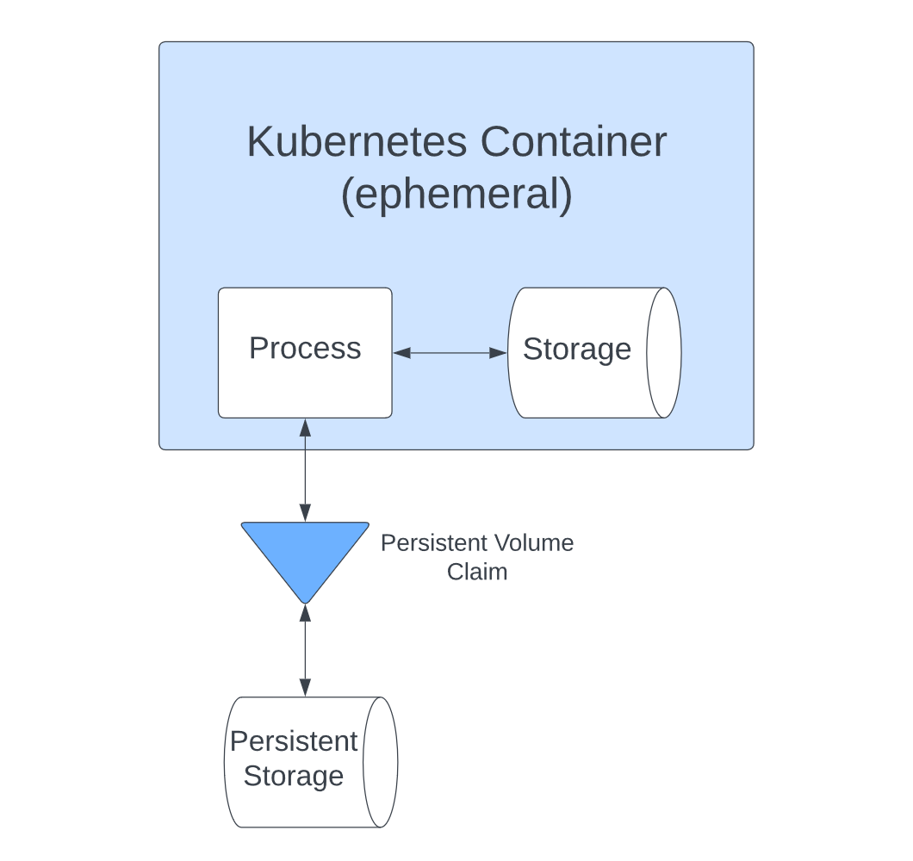

Persistent storage is essential for any account-driven website. However, in [Kubernetes](https://kubernetes.io/), most resources are ephemeral and unsuitable for keeping data long-term. Regular [storage is tied to the container](https://kubernetes.io/docs/concepts/storage/volumes/) and has a finite life span. Persistent storage has to be separately provisioned and managed.

Making permanent storage work with temporary resources brings challenges that you need to solve if you want to get the most out of your Kubernetes deployments.

In this article, you'll learn about what's involved in setting up persistent storage in a [cloud native](https://www.suse.com/suse-defines/definition/cloud-native/) environment. You'll also see how tools like [Longhorn](https://longhorn.io/) and [Rancher](https://www.rancher.com/) can enhance your capabilities, letting you take full control of your resources.

## **Persistent storage in Kubernetes: challenges and solutions**

Kubernetes has become the go-to solution for containers, allowing you to easily [deploy scalable sites](https://hackernoon.com/why-and-when-you-should-use-kubernetes-8b50915d97d8) with a high degree of fault tolerance. In addition, there are many tools to help enhance Kubernetes, including Longhorn and Rancher.

Longhorn is a lightweight block storage system that you can use to provide persistent storage to Kubernetes clusters. [Rancher](https://www.rancher.com/) is a container management tool that helps you with the challenges that come with running multiple containers.

You can use Rancher and Longhorn together with Kubernetes to take advantage of both of their feature sets. This gives you reliable persistent storage and better container management tools.

### **How Kubernetes handles persistent storage**

In Kubernetes, [files only last as long as the container](/blog/stupid-simple-kubernetes-persistent-volumes-explained-part-3/), and they're lost if the container crashes. That's a problem when you need to store data long-term. You can't afford to lose everything when the container disappears.

[Persistent Volumes](https://kubernetes.io/docs/concepts/storage/persistent-volumes/) are the solution to these issues. You can provision them separately from the containers they use and then attach them to containers [using a PersistentVolumeClaim](https://kubevious.io/blog/post/kubernetes-storage-architecture-challenges-and-solutions), which allows applications to access the storage:



However, managing how these volumes interact with containers and setting them up to provide the combination of security, performance and scalability you need bring further issues.

Next, you'll take a look at those issues and how you can solve them.

### **Security**

With storage, security is always a key concern. It's especially important with persistent storage, which is used for user data and other critical information. You need to make sure the data is only available to those that need to see it and that there's no other way to access it.

There are a few things you can do to improve security:

### **Use RBAC to limit access to storage resources**

Role-based access control (RBAC) lets you manage permissions easily, granting users permissions according to their role. With it, you can specify exactly who can access storage resources.

Kubernetes provides [RBAC management](https://kubernetes.io/docs/reference/access-authn-authz/rbac/) and allows you to assign both Roles, which apply to a specific namespace, and ClusterRoles, which are not namespaced and can be used to give permissions on a cluster-wide basis.

Tools like [Rancher also include RBAC support](https://docs.ranchermanager.rancher.io/pages-for-subheaders/manage-role-based-access-control-rbac). Rancher's system is built on top of Kubernetes RBAC, which it uses for enforcement.

With RBAC in place, not only can you control who accesses what, but you can change it easily, too. That's particularly useful for enterprise software managers who need to manage hundreds of accounts at once. RBAC allows them to control access to your storage layer, defining what is allowed and changing those rules quickly on a role-by-role level.

### **Use namespaces**

[Namespaces in Kubernetes](https://kubernetes.io/docs/concepts/overview/working-with-objects/namespaces/) allow you to create groups of resources. You can then set up different access control rules and apply them independently to each namespace, giving you extra security.

If you have multiple teams, it's a good way to stop them from getting in each other's way. It also keeps its resources private to their namespace.

Namespaces do provide a layer of basic security, compartmentalizing teams and preventing users from accessing what you don't want them to.

However, from a security perspective, namespaces do have limitations. For example, they [don't actually isolate all the shared resources](https://www.rapid7.com/blog/post/2021/04/08/kubernetes-namespaces-are-not-as-secure-as-you-think/) that the namespaced resources use. That means if an attacker gets escalated privileges, they can access resources on other namespaces served by the same node.

### **Scalability and performance**

Delivering your content quickly provides a better user experience, and maintaining that quality as your traffic increases and decreases adds an additional challenge. There are several techniques to help your apps cope:

#### **Use storage classes for added control**

[Kubernetes storage classes](https://kubernetes.io/docs/concepts/storage/storage-classes/) let you define how your storage is used, and there are various settings you can change. For example, you can choose to [make classes expandable](https://kubernetes.io/blog/2022/05/05/volume-expansion-ga/). That way, you can get more space if you run out without having to provision a new volume.

Longhorn has its [own storage classes](https://longhorn.io/docs/1.4.0/volumes-and-nodes/create-volumes/#binding-workloads-to-pvs-without-a-kubernetes-storageclass) to help you control when Persistent Volumes and their containers are created and matched.

Storage classes let you define the relationship between your storage and other resources, and they are an essential way to control your architecture.

#### **Dynamically provision new persistent storage for workloads**

It isn't always clear how much storage a resource will need. Provisioning dynamically, based on that need, allows you to limit what you create to what is required.

You can have your storage wait until a container that uses it is created before it's provisioned, which avoids the wasted overhead of creating storage that is never used.

Using [Rancher with Longhorn's storage classes](https://ranchermanager.docs.rancher.com/pages-for-subheaders/create-kubernetes-persistent-storage#dynamically-provisioning-new-storage-in-rancher) lets you provision storage dynamically without having to rely on cloud services.

#### **Optimize storage based on use**

Persistent storage volumes have various properties. Their size is an obvious one, but latency and CPU resources also matter.

When creating persistent storage, make sure that the parameters used reflect what you need to use it for. A service that needs to respond quickly, such as a login service, can be optimized for speed.

Using different storage classes for different purposes is easier when using a provider like Longhorn. [Longhorn storage classes](/blog/getting-started-with-longhorn-distributed-block-storage-and-cloud-native-distributed-sql/) can specify different disk technologies, such as NVME, SSD, or rotation, and these can be linked to specific nodes allowing you to match storage to your requirements closely.

### **Stability**

Building a stable product means getting the infrastructure right and aggressively looking for errors. That way, your product quality will be as high as possible.

#### **Maximize availability**

Outages cost time and money, so avoiding them is [an obvious goal](https://www.ondat.io/blog/deploying-cloud-native-persistent-storage-in-the-age-of-containers).

When they do occur, planning for them is essential. With cloud storage, you can automate reprovisioning of failed volumes to minimize user disruption.

To prevent data loss, you must ensure dynamically provisioned volumes aren't automatically deleted when a resource is done with them. Kubernetes enables the use protection on volumes, so they aren't immediately lost.

You can control the behavior of storage volumes by setting the reclaim policy. Picking the retain option lets you manually choose what to do with the data and prevents it from being deleted automatically.

#### **Monitor metrics**

As well as challenges, working with cloud volumes also offers advantages. Cloud providers typically include many strong options for monitoring volumes, facilitating a high level of observability.

Rancher makes it easier to monitor Kubernetes clusters. Its built-in [Grafana dashboards](https://grafana.com/) let you view data for all your resources.

Rancher collects memory and CPU data by default, and you can break this data down by workload using [PromQL queries](https://docs.ranchermanager.rancher.io/how-to-guides/advanced-user-guides/monitoring-alerting-guides/set-up-monitoring-for-workloads).

For example, if you wanted to know how much data was being read to a disk by a workload, you'd use the following PromQL from [Rancher's documentation](https://docs.ranchermanager.rancher.io/v2.6/integrations-in-rancher/monitoring-and-alerting/promql-expressions#workload-metrics):

```
sum(rate(container_fs_reads_bytes_total{namespace="$namespace",pod_name=~"$podName",container_name!=""}[5m])) by (pod_name)
```

Longhorn also offers a [detailed selection of metrics](https://longhorn.io/docs/1.3.2/monitoring/metrics/) for monitoring nodes, volumes, and instances. You can also check on the resource usage of your manager, along with the size and status of backups.

The observability these metrics provide has several uses. You should log any detected errors in as much detail as possible, enabling you to identify and solve problems. You should also monitor performance, perhaps setting alerts if it drops below any particular threshold. The same goes for error logging, which can help you spot issues and resolve them before they become too serious.

#### **Get the infrastructure right for large products**

For enterprise-grade products that require fast, reliable distributed block storage, Longhorn is ideal. It provides a highly resilient storage infrastructure. It [has features like application-aware snapshots and backups](/blog/longhorn-simplifies-distributed-block-storage-in-kubernetes/) as well as remote replication, meaning you can protect your data at scale.

Longhorn provides enterprise-grade distributed block storage and facilitates deploying a highly resilient storage infrastructure. It lets you provision storage on the major cloud providers, with built-in support for [Azure](https://azure.microsoft.com/en-us/), [Google Cloud Platform (GCP)](https://cloud.google.com/) and [Amazon Web Services (AWS)](https://aws.amazon.com/).

Longhorn also lets you spread your storage over [multiple availability zones](https://forums.rancher.com/t/how-to-configure-zone-awareness/18011) (AZs). However, keep in mind that there can be [latency issues](https://forums.rancher.com/t/multiple-locations/36611) if volume replicas reside in different regions.

## **Conclusion**

Managing persistent storage is a key challenge when setting up Kubernetes applications. Because Persistent Volumes work differently from regular containers, you need to think carefully about how they interact; how you set things up impacts your application performance, security and scalability.

With the right software, these issues become much easier to handle. With help from tools like [Longhorn](https://longhorn.io/) and [Rancher](https://www.rancher.com/), you can solve many of the problems discussed here. That way, your applications benefit from Kubernetes while letting you keep a permanent data store your other containers can interact with.

[SUSE](https://www.suse.com/) is an open source software company responsible for leading cloud solutions like Rancher and Longhorn. Longhorn is an easy, fast and reliable Cloud native distributed storage platform. Rancher lets you manage your Kubernetes clusters to ensure consistency and security. Together, these and [other products](https://www.suse.com/products/) are perfect for delivering business-critical solutions.
