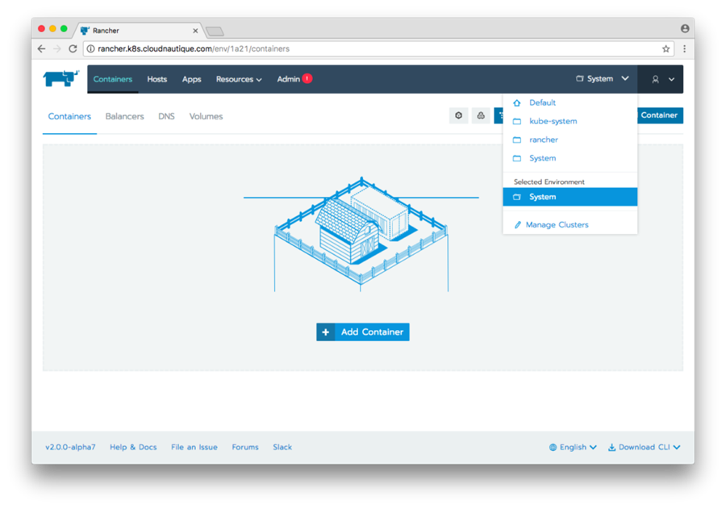
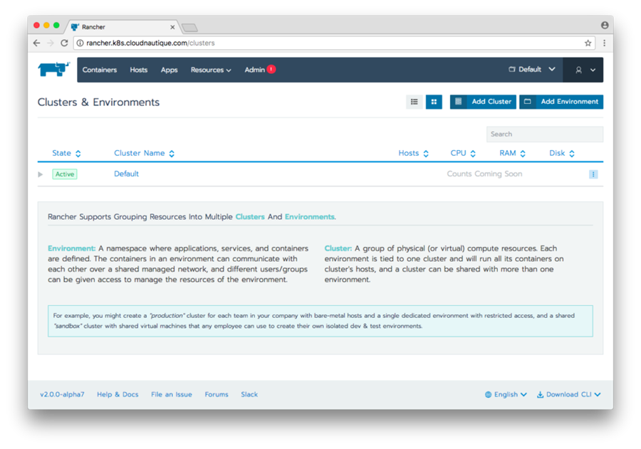
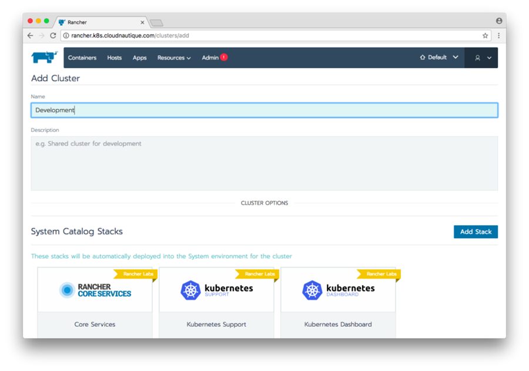
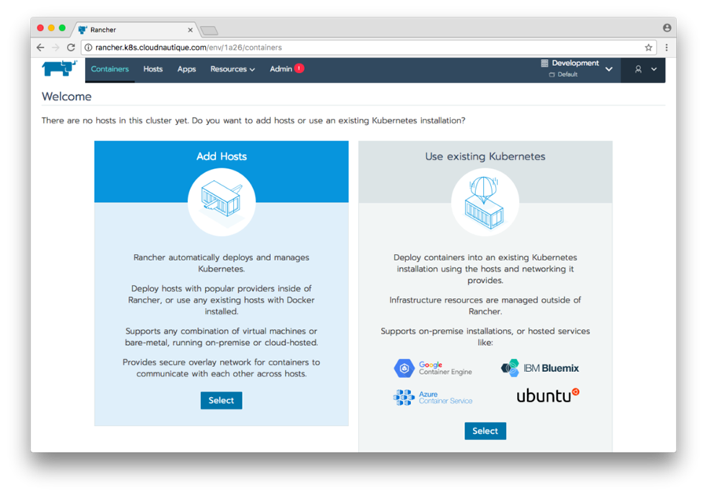
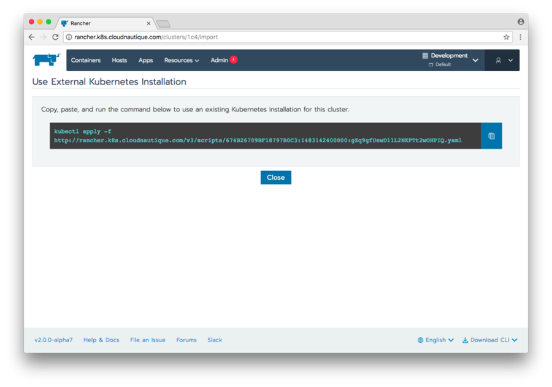
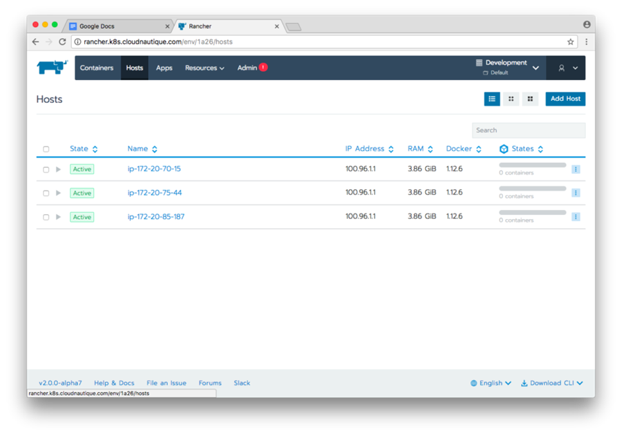

One of the hallmark features of [Rancher 2.0](https://rancher.com/rancher2-0/) is its ability to consume

Kubernetes clusters from anywhere. In this post, I’m going to walk you

through using the popular `kops` tool to create and manage Kubernetes

clusters on AWS and then bring them under Rancher 2.0 management. This

walkthrough will help you create a non-HA Kubernetes cluster, though

`kops` does support HA configurations. With this new cluster, we will

run the Rancher 2.0 tech preview in a pod with a persistent volume

claim.

### Prerequisites

To follow along, you will need a properly configured `kops` setup, as

outlined in the `kops` [AWS Getting Started Guide](https://github.com/kubernetes/kops/blob/master/docs/aws.md). The

AWS guide will walk you through setting up:

- AWS CLI configuration
- Working DNS managed by Route 53
- IAM roles configured for EC2 resources
- The S3 `kops` State Store
- Installation of the `kops` tool
- Installation of the `kubectl` CLI

## Creating Your Rancher-Kubernetes Cluster

First, we will set some environment variables to make typing less

painful on the CLI. Set a NAME for your cluster:

```
export NAME=rancher-management.k8s.cloudnautique.com
```

If you do not already have one, create a state store bucket:

```
aws s3 mb s3://cloudnautique-s3-bucket-for-cluster-state
```

Then, set an environment variable:

```
export KOPS_STATE_STORE=s3://cloudnautique-s3-bucket-for-cluster-state
```

Of note, for this post, I’m going to use real DNS managed by Route53.

The *k8s.cloudnautique.com* domain above is a managed Route53 zone.

Let’s create the cluster:

```
kops create cluster --zones us-west-1b --node-count 1 ${NAME}
```

This command generates a cluster in a single zone, *us-west-1b*, with a

single worker node. Next, actually deploy the cluster:

```
kops update cluster ${NAME} --yes
```

It will take 10-15 minutes to provision. Now would be a good time to

take a walk or get a cup of coffee. You can check the status of the

cluster using the command:

```
kops validate cluster
```

Here’s an example for this cluster:

```
```
> kops validate cluster
Using cluster from kubectl context: rancher-mgmt.k8s.cloudnautique.com

Validating cluster rancher-mgmt.k8s.cloudnautique.com

INSTANCE GROUPS
NAME            ROLE    MACHINETYPE MIN MAX SUBNETS
master-us-west-1b   Master  m3.medium   1   1   us-west-1b
nodes           Node    t2.medium   1   1   us-west-1b

NODE STATUS
NAME                        ROLE    READY
ip-172-20-54-160.us-west-1.compute.internal master  True
ip-172-20-56-231.us-west-1.compute.internal node    True

Your cluster rancher-mgmt.k8s.cloudnautique.com is ready
```
```

Once the cluster is up and running, we can start interacting with it via

`kubectl`.

```
kubectl get nodes
```

To see the pods currently running, enter this command:

```
kubectl -n kube-system get pods
```

Now, let’s deploy our Rancher 2.0 server container. First, create a

namespace for our app.

```
kubectl create ns rancher-server
```

You can deploy the Rancher server stack below after you replace the

`###YOUR DNSNAME###` variable with the domain name you want to use for

the Rancher UI.

```
```
apiVersion: v1
kind: PersistentVolumeClaim
metadata:
  name: rancher-db-claim
spec:
  storageClassName: default
  accessModes:
    - ReadWriteOnce
  resources:
    requests:
      storage: 10Gi
---
apiVersion: extensions/v1beta1
kind: Deployment
metadata:
  labels:
    run: rancher-server
  name: rancher-server
spec:
  replicas: 1
  selector:
    matchLabels:
      run: rancher-server
  strategy: {}
  template:
    metadata:
      labels:
        run: rancher-server
    spec:
      containers:
      - image: rancher/server:v2.0.0-alpha7
        name: rancher-server
        volumeMounts:
          - mountPath: "/var/lib/mysql"
            name: rancher-db
            subPath: mysql
      volumes:
        - name: rancher-db
          persistentVolumeClaim:
            claimName: rancher-db-claim
---
apiVersion: v1
kind: Service
metadata:
  name: rancher
  annotations:
    dns.alpha.kubernetes.io/external: ###YOUR DNS NAME###
    service.beta.kubernetes.io/aws-load-balancer-proxy-protocol: '*'
spec:
  selector:
    run: rancher-server
  ports:
    - protocol: TCP
      port: 80
      targetPort: 8080
  type: LoadBalancer
```
```

After a few minutes, you should be able to visit

*http://##YOURDNSNAME###* and load up the UI. A future improvement

would be to add TLS termination at the ELB, which `kops` supports. You

can optionally register your management cluster into Rancher. This will

deploy the Kubernetes Dashboard, giving you access to `kubectl` from the

Rancher UI. To do so, when you visit the Rancher UI, select **Use existing Kubernetes**. Then, copy and paste the `kubectl` command that

displays, and run it from your CLI.

## Adding a User Cluster

Now that we have a Kubernetes cluster to manage our Rancher server

cluster, let’s add an additional cluster for our user workload and to

checkout Rancher 2.0’s multi-cluster management. In this case, we are

going to deploy into the same VPC as the Rancher management cluster to

save on resources. Going this route is not a hard requirement for

Rancher. We will need the VPC ID. Assuming you have Jq installed, you

can use the following command:

```
export VPC=$(aws ec2 describe-vpcs --region us-west-1 --filters Name=tag:Name,Values="${NAME}" |grep -v ^kops|jq -r .Vpcs[].VpcId)
```

Then, let’s set our development cluster name environment variable:

```
export DEV_NAME=development.k8s.cloudnautique.com
```

Now it’s time to create our cluster:

```
kops create cluster --zones us-west-1b --node-count 3 --vpc ${VPC} ${DEV_NAME}
```

This time we still deploy to the same availability zone, but we will

deploy three worker nodes instead of just a single node. Also, we need

to edit out cluster configuration to ensure that our subnets do not

overlap.

```
kops edit cluster --name ${DEV_NAME}
```

You should see your VPCID and CIDR configured properly under the

following keys:

```
```
...
networkCIDR: 172.20.0.0/16
networkID: ${VPC}
...
```
```

If the `networkCIDR` is incorrect, now is the time to set it to the VPC

CIDR. You can find this setting by editing your management cluster

`kops edit cluster`. You also need to edit the subnets CIDR so that

it’s non-overlapping with the management cluster. For this, we set it

to *172.20.64.0/19*. Now, let’s deploy our cluster:

```
kops update cluster ${DEV_NAME} --yes
```

It will take a few minutes to provision. While that is happening, you

can go to the Rancher UI and click **Manage Clusters** from the

Environment menu in the right-hand corner.  On the Clusters &

Environments page, click **Add Cluster**.  Provide the cluster

a name.  Select **Use existing Kubernetes** to import your existing cluster.  Copy the command.

 Before running the

registration command, verify your `kubectl` command is using the correct

context:

```
kubectl config current-context
```

This should show the development cluster we created above. If it

doesn’t, go ahead and set it to the second cluster’s context.

```
kubectl config set-context ${DEV_NAME}
```

Replace *NAME* with the development cluster defined above. In the case

of this example, it is *development.k8s.cloudnautique.com*. On your

command line, paste the command copied from above and register your

development cluster. Now, when you click the **Hosts** tab, you see the

three hosts registered into the environment.  You are now ready

to use your Rancher environment to deploy apps from the Catalog, or from

your compose files. Once you are done playing, you can clean up all of

your resources with this command:

```
kops delete cluster ${DEV_NAME} --yes
```

Then, switch to the management cluster and do the same:

```
kops delete cluster ${NAME} --yes
```

## Summary

Now you can see how easy it is to bring in multiple Kubernetes clusters

within Rancher 2.0. Kubernetes clusters from `kops` are just one type of

cluster you can use; you can consume Kubernetes from Google’s GKE,

DigitalOcean, or Azure. Rancher 2.0 continues to forge ahead with the

cross-cloud container story by allowing users flexibility to run to

where they need. We hope you’ll give [Rancher 2.0](https://rancher.com/rancher2-0/) a try!

### About the Author

Bill Maxwell is a

senior software engineer at Rancher Labs. He has extensive experience in

software engineering and operations, and he has led continuous

integration and continuous delivery (CI/CD) initiatives. Prior to

Rancher Labs, Bill worked at GoDaddy in engineering, development, and

managing various cloud services product deployments. He holds a Masters

in Information Management degree from Arizona State University and has a

BSEE in Electrical Engineering from California State Polytechnic

University.
