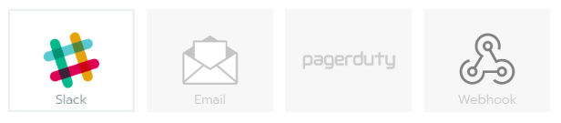
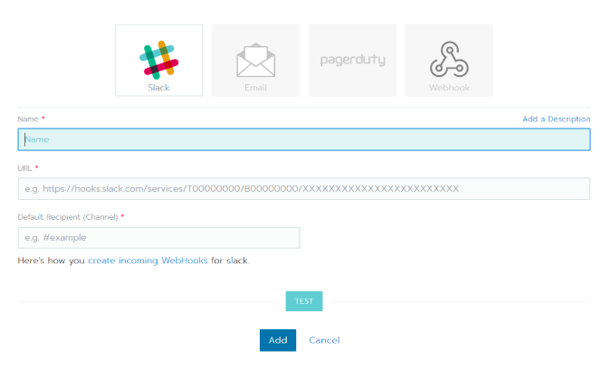
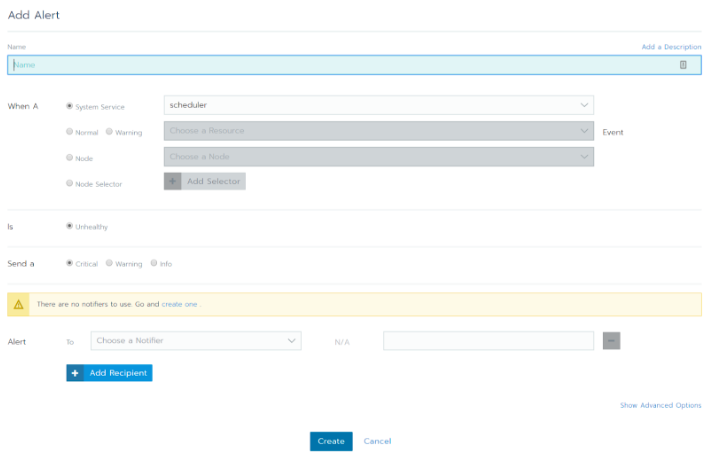
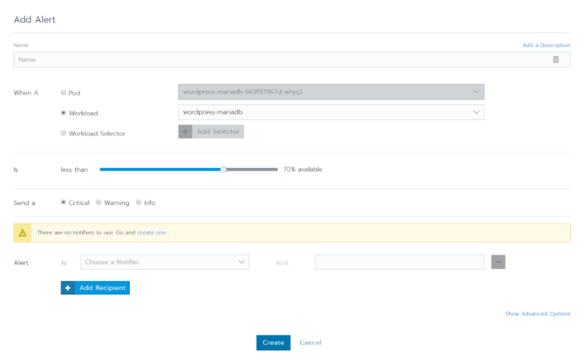

Expert Training in Kubernetes and RancherJoin our free online training sessions to learn more about Kubernetes, containers, and Rancher.[Sign up here](https://rancher.com/training/)

Some of the cool new features that have been introduced in Rancher 2.0 include Cluster and Workload Alerting. These Kubernetes monitoring features were frequently asked for under 1.x, so were high on the feature list for when we started development on 2.0. This article will focus exclusively on the new Alerting features, but is part of a series that will cover additional new aspects of Rancher 2.0.

## NOTIFIERS

The Alerting feature lets you create customised alerts and have those alerts sent to a number of backend systems.

The first step is to create a notifier. Notifiers are created at the cluster level. Select the Tools drop down and then select Notifiers. Clicking **Add Notifier** will then bring up a modal window that allows you to pick from the following options.

When you choose one of these options the various configuration parameters are then made available. In the example for Slack, below, you can see that there is a link that shows how to configure the notifier.

Adding in valid information will then allow for a test to be sent to the notifier. An example of the slack notification is below.

The webhook notifier should allow for notifications to be sent to a variety of systems that can then have a workflow that can handle the specific alert that has been triggered.

## CLUSTER LEVEL ALERTS

Back under the Tools drop down there is an option for Alerts. There are a few preconfigured alerts; these alerts, however, will not trigger until they are associated with a notifier.

Associating one of these with a notifier is as simple as editing the alert, setting the notifier, and saving.

To create a new alert, simply click **Add Alert** and you will be presented with

As you can see there are several options that you can set with alerts and these can be related to system or user resources. At the cluster level, you would set alerts based on cluster-wide resources, such as **Node** or the actual Kubernetes components.

## WORKLOAD LEVEL ALERTS

Workload alerts are set within the project context. Under the **Resources** drop down there is an **Alerts** menu item, within here clicking add will bring up the following.

Within the [Project](https://rancher.com/rancher-glossary-1-6-to-2-0-terms-concepts/) alerts you would set alerts relating to your actual application workloads, for example if your service wasn’t running at the scale that you had set, or had restarted a certain number of times in a specified time period.

### CONCLUSION

This blog was intended to provide a brief overview of one of the newer features that we introduced in Rancher 2.0. We are looking to enhance these features further so keep checking for updates.

In addition, our online trainings provide a live demo of setting up **Alerts**. Check the trainings out [here](https://rancher.com/training).

Expert Training in Kubernetes and RancherJoin our free online training sessions to learn more about Kubernetes, containers, and Rancher.[Sign up here](https://rancher.com/training/)
