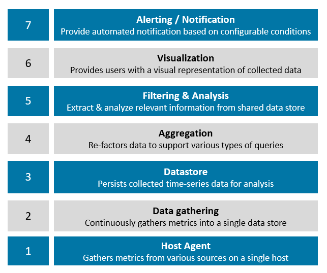
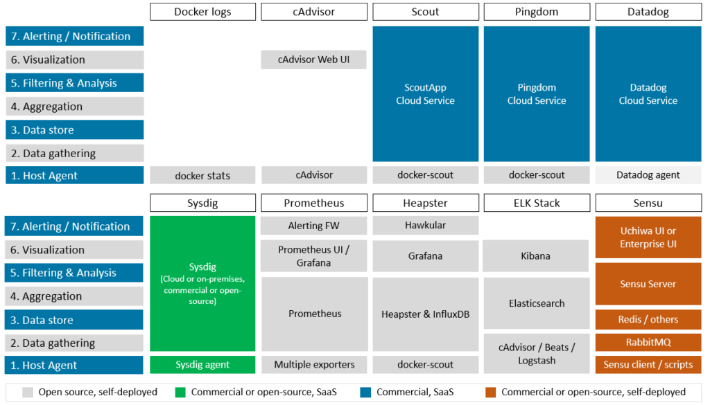
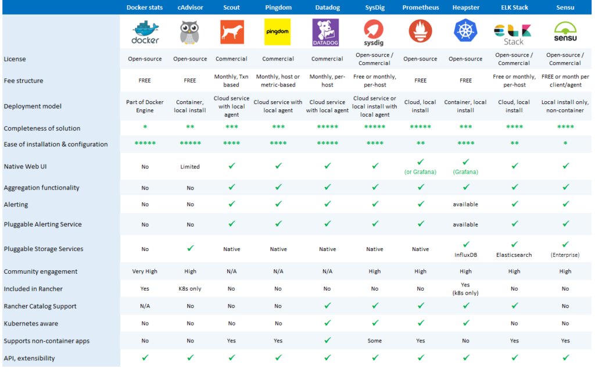
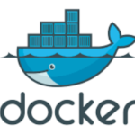

Continue your education with Kubernetes Master ClassesLearn to navigate the modern development landscape with confidence and get started without leaving home.[Learn More](https://rancher.com/kubernetes-master-class/)

Container monitoring environments come in all shapes and sizes. Some are open source while others are commercial. Some are available in the Rancher Catalog while others require manual configuration. Some are general purpose while others are aimed specifically at container environments. Some are hosted in the cloud while others require installation on own cluster hosts.

In this post, we take an updated look at 10 container monitoring solutions. This effort builds on earlier work including Ismail Usman’s
[Comparing 7 Monitoring Options for Docker](https://rancher.com/comparing-monitoring-options-for-docker-deployments/) from 2015 and The Great Container Monitoring Bake Off Meetup in October of 2016. This article was originally written in 2017 and was last updated at the end of 2018.

The number of monitoring solutions is daunting. New solutions are coming on the scene continuously, and existing solutions evolve in functionality. Rather than looking at each solution in depth, we will take the approach of drawing high-level comparisons. With this approach, readers can hopefully “narrow the list” and do more serious evaluations of solutions best suited to their own needs.

The monitoring solutions covered here include:

- [Native Docker](https://docs.docker.com/engine/reference/commandline/stats/)
- [cAdvisor](https://github.com/google/cadvisor)
- [Scout](http://scoutapp.com/)
- [Pingdom](http://pingdom.com/)
- [Datadog](https://www.datadoghq.com/)
- [Sysdig](http://sysdig.com/)
- [Prometheus](https://prometheus.io/)
- [Heapster / Grafana (deprecated)](https://github.com/kubernetes/heapster)
- [ELK stack](https://www.elastic.co/)
- [Sensu](http://sensuapp.org/)

In the following sections, we suggest a framework for comparing monitoring solutions, present a high-level comparison of each, and then discuss each solution in more detail by addressing how each solution works with Rancher. We also cover a few additional solutions you may have come across that did not make the top 10.

## A Framework for Comparison

One challenge with objectively comparing Docker monitoring solutions is that architectures, capabilities, deployment models, and costs can vary widely. One solution may extract and graph Docker-related metrics from a single host while another aggregates data from many hosts, measures application response times, and sends automated alerts under particular conditions.

Having a framework is useful when comparing solutions. We’ve constructed the following tiers of functionality that most monitoring solutions have in common as a basis for this comparison. Like any self-respecting architectural stack, this one has seven layers:

#### Diagram of Kubernetes monitoring layers

- **Host agents:** The host agent represents the appendages of the monitoring solution, extracting time-series data from various sources like APIs and log files. Agents are usually installed on each cluster host (either on-premises or cloud-resident) and are themselves often packaged as Docker containers for ease of deployment and management.
- **Data gathering framework:** While single-host metrics are sometimes useful, administrators usually need a consolidated view of all hosts and applications. Monitoring solutions typically have some mechanism to gather data from each host and persist it in a shared data store.
- **Datastore:** The datastore may be a traditional database, but is more commonly some form of scalable, distributed database optimized for time-series data comprised of key-value pairs. Some solutions have native datastores while others leverage pluggable open-source datastores.
- **Aggregation engine:** The problem with storing raw metrics from dozens of hosts is that the amount of data can become overwhelming. Monitoring frameworks often provide data aggregation capabilities, periodically crunching raw data into consolidated metrics (like hourly or daily summaries), purging old data that is no longer needed, or re-factoring data in some fashion to support anticipated queries and analysis.
- **Filtering & analysis:** A monitoring solution is only as good as the insights you can gain from the data. Filtering and analysis capabilities vary widely. Some solutions support a few pre-packaged queries presented as simple time-series graphs, while others have customizable dashboards, embedded query languages, and sophisticated analytic functions.
- **Visualization tier:** Monitoring tools usually have a visualization tier where users can interact with a web interface to generate charts, formulate queries and, in some cases, define alerting conditions. Depending on the solution, the visualization tier may be tightly coupled with the filtering and analysis functionality, or it may be separate.
- **Alerting & notification:** Few administrators have time to sit and monitor graphs all day. Another common feature of monitoring systems is an alerting subsystem that can provide notification if predefined thresholds are met or exceeded.

Beyond understanding how each monitoring solution implements the basic capabilities above, users will be interested in other aspects of the monitoring solution as well:

- Completeness of the solution
- Ease of installation and configuration
- Details about the web UI
- Ability to forward alerts to external services
- Level of community support and engagement (for open-source projects)
- Availability in a Rancher Catalog
- Support for monitoring non-containerized environments and apps
- Native Kubernetes support (pods, services, namespaces, etc.)
- Extensibility (APIs, other interfaces)
- Deployment model (self-hosted, cloud)
- Cost, if applicable

## Comparing Our 10 Monitoring Solutions

The diagram below shows a high-level view of how our 10 monitoring solutions map to our seven-layer model, which components implement the capabilities at each layer, and where the components reside. Each framework is complicated, and this is a simplification to be sure, but it provides a useful view of which component does what. Read on for additional detail.

#### Ten monitoring solutions at a glance

Additional attributes of each monitoring solution are presented in a summary fashion below. For some solutions, there are multiple deployment options, so the comparisons become a little more nuanced.

#### Additional comparison details

## Looking at Each Solution in More Depth

Now that we that we’ve presented a general overview of the capabilities of the solutions we’re comparing, we will look at each technology in a bit more depth.

### Docker Stats

At the most basic level, [Docker](https://www.docker.com/docker-community) provides built-in command monitoring for Docker hosts via the [`docker stats`](https://docs.docker.com/engine/reference/commandline/stats/) command. Administrators can query the Docker daemon and obtain detailed, real-time information about container resource consumption metrics, including CPU and memory usage, disk and network I/O, and the number of running processes.

`docker stats` leverages the [Docker Engine API](https://docs.docker.com/engine/api/) to retrieve this information. `docker stats` has no notion of history, and it can only monitor a single host, but clever administrators can write scripts to gather metrics from multiple hosts. `docker stats` is of limited use on its own, but the data it gathers can be combined with other data sources like [Docker log files](https://docs.docker.com/engine/reference/commandline/logs/) and [`docker events`](https://docs.docker.com/engine/reference/commandline/events/) to feed higher level monitoring services.

Docker only knows about metrics reported by a single host, so `docker stats` is of limited use monitoring [Kubernetes](https://rancher.com/kubernetes "Why has Kubernetes become the most popular container orchestration system?") with multi-host application services. With no visualization interface, no aggregation, no datastore, and no ability to collect data from multiple hosts, `docker stats` does not fare well against our seven-layer model. Because [Rancher](https://rancher.com) runs on Docker, basic `docker stats` functionality is automatically available to Rancher users.

### cAdvisor

[cAdvisor](https://github.com/google/cadvisor) (container advisor) is an open-source project that, like `docker stats`, provides users with resource usage information about running containers. cAdvisor was originally developed by Google to manage its own [lmctfy](https://en.wikipedia.org/wiki/Lmctfy) containers, but it now supports Docker as well. It is implemented as a daemon process that collects, aggregates, processes, and exports information about running containers.

cAdvisor exposes a web interface and can generate multiple graphs but, like `docker stats`, it monitors only a single Docker host. It can be installed on a Docker machine either as a container or natively on the Docker host itself. cAdvisor itself only retains information for 60 seconds and needs to be configured to log data to an external datastore. Datastores commonly used with cAdvisor data include [Prometheus](https://prometheus.io/) and
[InfluxDB](https://github.com/influxdata/influxdb).

While cAdvisor itself is not a complete monitoring solution, it is often a component of other monitoring solutions. Administrators can easily deploy cAdvisor on Rancher, and it is part of several comprehensive monitoring stacks.

### Scout

[Scout](http://scoutapp.com/) provides a cloud-based application and database-monitoring service aimed mainly at Ruby and Elixir environments. One of many use cases it supports is monitoring Docker containers leveraging its existing monitoring and alerting framework. We mention Scout because it was covered in previous comparisons as a solution for monitoring Docker.

Scout provides comprehensive data gathering, filtering, and monitoring functionality with flexible alerts and integrations to third-party alerting services. The team at Scout provides guidance on how to write scripts using Ruby and [StatsD](https://github.com/etsy/statsd/wiki) to tap into the [Docker Stats API](http://blog.scoutapp.com/articles/2015/06/22/monitoring-docker-containers-from-scratch) (as mentioned above) and the Docker Event API, and relay metrics to Scout for monitoring. They’ve also packaged a `docker-scout` container, available on Docker Hub ([`scoutapp/docker-scout`](https://hub.docker.com/r/scoutapp/docker-scout/)), that makes installing and configuring the scout agent simple. The ease of use will depend on whether users configure the StatsD agent themselves or leverage the packaged `docker-scout` container.

As a hosted cloud service, ScoutApp can save a lot of headaches when it comes to getting a container-monitoring solution up and running quickly. If you’re deploying Ruby apps or running the database environments supported by Scout, it probably makes good sense to consolidate your Docker, application, and database-level monitoring and use the Scout solution. Users might want to watch out for a few things, however.

At most service levels, the platform only allows for 30 days of data retention, and rather than being priced per month per monitored host, standard packages are priced per transaction ranging from $99 to $299 per month. The solution out-of-the-box is not Kubernetes-aware, and extracts and relays a limited set of metrics. Also, while `docker-scout` is available on Docker Hub, development is by Pingdom, and there have been only minor updates in the last two years to the agent component. Scout is not natively supported in Rancher but, because it is a cloud service, it is easy to deploy and use, particularly when the container-based agent is used. At present, the `docker-scout` agent is not in the Rancher Catalog.

### Pingdom

Since we’ve mentioned Scout as a cloud-hosted app, we also need to mention a similar solution called [Pingdom](http://server-monitor.pingdom.com/). Pingdom is a hosted-cloud service operated by [SolarWinds](http://www.solarwinds.com/company/home), a company focused on monitoring IT infrastructure. While the main use case for Pingdom is website monitoring, as a part of its server monitor platform, Pingdom offers approximately 90 plug-ins. In fact, Pingdom maintains [`docker-scout`](http://server-monitor.pingdom.com/plugin_urls/19761-docker-monitor), the same StatsD agent used by Scout.

Pingdom is worth a look because its pricing scheme appears better suited to monitoring Docker environments. Pricing is flexible, and users can choose between per-server based plans and plans based on the number of StatsD metrics collected ($1 per 10 metrics per month). Pingdom makes sense for users who need a full-stack monitoring solution that is easy to set up and manage, and who want to monitor additional services beyond the container management platform. Like Scout, Pingdom is a cloud service that can be easily used with Rancher.

### Datadog

[Datadog](https://www.datadoghq.com/) is another commercial hosted-cloud monitoring service similar to Scout and Pingdom. Datadog also provides a containerized agent for installation on each Docker host. However, rather than using generic StatsD like the cloud-monitoring solutions mentioned previously, Datadog has developed an enhanced StatsD called [DogStatsD](https://docs.datadoghq.com/guides/dogstatsd/).

The Datadog agent collects and relays the full set of metrics available from the Docker API, providing more detailed, granular monitoring. While Datadog does not have native support for Rancher, a Datadog catalog entry in the Rancher UI makes the Datadog agent easy to install and configure on Rancher. Rancher tags can also be used so that reporting in Datadog reflects the labels you’ve used for hosts and applications in Rancher. Datadog provides better access to metrics and more granularity in defining alert conditions than the cloud services mentioned earlier. Like the other services, Datadog can be used to monitor other services and applications as well, and it boasts a library of over 200 integrations. Datadog also retains data at full resolution for 18 months, which is longer than the cloud services above.

An advantage of Datadog over some of other cloud services is that it has integrations beyond Docker and can collect metrics from Kubernetes, etcd, and other services that you may be running in your Rancher environment. This versatility is important because it monitors metrics for things like Kubernetes pods, services, namespaces, and `kubelet` health. The Datadog-Kubernetes monitoring solution uses DaemonSets in Kubernetes to automatically deploy the data collection agent to each cluster node. Pricing for Datadog starts at approximately $15 per host per month and goes up from there depending services required and the number of monitored containers per host.

### Sysdig

[Sysdig](https://sysdig.com/) provides a cloud-based monitoring solution that focuses more narrowly on monitoring container environments including Docker, Swarm, Mesos, and Kubernetes. Sysdig also makes some of its functionality available in open-source projects, and they provide the option of either cloud or on-premises deployments of the Sysdig monitoring service. In these respects, Sysdig is different from the cloud-based solutions we’ve looked at so far.

Currently Sysdig is not available as a catalog app for Rancher 2, but it can be installed on Rancher outside of the catalog. The commercial Sysdig Monitor has Docker monitoring, alerting, and troubleshooting facilities and is also Kubernetes, Mesos, and Swarm-aware. Sysdig is automatically aware of Kubernetes pods and services, making it a good solution for Rancher. Sysdig is priced monthly per host like Datadog. While the entry price is slightly higher, Sysdig includes support for more containers per host, so actual pricing will likely be very similar depending on the user’s environment. Sysdig also provides a comprehensive CLI, `csysdig`, differentiating it from some of the offerings.

### Prometheus

[Prometheus](https://prometheus.io/) is a popular, open-source monitoring and alerting toolkit originally built at SoundCloud. It is now a CNCF project, the foundation’s second hosted project after Kubernetes.

As a toolkit, it is substantially different from monitoring solutions described thus far. A first major difference is that, rather being offered as a cloud service, Prometheus is modular and self-hosted, meaning that users deploy Prometheus on their clusters whether on-premises or cloud-resident. Instead of pushing data to a cloud service, Prometheus installs on each Docker host and pulls or “scrapes” data from an extensive variety of [exporters](https://prometheus.io/docs/instrumenting/exporters/) available to Prometheus via HTTP. Some exporters are officially maintained as a part of the Prometheus GitHub project, while others are external contributions. Some projects expose Prometheus metrics natively so that exporters are not needed.

Prometheus is highly extensible. Users need to manage the number of exporters and configure polling intervals appropriately depending on the amount of data they are collecting. The Prometheus server retrieves time-series data from various sources and stores data in its internal datastore. Prometheus provides features like service discovery, a separate push gateway for specific types of metrics, and has an embedded query language ([PromQL](https://prometheus.io/docs/prometheus/latest/querying/basics/)) that excels at querying multidimensional data. It also has an embedded web UI and API. The web UI in Prometheus provides good functionality but relies on users knowing PromQL, so some organizations prefer to use Grafana as an interface for charting and viewing cluster-related metrics. Prometheus has a discrete Alert Manager with a distinct UI that can work with data stored in Prometheus. Like other alert managers, it works with a variety of external alerting services including email, Hipchat, Pagerduty, Slack, OpsGenie, VictorOps, and others.

Because Prometheus is comprised of many components, and exporters need to be selected and installed depending on the services monitored, it is slightly more difficult to install; but as a free offering, the price is right. While not quite as refined as tools like Datadog or Sysdig, Prometheus offers similar functionality, extensive third-party software integrations, and best-in-class cloud monitoring solutions.

Prometheus is aware of Kubernetes and other container management frameworks. An entry in the Rancher Catalog makes getting started with Prometheus easier. For administrators who don’t mind going to a little more effort, Prometheus is one of the most capable monitoring solutions and should be on your shortlist for consideration.

### Heapster (deprecated)

Heapster was another solution that frequently came up when discussing monitoring-container environments. Since the time when this article was originally published, however, [Heapster has been deprecated by the Kubernetes project](https://github.com/kubernetes-retired/heapster#heapster). Kubernetes recommends a combination of the following tools as a replacement for Heapster:

- [metrics-server](https://github.com/kubernetes-incubator/metrics-server): For basic CPU/memory HPA metrics
- [Prometheus operator](https://github.com/coreos/prometheus-operator): Or any pipeline that gathers Prometheus-formatted metrics to perform general monitoring
- [eventrouter](https://github.com/heptiolabs/eventrouter): to transfer Kubernetes events

We’re leaving following information intact for context and reference.

Heapster was a project under the Kubernetes umbrella that helped enable container-cluster monitoring and performance analysis. Heapster specifically supported Kubernetes and OpenShift. People often described Heapster as a monitoring solution, but it was more precisely a “cluster-wide aggregator of monitoring and event data.” Heapster was never deployed alone; rather, it was a part of a stack of open-source components. The Heapster monitoring stack was typically comprised of:

- **A data gathering tier:** e.g., cAdvisor accessed with the `kubelet` on each cluster host
- **Pluggable storage backends:** e.g., ElasticSearch, InfluxDB, Kafka, Graphite, or roughly [a dozen others](https://github.com/kubernetes/heapster/blob/master/docs/sink-owners.md)
- **A data visualization component:** Grafana or Google Cloud Monitoring

A popular stack was comprised of Heapster, InfluxDB, and Grafana, and this combination was installed by default on Rancher for a time when users choose to deploy Kubernetes. These components were considered add-ons to Kubernetes, so they were not automatically deployed with all Kubernetes distributions. One of the reasons that InfluxDB was popular with Heapster was that it is one of the few data backends that supports both Kubernetes events and metrics, allowing for more comprehensive monitoring of Kubernetes. Heapster did not natively support alerting or services related to Application Performance Management (APM) found in commercial cloud-based solutions or Prometheus. Users that needed monitoring services could supplement their Heapster installation using [Hawkular](https://github.com/hawkular).

### ELK Stack

Another open-source software stack available for monitoring container environments is ELK, comprised of three open-source projects contributed by [Elastic](https://github.com/elastic). The ELK stack is versatile and is widely used for a variety of analytic applications, log file monitoring being a key one. ELK is named for its key components:

- [Elasticsearch](https://github.com/elastic/elasticsearch): a distributed search engine based on Lucene
- [Logstash](https://github.com/elastic/elasticsearch): a data-processing pipeline that ingests data and sends it to Elasticsearch (or other “stashes”)
- [Kibana](https://github.com/elastic/kibana): a visual search dashboard and analysis tool for Elasticsearch

An unsung member of the Elastic stack is [Beats](https://github.com/elastic/beats), described by the project developers as “lightweight data shippers.” There are a variety of off-the-shelf Beats including [Filebeat](https://www.elastic.co/products/beats/filebeat) (used for log files), [Metricbeat](https://www.elastic.co/products/beats/metricbeat) (using for gathering data metrics from various sources), and [Heartbeat](https://www.elastic.co/products/beats/heartbeat) for simple uptime monitoring among others. Metricbeat is Docker-aware, and the authors provide [guidance](https://www.elastic.co/guide/en/beats/metricbeat/current/running-on-docker.html) on how to use it to extract host metrics and monitor services in Docker containers.

There are variations in how the ELK stack is deployed. Lorenzo Fontana of Kiratech explains in [this article](https://blog.codeship.com/monitoring-docker-containers-with-elasticsearch-and-cadvisor) how to use cAdvisor to collect metrics for storage in ElasticSearch and analysis using Kibana. In [another article](https://aboullaite.me/docker-monitoring-with-the-elk-stack/), Aboullaite Mohammed describes a different use case focused on collecting Docker log files and analyzing various Linux and Nginx log files (`error.log`, `access.log`, and `syslog`). There are commercial ELK stack providers such as [logz.io](http://logz.io/) and [Elastic](https://www.elastic.co/) themselves that offer “ELK as a service”, supplementing the stack’s capabilities with alerting functionality. Additional information about using ELK with Docker is available [here](https://elk-docker.readthedocs.io/).

For Rancher users, the related EFK stack (Elasticsearch, Fluentd, and Kibana) is available as a [Rancher Catalog entry](https://github.com/rancher/charts/tree/master/charts/efk). While knowledgeable administrators can use Elastic-based stacks for container monitoring, this is a tougher solution to implement compared to Sysdig, Prometheus, or Datadog, all of which are more directly aimed at container monitoring.

### Sensu

[Sensu](https://sensu.io/) is a general-purpose, self-hosted monitoring solution that supports a variety of monitoring applications. A free Sensu Core edition is available under an MIT license, while an enterprise version with added functionality is available for for a price. Sensu uses the term client to refer to its monitoring agents, so depending on the number of hosts and application environments you are monitoring, the enterprise edition can get expensive.

Sensu has impressive capabilities outside of container management, but consistent with the other platforms we’ve looked at it from the perspective of monitoring the container environment and containerized applications. The number of Sensu [plug-ins](https://sensuapp.org/plugins#third-party-plugins) continues to grow, and there are dozens of Sensu and community supported plug-ins that allow metrics to be extracted from various sources.

In an earlier evaluation of Sensu on Rancher in 2015, it was necessary for the author to develop shell scripts to extract information from Docker, but an actively developed [Docker plug-in](https://github.com/sensu-plugins/sensu-plugins-docker) is now available for this purpose making Sensu easier to use with Rancher. Plug-ins tend to be written in Ruby with gem-based installation scripts that need to run on the Docker host. Users can develop additional plug-ins in the languages they choose. Sensu plug-ins are not deployed in their own containers, as common with other monitoring solutions we’ve considered (this may be because Sensu does not come from a heritage of monitoring containers).

Different users will want to mix and match plug-ins depending on their monitoring requirements, so having separate containers for each plug-in might become unwieldy. Plug-ins are deployable using platforms like Chef, Puppet, and Ansible, however. For Docker alone, for example, there are [six separate plug-ins](https://github.com/sensu-plugins/sensu-plugins-docker/tree/master/bin) that gather Docker-related data from various sources, including `docker stats`, container counts, container health, `docker ps`, and more. The number of plug-ins is impressive and includes many of the application stacks that users will likely be running in container environments (ElasticSearch, Solr, Redis, MongoDB, RabbitMQ, Graphite, and Logstash, to name a few). Plug-ins for management and orchestration frameworks like AWS services (EC2, RDS, ELB) are also provided with Sensi.

Sensu uses a message bus implemented using RabbitMQ to facilitate communication between the agents/clients and the Sensu server. Sensu uses Redis to store data, but it is designed to route data to external time-series databases. Among the databases supported are Graphite, Librato, and InfluxDB. Sensu as mentioned, do not offer a container friendly deployment model.

Sensu has a large number of features, but a drawback for container users is that the framework is harder to install, configure, and maintain because the components are not themselves Dockerized. Also, many of the alerting features like sending alerts to services like PagerDuty, Slack, or HipChat, for example, that are available in competing cloud-based solutions or open-source solutions like Prometheus require that purchase of the Sensu enterprise license.

### The Monitoring Solutions We Missed

- [Graylog](https://www.graylog.org/) is another open-source solution that comes up when monitoring Docker. Like ELK, Graylog is suited to Docker log file analysis. It can accept and parse logs and event data from multiple data sources and supports third-party collectors like Beats, Fluentd, and NXLog.
- [Nagios](https://www.nagios.org/) is usually viewed as better suited for monitoring cluster hosts rather than containers but, for those of us who grew up monitoring clusters, Nagios is a crowd favorite.
Continue your education with Kubernetes Master ClassesLearn to navigate the modern development landscape with confidence and get started without leaving home.[Learn More](https://rancher.com/kubernetes-master-class/)
