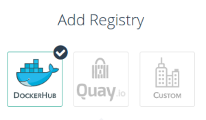
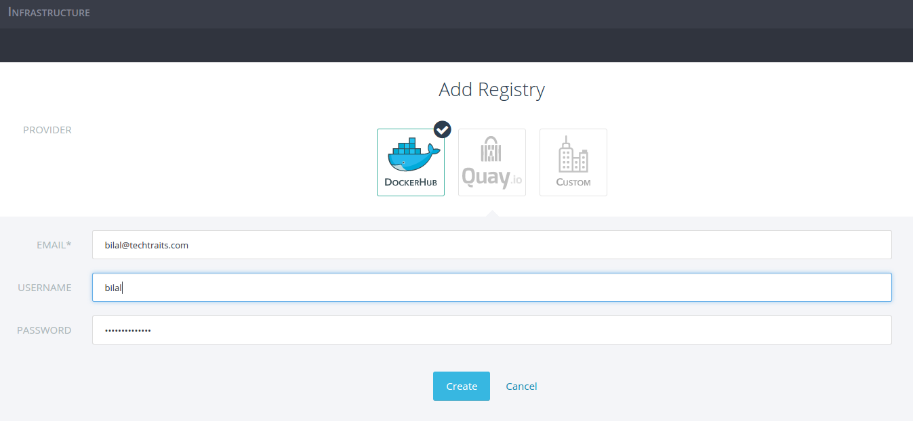
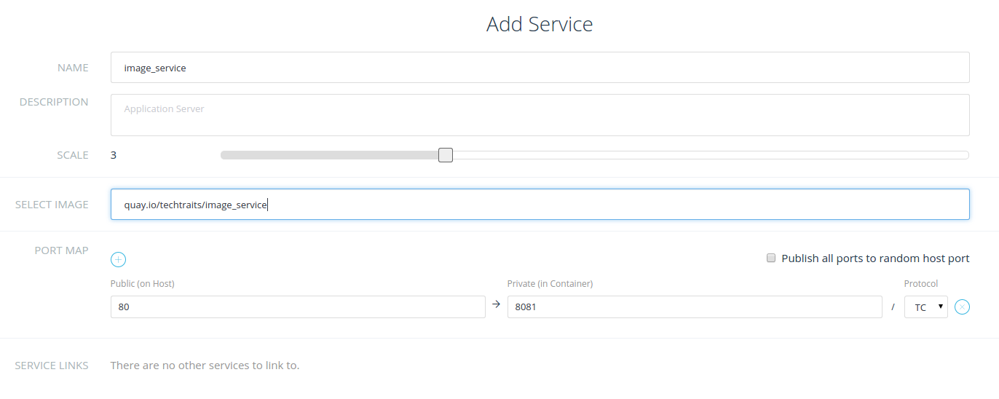
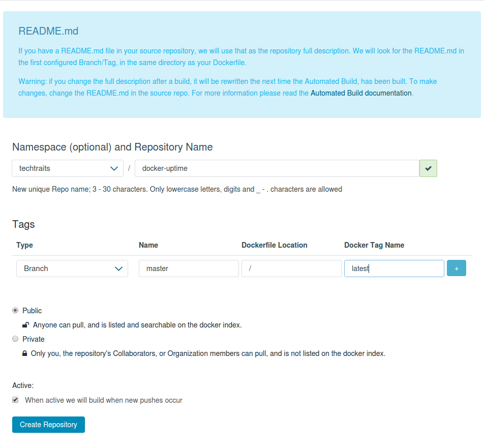
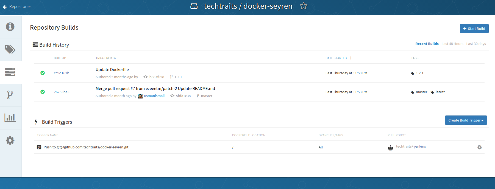
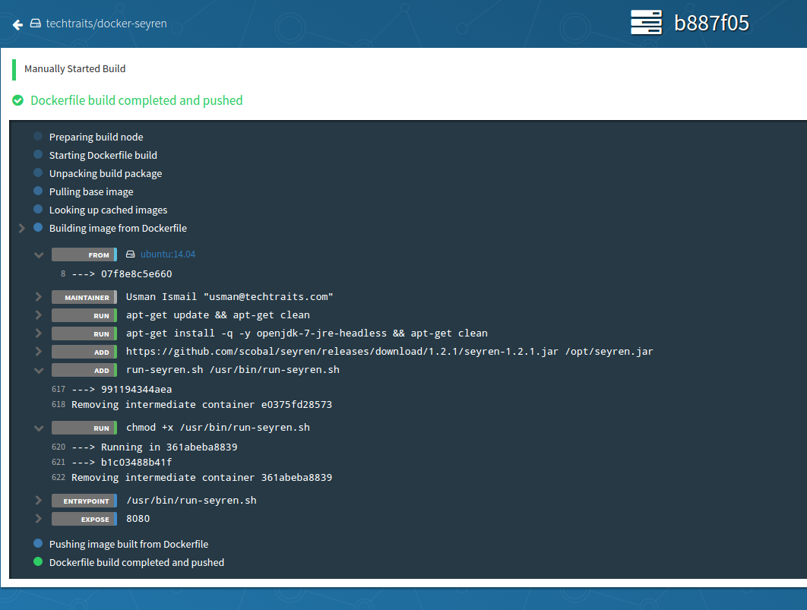
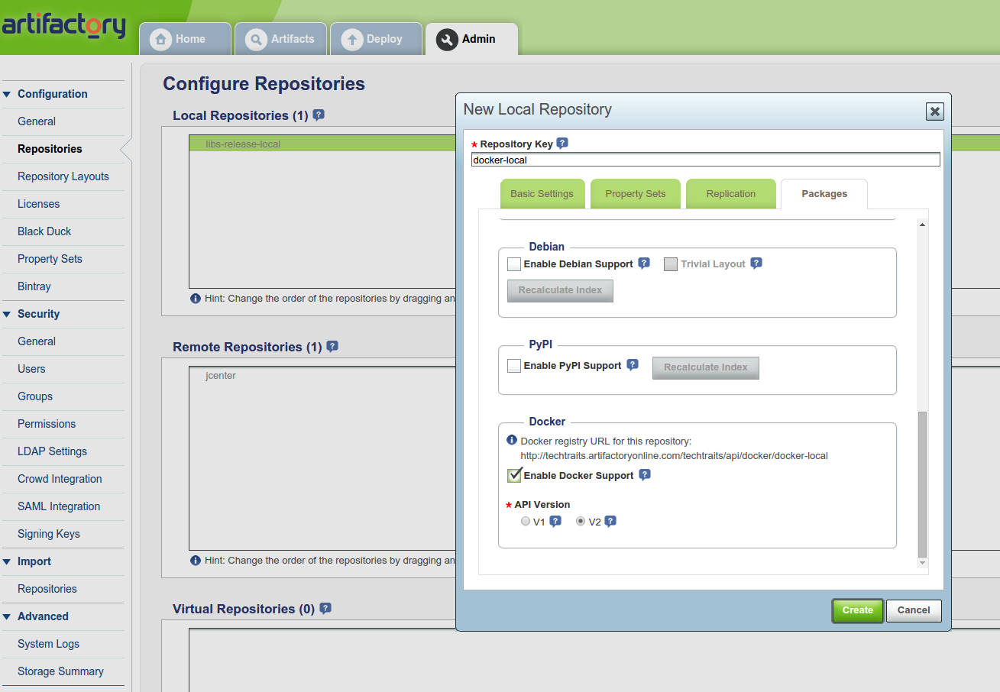
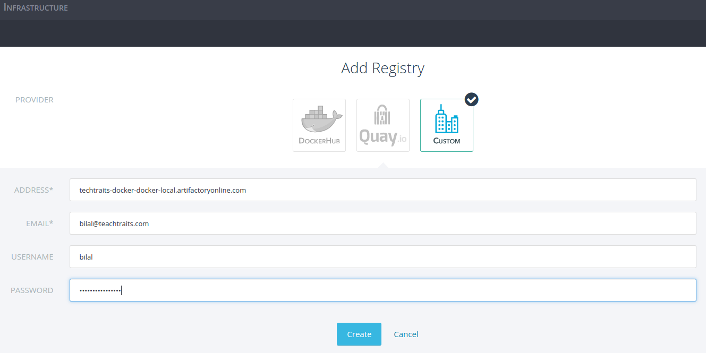
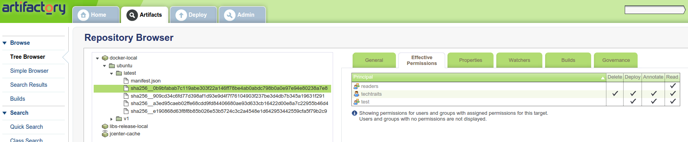
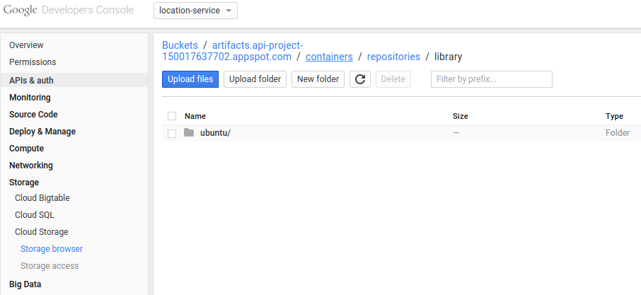

A Detailed Overview of Rancher's ArchitectureThis newly-updated, in-depth guidebook provides a detailed overview of the features and functionality of the new Rancher: an open-source enterprise Kubernetes platform.[Get the eBook](https://more.suse.com/fy21-global-web-landing-page-rancher2-technical-architecture)

One of the most useful aspects of the Docker workflow for deploying
containers is [Docker Hub](http://hub.docker.com). The ability to launch
any of the thousands of publicly available containers on Docker Hub
without having to build complex pipelines makes it much easier to manage
containers and deployments. While this is great for open source
software, for proprietary applications, it definitely makes sense to
host your images privately in a production-grade registry.

To host your private images you may use either a hosted registry as a
service or run your own registry. A hosted registry can be great if your
team doesn’t have enough bandwidth to maintain a registry and keep up
with the changing API specification. In this article, I’ll evaluate some
of the leading hosted docker registry providers.



## Overview

Before we dive into the various offerings, I would like to give a quick
overview of the Docker registry nomenclature and show you how to work
with private images.

### Docker Concepts

**Index:** An index tracks namespaces and docker repositories. For
example, Docker Hub is a centralized index for public repositories.

**Registry:** A docker registry is responsible for storing images and
repository graphs. A registry typically hosts multiple docker
repositories.

**Repository:** A docker repository is a logical collection of tags for
an individual docker image, and is quite similar to a git repository.
Like the git counterpart, a docker repository is identified by a URI and
can either be public or private. The URI looks like:

```
{registry_address}/{namespace}/{repository_name}:{tag}
```

For example,

```
quay.io/techtraits/image_service
```

There are, however, a couple of exceptions to the above rule. First, the
registry address can be omitted for repositories hosted with Docker Hub,
e.g., *techtraits/image\_service*. This works because the docker client
defaults to Docker Hub if the registry address is not specified. Second,
Docker Hub has a concept of official verified repositories and for such
repositories, the URI is just the repository name. For example, the URI
for the official Ubuntu repository is simply “ubuntu“.

### Working with docker registries

To use a docker registry with the command line tool, you must first
login. Open up a terminal and type:

```
docker login index.docker.io
```

Enter your username, password and email address for your Docker Hub
account to login. Upon successful login, Docker client will add the
credentials to your docker config (*~/.dockercfg*) and each subsequent
request for a private image hosted by that registry will be
authenticated using these credentials.

Similar to the command line tool, Rancher provides an easy way to
connect with your registries for managing your docker deployments. To
use a registry with Rancher, navigate to *settings* and select
*registries*. Next, put in your registry credentials and click create to
add a new registry. You can follow the same process for adding multiple
registries.

[](images/rancher_blog_rancher_create_registry.png)

Once your registry is added, the rest of the flow for launching
containers from your private images remains the same and is covered in
detail
**[here](https://rancher.com/the-magical-moment-when-container-load-balancing-meets-service-discovery/)**.
For instance, in the example below, I’ve created a new service with a
private image hosted in Quay.io:

[](images/rancher_blog_rancher_using_image.png)

## Hosted docker registries

Now that we have covered the basics of working with docker registries,
I’m going to evaluate some of the leading hosted registry-as-a-service
providers. For each service, I’ll highlight the key features and
summarize my findings. I’ll be using the following criteria to evaluate
and compare registries:

1. Workflow (build/deployment, collaboration, ease of use and
   visibility)
2. Authentication and authorization
3. Availability and performance
4. Pricing

### [Docker Hub](https://hub.docker.com/)

Docker Hub is an obvious choice for hosted private repositories. To get
started with Docker Hub, sign up
[here](https://hub.docker.com/account/signup/) and create a new private
repository. It is very
[well-documented](https://docs.docker.com/userguide/dockerrepos/) and
straightforward to work with, and so I’ll skip the details. Every user
is entitled to one free private repository and you can select between
multiple [tiers](https://registry.hub.docker.com/plans/) based on the
number of private repositories you need. I really like that the pricing
is usage independent, i.e., you are not charged for the network
bandwidth used for pulling (and pushing) images.

**Collaboration and access control:** If you are familiar with Github,
you will feel right at home with Docker Hub. The collaboration model
adopted by Docker Hub is very similar to Github where individual
collaborators can be added for each repository. You can also create
organizations in Docker Hub. There is also support for creating groups
within organizations; however, there is no way of assigning permissions
to groups. What this means is that all users added to an organization
share the same level of access to a repository. The coarse-grained
access control may be suitable for smaller teams, but not for larger
teams looking for finer control for individual repositories. Docker Hub
also doesn’t support any of LDAP, Active Directory and SAML, which means
that you can’t rely on your organization’s internal user directory and
groups for restricting access to your repositories.

**Docker Hub and your software delivery pipeline:** Docker Hub aims to
be more than just a repository for hosting your docker images. It
seamlessly integrates with Github and Bitbucket to automatically build
new images from Dockerfile. When setting up an automated build,
individual git branches and tags can be associated with docker tags,
which is quite useful for building multiple versions of a docker image.

[](images/rancher_blog_docker_hub_build_repo.png)

For your automated builds in Docker Hub, you can link repositories to
create build pipelines where an update to one repository triggers a
build for the linked repository. In addition to linked repositories,
Docker Hub lets you configure webhooks which are triggered upon
successful updates to a repository. For instance, webhooks can be used
to build an automated test pipeline for your docker images.

Although useful, automated build support by Docker Hub does have a few
rough edges. First, the visibility into your registry is limited; for
instance, there are no audit logs. Second, there is no way of converting
an image repository into an automated build repository. This somewhat
artificial dichotomy between repository types means that built images
can’t be pushed to an automated build repository. Another limitation of
Docker Hub is that it only supports Github and BitBucket. You are out of
luck if your git repositories are hosted elsewhere, e.g., Atlassian’s
Stash.

Overall, Docker Hub works well for managing private images and automated
image builds; however, on a number of occasions I noticed performance
degradation when transferring images. Unfortunately without SLAs, I
would be a bit concerned about using Docker Hub as the backbone for
large-scale production deployments.

#### Summary:

##### **Workflow:**

+ seamless integration with Github and BitBucket

+ familiar Github-esq collaboration model

+ repository links and webhooks for build automation

+ well-documented and easy to use

– build repositories lack support for custom git repos

– limited insight into registry usage

##### **Authentication and authorization:**

+ ability to create organizations

– lacks fine-grained access control

– lacks support for external authentication providers , e.g. LDAP, SAML
and OAuth

##### **Availability and performance:**

– uneven performance

##### **Pricing:**

+ inexpensive and usage-independent pricing

### [Quay.io](https://quay.io/)

Next, we’ll look at [Quay.io](https://quay.io/) by
[CoreOS](https://coreos.com/). It’s a free service for public
repositories and there are multiple pricing tiers to choose from, based
on the number of private docker repositories you are looking to host.
Like Docker Hub, there is no additional charge for network bandwidth and
storage.

**Authentication and access control:** In Quay we can create
organizations and teams where each team can have its own permissions.
There are three permission levels to chose from: read (view and pull
only), write (view, read and write) and admin. Users added to a team
inherit their team’s permissions by default. This allows for more
control over access to individual repositories. As for authentication,
in addition to email based login, Quay supports OAuth integrations but
lacks support for SAML, LDAP and Active directory.

**Automated builds done right:** Workflow is one area where Quay excels.
Not only does it have an intuitive and streamlined interface, it does a
number of small things right to seamlessly integrate with your software
delivery pipeline. A few highlights:

- Support for custom git repositories for build triggers using public
  keys
- Regular expression support for mapping branches and docker tags.
  This is quite useful for integrating with your git workflow (e.g.
  [git flow](http://nvie.com/posts/a-successful-git-branching-model/))
  to automatically generate new versions of docker images for each new
  version of your application.
- Robot accounts for build servers
- Rich notification options including email, HipChat and webhooks for
  repository events

[](images/rancher_blog_quay_builds.png)

**Visualizations and more visualizations:** Quay has some great
visualizations for your docker images, which effectively capture the
evolution of an image. Visualizations don’t end there though, as Quay
also offers detailed audit trail, build logs (shown below) and usage
visualizations for visibility into all aspects of your docker registry.

[](images/rancher_blog_quay_build_log.png)

While working with Quay, I didn’t notice any performance deteriorations,
which is a good sign. But since I haven’t used it for large
deployments, I don’t have any further insights into how it would behave
under load.

#### Summary:

##### **Workflow:**

+ clean, intuitive and streamlined interface

+ automated builds done right

+ great visibility into your registry usage

+ webhooks and rich event notifications

##### **Authentication and authorization:**

+ ability to create organizations and teams

+ fine-grained access control through permissions

– limited OAuth-only authentication support

##### **Pricing:**

+ relatively inexpensive with usage-independent pricing

### [Artifactory](http://www.jfrog.com/artifactory/)

Artifactory is an open source repository manager for binary artifacts.
Unlike some of the other registry services in our list, Artifactory
focuses on artifact management, high availability and security; for
instance, it leaves the builds to your build servers. Similar to Quay
and Docker Hub, Artifactory comes in two flavours: an on-premise
solution and Artifactory cloud. However, unlike Docker Hub and Quay,
Artifactory is relatively expensive if you’re only looking to use it as
a docker registry. It starts out at $98/month for 8GB of storage and
400GB network bandwidth per month with per GB charges for additional
usage.

**Repository or a registry:** For a new user, it can be a bit confusing
to get started. First, you’ll notice that a docker registry is just a
repository in Artifactory. Then we have to select between a local
repository or a remote repository. The distinction between the two is
that a local repository is hosted by Artifactory whereas a remote
repository is an external repository for which Artifactory acts as a
proxy. I think remote repositories can be quite useful for ensuring
availability, where Artifactory provides a unified interface to all your
artifacts while also acting as a cache layer for remote artifacts.

To create a docker registry, select “repositories” in the Admin view and
create a new local repository. Make sure you select docker as the
package type for the new repository:

[](images/rancher_blog_artifactory_docker_repo.png)

The address for your docker registry will look like:

```
{account-name}-docker-{repo-name}.artifactoryonline.com
```

For example, I created a “docker-local” repository in my techtraits
account and got the following registry address::

```
techtraits-docker-docker-local.artifactoryonline.com
```

Except for an awkwardly long address, your docker commands would work
the same with Artifactory because it fully supports the docker registry
API. For instance, I used the following commands to login, tag, push and
pull images with the docker client:

```
docker login techtraits-docker-docker-local.artifactoryonline.com
docker tag ubuntu techtraits-docker-docker-local.artifactoryonline.com/ubuntu
docker {push|pull} techtraits-docker-docker-local.artifactoryonline.com/ubuntu
```

Rancher doesn’t have out of the box support for Artifactory but it can
be added using the “custom” registry option. Just set your email
address, credentials and the repository address and you are all done.
You should now be able to use Rancher to run containers from your
private images hosted in an Artifactory registry.

[](images/rancher_blog_rancher_artifactory_registry.png)

**Advanced security:** Artifactory supports a suite of authentication
options including LDAP, SAML and Atlassian’s Crowd. For fine-grained
access control, there is support for user and group level permissions.
You can also specify which group(s) a new user is added to by default.
The permissions can further be controlled on a per-repository level for
granular access control. For instance, in the screenshot below I have
three groups, each with different access to my private repository:

[](images/rancher_blog_artifactory_image_view.png)

#### Summary:

##### **Workflow:**

+ all-in-one artifact management model

– learning curve for new users

– limited insight into registry usage

##### **Authentication and authorization:**

+ comprehensive authentication capabilities

+ fine-grained access control

##### **Availability and performance:**

+ remote repositories for high availability

##### **Pricing:**

– steep pricing

####

### [Google Container Registry](https://cloud.google.com/tools/container-registry/)

Google is one of the key innovators in the containerization space and
so, not surprisingly, it also offers a hosted registry service. If
you’re not already using Google cloud services, you can get started by
creating a new Google API project (with billing enabled) in Google’s
developer console.

Unlike some of the other services, there are some caveats when working
with the registry service. Therefore, I’m going to trace the steps for
working with it.

First, you’d need to install [Google cloud client
SDK](https://cloud.google.com/sdk/). Make sure you are able to run
docker without sudo if you are installing gcloud as a non-root user.
Next, we need to authenticate with Google using the client sdk:

```
gcloud auth login
```

To push and pull images, we can invoke the docker command through
gcloud:

```
gcloud preview docker push|pull gcr.io/<PROJECT_ID>/ubuntu
```

Note that your registry address is fixed for each project and looks
like:

```
gcr.io/<PROJECT_ID>
```

Google command line tool will add multiple entries for various regions
in your docker config when gcloud’s docker commands are invoked for the
first time. A config entry looks like:

```
"https://gcr.io": {
    "email": "not@val.id",
    "auth": "<AUTH-TOKEN>"
}
```

Note that Google doesn’t store a valid email address in the config
because it relies on temporary tokens for authorization. This approach
enhances security; however, it does so at the expense of compatibility
with the docker client and registry APIs. As it turns out, this
additional dependency on Google client SDK and incompatibility with
docker is one of the main reasons why Rancher doesn’t support it.

[](images/rancher_blog_google_registry.png)

Behind the scenes, your images are simply stored in a Google Cloud
Storage (GCS) bucket and you are only charged for GCS storage and
network egress. This makes Google registry a relatively inexpensive
service. High availability and fast access are other out-of-the-box
benefits that you get from a GCS-based image store.

**Workflow:** While I like the idea of using GCS for storing images, the
overall support for a docker based workflow is quite minimal. For
instance, the registry service doesn’t support webhooks or notifications
for when repositories get updated. It also doesn’t provide any insight
into your registry usage. This is one area where I think Google’s docker
registry service needs quite a bit of work.

**Security and access control:** Google takes a number of steps to
ensure secure access to your docker images. First, it uses short-lived
tokens when talking to the registry service. Second, all images are
encrypted before they are written to GCS. Third, access to individual
images and repositories can be restricted through GCS support for object
and bucket level
[ACLs](https://cloud.google.com/storage/docs/access-control). Lastly,
you can sync up your organization’s user directories with the Google
project using [Google Apps Directory
Service](https://support.google.com/a/answer/106368).

#### Summary:

##### **Workflow:**

– incompatibility with docker client

– minimal support for integration with build and deployment pipelines

– limited visibility into registry usage

##### **Authentication and authorization:**

+ fine-grained access control with GCS ACLs

+ enhanced security through short-lived temporary auth tokens

+ support for LDAP sync

##### **Performance and availability:**

+ uses the highly available Google cloud storage layer

##### **Pricing:**

+ low cost

####

## Conclusion:

In this article I compared a few hosted docker registry options. There
are obviously pros and cons to all of these tools, and they are changing
at a very fast pace right now. I think Quay is currently an excellent
option for many organizations. It is inexpensive, offers unparalleled
insight into docker registry usage, and can seamlessly integrate with
your build and deployment pipelines.

Both Google Container Registry and Artifactory are targeted towards
large enterprises with focus on high availability. They also integrate
with LDAP to sync with organization’s user directory and groups. I think
Google container registry can be a viable option if you are already
invested in their cloud platform. In a similar vein to Google,
Artifactory can be a great option for teams already using it for
centralized artifact management. However, it can get expensive if you
only plan to use it as a hosted docker registry.

Enterprise DockerHub is already a very good platform, and should be
getting better with the recent announcement of a new version, which
should be coming out any day now. Once that is available, I’ll dig in
and look at it further.

To learn more about running any of these with Rancher, please join our
[beta](https://info.rancher.com/beta)or schedule a demo with one of our
services.

*Bilal Sheikh is a server and platform engineer with experience in
building cloud-based distributed services and data platforms. You can
find him on twitter @mbsheikh, or read about his work at
[techtraits.com](http://techtraits.com)*

**You might also be interested in:**

- [Container registries you may have
  missed](https://rancher.com/container-registries-might-missed/) Some
  more registry options, beyond the usual suspects
A Detailed Overview of Rancher's ArchitectureThis newly-updated, in-depth guidebook provides a detailed overview of the features and functionality of the new Rancher: an open-source enterprise Kubernetes platform.[Get the eBook](https://more.suse.com/fy21-global-web-landing-page-rancher2-technical-architecture)
