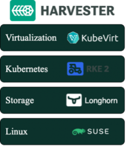
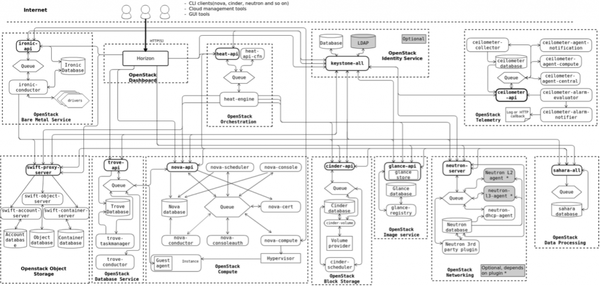
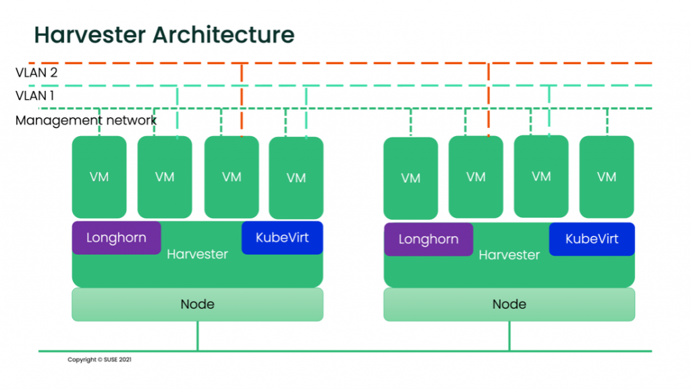
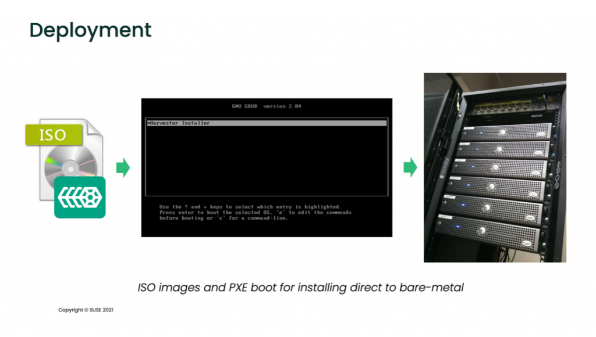
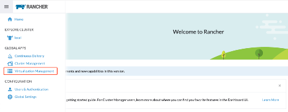
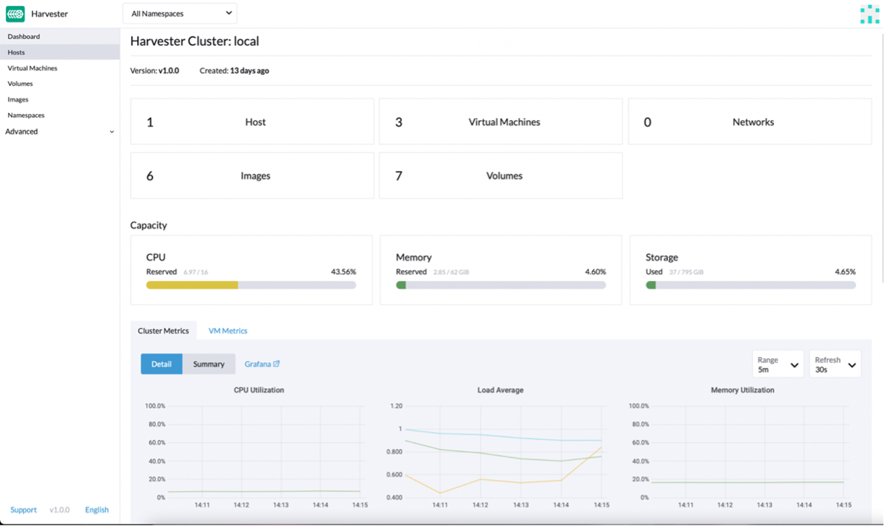

## Introduction

The effectiveness of good resource management in a secure and agile way is a challenge today. There are several solutions like Openstack and Harvester, which handles your hardware infrastructure as on-premise cloud infrastructure. This allows the management of storage, compute, and networking resources to be more flexible than deploying applications on single hardware only.

Both OpenStack and Harvester have their own use cases. This article describes the architecture, components, and differences between them to clarify what could be the best solution for every requirement.

This post analyzes the differences between OpenStack and Harvester from different perspectives: infrastructure management, resource management, deployment, and availability.

Cloud management is about managing data center resources, such as storage, compute, and networking. Openstack provides a way to manage these resources and a dashboard for administrators to handle the creation of virtual machines and other management tools for networking and storage layers.

While both Harvester and OpenStack are used to create cloud environments, there are several differences I will discuss.

According to the product documentation, [OpenStack](https://docs.openstack.org/yoga/) is a cloud operating system that controls large pools of compute, storage and networking resources throughout a data center. These are all managed through a dashboard that gives administrators control while empowering their users to provision resources through a web interface.

Harvester is the next generation of open source hyperconverged infrastructure (HCI) solutions designed for modern cloud native environments. Harvester also uses [KubeVirt technology](https://kubevirt.io/) to provide cloud management with the advantages of Kubernetes. It helps operators consolidate and simplify their virtual machine workloads alongside Kubernetes clusters.

## Architecture

While OpenStack provides its own services to create control planes and configures the infrastructure provided, Harvester uses the following technologies to provide the required stacks:

Harvester is installed as a node operating system using an ISO or a pxe-based installation, which uses **RKE2 as a container orchestrator on top of SUSE Linux Enterprise Server to provide** **distributed storage with Longhorn and virtualization with Kubevirt.**

### APIs

Whether your environment is in production or in a lab setting, API use is far-reaching— for programmatic interactions, automations and new implementations.

Throughout each of its services, OpenStack provides several APIs for its functionality and provides storage, management, authentication and many other external features. As per the [documentation](https://docs.openstack.org/install-guide/get-started-logical-architecture.html), the logical architecture gives an overview of the API implementation.

In the diagram above, you can see the APIs a productive Openstack provides **in bold.**

Although OpenStack can be complex, it allows a high level of customization.

Harvester, in the meantime, uses Kubernetes for virtualization and Longhorn for storage, taking advantage of their APIs and allowing a high level of customization from the containerized architecture perspective. It can also be extended through the K8s *CustomResourceDefinitions,* whichexpands and migrates easier.

At the networking level, Harvester only supports VLAN through bridges and NIC bounding. Switches and advanced network configurations are outside the scope of Harvester.

OpenStack can provide multiple networking for advanced and specialized configurations.

### Deployment

OpenStack provides several services on bare metal servers, such as installing packages and libraries, configuring files, and preparing servers to be added to OpenStack.

Harvester provides an ISO image preconfigured to be installed on bare metal servers.

Just install or pxe-install the image, and the node will be ready to join the cluster. This adds flexibility to scale nodes quickly and securely as needed.

### Node types

OpenStack’s minimum architecture requirements consist of two nodes: a controller node to manage the resources and provide the required APIs and services to the environment and a compute node to host the resources created by the administrator. The controller nodes will maintain their roles supported in a production architecture.

Harvester nodes are interchangeable. It can be deployed in all-in-one mode, and the same node serving as a controller will act as compute node. This makes Harvester an excellent choice to consider for Edge architecture.

### Cluster management

Harvester is fully integrated with Rancher, making adding and removing nodes easy. There is no need to preconfigure new compute nodes or handle the workloads since Rancher manages the cluster management.

Harvester can start in a single node (also known as all-in-one), where the node serves as a compute and a single node control plane. Longhorn, deployed as part of Harvester, provides the storage layer. When the cluster reaches three nodes, Harvester will reconfigure itself to provide High Availability features without disruption; the nodes can be promoted to the control plane or demoted as needed.

In OpenStack, roles (compute, controller, etc.) are locked since the node is being prepared to be added to the cluster.

### Operations

Harvester leverages Rancher for authentication, authorization, and cluster management to handle the operation. Harvester integration with Rancher provides an intuitive dashboard UI where you can manage both at the same time.

Harvester also provides monitoring, managed with Rancher since the beginning. Users will see the metrics on the dashboard, shown below:

The dashboard also provides a single source of truth to the whole environment.

### Storage

In Harvester, storage is provided by Longhorn as a service running on the compute nodes, so Longhorn scales easily with the rest of the cluster as new nodes are added. There is no need for extra nodes for storage. There is also no need to have external storage controllers to communicate between the control plane, compute, and storage nodes. Storage is distributed along the Harvester nodes from the view of the VMs (there is no local storage), and it also supports backups to NFS or S3 buckets.

## Conclusion

Harvester is a modern, powerful cloud-based [HCI solution](https://www.suse.com/c/the-complete-hyperconverged-infrastructure-solutions-guide/) based on Kubernetes, fully integrated with Rancher, that eases the deployment, scalability and operations.

While Harvester only supports NIC bounding and VLAN (bridge) methods, more networking modes will be added.

For more specialized **network** configurations, OpenStack is the preferred choice.

**Want to know more?**

Check out the resources!

- [Harvester Product Page](https://www.suse.com/products/harvester/)

- [Getting Hands on with Harvester HCI](/blog/getting-hands-on-with-harvester-hci/)

You can also check this in-depth SUSECON session delivered by my colleague Guang Yee:

[embed]https://youtu.be/aWOLPVQ4W3c[/embed]

 

---

**Harvester** is open source -- if you want to contribute or check what is going on, visit the [Harvester github repository](https://github.com/harvester/harvester)
