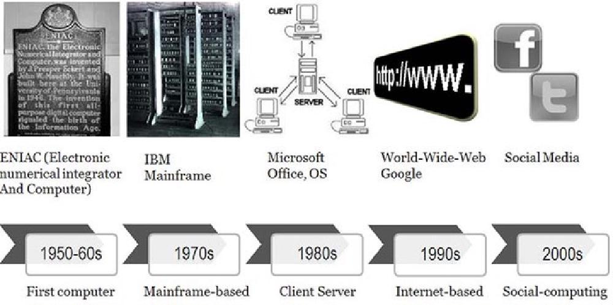
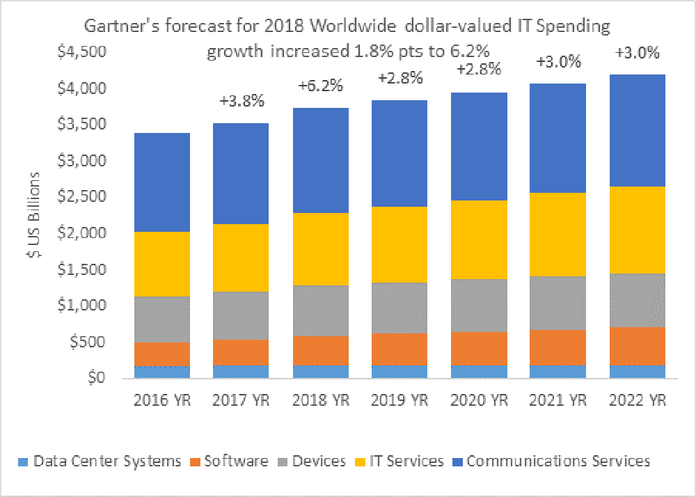
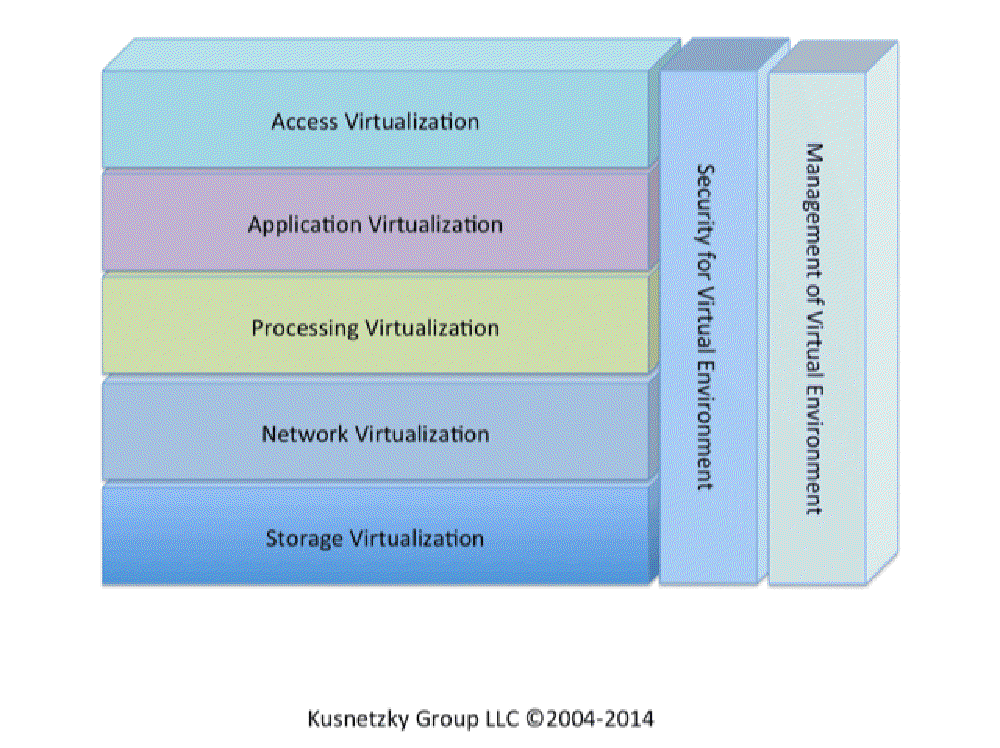

## Introduction

Today’s applications are marvels of distributed systems development. Each function or service that makes up

an application may be executing on a different system, based upon a different system architecture, that is

housed in a different geographical location, and written in a different computer language. Components of

today’s applications might be hosted on a powerful system carried in the owner’s pocket and communicating

with application components or services that are replicated in data centers all over the world.

What’s amazing about this, is that individuals using these applications typically are not aware of the

complex environment that responds to their request for the local time, local weather, or for directions to

their hotel.

Let’s pull back the curtain and look at the industrial sorcery that makes this all possible and contemplate

the thoughts and guidelines developers should keep in mind when working with this complexity.

## The Evolution of System Design

#### Figure 1: Evolution of system design over time

Source: Interaction Design Foundation, [The Social Design of Technical Systems: Building technologies for communities](https://www.interaction-design.org/literature/book/the-social-design-of-technical-systems-building-technologies-for-communities/the-evolution-of-computing)

Application development has come a long way from the time that programmers wrote out applications, hand

compiled them into the language of the machine they were using, and then entered individual machine

instructions and data directly into the computer’s memory using toggle switches.

As processors became more and more powerful, system memory and online storage capacity increased, and

computer networking capability dramatically increased, approaches to development also changed. Data can now

be transmitted from one side of the planet to the other faster than it used to be possible for early

machines to move data from system memory into the processor itself!

Let’s look at a few highlights of this amazing transformation.

### Monolithic Design

Early computer programs were based upon a monolithic design with all of the application components were

architected to execute on a single machine. This meant that functions such as the user interface (if users

were actually able to interact with the program), application rules processing, data management, storage

management, and network management (if the computer was connected to a computer network) were all contained

within the program.

While simpler to write, these programs become increasingly complex, difficult to document, and hard to update

or change. At this time, the machines themselves represented the biggest cost to the enterprise and so

applications were designed to make the best possible use of the machines.

### Client/Server Architecture

As processors became more powerful, system and online storage capacity increased, and data communications

became faster and more cost-efficient, application design evolved to match pace. Application logic was

refactored or decomposed, allowing each to execute on different machines and the ever-improving networking

was inserted between the components. This allowed some functions to migrate to the lowest cost computing

environment available at the time. The evolution flowed through the following stages:

#### Terminals and Terminal Emulation

Early distributed computing relied on special-purpose user access devices called terminals. Applications had

to understand the communications protocols they used and issue commands directly to the devices. When

inexpensive personal computing (PC) devices emerged, the terminals were replaced by PCs running a terminal

emulation program.

At this point, all of the components of the application were still hosted on a single mainframe or

minicomputer.

#### Light Client

As PCs became more powerful, supported larger internal and online storage, and network performance increased,

enterprises segmented or factored their applications so that the user interface was extracted and executed

on a local PC. The rest of the application continued to execute on a system in the data center.

Often these PCs were less costly than the terminals that they replaced. They also offered additional

benefits. These PCs were multi-functional devices. They could run office productivity applications that

weren’t available on the terminals they replaced. This combination drove enterprises to move to

client/server application architectures when they updated or refreshed their applications.

#### Midrange Client

PC evolution continued at a rapid pace. Once more powerful systems with larger storage capacities were

available, enterprises took advantage of them by moving even more processing away from the expensive systems

in the data center out to the inexpensive systems on users’ desks. At this point, the user interface and

some of the computing tasks were migrated to the local PC.

This allowed the mainframes and minicomputers (now called servers) to have a longer useful life, thus

lowering the overall cost of computing for the enterprise.

#### Heavy client

As PCs become more and more powerful, more application functions were migrated from the backend servers. At

this point, everything but data and storage management functions had been migrated.

#### Enter the Internet and the World Wide Web

The public internet and the World Wide Web emerged at this time. Client/server computing continued to be

used. In an attempt to lower overall costs, some enterprises began to re-architect their distributed

applications so they could use standard internet protocols to communicate and substituted a web browser for

the custom user interface function. Later, some of the application functions were rewritten in Javascript so

that they could execute locally on the client’s computer.

#### Server Improvements

Industry innovation wasn’t focused solely on the user side of the communications link. A great deal of

improvement was made to the servers as well. Enterprises began to harness together the power of many

smaller, less expensive industry standard servers to support some or all of their mainframe-based functions.

This allowed them to reduce the number of expensive mainframe systems they deployed.

Soon, remote PCs were communicating with a number of servers, each supporting their own component of the

application. Special-purpose database and file servers were adopted into the environment. Later, other

application functions were migrated into application servers.

Networking was another area of intense industry focus. Enterprises began using special-purpose networking

servers that provided fire walls and other security functions, file caching functions to accelerate data

access for their applications, email servers, web servers, web application servers, distributed name servers

that kept track of and controlled user credentials for data and application access. The list of networking

services that has been encapsulated in an appliance server grows all the time.

### Object-Oriented Development

The rapid change in PC and server capabilities combined with the dramatic price reduction for processing

power, memory and networking had a significant impact on application development. No longer where hardware

and software the biggest IT costs. The largest costs were communications, IT services (the staff), power,

and cooling.

Software development, maintenance, and IT operations took on a new importance and the development process was

changed to reflect the new reality that systems were cheap and people, communications, and power were

increasingly expensive.

#### Figure 2: Worldwide IT spending forcast

Source: [Gartner Worldwide IT Spending Forecast, Q1 2018](https://www.gartner.com/technology/research/it-spending-forecast/)

Enterprises looked to improved data and application architectures as a way to make the best use of their

staff. Object-oriented applications and development approaches were the result. Many programming languages

such as the following supported this approach:

- C++
- C#
- COBOL
- Java
- PHP
- Python
- Ruby

Application developers were forced to adapt by becoming more systematic when defining and documenting data

structures. This approach also made maintaining and enhancing applications easier.

### Open-Source Software

[Opensource.com](https://opensource.com/) offers the following definition for open-source

software: “Open source software is software with source code that anyone can inspect, modify, and enhance.”

It goes on to say that, “some software has source code that only the person, team, or organization who

created it — and maintains exclusive control over it — can modify. People call this kind of software

‘proprietary’ or ‘closed source’ software.”

Only the original authors of proprietary software can legally copy, inspect, and alter that software. And in

order to use proprietary software, computer users must agree (often by accepting a license displayed the

first time they run this software) that they will not do anything with the software that the software’s

authors have not expressly permitted. Microsoft Office and Adobe Photoshop are examples of proprietary

software.

Although open-source software has been around since the very early days of computing, it came to the

forefront in the 1990s when complete open-source operating systems, virtualization technology, development

tools, database engines, and other important functions became available. Open-source technology is often a

critical component of web-based and distributed computing. Among others, the open-source offerings in the

following categories are popular today:

- Development tools
- Application support
- Databases (flat file, SQL, No-SQL, and in-memory)
- Distributed file systems
- Message passing/queueing
- Operating systems
- Clustering

### Distributed Computing

The combination of powerful systems, fast networks, and the availability of sophisticated software has driven

major application development away from monolithic towards more highly distributed approaches. Enterprises

have learned, however, that sometimes it is better to start over than to try to refactor or decompose an

older application.

When enterprises undertake the effort to create distributed applications, they often discover a few pleasant

side effects. A properly designed application, that has been decomposed into separate functions or services,

can be developed by separate teams in parallel.

Rapid application development and deployment, also known as DevOps, emerged as a way to take advantage of the

new environment.

### Service-Oriented Architectures

As the industry evolved beyond client/server computing models to an even more distributed approach, the

phrase “service-oriented architecture” emerged. This approach was built on distributed systems concepts,

standards in message queuing and delivery, and XML messaging as a standard approach to sharing data and data

definitions.

Individual application functions are repackaged as network-oriented services that receive a message

requesting they perform a specific service, they perform that service, and then the response is sent back to

the function that requested the service.

This approach offers another benefit, the ability for a given service to be hosted in multiple places around

the network. This offers both improved overall performance and improved reliability.

Workload management tools were developed that receive requests for a service, review the available capacity,

forward the request to the service with the most available capacity, and then send the response back to the

requester. If a specific service doesn’t respond in a timely fashion, the workload manager simply forwards

the request to another instance of the service. It would also mark the service that didn’t respond as failed

and wouldn’t send additional requests to it until it received a message indicating that it was still alive

and healthy.

## What Are the Considerations for Distributed Systems

Now that we’ve walked through over 50 years of computing history, let’s consider some rules of thumb for

developers of distributed systems. There’s a lot to think about because a distributed solution is likely to

have components or services executing in many places, on different types of systems, and messages must be

passed back and forth to perform work. Care and consideration are absolute requirements to be successful

creating these solutions. Expertise must also be available for each type of host system, development tool,

and messaging system in use.

### Nailing Down What Needs to Be Done

One of the first things to consider is what needs to be accomplished! While this sounds simple, it’s

incredibly important.

It’s amazing how many developers start building things before they know, in detail, what is needed. Often,

this means that they build unnecessary functions and waste their time. To quote Yogi Berra, “if you don’t

know where you are going, you’ll end up someplace else.”

A good place to start is knowing what needs to be done, what tools and services are already available, and

what people using the final solution should see.

### Interactive Versus Batch

Since fast responses and low latency are often requirements, it would be wise to consider what should be done

while the user is waiting and what can be put into a batch process that executes on an event-driven or

time-driven schedule.

After the initial segmentation of functions has been considered, it is wise to plan when background, batch

processes need to execute, what data do these functions manipulate, and how to make sure these functions are

reliable, are available when needed, and how to prevent the loss of data.

### Where Should Functions Be Hosted?

Only after the “what” has been planned in fine detail, should the “where” and “how” be considered. Developers

have their favorite tools and approaches and often will invoke them even if they might not be the best

choice. As Bernard Baruch was reported to say, “if all you have is a hammer, everything looks like a nail.”

It is also important to be aware of corporate standards for enterprise development. It isn’t wise to select a

tool simply because it is popular at the moment. That tool just might do the job, but remember that

everything that is built must be maintained. If you build something that only you can understand or

maintain, you may just have tied yourself to that function for the rest of your career. I have personally

created functions that worked properly and were small and reliable. I received telephone calls regarding

these for ten years after I left that company because later developers could not understand how the

functions were implemented. The documentation I wrote had been lost long earlier.

Each function or service should be considered separately in a distributed solution. Should the function be

executed in an enterprise data center, in the data center of a cloud services provider or, perhaps, in both.

Consider that there are regulatory requirements in some industries that direct the selection of where and

how data must be maintained and stored.

Other considerations include:

- What type of system should be the host of that function. Is one system architecture better for that

  function? Should the system be based upon ARM, X86, SPARC, Precision, Power, or even be a Mainframe?
- Does a specific operating system provide a better computing environment for this function? Would Linux,

  Windows, UNIX, System I, or even System Z be a better platform?
- Is a specific development language better for that function? Is a specific type of data management tool?

  Is a Flat File, SQL database, No-SQL database, or a non-structured storage mechanism better?
- Should the function be hosted in a virtual machine or a container to facilitate function mobility,

  automation and orchestration?

Virtual machines executing Windows or Linux were frequently the choice in the early 2000s. While they offered

significant isolation for functions and made it easily possible to restart or move them when necessary,

their processing, memory and storage requirements were rather high. Containers, another approach to

processing virtualization, are the emerging choice today because they offer similar levels of isolation, the

ability to restart and migrate functions and consume far less processing power, memory or storage.

### Performance

Performance is another critical consideration. While defining the functions or services that make up a

solution, the developers should be aware if they have significant processing, memory or storage

requirements. It might be wise to look at these functions closely to learn if that can be further subdivided

or decomposed.

Further segmentation would allow an increase in parallelization which would potentially offer performance

improvements. The trade off, of course, is that this approach also increases complexity and, potentially,

makes them harder to manage and to make secure.

### Reliability

In high stakes enterprise environments, solution reliability is essential. The developer must consider when

it is acceptable to force people to re-enter data, re-run a function, or when a function can be unavailable.

Database developers ran into this issue in the 1960s and developed the concept of an atomic function. That

is, the function must complete or the partial updates must be rolled back leaving the data in the state it

was in before the function began. This same mindset must be applied to distributed systems to ensure that

data integrity is maintained even in the event of service failures and transaction disruptions.

Functions must be designed to totally complete or roll back intermediate updates. In critical message passing

systems, messages must be stored until an acknowledgement that a message has been received comes in. If such

a message isn’t received, the original message must be resent and a failure must be reported to the

management system.

### Manageability

Although not as much fun to consider as the core application functionality, manageability is a key factor in

the ongoing success of the application. All distributed functions must be fully instrumented to allow

administrators to both understand the current state of each function and to change function parameters if

needed. Distributed systems, after all, are constructed of many more moving parts than the monolithic

systems they replace. Developers must be constantly aware of making this [distributed computing](https://www.suse.com/c/distributed-edge-computing-unlocking-the-power-of-decentralized-networks-to-drive-innovation/) environment

easy to use and maintain.

This brings us to the absolute requirement that all distributed functions must be fully instrumented to allow

administrators to understand their current state. After all, distributed systems are inherently more complex

and have more moving parts than the monolithic systems they replace.

### Security

Distributed system security is an order of magnitude more difficult than security in a monolithic

environment. Each function must be made secure separately and the communication links between and among the

functions must also be made secure. As the network grows in size and complexity, developers must consider

how to control access to functions, how to make sure than only authorized users can access these function,

and to to isolate services from one other.

Security is a critical element that must be built into every function, not added on later. Unauthorized

access to functions and data must be prevented and reported.

### Privacy

Privacy is the subject of an increasing number of regulations around the world. Examples like the European

Union’s GDPR and the U.S. HIPPA regulations are important considerations for any developer of

customer-facing systems.

## Mastering Complexity

Developers must take the time to consider how all of the pieces of a complex computing environment fit

together. It is hard to maintain the discipline that a service should encapsulate a single function or,

perhaps, a small number of tightly interrelated functions. If a given function is implemented in multiple

places, maintaining and updating that function can be hard. What would happen when one instance of a

function doesn’t get updated? Finding that error can be very challenging.

This means it is wise for developers of complex applications to maintain a visual model that shows where each

function lives so it can be updated if regulations or business requirements change.

Often this means that developers must take the time to document what they did, when changes were made, as

well as what the changes were meant to accomplish so that other developers aren’t forced to decipher mounds

of text to learn where a function is or how it works.

To be successful as a architect of distributed systems, a developer must be able to master complexity.

### Approaches Developers Must Master

Developers must master decomposing and refactoring application architectures, thinking in terms of teams, and

growing their skill in approaches to rapid application development and deployment (DevOps). After all, they

must be able to think systematically about what functions are independent of one another and what functions

rely on the output of other functions to work. Functions that rely upon one other may be best implemented as

a single service. Implementing them as independent functions might create unnecessary complexity and result

in poor application performance and impose an unnecessary burden on the network.

### Virtualization Technology Covers Many Bases

Virtualization is a far bigger category than just virtual machine software or containers. Both of these

functions are considered processing virtualization technology. There are at least seven different types of

virtualization technology in use in modern applications today. Virtualization technology is available to

enhance how users access applications, where and how applications execute, where and how processing happens,

how networking functions, where and how data is stored, how security is implemented, and how management

functions are accomplished. The following model of virtualization technology might be helpful to developers

when they are trying to get their arms around the concept of virtualization:

#### Figure 3: Architure of virtualized systems

Source: 7 Layer Virtualizaiton Model, [VirtualizationReview.com](https://virtualizationreview.com/articles/2014/10/14/7-layer-virtualization-model.aspx)

### Think of Software-Defined Solutions

It is also important for developers to think in terms of “software defined” solutions. That is, to segment

the control from the actual processing so that functions can be automated and orchestrated.

## Tools and Strategies That Can Help

Developers shouldn’t feel like they are on their own when wading into this complex world. Suppliers and

open-source communities offer a number of powerful tools. Various forms of virtualization technology can be

a developer’s best friend.

### Virtualization Technology Can Be Your Best Friend

- **Containers** make it possible to easily develop functions that can execute without

  interfering with one another and can be migrated from system to system based upon workload demands.
- **Orchestration technology** makes it possible to control many functions to ensure they are

  performing well and are reliable. It can also restart or move them in a failure scenario.
- **Supports incremental development:** functions can be developed in parallel and deployed

  as they are ready. They also can be updated with new features without requiring changes elsewhere.
- **Supports highly distributed systems:** functions can be deployed locally in the

  enterprise data center or remotely in the data center of a cloud services provider.

### Think In Terms of Services

This means that developers must think in terms of services and how services can communicate with one another.

#### Well-Defined APIs

Well defined APIs mean that multiple teams can work simultaneously and still know that everything will fit

together as planned. This typically means a bit more work up front, but it is well worth it in the end. Why?

Because overall development can be faster. It also makes documentation easier.

#### Support Rapid Application Development

This approach is also perfect for rapid application development and rapid prototyping, also known as DevOps.

Properly executed, DevOps also produces rapid time to deployment.

#### Think In Terms of Standards

Rather than relying on a single vendor, the developer of distributed systems would be wise to think in terms

of multi-vendor, international standards. This approach avoids vendor lock-in and makes finding expertise

much easier.

## Summary

It’s interesting to note how guidelines for rapid application development and deployment of distributed

systems start with “take your time.” It is wise to plan out where you are going and what you are going to do

otherwise you are likely to end up somewhere else, having burned through your development budget, and have

little to show for it.

### Sign up for Online Training

To continue to learn about the tools, technologies, and practices in the modern development landscape, [sign up](https://rancher.com/training) for free online training sessions. Our engineers host

weekly classes on Kubernetes, containers, CI/CD, security, and more.
