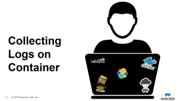

Container

logging is a common challenge for container deployments. Logging with

containers is a bit different than traditional logging, because the logs

for each container are nested within the container. On September 16th,

we hosted an online meetup discussing all aspects of container logging,

and demonstrating how to build a scalable logging service for Docker

and Rancher that uses Elasticsearch, Logstash, and Kibana (ELK), along

with Logspout. In the meetup Rancher DevOps lead Bill Maxwell discussed:

• Docker Logging Challenges • Options for gathering logs from containers

• System and Application logging requirements • Deploying an ELK stack

using Docker Compose with Rancher • Scaling and managing a production

ELK deployment You can view a recording of the meetup below. Bill also

recently posted a [blog about how he built our ELK stack](https://rancher.com/running-our-own-elk-stack-with-docker-and-rancher/)

here at Rancher Labs. If you’d like to Learn more about Rancher, please

join our [Beta](https://info.rancher.com/beta)program.
