## **Container Management: A Comprehensive Overview of Rancher Desktop's Settings**

Rancher Desktop is equipped with convenient and powerful features that make it stand out as one of the best developer tools and the fastest ways to build and deploy Kubernetes locally.

In this blog, we will tackle **Rancher Desktop´s functionalities and features** to guide you and help you take full advantage of all the benefits of using Rancher Desktop as a [container management platform](https://rancher.com/?utm_source=blog&utm_medium=rancher_blog&utm_campaign=A_Closer_Look_at_Rancher_Desktop_Settings) and for **running local Kubernetes**.

## **Rancher Desktop Dashboard**

Rancher Desktop Dashboard is an amazing graphical user interface that provides developer tools useful in handling their Kubernetes Cluster. Some of the features and functionalities are:

- Visualization of all nodes and deployments.
- Creation, configuration and **monitorization of your local k8s clusters and resources** stats.
- **Namespace management, project management.**

- **Workload management,** where developers can perform health checks, monitor their resource consumption, control security and even add more storage for their workloads.
- **Pods management,** such as scaling policy, network & pod scheduling, among other things.
- **Helm chart apps catalog** to make it more convenient for developers to install applications easily on Kubernetes.

If you want to access the dashboard, simply click the Rancher Desktop Dashboard option on the taskbar's system tray.

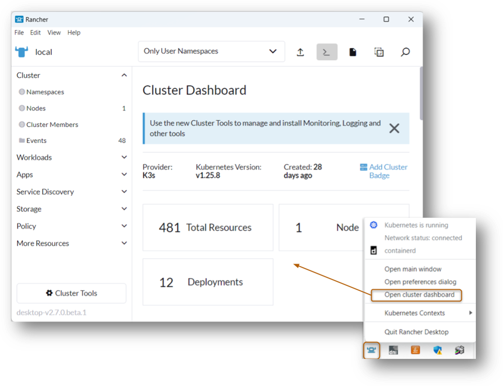

*Access Rancher Desktop Dashboard from your system tray*

## **Get in Touch with the Community**

If developers come across any problem or perhaps would like to discuss some issues and share solutions with the rest, you will find the Rancher Desktop’s active [Slack channel](https://rancher-users.slack.com/?redir=%2Farchives%2FC0200L1N1MM), our [github homepage](https://github.com/rancher-sandbox/rancher-desktop) and [github issues page](https://github.com/rancher-sandbox/rancher-desktop/issues) if you want to report a bug, an issue or connect to our growing community. Moreover, we would like to improve at Rancher Desktop continuously, so we encourage you to enable the statistics collection in this tab.

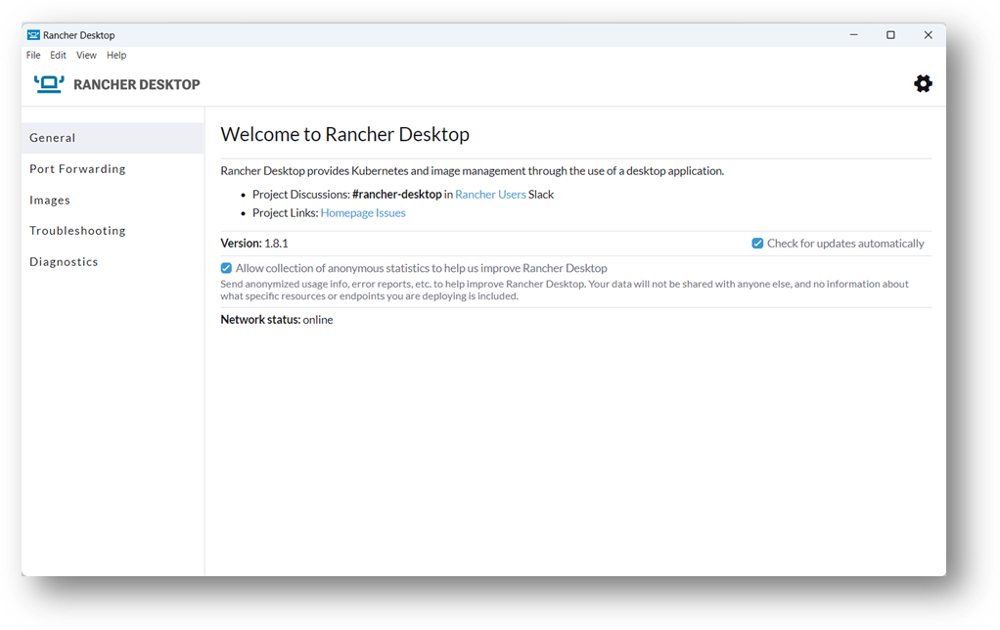

## **Kubernetes Port Forwarding**

**Through port forwarding**, **developers can easily access services defined in their local Kubernetes cluster** using non-colliding ports on their laptop’s local network.

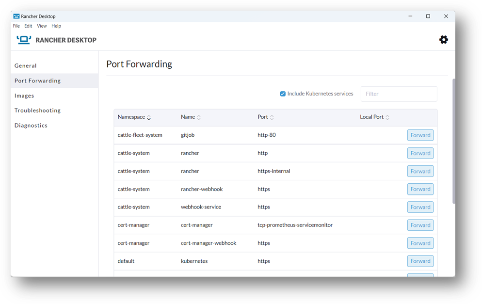

## **Build and Scan Images for Vulnerability**

Developers must guarantee that the container images they use or build are adequately tested and thoroughly checked for any security threats, misconfigurations and vulnerabilities before being pushed outside their local development environment. With Rancher Desktop, you cannot only build, pull and push images, but you can also scan images on your local machine to ensure that they are all examined, inspected and secure. All these can be done with the push of a button.

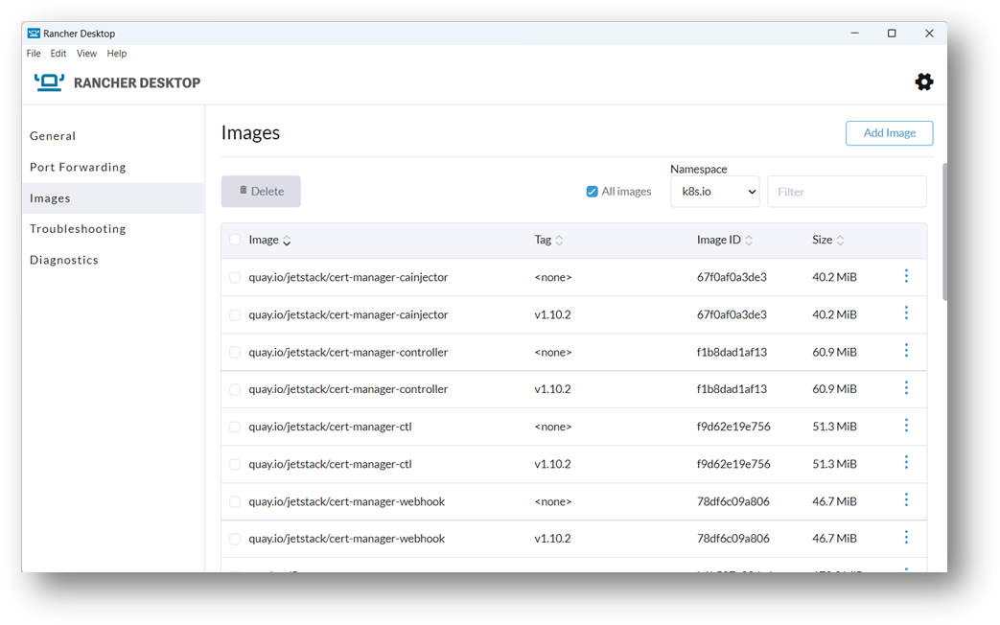

## **Diagnostics and Help with Troubleshooting**

An important aspect to understand is what is happening with your local cluster and Rancher Desktop itself. You can **access all the log files, misconfiguration, or any application issues in the Diagnostics and Troubleshooting tab**. These developer tools will give you all the information necessary to trace and debug in your environment. Moreover, you can enable the options to **reset Kubernetes at the initial state** or to **restore Rancher Desktop to its default settings to** **remove all configurations and workloads.**

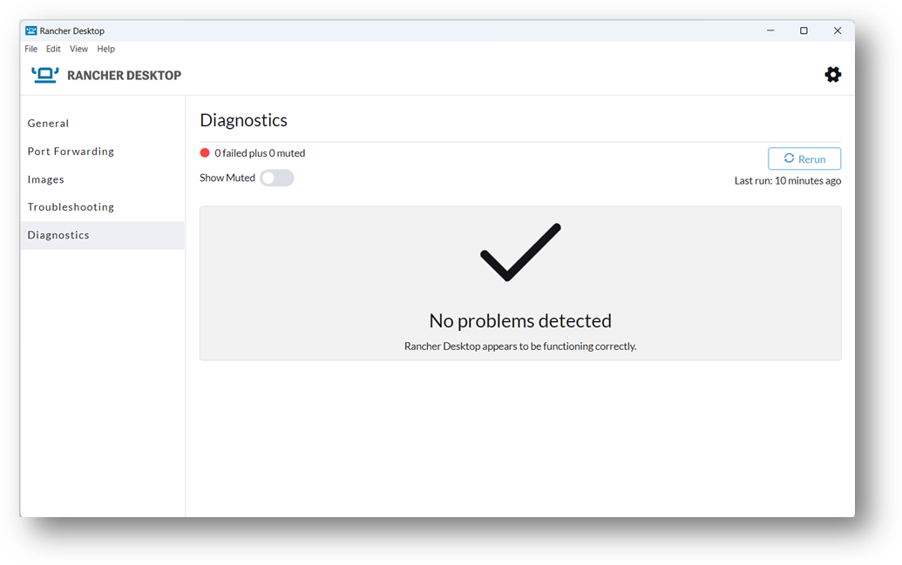

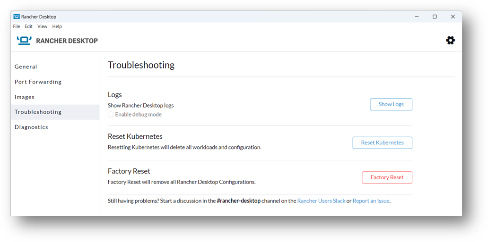

### **Install Extensions**

Developers can customize their environment according to their needs by **installing extensions to increase its functionality**. This is the latest addition to the features provided by Rancher Desktop. In the Extensions tab, you can select **from our extensive catalog of extensions** that have been tested and proven. As of **[Rancher Desktop version 1.9](https://www.suse.com/c/rancher_blog/rancher-desktop-1-9-tech-preview-with-support-for-docker-extensions/),** Docker extensions will also be supported so developers can seamlessly adapt the application to what they are accustomed to.

If you would like to verify which extensions have been installed in your Rancher Desktop, the installed extensions will be displayed on the left side under the Extensions tab.

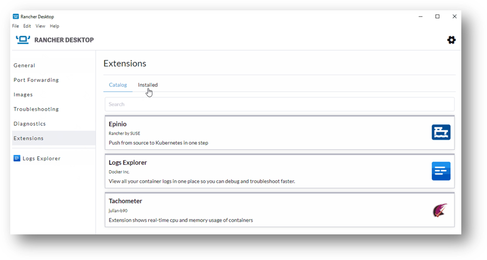

*Install extensions that are tested and proven*

### **Preference / Settings**

Aside from all the useful features mentioned above, here are some settings you can configure according to your requirement in the Preferences section.

- Enable or disable the **automatic updates from Rancher Desktop as well as collect anonymous statistics.**
- **Automatically start all containers and Kubernetes** in your Rancher Desktop **at login.**

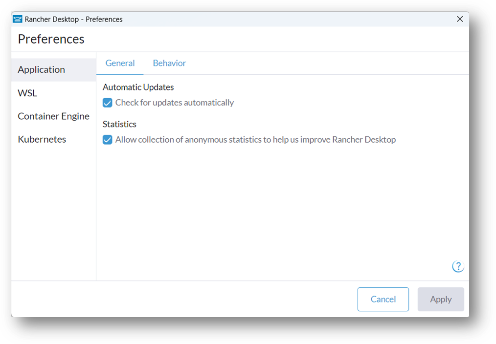

- If you are using Windows OS, Rancher Desktop will have a configuration that **exposes Rancher Desktop's Kubernetes configuration to** **Windows Subsystem for Linux (WSL) distros** so that you can use commands such as kubectl to communicate with Kubernetes.

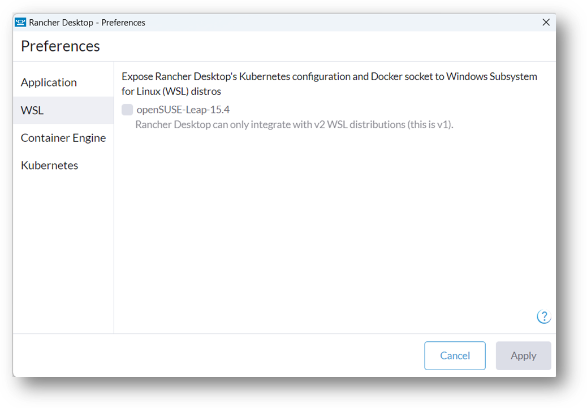

- On macOS and Linux Systems, you can configure the system and **allot CPU and memory resources for** the local cluster for your virtual machine.

- **Disable Kubernetes to reduce the resource consumption** on your machine and simply use Rancher Desktop as a container management platform.

- Choose and **modify the Kubernetes version** to test different configurations and applications.

- **Enable or disable Traefik for the ingress and load balancer**.

- Change the default Kubernetes API port.

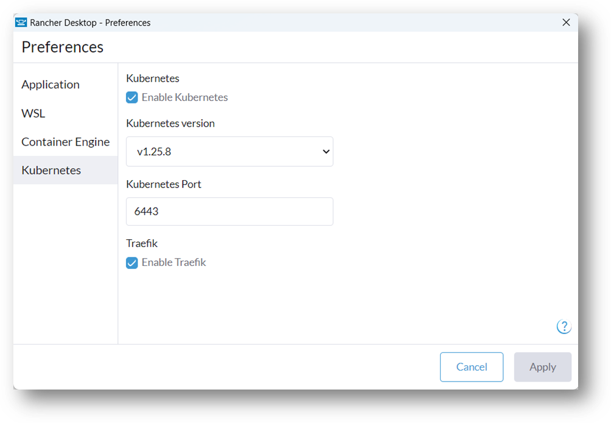

- **Easily switch container engines between dockerd (Moby),** which enables the Docker API and the use of the Docker CLI or **contained,** which provides namespaces for containers, and the use of nerdctl in the preferences section. This makes Rancher Desktop easy to use.

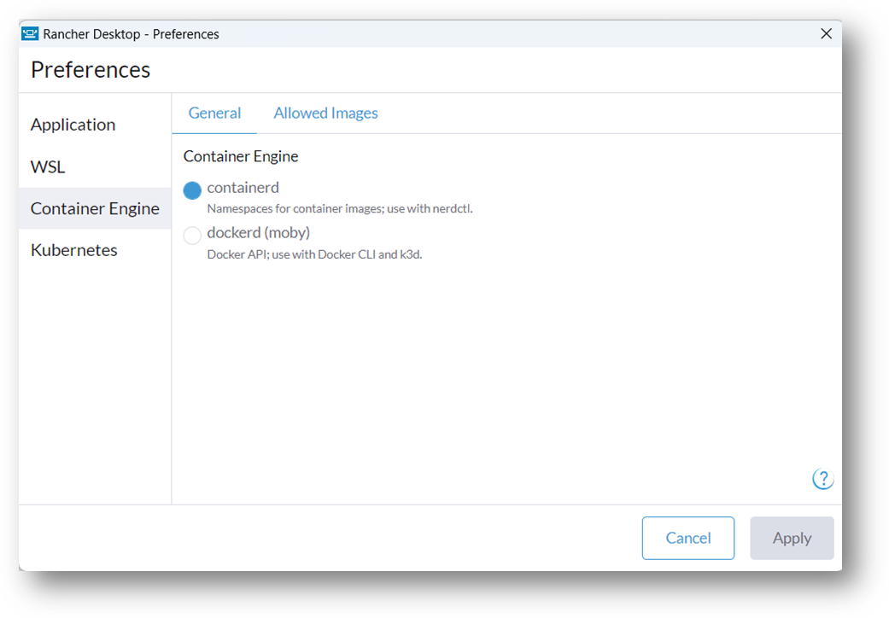

## **Summary**

**Rancher Desktop** **is an excellent and suitable application for developers,** thanks to all its features and functionalities. Installation is pretty straightforward, regardless of whether you are using Linux, Mac or Windows OS. As you have seen here, you have plenty of options to adapt it to your needs. Developers can **get Kubernetes running** **locally** as well as **manage all their workloads, clusters and resources** with the push of a button. If you would like to learn more about Rancher Desktop, feel free to visit [our website](https://rancherdesktop.io/) or connect with our community on [#rancher-desktop](https://rancher-users.slack.com/archives/C0200L1N1MM) channel.
