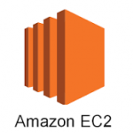
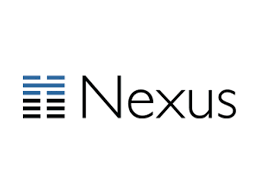

Registries are one of the key components that make working with

containers, primarily Docker, so appealing to the masses. A registry

hosts images that are downloaded and run on hosts in a container engine.

A container is simply a running instance of a specific image. Think of

an image as a ready-to-go package, like an MSI on Microsoft Windows or

an RPM on SUSE Linux Enterprise. I won’t go into the details of how

registries work here, but if you want to learn more,[this article](https://rancher.com/comparing-four-hosted-docker-registries/) is

a great read. Instead, what I’d like to do in this post is highlight

some of the container registries that currently remain under the radar.

While the big-name registries are already familiar to most people who

work with Docker, there are smaller registries worth considering, too,

when you are deciding where to host your images. Keep reading for a

discussion of these lesser-known container registries.

## The Well-Known Registries

First, though, let me identify the big-name registries, so that it’s

clear what I’m comparing the under-the-radar registries to. By all

accounts, currently, the most popular registry is [Docker Hub](https://hub.docker.com/). Docker Hub is the center of the known

registry universe. It is the default hosted registry that every Docker

install is configured to reference. Other popular registries include:

- [Docker Trusted Registry](https://docs.docker.com/docker-trusted-registry/), which

  is based on the open source [Docker Distribution](https://github.com/docker/distribution)
- [Quay.io](https://quay.io/), a hosted registry from CoreOS
- [Enterprise Registry,](https://tectonic.com/quay-enterprise/) an

  on-premises version of Quay
- [Google Container Registry](https://cloud.google.com/container-registry/), a hosted

  registry on Google Cloud Platform
- [Artifactory by JFrog](https://www.jfrog.com/artifactory/), which

  can be deployed on-premises or hosted

## The Registries you Might Be Missing

Now, let’s get to the interesting part. Here is an overview of

lesser-known registries.

### Amazon EC2 Container Registry (ECR)

You probably already know that Amazon offers a hosted container service called Amazon EC2 Container Service (ECS). But the registry that Amazon provides to complete ECS tends to receive less attention. That registry, called [Amazon EC2 Container Registry (ECR)](https://aws.amazon.com/ecr/), is a hosted Docker container

registry. It integrates with ECS. Introduced in December 2015, it is a

somewhat newer registry option than most of the better-known registries,

explaining why some users may not be familiar with it. ECS is not the

only container registry that is compatible with ECR. ECS supports

external registries, too. However, the main advantage of ECR is that it

is a fully hosted and managed registry, which simplifies deployment and

management. ECR also is as scalable as the rest of the ECS

infrastructure -- which means it is very, very scalable. *Best Use Cases:* If you are a heavy user of AWS services, or plan to be, and are

starting to look for a place to host private images, then ECR makes

perfect sense to use. It is also a good choice if you have a large

registry deployment or expect your registry to expand significantly over

time; in that case, you’ll benefit from the virtually unlimited

scalability of ECR.

### FlawCheck Private Registry

[FlawCheck Private Registry](https://www.flawcheck.com/) (which was recently

acquired, along with the rest of FlawCheck’s business, by security

vendor Tenable) is a security-focused registry option. It offers

integrated vulnerability scanning and malware detection for container

images. While there is no magic bullet for keeping your container images

free of malicious code, or preventing the insertion of malicious images

into your registry, FlawCheck’s scanning features can help mitigate the

risks. *Best Use Case*: For security-conscious companies out there, this

is a really great option. I foresee a lot of adoption for this registry

in heavily regulated industries.

### GitLab Container Registry

[GitLab Container Registry](https://docs.gitlab.com/ee/user/project/container_registry.html), which can run as a hosted or on-premises registry, is GitLab’s solution for hosting container images. It’s built into GitLab and completely compatible with the rest of GitLab’s tools, which means it can integrate directly into your GitLab delivery pipeline. That’s an advantage if your team is seeking to adopt a seamless, DevOps workflow with as few moving

parts as possible. *Best Use Case:* Some developers will find it

convenient to store their Docker images on the same platform as their

source code. If you use GitLab for your source code, then you’ll likely

find the GitLab Container Registry handy. Otherwise, however, GitLab

Container Registry doesn’t offer any killer features unavailable from

most other registries.

### Portus by SUSE

[Portus](http://port.us.org/) is not technically a registry, but it provides a front-end that replaces the native UI for on-premises deployments of Docker Registry. Portus is designed to add value to Docker Registry by providing extra access control options. These include the ability to configure “Teams” or

registry users, with different access levels established for each Team.

(In many ways, this feature is similar to user groups on Unix-like

systems.) Portus also supports registry namespaces, which make it

possible to configure the types of modifications individual users, as

well as teams of users, can make to different repositories on a granular

basis. Also notable is that Portus provides a user-friendly Web

interface for configuring registry settings and access controls. (A CLI

configuration tool, portusctl, is available as well.) *Best Use Case:*

If you like Docker Registry but need extra security controls, or have

other reasons to use fine-grained access control, Portus is a strong

solution.

### Sonatype Nexus

[Sonatype Nexus](https://www.sonatype.com/products-sonatype), which supports

hosted and on-premises deployments, is a general-purpose repository. It

supports much more than Docker image hosting, but it can be used as a

Docker registry as well. It has been around for much longer than Docker,

and is likely to be familiar to seasoned admins even if they have not

previously worked with container registries. The core Nexus platform is

open source, but a commercial option is available as well. *Best Use Case:* Many companies have had Nexus deployed as a repository for Maven

for years. By simply upgrading to a modern release of the platform,

organizations can add support for hosting Docker images, thereby

creating their own Docker registry without having to train development

or operational staff on a new product. Plus, they can host other types

of artifacts alongside Docker images.

### VMware Harbor Registry

You

might not think of VMware as a major player in the Docker ecosystem, but

the company certainly has its toes in the water. [Harbor Registry](https://vmware.github.io/harbor/) is VMware’s answer for

hosting Docker images. This registry is built on the foundation of

Docker Distribution, but it adds security and identity-management

features. It also supports multiple registries on a single host. *Best Use Case:* Because of Harbor’s focus on security and user management,

this option offers some valuable registry features that enterprises

might seek, which are not available from all other registries. It’s a

good choice in the enterprise. It’s worth noting, too, that because

Harbor runs as Docker containers, it is easy to install on any server

that has a Docker environment -- and the developers even offer an

offline installer, which could be handy in situations where security

considerations or other factors mean that a connection to the public

Internet is not available.

### Conclusion

The main variables between the different registry offerings include what

type of deployment environment they support (hosted, on-premise or

both); how fine-tuned their access control options are; and how much

additional security they provide for container registries. Choosing the

right registry for your needs, of course, will depend on how these

features align with your priorities. But with so many choices, it’s not

difficult to find a registry that delivers the perfect balance for a

given organization’s needs. *About the Author: Vince Power is an Enterprise Architect at Medavie Blue Cross. His focus is on cloud adoption and technology planning in key areas like core computing (IaaS), identity and access management, application platforms (PaaS), and continuous delivery.* **You might also be interested in:**

- White Paper: [Comparing Kubernetes, Mesos, and Docker Swarm](https://info.rancher.com/comparing-kubernetes-swarm)
