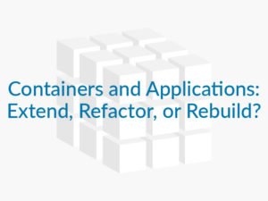

Technology is a

constantly changing field, and as a result, any application can feel out

of date in a matter of months. With this constant feeling of impending

obsolescence, how can we work to maintain and modernize legacy

applications? While rebuilding a legacy application from the ground up

is an engineer’s dream, business goals and product timelines often make

this impractical. It’s difficult to justify spending six months

rewriting an application when the current one is working just fine, code

debt be damned. Unfortunately, we all know that product development is

never that black and white. Compromises must be made on both sides of

the table, meaning that while a complete rewrite might not be possible,

the long-term benefits of application modernization efforts must still

be valued. While many organizations don’t have the luxury of building

brand new, cloud-native applications, there are still techniques that

can be used to modernize existing applications using container

technology like Docker. These modernization techniques ultimately fall

into three different categories: extend, refactor, and rebuild. But

before we get into them, let’s first touch on some Dockerfile basics.

### Dockerfile Basics

For the uninitiated, Docker is a containerization platform that “wraps

a piece of software in a complete filesystem that contains everything

needed to run: code, runtime, system tools, system libraries” and

basically everything that can be installed on a server, without the

overhead of a virtualization platform. While the pros and cons of

containers are out of the scope of this article, one of the biggest

benefits of Docker is the ability to quickly and easily spin up

lightweight, repeatable server environments with only a few lines of

code. This configuration is accomplished through a file called the

Dockerfile, which is essentially a blueprint that Docker uses to build

container images. For reference, here’s a Dockerfile that spins up a

simple Python-based web server (special thanks to [Baohua Yang](https://github.com/yeasy/simple-web) for the awesome example):

```
# Use the python:2.7 base image
 FROM python:2.7

# Expose port 80 internally to Docker process
 EXPOSE 80

# Set /code to the working directory for the following commands
 WORKDIR /code

# Copy all files in current directory to the /code directory
 ADD . /code

# Create the index.html file in the /code directory
 RUN touch index.html

# Start the python web server
 CMD python index.py
```

This is a simplistic example, but it does a good job of illustrating

some Dockerfile basics, namely extending pre-existing images, exposing

ports, and running commands and services. Even these few instructions

can be used to spin up extremely powerful microservices, as long as the

base source code is architected properly.

### Application Modernization

At a high level, containerizing an existing application is a relatively

straightforward process, but unfortunately not every application is

built with containerization in mind. Docker has an ephemeral filesystem,

which means that storage within a container is not persistent. Any file

that is saved within a Docker container will be lost unless specific

steps are taken to avoid this. Additionally, parallelization is another

big concern with containerized applications. Because one of the big

benefits of Docker is the ability to quickly adapt to increasing traffic

requirements, these applications need to be able to run in parallel with

multiple instances. As mentioned above, in order to prepare a legacy

application for containerization, there are a few options available:

extend, refactor, or rebuild. But which solution is the best depends

entirely on the needs and resources of an organization.

**Extend**

Extending the existing functionality of a non-containerized application

often requires the least amount of commitment and effort on this list,

but if it isn’t done right, the changes that are made can lead to

significantly more technical debt. The most effective way to extend an

existing application with container technology is through microservices

and APIs. While the legacy application itself isn’t being

containerized, isolating new features into Docker-based microservices

allows for the modernization of a product, and at the same time tees the

legacy code up for easier refactoring or rebuilding in the future.

At a high level, extension is a great choice for applications that are

likely to be rebuilt or sunset at some point in the not-too-distant

future—but the older the codebase, the more it might be necessary to

completely refactor certain parts of it to accommodate a Docker

platform.

**Refactor**

Sometimes, extending an application through microservices or APIs isn’t

practical or possible. Whether there is no new functionality to be

added, or the effort to add new features through extension is too high

to justify, refactoring parts of a legacy codebase might be necessary.

This can be easily accomplished by isolating individual pieces of

existing functionality from the current application into containerized

microservices. For example, refactoring an entire social network into a

Docker-ready application might be impractical, but pulling out the piece

of functionality that runs the user search engine is a great way to

isolate individual components as separate Docker containers.

Another great place to refactor a legacy application is the storage

mechanism used for writing things like logs, user files, etc. One of the

biggest roadblocks to running an application within Docker is the

ephemeral filesystem. Dealing with this can be handled in one of a few

ways, the most popular of which is through the use of a cloud-based

storage method like Amazon S3 or Google Cloud Storage. By refactoring

the file storage method to utilize one of these platforms, an

application can be easily run in a Docker container without losing any

data.

**Rebuild**

When a legacy application is unable to support multiple running

instances, it might be impossible to add Docker support without

rebuilding it from the ground up. Legacy applications can have a long

shelf life, but there comes a point when poor architecture and design

decisions made in the early stages of an application can prevent

efficient refactoring of an application in the future. Being aware of

impending development brick walls is crucial to identifying risks to

productivity.

Ultimately, there is no hard rule when it comes to modernizing legacy

applications with container technology. The best decision is often the

one that is dictated by both the needs of the product and the needs of

the business, but understanding how this decision affects the

organization in the long run is crucial to ensuring a stable application

without losing productivity.

**To learn more about using containers, join our [February Online Meetup: More Tips and Tricks for Running Containers Like a Pro](https://info.rancher.com/february-2017-more-tips-and-tricks), happening Tuesday, Feb 28.**

*Zachary Flower ([@zachflower](https://twitter.com/zachflower)) is a freelance web developer, writer, and polymath. He’s built projects for the NSA and created features for companies like Name.com and Buffer.*
